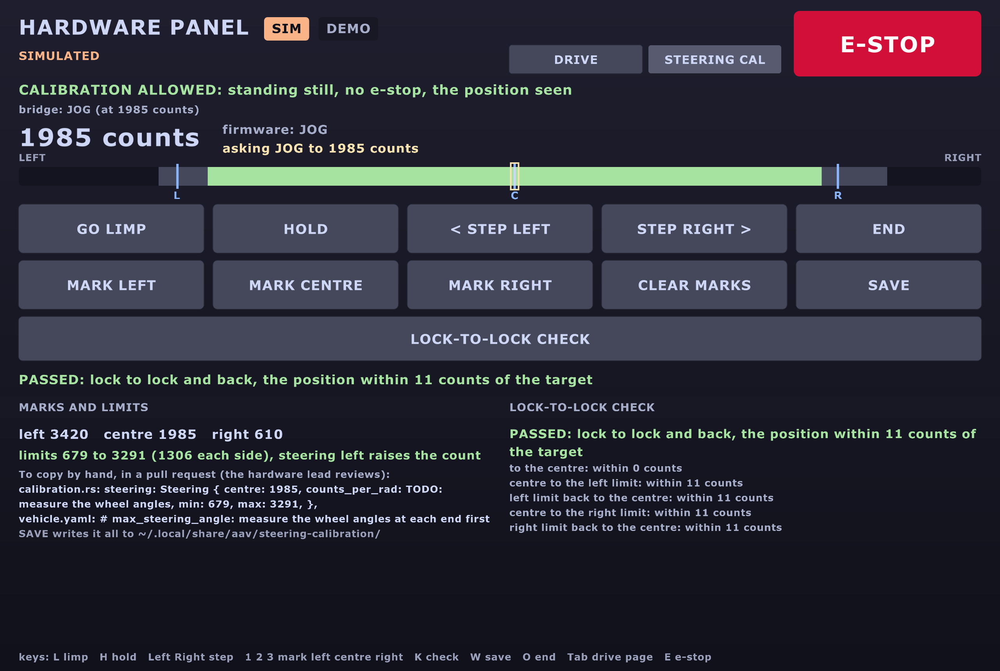

# Actuator tests: measure how the car moves

One script runs the stage-3 and stage-4 tests of `tests.md`: it drives the car,
logs what happened, and prints the numbers for `vehicle.yaml`. Built and proven in Gazebo
(15 Oct); the same script runs on the car.

!!! note "The short version"
    - `pixi run actuator-test --list` shows the tests. Add `--sim` for Gazebo.
    - **On the car:** stage 3 on stands (`--stands`), stage 4 in an empty lot. It asks you
      to type the test's name first, and never goes above 1 m/s (0.3 on stands).
    - **To stop:** Ctrl-C, the e-stop, or the joystick's deadman. Any of them, any time.
    - It prints the `vehicle.yaml` lines to paste. It never writes the file itself.

## How it fits

```text
 actuator_test ──/drivers/tests/cmd_vel──► twist_mux ──► ego ──► backend ──► the car
   (priority 60)                               ▲                    (or Gazebo)
 joystick 100, RC 95, keyboard 90 ─────────────┘ always win
        │
        └── reads back: /vehicle/odom (speed), /vehicle/steering, /throttle, /brake,
            the IMU, /localization/odom/local, GPS, /safety/estop, /system/source
```

It's a driver like any other ([Build a driver](howto-driver.md)), in twist_mux's `tests`
slot: below every person (joystick, RC, keyboard), above Nav2 and every other program.

## The tests

| Test | # | Where | What it does | Gives (`vehicle.yaml`) |
|---|---|---|---|---|
| `steer-sweep` | 3.10 | stands | steps full left → centre → full right and back, 2.5 s each | angle per command; `max_steering_angle`, `steer_offset` |
| `steer-rate` | 3.11 | stands | centre → full lock → centre, each way | `steer_rate`, `steer_lag` |
| `steer-centre` | 3.12 | stands | straight, then tiny steps (0.002 rad) each way | `steer_offset`, `steer_deadband` |
| `speed-up` | 4.1 | lot | from still to the speed cap | time to 0.5, 1, 2, 3 m/s; g (wheels and IMU); `max_accel`, `throttle_lag` |
| `coast` | 4.2 | lot | to 2 m/s, then neither throttle nor brake | `drag` |
| `brake` | 4.3 | lot | to 1, 2, 3 m/s (up to the cap), then stop | stopping distance, g; `max_brake`, `brake_lag` |
| `throttle-map` | 4.4 | lot | speed-ups to ¼, ½, ¾ and all of the cap | throttle % → acceleration; `throttle_deadband` |
| `circles` | 4.5, 4.6 | lot | one full circle per angle, both ways, at 1 m/s | real wheel angle per command; tightest circle |
| `straight` | 4.7 | lot | 10 m at 0.5 m/s, steering straight | sideways drift; `steer_offset` |
| `actuator-test preflight --stands` | 3.P | stands | speed up, hold, slow, brake; steer left, right, centre; every sensor counted | PASS / FAIL per line, no `vehicle.yaml` lines ([below](#the-preflight-on-stands)) |

The steering tests creep at 0.2 m/s: ego only turns the wheels while the car moves. On
stands the wheels spin slowly; in Gazebo the car crawls in arcs.

## In Gazebo

```bash
pixi run sim world:=empty gui:=false rviz:=false nav:=false sim_speed:=3   # terminal 1
pixi run actuator-test speed-up --sim                                      # terminal 2
```

- `sim_speed:=3` lets ego go to 3 m/s, so `speed-up` and `brake` reach 2 and 3 m/s.
- `--sim` keeps ROS on this computer and uses Gazebo's clock. The script refuses to run
  without it when Gazebo announces SIM, and with it when anything announces REAL.
- `nav:=false`: nothing else drives. The empty world has room for the circles.

## On the car

The task is **not** `--local`, so it reaches the car's computers. Run it from the laptop
on the car's network, with the car's stack running (`pixi run car ...`).

### Stage 3: on stands

```bash
pixi run actuator-test steer-sweep --stands
pixi run actuator-test steer-rate --stands
pixi run actuator-test steer-centre --stands
```

1. The script prints the checklist from `tests.md` stage 3. Check it out loud.
2. Type the test's name to start. Anything else cancels; nothing moves.
3. **No steering sensor yet?** (The 2025-26 ESP32 reports none: team-todo.md B6.) At each
   measuring point the car stops and asks for the angle in degrees: read it with a
   protractor or a phone app on the wheel. `steer-rate` then needs a video instead.

### Stage 4: in an empty lot

```bash
pixi run actuator-test speed-up
pixi run actuator-test coast
pixi run actuator-test brake --speeds 0.5 1.0
pixi run actuator-test circles --angles 0.25 0.5
pixi run actuator-test straight
```

Run `coast` first: the throttle fit uses `vehicle.yaml`'s `drag`. Then paste the drag in,
then run the rest. Start at walking pace: `--max-speed 0.5`.

### The safety layers

| Layer | What it does |
|---|---|
| **Typing the test's name** | on the real car (or when nobody announces `/system/source`), nothing moves until you type it. No keyboard (a script, a pipe): refused |
| **Speed cap** | 1 m/s on the car, 0.3 m/s on stands; `--max-speed` can lower it, never raise it there |
| **ego must answer** | on the car, no answer from ego (its speed cap and steering limits): refused. In Gazebo, a warning |
| **Stage check** | on the car, stage-3 tests need `--stands`, stage-4 tests refuse it |
| **Envelope** | each test has a speed, distance and time limit (printed at the start): crossing one stops the car |
| **Ctrl-C, errors** | zero commands until the car stands still, then it exits. A second Ctrl-C can't cut that short |
| **`/safety/estop`** | stops the test at once (twist_mux's lock and the backend brake too) |
| **Someone takes over** | the joystick or keyboard outranks the test in twist_mux; the script sees it and stops |
| **Stale speed** | no `/vehicle/odom` for 0.5 s: stop |
| **Nothing through twist_mux** | 2 s with no `/control/cmd_vel`: stop (a lock, or a mux without the `tests` slot) |
| **A speed nobody sees** | told to drive, but under 0.05 m/s measured for 4 s: stop (4, not 2: a Hall sensor with 8 clicks a turn says nothing until 2 clicks, about 0.24 m, which a slow start takes 2-3 s to roll; seen on the bench, 29 Oct). On stands the front wheel sensors read 0 while the rear (driven) wheels spin ([TODO 49b](../TODO.md)), so the speed cap can't work |
| **A runaway** | the speed rises 0.1 m/s in 1 s while the command falls or sits at 0 (a stuck throttle): stop |
| **A cut-short run** | still saves its log and table, but prints no `vehicle.yaml` lines |

!!! warning "ego's steering rate"
    `steer-rate` lifts ego's `max_steering_rate` (0.6 rad/s) to 3 rad/s while it runs, so it
    times the motor, not ego, and puts it back after. ego allows a live change to that one
    limit only. If the script is killed (not Ctrl-C), restart ego to be sure.

### What the car can measure today

The 2025-26 ESP32 drives the car until the spine replaces it (`legacy_uart_bridge`).

| Measurement | Today (ESP32) | With the spine |
|---|---|---|
| Speed | ✅ the front wheel sensors (the hardware lead's Arduino on CAN, `spine_bridge role:=sensors`), `/vehicle/odom` | ✅ |
| IMU g, yaw rate | ✅ once the IMU runs | ✅ |
| Pose (circles, straight) | ✅ the local EKF; GPS logged too | ✅ |
| Steering angle | ❌ no sensor: type it in on stands (✅ with the uplink, once H9 says yes, if the Jrk has feedback) | ✅ `/vehicle/steering` |
| Throttle and brake levels | ❌ not reported: no `max_accel` or `max_brake` fit, only the g figures. A speed command **is** the throttle there: speed ÷ `full_throttle_speed` (`legacy_protocol.py`). ✅ with the uplink (H9) | ✅ `/vehicle/throttle`, `/vehicle/brake` |
| Coasting | ❌ a low speed command still pushes, and 0 brakes | ✅ inside the speed loop's coast band |
| A fixed brake % (4.3 as written) | ❌ no brake command exists: the tests brake with a normal stop | ❌ the same |

What each fit can still give, with what is missing:

| Missing | The fit falls back to | Gives |
|---|---|---|
| Throttle level (ESP32) | ego's speed ÷ `full_throttle_speed` → wheel speed | `max_accel`; the delay only if the pulses resolve it |
| Brake level | brake demand → IMU deceleration | `max_brake`, `brake_lag`, `brake_dead_time` |
| Brake level **and** demand | "stop asked for" → IMU deceleration | the whole stop's dead time and lag; no `vehicle.yaml` line |
| Fine wheel speed (Hall pulses) | each speed compared with the model's mean since the last pulse | the gain; a delay under 2 pulse intervals is refused |

## Find the steering actuator's ends and centre

**Why:** the car steers to the right. Its centre is a guess, and the 2025-26 C++ disagrees
with itself: centre 1950 and range 400-3500 in `setSteer()`, but centre 500 and range
0-1550 in `hardware_configs.h`; it also steers with two gains (1950 counts a unit one
side, 1550 the other). Our Rust firmware copied 1950 / 400-3500 / 3100 counts a radian
(`calibration.rs`, `TODO(Q1)`, `TODO(Q2)`). Nobody has measured the real ends.

**Gives:** the centre, equal limits each side of it, the counts a radian, and
`max_steering_angle`. Test 3.0 in [tests.md](tests.md#3b-steering-on-stands): do it
before 3.10. **3.10 then runs only inside the measured ends:** both ends outside today's
software limits (400-3500), or the measured ends flashed in `calibration.rs` first
([car day, A6](car-day.md#a6-the-steering-actuators-ends-way-a)).

!!! warning "Before any sweep"
    - **The car on stands**, all four wheels off the ground, the e-stop in someone's hand.
    - **The steering actuator's current limit set low first** (its Jrk's settings, in
      Pololu's utility), so a wrong target pushes gently against the stop. The value is
      the hardware lead's: **______** (write it here and on the sheet).
    - **The steering actuator's own (Jrk) limits are the last line of defence.** They are
      the hardware lead's to set. Our software limits come first; they don't replace them.
    - Hands clear of the wheels and the linkage while the motor is on.

### Counts: the unit here

A position or a target is a number of **counts**, 0 to 4095: the steering actuator's
feedback (its Jrk's "scaled feedback"), in the same units as its targets. Not radians:
radians are worked out *from* this calibration.

```text
   full left            centre                full right
   (left end)        (wheels straight)        (right end)
      |---- travel left ----|---- travel right ----|
            |-- half --|-- half --|        half = smaller travel - 5 %
            lo       centre       hi       the limits: the same each side
```

### Two ways

| | Way A: car day, whatever firmware is on the ESP32 | Way B: later, the Rust firmware with the uplink and the hardware panel |
|---|---|---|
| Needs | a laptop with Pololu's free **Jrk G2 configuration utility**, a USB cable to the steering actuator's Jrk | the Rust ESP32 firmware with `uplink` (session 6), the uplink's wire (H9), the Jrk's feedback mode set to analog |
| Reads | the utility's Status tab: feedback, scaled feedback, target | `/vehicle/steering_actuator/raw` (counts), in the panel |
| Moves the wheels | by hand, the motor stopped | **buttons:** small jog steps; or **by hand:** limp (motor off) |
| Who | the hardware lead, or someone they show | the laptop person, with the hardware lead there |

### Way A: Pololu's utility over USB (car day)

| # | Do | Write down |
|---|---|---|
| A1 | The car off. USB from the laptop to the steering actuator's Jrk. Open the utility; it finds the Jrk | its serial number |
| A2 | **Save its settings first, as a backup**: File, then Save settings file. Name it `steering-jrk-<date>.txt`; keep it with the car's files (not in git if it holds anything private) | the file's name |
| A3 | Read its feedback mode (Feedback tab): it must be **Analog**. Not analog: there is no position to read; stop, tell the hardware lead | the mode |
| A4 | With the hardware lead: the current limit low (Motor tab), applied | the old and new values |
| A5 | The ESP32 sends a steering target all the time, so the motor won't stay off. **Power everything off first.** Then, with the hardware lead, stop it reaching the Jrk: the ESP32 left off, or its I2C unplugged **with the power still off** (never with it on). Power the Jrk back, then press **Stop motor** in the utility | how |
| A6 | Turn the wheels by hand, gently, to **full left** (the steering stops, not the tyre on the frame). Read **Scaled feedback** | left end |
| A7 | Wheels **straight** (a straight edge on both front wheels, or a string line to the rear wheels). Read it | centre |
| A8 | **Full right**. Read it | right end |
| A9 | At each end, the wheel angle with a protractor (both front wheels; write the mean) | angles |
| A10 | The Jrk's own limits: change them **only with the hardware lead**. Otherwise leave everything as it was: load the backup (File, Open settings file) if anything changed | what changed |

Menu and tab names are from Pololu's user's guide; the version on the laptop may name
them a little differently.

### Way B: the hardware panel (Rust firmware)

**Not on car day.** Car day runs link version 2 throughout
([one link version on the car](car-day.md#one-link-version-on-the-car)). Way B comes later,
once the Rust firmware with the uplink is flashed and H9 says the wire is there. Then the
Motor Pi's `legacy.yaml`, for this session only, with the hardware lead's say-so:

```yaml
frame_version: 3
uplink: true
steering_calibration: stands     # back to none afterwards
```

Then, on the laptop (on the car's network, the car's `ROS_DOMAIN_ID`; [mac.md](mac.md)),
the hardware panel's **STEERING CAL** page (Tab):

```bash
pixi run tools/ros.sh ros2 launch aav_hud hw_panel.launch.py    # then Tab
```

Not `pixi run hw-panel`: it is localhost-only, so it never sees the car. The page:
[hud.md](hud.md#the-steering-calibration-page).



| # | Do (button, key) | Expect |
|---|---|---|
| B1 | Nothing driving; the brake on. Open the page | **ALLOWED**; the bridge's line says `OFF`; the position in counts |
| B2 | **By hand:** GO LIMP (L) | firmware `LIMP`; the motor off; the counts follow the wheels |
| B3 | Full left: MARK LEFT (1). Straight: MARK CENTRE (2). Full right: MARK RIGHT (3) | the three marks; the limits and any warnings under them |
| B4 | **Or with the motor:** HOLD (H), then STEP LEFT / STEP RIGHT (Left, Right), 25 counts a press, a few seconds apart | the wheels move slowly (300 counts a second at most) |
| B5 | Stop a step before the steering binds or the motor strains; MARK that end | the end |
| B6 | The same toward the other end, and back to straight, MARK CENTRE | |
| B7 | HOLD near the centre, then LOCK-TO-LOCK CHECK (K) | centre to the left limit and back, to the right limit and back, at 100 counts a second; **PASSED**, or **STOPPED** and why, holding where the wheels are |
| B8 | SAVE (W) | the file's path on screen and in the log (below) |
| B9 | END (O) | `RETURN`, then `OFF`: the wheels go back slowly to the steering asked for |

**The check stops** (and holds) when the position falls 150 counts behind the target, stops
moving for 0.6 s while the target moves, misses a leg's end, is lost, or the firmware stops
jogging. A stop near an end: mark that end again, a little inside; then check again.

**Where the result goes.** SAVE writes
`~/.local/share/aav/steering-calibration/steering-<UTC time>.txt`: the marks, the check's
result, and the lines for `calibration.rs` and `vehicle.yaml`. The panel never writes
either file: copy them by hand, as below, with the sheet. For `max_steering_angle`, add
the wheel angles with the `steering_limits` command (the file has it, filled in).

Without the panel, from any laptop on the car's network:

```bash
ros2 topic echo /vehicle/steering_actuator/raw                 # position: counts
ros2 topic echo /vehicle/steering_actuator/calibration          # what it does, and why not
# limp (mode 1), sent at 10 Hz while it runs; Ctrl-C ends it within 0.5 s:
ros2 topic pub -r 10 /drivers/buttons/steering_calibration aav_interfaces/msg/SteeringCalibration "{mode: 1}"
# jog (mode 2) to a target, in counts:
ros2 topic pub -r 10 /drivers/buttons/steering_calibration aav_interfaces/msg/SteeringCalibration "{mode: 2, target: 2000}"
```

**Refused?** The line says why: not braked, a speed asked for, an e-stop, the RC or a
test driving, no position (the Jrk's feedback isn't analog), or the bridge's own rules
(`steering_calibration` is `none`, no uplink, ego driving, the car moving).

A jog target never goes outside today's software limits (400-3500). If an end lies
beyond them, use limp: the counts are read there all the same.

| What keeps it safe | Where |
|---|---|
| only standing still and braked; the throttle held at 0 throughout | the firmware (`legacy-link` `SteerCal`) and the bridge |
| jog clamped to the software limits, 300 counts a second | the firmware |
| leaving limp holds where the wheels are, then moves back slowly | the firmware |
| the Orin's heartbeat lost (100 ms): leave, and hold there | the firmware |
| the panel stops asking (0.5 s): leave | the bridge |
| the panel asks nothing with an e-stop, the car moving, or no position; its jog stays in 400-3500; its check stays inside the limits and stops on resistance | the panel (panel-core `calibration`, `sweep`) |
| `steering_calibration: none` by default | the bridge, `legacy.yaml` |

### The sheet

Print it; fill it in at the car. One sheet a session.

| | Left end | Centre | Right end |
|---|---|---|---|
| Counts | ________ | ________ | ________ |
| Wheel angle, left front (deg) | ________ | 0 | ________ |
| Wheel angle, right front (deg) | ________ | 0 | ________ |
| Wheel angle, the mean (deg) | ________ | 0 | ________ |

| Worked out (`steering_limits`) | Value |
|---|---|
| travel left, travel right (counts) | ________ , ________ |
| half = smaller travel - 5 % (counts) | ________ |
| limits: lo, hi (counts) | ________ , ________ |
| counts a radian (sign: + if left raises the count) | ________ |
| `max_steering_angle` (rad) | ________ |
| warnings | ________________________ |
| date, way (A or B), who, the hardware lead | ________________________ |

```bash
ros2 run aav_legacy steering_limits --left <counts> --centre <counts> --right <counts> \
    --left-deg <mean> --right-deg <mean>
```

It prints the lines for `firmware/spine/crates/spine-board/src/calibration.rs` (`Steering`:
centre, counts a radian, min, max) and for `vehicle.yaml` (`max_steering_angle`). It flags
a centre far from the middle of the travel, a lopsided travel, feedback that doesn't change
or is clipped at 0 or 4095, and two sides whose gains differ. A person puts them in, in a
pull request, with the sheet's photo; the hardware lead reviews it.

## The preflight on stands

One run before the car goes on the ground (Ben, 29 Oct; the design:
`docs/designs/2026-10-29_preflight.md`). It drives and checks every sensor at once.

```bash
pixi run actuator-test preflight --stands --sim                          # Gazebo (pixi run sim first)
pixi run actuator-test preflight --stands --bench                        # bench mode (pixi run bench first)
pixi run actuator-test preflight --stands --no-drive --skip steering     # the car today: the sensors only
pixi run actuator-test preflight --stands --skip steering gps lidar      # the car, once it has a rear-wheel speed
```

| Step | Command |
|---|---|
| still, settle 3 s | 0 (the IMU's bias, the GPS's start) |
| speed up, hold 5 s | 0.3 m/s |
| slow down 3 s | 0.15 m/s |
| brake | 0, until still |
| steer left, right, centre | 3 s each, creeping at 0.2 m/s |

Then one line per check: `PASS`, `FAIL`, `WARN` or `SKIP`.

| Lines | PASS when |
|---|---|
| one per sensor | at least 0.8 x its documented rate (IMU 200 Hz, wheels 100, GPS 1, lidar and radar 10, camera 15), no gap over 5 messages, values in range (gravity 9.81 ± 0.5 at rest) |
| speeds up, holds, slows, brakes | 80% of the cap; within 25% in the hold (the open-loop ESP32: a WARN with its throttle gain); still within 5 s |
| steers | left and right measured, centre within `steer_offset` ± (2 x `steer_deadband` + 0.02 rad); no sensor: it asks you |
| stands: IMU still | its speed change while speeding up under 0.4 x the wheels' |
| stands: GPS still | Doppler under 0.1 m/s; with no Doppler only a WARN |

!!! warning "On the car, the drive is refused today"
    The car is rear-wheel drive; its wheel sensors are on the **front**. On stands
    `/vehicle/odom` reads 0 while the motor spins, so no speed cap can work
    ([TODO 49b](../TODO.md)). Until `vehicle.yaml`'s `speed_wheels` says `rear`, run
    `--no-drive`: the sensors only, nothing moves. Also refused: the C++ ESP32 (its
    no-timeout lock), and the bridge on `speed_loop.mode pi`.

In Gazebo and on the bench the car is **on the ground**, so the stands lines check the
opposite (the IMU and GPS agree with the wheels) and say so. Who must be there on the car:
the **e-stop person** (they are the stop), someone watching the **rear wheels** with a
tachometer app, the laptop person; run it on the Orin (ssh + tmux) or a wired laptop.
The word to type: `preflight`. If the car is still moving 5 s after the stop, it prints
**NOT STOPPED: E-STOP NOW** and sets `/safety/estop`.

### Tested, 29 Oct

| Where | Result |
|---|---|
| Gazebo, empty world (`--sim --skip camera radar battery`) | every drive and sensor line PASS: 0.34 m/s held for 0.30, still 0.5 s after the brake, steering +0.50 / -0.50 / 0.000 rad, IMU 0.25 vs wheels 0.25 m/s, Doppler 0.36 vs 0.34. Lidar FAIL: the empty world has none (name it with `--skip lidar`) |
| Bench (`--bench`), spine armed | every sensor line PASS (IMU 50 Hz, \|a\| 9.78; GPS 5 Hz; camera 640x360 10 Hz; battery 50.9 V). The drive stopped itself: the front wheels read 0 for over 2 s of a slow start (8 Hall clicks a turn), so the "speed nobody sees" stop, then at 2 s, fired; now 4 s. The run again at 4 s: not yet done |
| `--no-drive`, the real car | untested: no car |

## Trusting the fits

Each lag fit is now a **dead time, then a lag** (FOPDT). The old fit (a lag alone)
stays beside it, so you can compare.

```text
 command ──► wait (dead time) ──► first-order lag (τ) ──► measured
```

| Rule | What it means |
|---|---|
| **The path is named** | each row and each `vehicle.yaml` line says *from* which signal *to* which: e.g. `throttle level -> wheel speed`, never `cmd_vel -> speed` (that would measure ego's ramp and the speed loop too) |
| **The rms is printed** | with each fit, in the signal's units; the old fit's rms beside it |
| **True times** | the fits use each message's arrival time (`t_*` columns), not the 50 Hz copies |
| **A dead time counts** | only if it is longer than the resolution, and fits at least 1.1 × better than a lag alone |
| **Refused, with a reason** | a lag shorter than the data can resolve gets no `vehicle.yaml` line, and a NOTE says why |

**The resolution** is two fresh values (Nyquist), plus what noise blurs:

```text
resolution = 2 × (time between fresh values) + rms ÷ (slope × √moving samples)
```

| Signal | Fresh values every | Resolution |
|---|---|---|
| a level at 50 Hz | 0.02 s | 0.04 s |
| Hall wheel speed, 8 holes on a 0.30 m wheel, at 1 m/s | 0.118 m ÷ 1 m/s = 0.12 s | 0.24 s |
| ... at 0.5 m/s | 0.24 s | 0.47 s |

So at walking pace a 0.1 s throttle lag can't be read from the wheel speed: use the
throttle level, or the IMU. `analysis.pulse_interval()` works it out before a run.

**Steering play** is measured first (`steer_play`: where it settles after moves up and
moves down), then the lag is fitted with it. Left out, play looks like a longer lag.

**Tested on pretend data** (`test/test_robustness.py`) with play, Hall pulses, noise,
no brake level and known dead times:

| Case | Tolerance it meets |
|---|---|
| dead time + lag, from a level | 10 ms (40 ms with 5% noise) |
| steering with 0.02-0.04 rad play | rate 3%, play 3 mrad, lag 10 ms, dead time 25 ms |
| Hall pulses, up to 3 m/s | `max_accel` 2%; total delay 40 ms or 10% |
| Hall pulses, under 1 m/s | `max_accel` 5%; the 0.15 s delay **refused** |
| brake from the IMU only | `max_brake` 2%; lag and dead time 20 ms |

## The speed loop's profile (TODO 27)

The spine's speed loop has two profiles ([Tuning the speed
loop](vehicle-model.md#tuning-the-speed-loop)): `default`, today's gains (overshoots about
15%), and `smooth` (no overshoot on the model, robust to the throttle's 5x guess). The
firmware keeps `default`. Try `smooth` here, in this order:

| When | What to run | What you should see |
|---|---|---|
| Before the car | `pixi run sim-check --speed-steps-only --speed-loop smooth` | each step ends within 5%, overshoot under 3% |
| After 4.1, 4.2, 4.4 (`max_accel`, `drag`) | `pixi run python3 tools/vehicle_model.py --set max_accel=... --set drag=... --speed-loop` | `smooth` still 0% at K with the measured numbers; if not, redo its gains (pole placement, then b) |
| Stage 3, on stands, **once the spine closes the loop** (it has the wheel speed) | build the board with `speed_loop: SpeedLoopConfig::smooth()` in its `SpineConfig`; a held step (below) at 0.3 m/s | the wheels reach 0.3 m/s without passing 0.31; `/vehicle/throttle` steady, no jitter |
| Stage 4, in the lot | the held step at 0.5 and 1.0 m/s, each profile, the same day | the peak speed in `/vehicle/odom` against the target; then pick one |

The held step is a scripted drive, 20 s at the target (the `speed-up` test stops 1 s after
reaching 95%: too soon to see the peak, which comes 5-7 s in):

```bash
ros2 action send_goal /scripted_drive aav_interfaces/action/ScriptedDrive \
  "{target_speed: 0.5, acceleration: 1.0, deceleration: 1.0, hold_time: 20.0}" --feedback
```

!!! warning "Today's ESP32 has no closed speed loop"
    It drives the throttle open loop (speed ÷ `full_throttle_speed`), so neither profile
    runs on the car until the spine gets the wheel speed. On stands the wheels carry no
    load: the car is nearly a pure integrator there, the case where today's gains overshoot
    most. The e-stop person watches.

## What it saves

Each run gets a folder, `~/aav-tests/<date>-<time>-<test>[-sim]/` (`--out` or
`$AAV_TESTS_DIR` moves it):

| File | Holds |
|---|---|
| `log.csv` | 50 rows a second: commands, speed, steering, throttle, brake, wheels, IMU, pose, GPS, ego's command; and each value's arrival time (`t_speed`, `t_imu`...) |
| `summary.txt` | the table and the `vehicle.yaml` lines, as printed |
| `meta.yaml` | the test, the source, the cap and envelope, ego's limits, `vehicle.yaml` then, the steps; and `shaping`: what shaped the commands |
| `bag/` | with `--bag`: a rosbag of every topic it reads and sends |

`pixi run actuator-test --analyse <folder>` prints the report again from `log.csv`.
Older logs (no `t_*` columns, no `shaping`) still work: the fits use the rows' times.

`shaping` in `meta.yaml`:

| Key | Holds | When unknown |
|---|---|---|
| `backend` | `legacy`, `spine`, `gazebo`, `gazebo-spine`, `bench` | `unknown` |
| `speed_loop` | the profile (`default`, `smooth`), or "none: open loop" on the ESP32 | on the car's spine: built into the firmware, so write it down |
| `full_throttle_speed` | the legacy bridge's (its open loop) | `unknown`, or `n/a` |
| `ego`, `ego_changed` | ego's limits (its ramp is before the backend); what the test lifted | "ego did not answer" |

## Proven in Gazebo (15 Oct)

`world:=empty`, `sim_speed:=3`, `vehicle.yaml`'s guessed numbers in the actuator model.
The script should give them back:

| Number | `vehicle.yaml` | Measured | Test |
|---|---|---|---|
| `max_accel` | 1.5 m/s² | 1.496 | `speed-up`; 1.495 in `throttle-map` |
| `throttle_lag` | 0.1 s | 0.100 | `speed-up` |
| `throttle_deadband` | 0 | 0.113 ⚠️ | `throttle-map`: Gazebo's car starts rolling about 0.3 s after the model does |
| `drag` | 0.1 /s | 0.100 | `coast` |
| `max_brake` | 3.0 m/s² | 3.045 | `brake` |
| `brake_lag` | 0.2 s | 0.200 | `brake` |
| `steer_rate` | 0.8 rad/s | 0.817 | `steer-rate` |
| `steer_lag` | 0.1 s | 0.105 | `steer-rate` |
| `steer_offset` | 0 | 0.000 | `steer-centre`, `steer-sweep`, `straight` |
| `steer_deadband` | 0.005 rad | 0.005 | `steer-centre` |
| `max_steering_angle` | 0.5 rad | 0.495 | `steer-sweep` (the deadband leaves 0.005 short) |
| real angle, full-lock circle | 0.5 rad | 0.484 (was 0.433) | `circles`: fixed 15 Oct (below) |
| real angle at 0.2 / 0.35 rad | 0.2 / 0.35 | 0.196 / 0.341 | `circles`: yaw rate, odometry circle and GPS circle agree within 1% |

Other figures from the same runs: 0 → 3 m/s in 6.2 s; IMU and wheel-speed g agree
(0.054 vs 0.056 g mean); stopping from 1.1 / 2.2 / 3.1 m/s took 1.05 / 2.57 / 4.46 m;
drift over 10 m was 0.06 m; the full-lock circle was 6.8 m across, not 5.75 (6.0 m since the fix below).

!!! success "Fixed: Gazebo's car now reaches full lock (S3, 15 Oct)"
    Told 0.5 rad, the car turned as if 0.433. The cause was Gazebo's Ackermann system
    (gz-sim 8): it turns `steering_limit` into a smallest circle, wheelbase ÷ sin(limit),
    so a limit of 0.5 stopped the middle wheel at 0.447. Tyre slip (about 3%) took the
    rest. Now `vehicle.gazebo_steering_limit` gives Gazebo 0.578, worked out from
    `max_steering_angle`. `vehicle.yaml` and the real car's meaning don't change.

    | `circles --sim`, 1 m/s | Before | After |
    |---|---|---|
    | full lock, left / right | 0.433 | 0.485 / 0.484 rad (3% short) |
    | 0.35 rad, left / right | 0.339 | 0.342 / 0.341 |
    | 0.2 rad, left / right | 0.194 | 0.197 / 0.196 |
    | circle across, full lock | 6.8 m | 5.93-5.98 m |
    | Gazebo's wheels at full lock, inside / outside | 0.498 / 0.405 (worked out) | 0.563 / 0.449 (Ackermann: 0.563 / 0.449) |

    The wheels now point exactly where Ackermann says. The last 3% is the tyres
    sliding sideways, at every angle: the real car will slide too, and `circles` on the
    car measures it. `steer-sweep --sim` still reads 0.495 (the deadband).

!!! note "Gazebo's IMU"
    Gazebo's own IMU never felt the car speed up or brake (0.00 m/s² while speeding up at
    0.6). `gazebo_imu` now gives it the car's acceleration ([Simulation](simulation.md)).

### Checked in Gazebo and against a pretend real car (15 Oct)

| What was done | What happened |
|---|---|
| Ctrl-C during `speed-up`, at about 1.5 m/s | "STOPPING: Ctrl-C"; stood still, exited in 3.2 s |
| `/safety/estop` true during `speed-up` | "STOPPING: /safety/estop is true"; stood still |
| The keyboard slot sends zeros during `straight` | "someone else is driving"; stood still |
| Gazebo, without `--sim` | refused: add `--sim` |
| A pretend REAL announcer, no keyboard attached | checklist printed, then refused |
| ... a stage-3 test without `--stands` | refused |
| ... `--sim`; `--max-speed 1.5` | refused; refused |
| ... typed "yes" | "Cancelled: nothing moved" |
| ... typed "speed-up", but no car | refused: no `/vehicle/odom` |

## The code

| File | What |
|---|---|
| `ros/drivers/aav_actuator_tests/aav_actuator_tests/actuator_test.py` | the ROS node and the command line |
| `procedures.py` | each test's steps |
| `safety.py` | the rules: REAL or SIM, caps, envelope, confirmation |
| `analysis.py`, `reports.py` | the maths and the report: no ROS, unit-tested |
| `test/synthetic.py`, `test/test_robustness.py` | pretend data with play, Hall pulses, noise; the fits must give the numbers back or refuse |
| `test/fake_car.py` | ego's model + Gazebo's actuator model: the tests check each test gets the numbers back |
| `tools/actuator_test.sh` | the pixi task: `--local` only with `--sim` |
