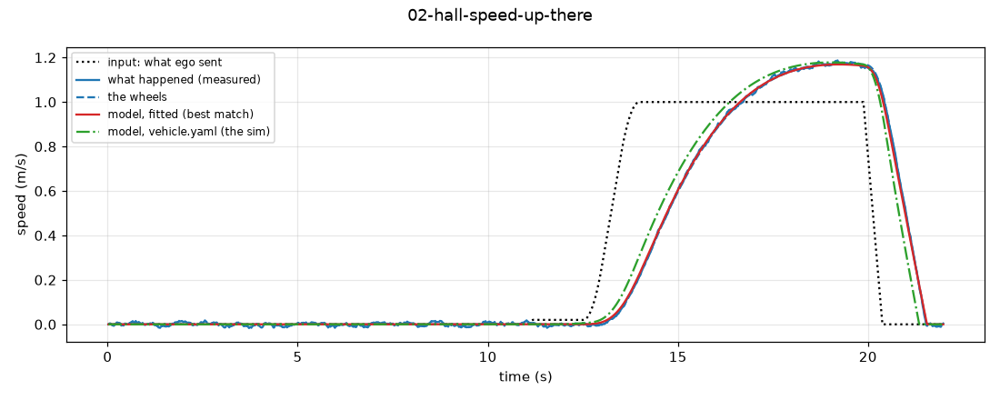
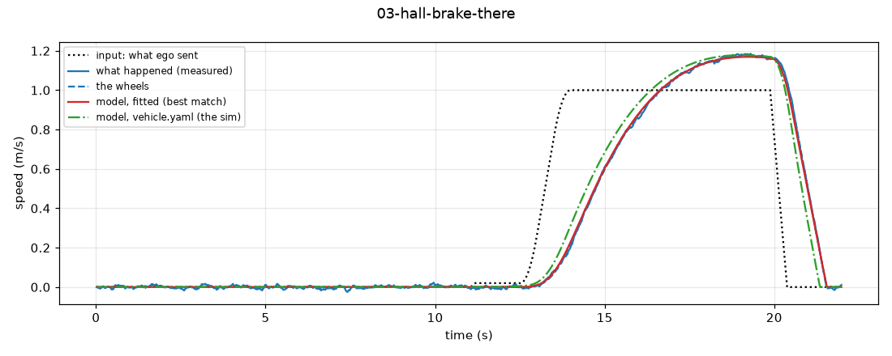
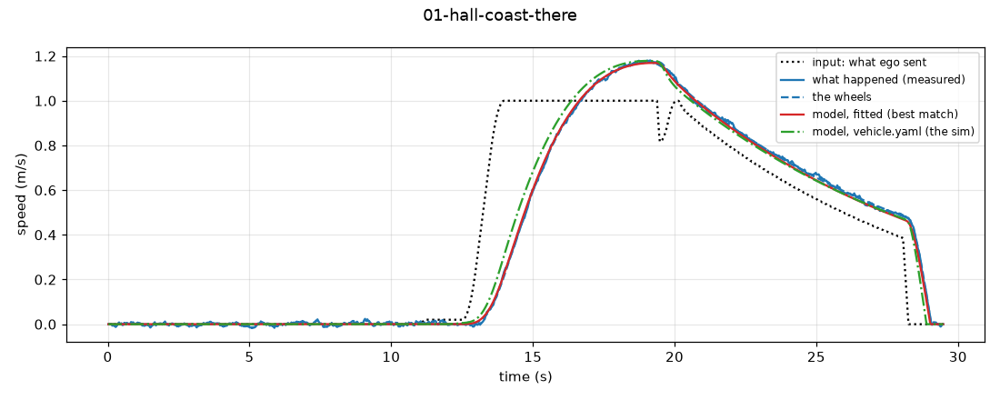
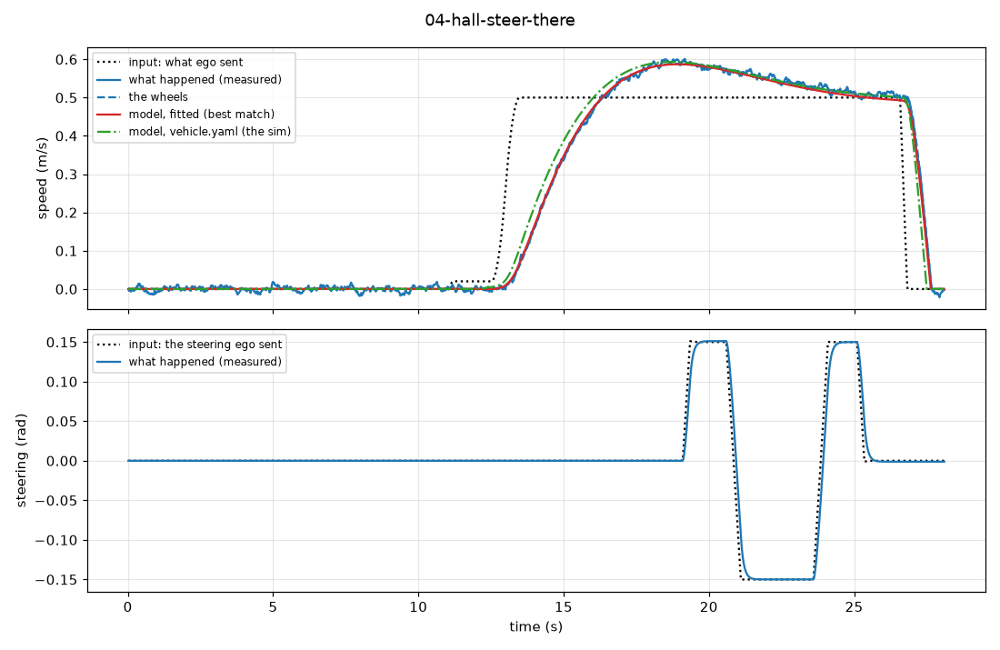
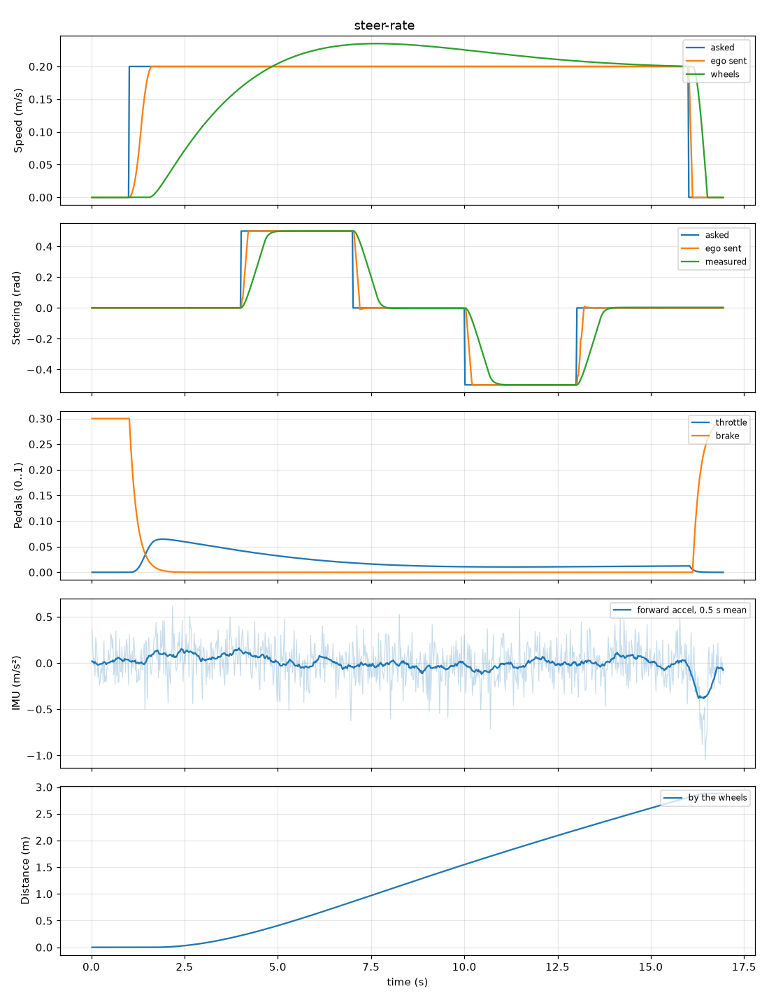
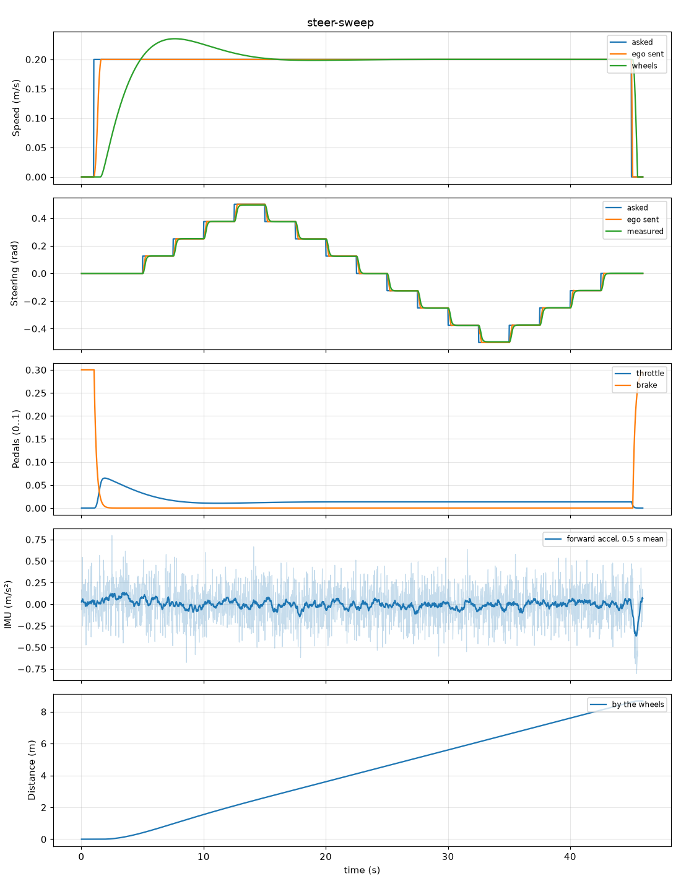
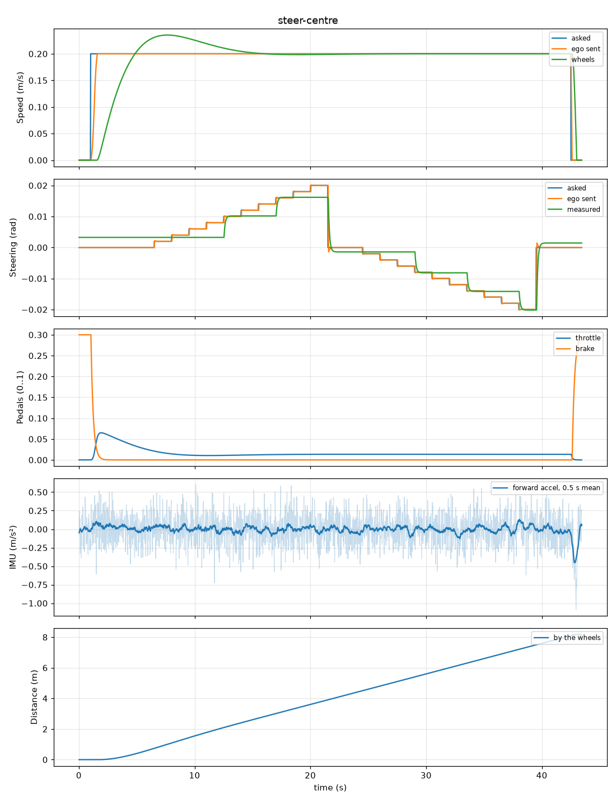
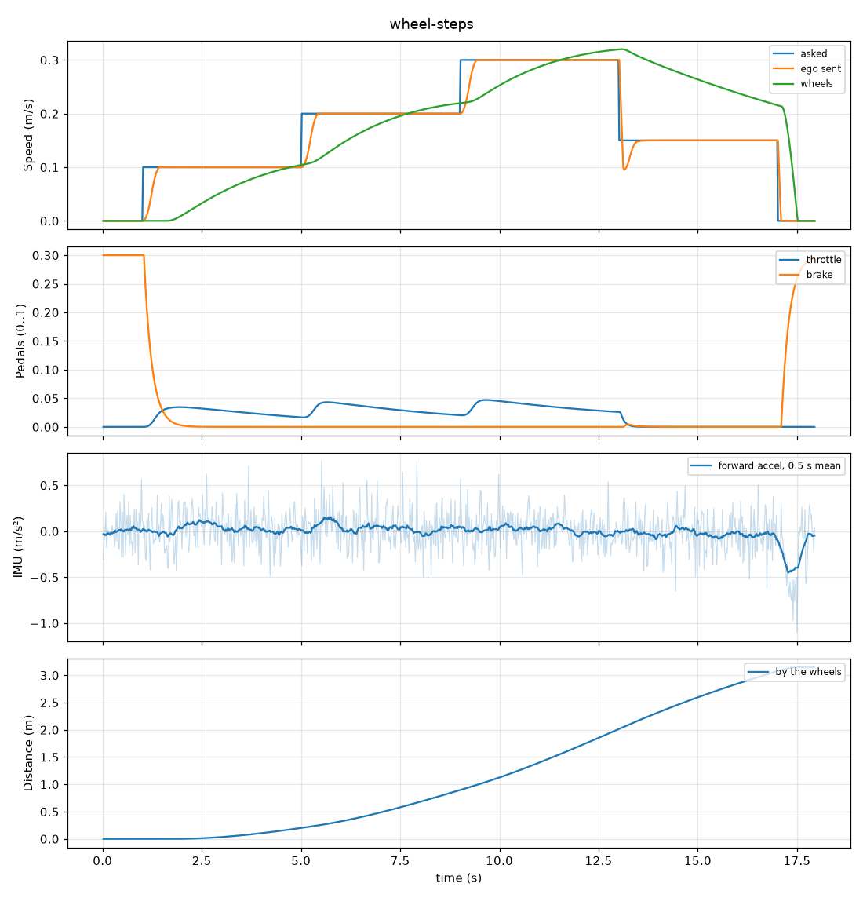
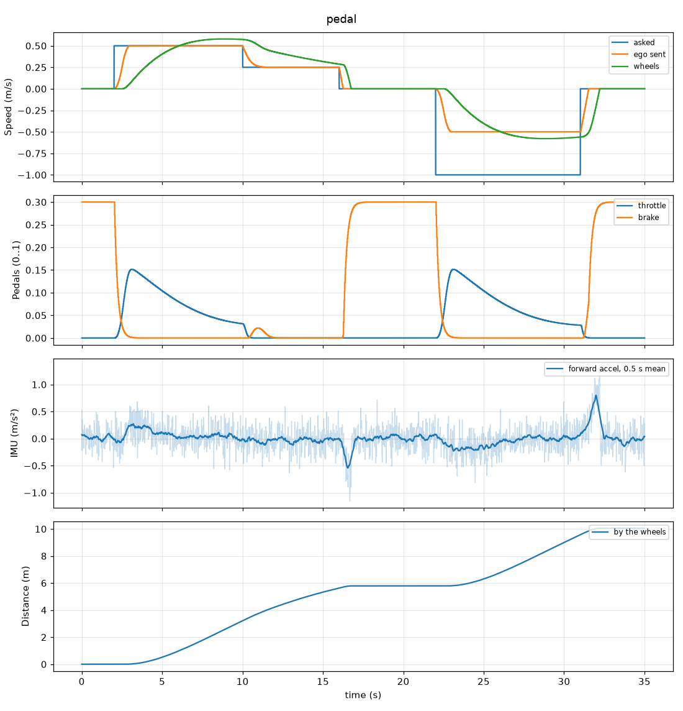
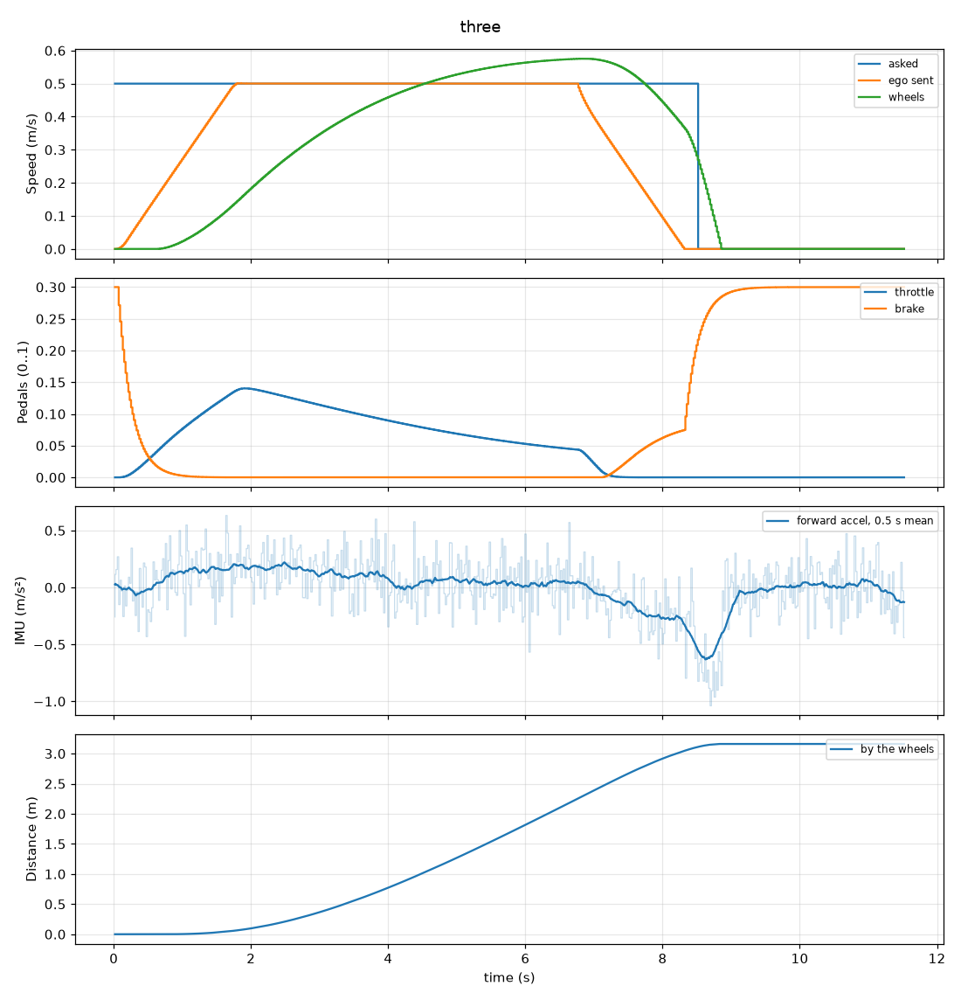

# Car day, 21 Nov: flash, calibrate, record

Ben, 20 Nov: flash the ESP32 and the Motor Pi (CORTEX), check the IMU, the cameras and
the lidar, measure the steering lock to lock, set the RC's channel 6, then record drives
with a laptop as the Orin, "so we record as much data as possible", to build better maps
and find what is static.

The setup and the moves: [drive by hand and record](drive-and-record.md).

## Bring

| ☐ | Thing |
|---|---|
| ☐ | stands, chocks |
| ☐ | the RC transmitter, charged |
| ☐ | the ESP32's USB cable; a multimeter |
| ☐ | a laptop with the repo, **built** (`pixi run build`), 30 GB free |
| ☐ | **the Ethernet cable**: the laptop on the car's switch, so the heartbeat and the lidar don't ride the WiFi |
| ☐ | a second laptop or drive for the bags: about 5 GB each 10 minutes with the lidar |
| ☐ | the printed steering sheet ([actuator tests](actuator-tests.md#the-sheet)) |

## The order

Everything up to step 7 **on stands**, wheels off the ground.

| # | Do | Command or page | Done when |
|---|---|---|---|
| 1 | The laptop ready | `pixi run car-day-check` | OK, nothing MISSING |
| 2 | Look before changing: what each computer runs | `pixi run doctor`; [car-day.md](car-day.md) | the Orin's JetPack, CORTEX's Ubuntu, the camera Pi's OS written down |
| 3 | **Flash the ESP32**, the C++ saved first | `pixi run esp walk` (guided: saves the C++, builds, flashes once you type `flash`, runs the first check) | SAFE TO GO ON. Way back: [the bench](esp32-bench.md) |
| 4 | **Upgrade CORTEX** (the Motor Pi) and set `frame_version: 2` in its `legacy.yaml` | [car setup](car-setup.md), `tools/car_setup.sh` | the bridge runs; the ESP32's log shows new counters |
| 5 | The sensors, one by one, on the hardware screen | see "The hardware screen" below | each row live |
| 6 | **The steering**, lock to lock | see "The steering" below | the sheet filled in |
| 7 | **The RC**: which switch sends CH6 | flip each switch; watch the screen's GRAPHS page or the ESP32's log | CH6 found; up = RC direct |
| 8 | Off the stands: [the three levels](#driving-three-levels-up), at 0.3 m/s, then each stop | [drive and record](drive-and-record.md), moves 4-6 | it stops each way |
| 9 | **Record the drives** | see "Recording" below | 3 drives of the same route or more |

## Driving: three levels up

Ben, 21 Nov: "esp32 with the remote then joystick cortex to esp32 and then finally orin or
laptop too." Each level adds one link. Go up only when the one below works.

```text
 1  RC ──────────────────────────────────────────────► ESP32        no computer
 2  joystick ─USB─► CORTEX: ros, ego, mux, bridge ─UART─► ESP32     no Orin
 3  joystick ─USB─► laptop or Orin: ros, ego, mux ─Ethernet─► CORTEX: bridge ─► ESP32
```

| Level | Run | Done when | If it doesn't move |
|---|---|---|---|
| **1** ESP32 + RC | nothing: CH6 up (RC direct) | it steers, drives, brakes; CH6 down stops | the ESP32's log: iBUS frames? the stick at 0 first (`rc_hold`) |
| **2** joystick on CORTEX | on CORTEX: `~/aav-jazzy/aav.sh ros2 launch aav_bringup car.launch.py machine:=motor_pi_alone max_speed:=0.3` | the trigger held + the stick: it moves; trigger let go: it stops | below |
| **3** laptop (or Orin) | on CORTEX: `car motor_pi`; on the laptop: `car.launch.py machine:=laptop_orin max_speed:=0.3` ([drive and record](drive-and-record.md)) | as level 2; the laptop unplugged: the ESP32 brakes in 100 ms | the Ethernet, WiFi off, the same `ROS_DOMAIN_ID` |

**The joystick checks** (level 2), on CORTEX, before blaming anything else:

| # | Check | How |
|---|---|---|
| 1 | ROS sees the stick | `ros2 topic echo /drivers/joy/joy`: numbers change as you move it |
| 2 | The deadman is **button 0** | press each button: which index goes to 1? If not 0: `enable_button` in `aav_teleop/config/teleop_twist_joy.yaml` |
| 3 | Speed is **axis 1**, steering **axis 0** | move one way at a time; else `axis_linear` / `axis_angular` there |
| 4 | It reaches ego | `ros2 topic echo /drivers/joy/cmd_vel` with the trigger held |
| 5 | The Rust firmware is on the ESP32 | the old C++ locks every program out: the joystick then works on stands only |
| 6 | The user may read it | in the `input` group (`groups`) |

Later (to discuss with the team): a **joystick direct** mode in the firmware, as RC
direct, so the stick works with every computer down. Our ESP32 can't read USB, so the
stick's potentiometers and button would be wired to its analog pins (the hardware lead's
call). Then the ESP32 picks RC, then the joystick, then the computer.

## The hardware screen

On the car's network, not localhost:

```sh
export ROS_DOMAIN_ID=42
pixi run tools/ros.sh ros2 launch aav_hud hw_panel.launch.py stands:=true
```

**Not `pixi run hw-panel`**: that one stays on the laptop and never sees the car.

| Row | If it's dead |
|---|---|
| IMU | the localization Pi's IMU (upgraded; maybe a second one needed) |
| GPS | the localization Pi |
| lidar: Hz and points | below |
| cameras: Hz | the camera Pi: likely still the wrong OS, so reflash it ([car setup](car-setup.md)) |
| steering, throttle, brake | the Motor Pi's bridge |
| wheels | the Arduino's CAN frames, on the Orin |

## The lidar

A Velodyne VLP-16 on the roof, at **192.168.1.201**, with its own web page (open
`http://192.168.1.201` in a browser). It spins 10 times a second and sends UDP packets
to **one** computer: today the Orin. A driver (`velodyne`) turns them into a point cloud,
`/sensors/lidar/points`; the screen shows its rate and point count.

| Who records the lidar | How |
|---|---|
| the Orin, if it runs our stack | `car orin_sensors` there; record there |
| a laptop, if the Orin doesn't | on the lidar's web page set the destination to the laptop's address, the laptop on the car's switch by the Ethernet cable, run the `lidar` part there. **Untried**: write down the old destination first and put it back after |

## The steering

| Firmware | How | Safe? |
|---|---|---|
| the Rust, with the uplink wire (H9) | the screen's **STEERING CAL** page (Tab): **GO LIMP** first and mark the ends **by hand**, motor off; then the LOCK-TO-LOCK CHECK | the firmware clamps every jog to 400-3500 counts at 300 counts a second; the check stops on resistance (150 counts behind, or 0.6 s stuck); never moving, always braked. Needs `frame_version: 3`, `uplink: true`, `steering_calibration: stands` in `legacy.yaml` for that session ([actuator tests](actuator-tests.md#way-b-the-hardware-panel-rust-firmware)) |
| no uplink wire | Pololu's Jrk utility on a laptop, by hand, with the hardware lead ([Way A](actuator-tests.md#way-a-pololus-utility-over-usb-car-day)) | the motor off; nothing drives |
| neither today | keep the 2025-26 code's values (400-3500 counts) | as the car drove before |

**Limp first, always**: by hand, with the motor off, nothing can strain. Only then the
motorised check. The panel never writes `vehicle.yaml`: SAVE writes a file, a person
copies the numbers.

## Recording

The laptop is the Orin ([drive and record](drive-and-record.md)): its joystick and mux
drive, and it makes the heartbeat. For mapping, record every raw sensor at full rate:

```sh
pixi run record-drive --check                      # disk, rates, clocks: before anything
pixi run record-drive --name lot1 --note "the lot, clockwise"
```

Then the same route again (lot2, lot3...), at different times if you can: parked cars
move, buildings don't.

| After, at home | Gives |
|---|---|
| `pixi run map-drive bags/<drive>` | one drive's map: KISS-SLAM, NDT's map, a 2D map |
| `pixi run map-area lot bags/<lot1> bags/<lot2> bags/<lot3>` | the lot from every drive: what every pass saw is static; what only one saw is marked |
| `pixi run tools/ros.sh python3 tools/score_drive.py bags/<drive>` | each drive's scorecard |

## The sim baseline: what the car should do (20 Nov)

Tonight's runs in Ravensim, the same commands as tomorrow's minus `--sim`. The sim car
follows our car model with `vehicle.yaml`'s numbers, the ones the planners use too.
Tomorrow's car runs go beside each graph; the gaps are the guesses to fix.

How to read a graph: the **input** (black dotted, what ego sent) is a step; **what
happened** (blue) follows it late and rounded. A model's answer to the same step is drawn
over it: **fitted** (red, the best match: its numbers are what the car is) and
**vehicle.yaml** (green, what the sim and the planners assume).

### Speed: a step up, then a brake (the hallway)

In this run the sim car was given **other** numbers than `vehicle.yaml` (a slower
throttle and brake), as the real car will have: the red finds them, the green misses.







| Number | The sim car had | The test found | Trusted | `vehicle.yaml` now | The car (21 Nov) |
|---|---|---|---|---|---|
| throttle lag | 0.30 s | 0.30 ± 0.04 s | yes | 0.10 | |
| throttle delay | 0.30 s | 0.33 ± 0.01 s | yes | - | |
| max accel | 1.50 m/s² | 1.51 m/s² | yes | 1.50 | |
| drag | 0.10 /s | 0.103 /s | yes | 0.10 | |
| max brake | 3.0 m/s² | 2.8 ± 0.3 m/s² | yes | 3.0 | |
| brake lag | 0.35 s | 0.27 ± 0.13 s | **no**: the 3 runs disagree | 0.20 | |
| stop from 1 m/s | - | 1.17 m | yes | - | |
| steering lag | 0.10 s | 0.100 s | yes | 0.10 | |

The fitted model matched **12 of 12** passes (speed within 10 %, the stop within 0.2 m).
Where a number isn't trusted the report says why; more passes narrow it.

### Steering: steps on stands









| Number | The sim car had | The test found | The car (21 Nov) |
|---|---|---|---|
| steering rate | 0.80 rad/s | 0.79 rad/s | |
| steering lag | 0.10 s | 0.093 s | |
| full lock | 0.50 rad | 0.495 rad | |
| centre offset | 0 | 0.0002 rad | |

### Throttle on free wheels (stands)



The sim's wheels take 2-3 s to reach each step and overshoot the 0.3 m/s one; asked to
drop to 0.15 they coast down on drag alone. Does the car do the same?

### The pedal and "3 m and stop"





| Move | Asked | The sim | The car (21 Nov) |
|---|---|---|---|
| 3 m and stop (scripted) | 3.00 m | 3.16 m by the wheels, 3.11 by the EKF | |
| drive to a point 3 m ahead | stop on B | 0.07 m from B, 9.6 s | |

### Draw the car's beside these

```sh
pixi run python3 tools/step_plots.py --hallway ~/aav-tests/<car hallway session> --out /tmp/car
pixi run python3 tools/step_plots.py ~/aav-tests/<sim stands> ~/aav-tests/<car stands> \
    --label sim car --out /tmp/compare
```

## Write down

Everything seen goes into the repo afterwards: the versions (step 2), the steering sheet,
CH6's switch, the lidar's destination, which bags were made. Until then our stack is
[[untested]] on the car.
