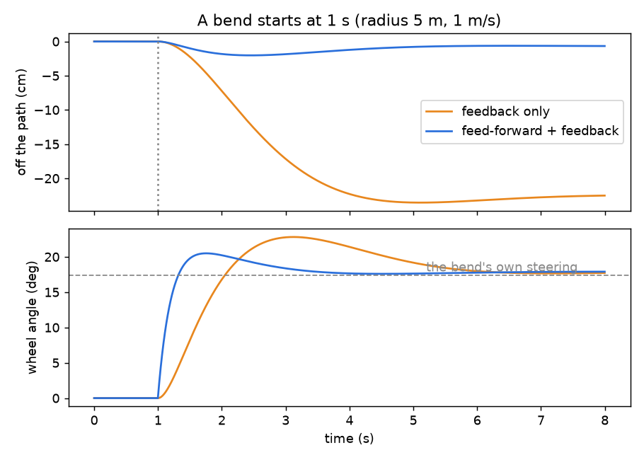
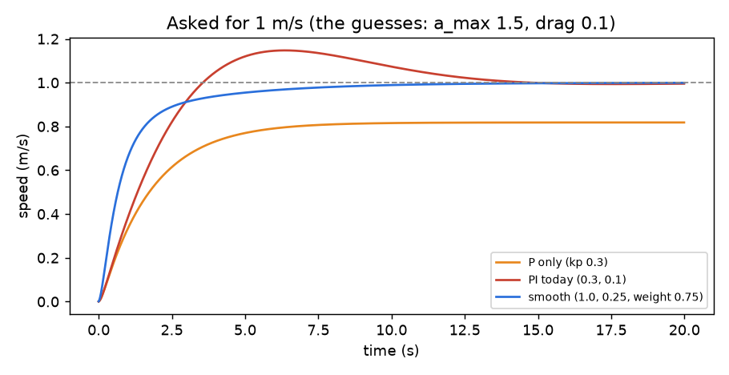
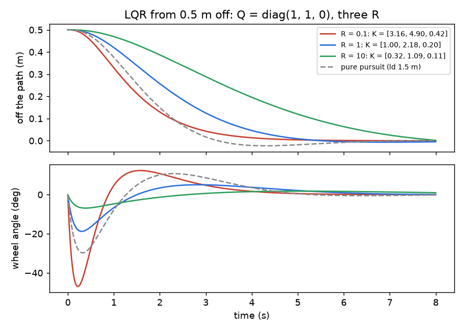
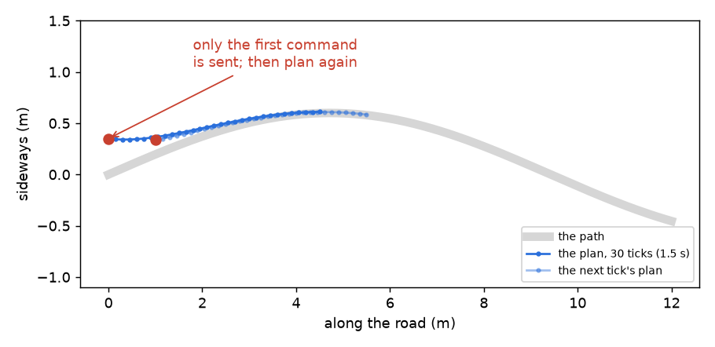
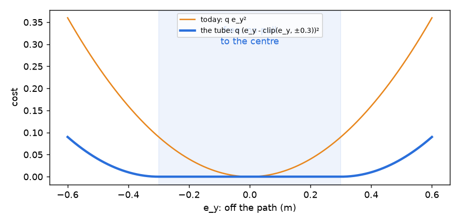
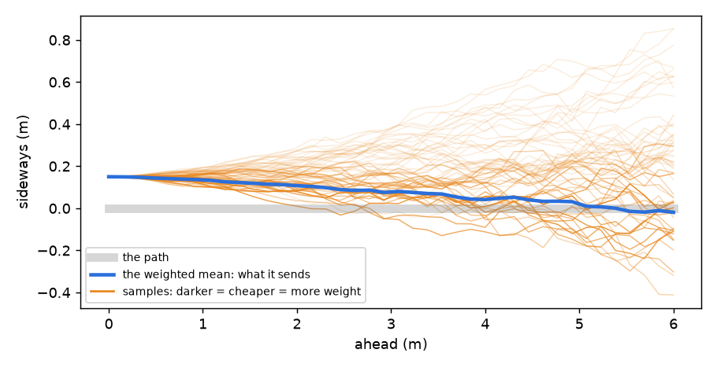
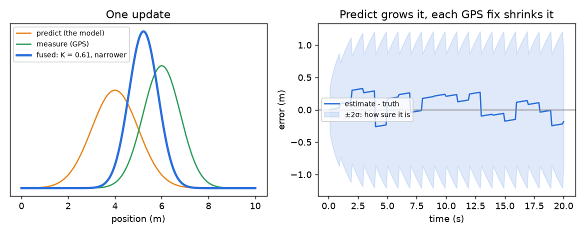

# Control, explained: the maths that drives our car

Ben, 21 Nov: "write a document explaining the mpc and the feed forward pi and all the
different math and models that we use and how we can make them better ... I need to
learn from it." Then: "LQR and LQI would be good too", "and the EKF".

Each section has the same four parts:

| Part | What |
|---|---|
| **The idea** | one picture, in words |
| **The maths** | the equations, step by step (the gentle start: [learn state space](learn-state-space.md)) |
| **On our car** | where it lives in the code, and its numbers |
| **Better** | how we could improve it |

The figures come from `tools/control_figures.py`, using the same models and guesses as
[the car as a linear model](vehicle-model.md). **Every car number is a guess** until car
day's step tests measure it.

## 0. The whole chain

```text
             ESTIMATION                         CONTROL
 sensors ──► EKF: where am I? ──► follower: what do I do? ──► ego ──► ESP32 ──► actuators
 wheels,     (section 9)          MPPI or MPC (6, 7)          limits   speed loop   steering
 IMU, GPS,                        steering + set speed        ramps    PI (3)       Jrk PID
 lidar                            every 50 ms                 50 Hz    every 10 ms  (its own)
```

| Layer | Asks | Answers with | How often |
|---|---|---|---|
| EKF | Where is the car, which way, how fast? | a best guess and how sure it is | 30 Hz |
| Follower (MPPI, MPC) | Which steering and speed keep us on the path? | a steering angle and a set speed | 20 Hz |
| ego | Is that safe and possible? | the same, limited and smoothed | 50 Hz |
| ESP32 speed loop | How much throttle or brake gives that speed? | a pedal level | 100 Hz |
| Steering actuator (Jrk) | How do I turn the motor to that angle? | motor power | its own loop |

**Two ideas run through everything:**
- **A model** says how the car answers a command (section 1).
- **A controller** uses the model to pick the command. Feedback corrects what went wrong;
  feedforward acts on what we already know is coming (section 2).

## 1. Models: how the car answers

### The idea

A model is a small set of equations: "if I send this, the car does that". Every
controller here, and the EKF, uses one.

### The maths: three pieces

**The bicycle.** Two wheels instead of four, about the rear axle:


The dot means "how fast it changes". δ = the wheel angle, L = the wheelbase, 1.561 m.

**A lag.** An actuator doesn't jump: it creeps toward the command. A first-order lag:


a = what the actuator does, u = what we asked, τ = its time constant.

After τ seconds it has done 63 % of the change; after 3τ, 95 %.

**A dead time.** Nothing happens at all for T seconds, then the lag starts. The camera
frame's age and the ROS chain add these.

### State space: the matrix form

Ben, 20 Nov: "state space is the matrix form for x order derivatives right?" Yes. Any
n-th order equation becomes n first-order ones, stacked as a vector:


| Letter | Is |
|---|---|
| **x** | the state: everything the future depends on |
| u | what we send |
| y | what we measure |

**The car's sideways motion**, linearised for small errors (vehicle-model.md, section 3):


Read row by row:

| Row | Says |
|---|---|
| e_y' = v · e_θ | pointing off the path moves you sideways, faster at speed |
| e_θ' = (v/L) · δ | steering turns the car |
| δ' = (δcmd − δ)/τs | the wheels creep toward what we asked (τs ≈ 0.16 s) |

**The eigenvalues of A** say how the car behaves left alone: 0, 0 and −1/τs. Two zeros
mean nothing pulls it back to the path. That's why we need a controller.

### On our car

| What | Where |
|---|---|
| The full nonlinear model (lags, dead times, rate limits, the speed loop) | `ros/bringup/aav_description/car-model/` (Rust) and `car_model.py` ([car model](car-model.md)) |
| Its numbers | `vehicle.yaml` `actuators:` |
| The linear version, poles and margins | `tools/vehicle_model.py`, [vehicle-model.md](vehicle-model.md) |

The same model is used by ego (its look-ahead), MPPI, the MPC and the simulator.

### Better

- **Measure it.** Car day's step tests (`car-test`, `tools/step_plots.py`) give the real
  lags, dead times and throttle map. Fit, put into `vehicle.yaml`, and every controller
  gets better at once.
- **A dynamic bicycle** (tyre slip) only matters fast or on ice: not yet.

## 2. Feedback and feedforward

### The idea

| | Acts on | Like |
|---|---|---|
| **Feedback** | the error you can see now | steering back after you drift |
| **Feedforward** | what you know is coming | turning the wheel as the bend starts |

Feedback alone is always late: it waits for an error. Feedforward is fast but blind: if
the model is wrong, it's wrong. **Together:** feedforward does most of the work, feedback
mops up what's left.

### The maths

For a bend of curvature κ (1/radius), the bicycle says the steering that holds it is


The first line is the bend's own steering (feedforward); the second adds the feedback.



**What the figure shows** (a 5 m bend at 1 m/s, pure pursuit's gains):

| | Off the path |
|---|---|
| Feedback only | 22 cm, and it **stays** 22 cm off: it needs an error to hold any steering at all |
| Feedforward + feedback | 2 cm, then back to nearly 0 |

That steady 22 cm is a rule: **a feedback controller with no integral needs an error to
produce an output**. Feedforward supplies the output, so no error is needed.

### On our car

| Where | Feedforward |
|---|---|
| The MPC's steering | ✅ `atan(L κ)` along the path ahead, shifted by the steering's dead time (`feed_forward` in `aav_mpc_lag/crates/mpc-lag/src/tracker.rs`; the node reports `feed_forward_rad`) |
| MPPI | in effect: its samples are rolled out on the path's bends, so the best one already turns |
| The ESP32 speed loop | ❌ tried on the model, turned down: with the throttle 2x stronger than guessed it overshot 88 % ([vehicle-model.md](vehicle-model.md#the-candidates-on-the-model)) |

### Better

- **A speed feedforward**, once the throttle map is measured: throttle ≈ (drag · v +
  wanted acceleration) / a_max. The PI then corrects only the map's error.

## 3. PI: the speed loop on the ESP32

### The idea

PI is feedback with two parts:

| Part | Does | Alone |
|---|---|---|
| **P**: proportional | push harder the bigger the error | always a little short (needs an error to push) |
| **I**: integral | keep adding up the error over time | slowly removes that last bit |

### The maths


The car (vehicle-model.md, section 1), with d its drag and a_max its full-throttle
acceleration:


With a lag on the throttle too, in Laplace form (s ≈ "how fast"):


P is the car (throttle command to speed), C the controller.

**Why the integral removes the error.** The final value theorem: the error left at the end
is 1 / (1 + C(0) P(0)). With ki > 0, C(0) = ∞, so the error is 0.


**Why today's PI overshoots.** The PI adds a "zero" at −ki/kp that sits near the car's
slow pole, and kicks the response. The fix, a **setpoint weight** b:


The P part reacts less to a new set speed, but still fully to the car's own speed.



| Design | Overshoot | Settles | Error at the end |
|---|---|---|---|
| P only (kp 0.3) | 0 | — | 18 % short |
| PI today (0.3, 0.1) | 15 % | 13 s | 0 |
| **`smooth`** (1.0, 0.25, b 0.75) | **0** | **6 s** | 0 |

### On our car

| What | Where |
|---|---|
| The loop | `firmware/spine/crates/spine-core/src/speed_loop.rs`, every 10 ms on the ESP32 |
| Profiles | `default`, `smooth`, `lqi` (`speed_loop:=`) |
| Anti-windup | clamping: no integrating while the throttle is pinned |
| Brake | a separate P loop past a 0.2 m/s coast band |

### Better

- **Pole placement** on the measured car: pick where the poles go, solve for kp, ki
  (vehicle-model.md, "Pole placement").
- **Gain scheduling** if the car behaves differently at 0.5 and 2 m/s.

## 4. LQR: the best gains from the model

### The idea

PI's gains are picked by hand. LQR picks them **from the model**, by answering: what
feedback u = −K x makes this cost as small as possible, forever?


The first term is how far off we are; the second, how hard we work.

| You choose | Means |
|---|---|
| **Q** big | "I hate being off the path" |
| **R** big | "I hate big steering" |

### The maths

1. Write the model: A, B (section 1).
2. Choose Q and R.
3. Solve the **Riccati equation** for P (a computer does this):
   
4. The gain: `K = R⁻¹ Bᵀ P`. The controller: `u = −K x`.

**What you get for free:** the closed loop is always stable (if the model is right), with
at least 60° of phase margin. That is the "maths proof it will resolve".



| R | K = [e_y, e_θ, δ] | What happens |
|---|---|---|
| 0.1 | [3.16, 4.90, 0.42] | back in 2 s, but 45° of steering: **beyond full lock** |
| 1 | [1.00, 2.18, 0.20] | back in 4 s, 18° |
| 10 | [0.32, 1.09, 0.11] | gentle, 7° |

**The catch:** LQR doesn't know about limits. R = 0.1 asks for more steering than the car
has. That's what MPC fixes (section 6).

### On our car

| Where | |
|---|---|
| `tracker:=lqr` | `aav_track`'s LQR lane keeper, a trial follower |
| `VehicleModel.speed_lqi` | the speed loop's gains (next section) |
| Pure pursuit | is secretly a hand-made u = −K x (vehicle-model.md, section 3), which is why it fits on the same graph |

### Better

- **K that changes with speed** (gain scheduling): A has v in it, so the best K does too.

## 5. LQI: LQR with an integral

### The idea

LQR, like P, leaves a steady error when something pushes constantly (a hill, drag). LQI
adds the **integral of the error as one more state**, so the LQR solves for the I gain
too.

### The maths


z is the integral of the speed error, added as one more state.

Solve the same Riccati equation for the bigger state. The k_z part is the integral gain,
chosen by the maths rather than by hand. The ESP32 solves the **discrete** version (it runs
in steps of 10 ms, not continuously).

### On our car

| What | Where |
|---|---|
| `speed_loop:=lqi` | `spine-core`; one signed acceleration for both throttle and brake |
| Its gains | `VehicleModel.speed_lqi` (the discrete Riccati equation), in [vehicle-model.md](vehicle-model.md#the-lqi-todo-3) |
| Result on the model | 0 % overshoot, settles in 5.0 s, 44° margin: as good as `smooth` |

### Better

- Re-solve K once car day measures a_max, drag and the lags. LQI's advantage over PI
  grows the better the model is.

## 6. MPC: LQR that looks ahead and respects limits

### The idea

Every 50 ms:
1. **Predict** the next 1.5 s (30 ticks) with the model, for a sequence of commands.
2. **Choose** the sequence with the lowest cost, **within the limits** (full lock, the
   steering rate, top speed).
3. **Send only the first command.** Next tick, start again from where the car really is.



This "plan, send one, plan again" is called the **receding horizon**. Replanning every
tick is the feedback; the plan along the bends ahead is the feedforward.

### The maths

The cost, summed over the 30 ticks (`tracker.rs`'s header):


**How it's solved:**

| Step | What |
|---|---|
| Linearise | about the last plan, shifted by one tick: `X = X̄ + M ΔU` |
| Condense | write every future state through ΔU only: a quadratic in ΔU |
| QP | minimise ½ ΔUᵀ P ΔU + qᵀ ΔU within the limits: our own ADMM solver (`qp.rs`) |
| Send | u[0] and c[0] |


It is LQR's cost (section 4), with a finite horizon, limits, and the full lagged model.

### The tube (21 Nov)

Ben: "It doesn't need to be super aggressive sticking to the line so that it doesn't
oscillate so much."



Inside ±w the target for e_y is where the plan already is, so there is no pull to the
centre. Outside, the cost rises as before. Tuned 21 Nov: **w = 0.3 m** is the default
(`mpc_lag_tube:=0` turns it off).


### On our car

| What | Where |
|---|---|
| The Rust MPC | `ros/drivers/aav_mpc_lag/` (`tracker:=mpc_lag_rs`), 1.6 ms a tick |
| The Python one | `aav_track` (`tracker:=mpc_lag`), 6.8 ms |
| Reversing | cut at cusps, a backwards stretch mirrored (20 Nov) |
| League, 21 Nov | every leg, the closest to the path, but **2x MPPI's sway** ([results](league-results-2026-11-20.md#mpc-against-mppi-21-nov-todo-213)) |

### Better

- **The tube** ✅ tuned 21 Nov: 0.3 m cut University Drive's sway from 0.251 to 0.160
  (MPPI: 0.132), every leg still reached.
- **Tune r_rate** (the cost on steering changes): more = calmer.
- **The costmap in the cost** (Ben's idea): the kerb as a wall, the yellow line costly,
  the other side costlier. Today the MPC follows only the path.
- **A terminal cost from LQR's P** makes the finite horizon provably stable.

## 7. MPPI: sampling instead of solving

### The idea

Instead of solving for the best commands, **try lots of them**:
1. Take the last plan and add random wiggles: 2,000 versions (`mppi_lag_1k`: 1,000).
2. Roll each one forward through the car model.
3. Score each one (the critics: path, goal, obstacles, smoothness).
4. Average them, **weighted by how good they were**: cheap ones count a lot.



### The maths


c_k = sample k's cost, ε_k = its wiggle, λ = how picky.

| | MPC | MPPI |
|---|---|---|
| Finds the plan by | solving a QP (calculus) | sampling and averaging |
| Cost must be | smooth, quadratic | anything: walls, lanes, if-then |
| Limits | exact constraints | samples clipped |
| Result | the exact best, for a linearised model | close to the best, for the full model |
| Calm? | can chase small errors | averaging smooths it: **the calmest today** |

**Our change:** the noise is **correlated** (smooth wiggles, AR(1) 0.8). White noise
averages away through the slow steering, so every sample drives alike and MPPI learns
nothing ([mppi-lag.md](mppi-lag.md#why-the-noise-is-correlated)).

### On our car

`ros/drivers/aav_mppi_lag/` (`tracker:=mppi_lag`), the default follower: 3.4 ms a tick on
a Mac; about 10 ms on the Orin.

### Better

- **Time `mppi_lag_1k` on the Orin** (TODO 152), then use it on the car.
- **Lane and kerb costs** from the map (already a `LaneCritic`).

## 8. Stability: will it settle?

### The idea

A controller is **stable** if, after a push, the car comes back and stays. Three ways to
check:

| Tool | Asks | Used for |
|---|---|---|
| **Poles** (eigenvalues of the closed loop) | do all of them have a negative real part? | every linear loop here |
| **Margins** (Bode) | how much extra delay or gain before it oscillates? | the delays: vehicle-model.md, section 4 |
| **Lyapunov** | is there an "energy" that always goes down? | LQR (its P is one); MPC with a terminal cost; Ben's safety filter |

### The maths

**Poles.** For u = −K x, the closed loop is `x' = (A − BK) x`. Its eigenvalues λ:


| λ | Means |
|---|---|
| real part < 0 | the error dies away (faster the more negative) |
| an imaginary part | it rings (oscillates) as it dies |
| real part > 0 | **unstable**: it grows |

**Lyapunov.** Find V(x) > 0 (like distance², or LQR's xᵀPx) that always falls:
V' < 0. Then x must go to 0. This is the "maths proof it will resolve".


**The final value theorem.** Where does it end up? `lim s·E(s)` as s → 0 (section 3).

### On our car

| Loop | Poles | From |
|---|---|---|
| Speed, `smooth` | −0.28, −1.61, −8.2 (all real: no ringing) | vehicle-model.md |
| Pure pursuit at 1 m/s | −0.76 ± 0.78j, −4.6 (ζ 0.7) | vehicle-model.md |

### Better

- **Barrier functions (CBF)**, the safety filter idea: like Lyapunov, but proving the car
  never **enters** a bad set (the kerb, another car), instead of always reaching a good
  one. Each follower's look-ahead is checked against the barriers (Ben's thesis).

## 9. The EKF: where am I?

### The idea

Every sensor is wrong in its own way:

| Sensor | Good at | Bad at |
|---|---|---|
| wheels | short distances | drift over time, slip |
| IMU gyro | turning | drift; no absolute heading |
| GPS | absolute position | jumpy, ±1 m, slow |
| lidar + map (NDT) | precise position | needs a map; can lose it |

The Kalman filter blends them: **predict** with the model, **correct** with each
reading, trusting each by how noisy it is.

### The maths: predict, then update

**Predict** (the model moves the guess; we get less sure):


**Update** (a reading pulls the guess; we get more sure):


| Letter | Is |
|---|---|
| P | how unsure we are (the covariance) |
| Q | how wrong the model may be |
| R | how noisy the reading is |
| K | the Kalman gain: 0 = ignore the reading, 1 = trust it fully |
| z | the reading |

**The "E" (extended):** the bicycle has sin and cos, so it isn't linear. The EKF
linearises it at each step (F and H are Jacobians): the same trick as the MPC.



**LQR's mirror image.** The Kalman gain comes from a Riccati equation, the same one as
LQR's, run in the other direction. Control and estimation are twins; that's why they're
taught together.

### On our car

| EKF | Fuses | Gives | Used by |
|---|---|---|---|
| `ekf_local` | wheels, IMU turn rate | smooth `odom → base_link` | the followers, the local costmap |
| `ekf_global` | + GPS, GPS heading (+ NDT) | `map → odom`, true position | the planner |

Both are robot_localization, at 30 Hz, in 2D. Config: `ros/localization/aav_localization/config/`.
Choices worth knowing ([learn-localization.md](learn-localization.md#7-our-two-ekfs-their-real-inputs)):
it fuses vy = 0 (a car can't slide sideways); the IMU gives the turn rate, never the
heading.

### Better

- **Tune Q and R from car day's recordings**: the noise numbers are guesses today.
- **A kinematic EKF** (`pose:=kinematic_ekf`): no gain in the sim, kept for the car,
  where wheels slip.
- **NDT leading**, the GPS as a fallback (`--ndt-leads`): 92 % of clouds gave a pose on
  the campus.

## 10. What to make better first

| # | Do | Helps | Needs |
|---|---|---|---|
| 1 | **Measure the car** (step tests, lock to lock, throttle map) | every model, every controller | car day |
| 2 | **The MPC's `r_rate`**, then the costmap in its cost (the tube is done: 0.3 m) | MPC sway | the sim |
| 3 | **Re-solve LQI and pole placement** on measured numbers | the speed loop | 1 |
| 4 | **A speed feedforward** from the measured throttle map | faster speed response | 1 |
| 5 | **Tune the EKFs' Q and R** from recorded drives | where-am-I | car day's bags |
| 6 | **The costmap in the MPC's cost** (kerb wall, yellow line) | lane keeping | after car day |
| 7 | **The safety filter** (barriers) on every program driver | safety | Ben's thesis |

## Glossary

| Word | Means |
|---|---|
| state x | the numbers the future depends on (position, heading, speed, wheel angle...) |
| A, B | how the state changes by itself (A), and from a command (B) |
| pole, eigenvalue | a "speed" of the system: negative = settles, positive = blows up |
| lag (τ) | creeping toward the command; 63 % after τ |
| dead time | nothing at all, then the lag |
| gain K | how hard the controller pushes for each unit of error |
| Q, R | in LQR and MPC: how much we hate error (Q) and effort (R). In the EKF: model noise (Q) and sensor noise (R) |
| Riccati equation | the equation whose answer gives LQR's best K (and the Kalman gain) |
| horizon | how far ahead the MPC plans (1.5 s) |
| QP | quadratic program: minimise a bowl-shaped cost within straight-line limits |
| covariance P | how unsure the EKF is: a spread, drawn as an ellipse |
| Jacobian | the slopes of a nonlinear function: how to linearise it |

## Run it

```sh
pixi run python tools/control_figures.py        # these figures
pixi run python3 tools/vehicle_model.py         # poles, steps, margins
pixi run python3 tools/state_space_demo.py      # the state-space teaching example
```
