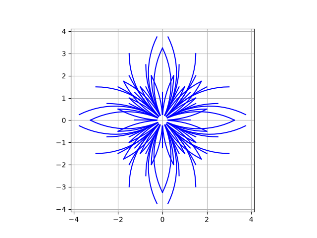
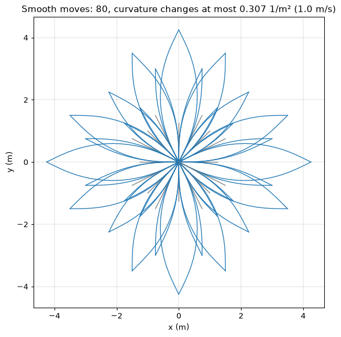

# Controllers: which one, where, and why

Every controller we use or are looking at, on one page: what it is, what it's good and
bad at, what it needs, and where it would run on our car.

!!! note "The short version"
    - **Speed and brake:** feed-forward + PI. In the ROS bridge first, then in
      `spine-core` on the ESP32. The bridge's loop has a smooth stop (29 Oct); an LQI
      is built in `spine-core` to compare (`speed_loop:=lqi`, section 2a).
    - **Steering, following a path:** MPPI that knows the lag (`aav_mppi_lag`, Rust) is
      the default (sim, bench and car); Nav2's MPPI was, until Nav2 went on 17 Nov.
      Our trackers (pure pursuit, Stanley, LQR, MPC) are trials; they reverse since
      19 Nov (TODO 174: a backwards stretch is driven mirrored); MPC is the leading
      candidate among them.
    - **The steering motor:** the Jrk G2's own position PID, underneath everything.
    - **Obstacle tours:** the State Lattice plans (since 1 Nov; ours in Rust,
      `aav_planner`, since 14 Nov), MPPI follows. Hybrid-A* and the diffusion planner
      are challengers ([Planners](#planners)).
    - **Trials:** LQR, Stanley, MPC and the lag-aware ones (`mpc_lag`, `mppi_lag`) run
      **beside** the defaults, picked at launch (`tracker:=`), and scored on the same
      routes. Built since 29 Oct; the scores: [Trials](trials.md), [MPPI that knows
      the lag](mppi-lag.md).
    - **Our own costmap, planner, navigator and smoother** (Rust, 8 Nov) are the
      defaults since Nav2 went (17 Nov, [Nav2, as it was](history/nav2-as-it-was.md)):
      [Switches](switches.md#the-defaults-what-runs-if-you-say-nothing).
    - **Localization** has its own trials: AMCL, NDT and KISS-ICP beside today's EKF
      (section 8).
    - **Every number here is a guess** until the car is measured
      ([Measure the car](measure-the-car.md), [Actuator tests](actuator-tests.md)).

The basics (feedback, PID, Ackermann) are in [Learn: control](learn-control.md). The maths
(poles, margins, state space) is in [The car as a linear model](vehicle-model.md) and
[Learn: state space](learn-state-space.md). This page links to them and doesn't repeat them.

## 1. The layers: which loop runs where

```text
 ORIN #1                                              senses
 ┌───────────────────────────────────────────────┐
 │ planner: State Lattice (ours)   1 Hz          │  the costmap, the goal
 │      │ a path                                 │
 │      ▼                                        │
 │ follower: MPPI with lag        20 Hz          │  the pose (EKF), the costmap
 │   or our path follower (pure pursuit; MPC)    │
 │      │ speed + turn rate (TwistStamped)       │
 │      ▼                                        │
 │ twist_mux ──► ego              50 Hz          │  limits only (no sensor)
 └──────┼────────────────────────────────────────┘
        │ speed + acceleration + steering angle
        ▼
 SPEED AND BRAKE: feed-forward + PI               wheel speed (+ the IMU)
   now:   the ROS bridge (aav_legacy)   50 Hz
   later: the ESP32, spine-core        100 Hz
        │ throttle (DAC)      │ brake target    │ steering target
        ▼                     ▼                 ▼
   throttle motor      brake Jrk G2        STEERING Jrk G2: position PID
                                           ~1 kHz                          the steering pot
```

| Loop | Runs on | How fast | Senses | Today |
|---|---|---|---|---|
| Plan a path | Orin: our planner (`aav_planner`: the State Lattice; Hybrid-A* with `planner_search:=hybrid`) | 1 Hz | costmap, goal | in use |
| Follow the path | Orin: MPPI with lag (`aav_mppi_lag`, `nav2.yaml`'s MPPI block) | 20 Hz | the EKF's pose, the costmap | in use |
| Turn speed + turn rate into an angle | Orin: `ego` | 50 Hz | nothing: it's maths and limits | in use |
| Speed and brake | the bridge (50 Hz), then the ESP32 (100 Hz: a 10 ms tick) | 50 → 100 Hz | wheel speed | open loop today |
| Steering angle | inside the steering Jrk G2 | ~1 kHz | the steering pot | to confirm (H2) |

**The rule** ([Learn: control](learn-control.md#3-where-each-loop-closes-on-our-car)):
inner loops are fast and simple, and sit next to the motor. The outer controller can be
swapped; the loops underneath stay the same, so a comparison tests only the outer one.

Rates: MPPI's 20 Hz is `controller_frequency` in `nav2.yaml` (the settings file our nodes read); ego's 50 Hz is `rate_hz` in
`ego.yaml`; the bridge's 50 Hz is `legacy_uart_bridge`'s `rate_hz`; the ESP32's 10 ms is
`TICK` in `boards/esp32-umod`. The Jrk's ~1 kHz is the control plan's figure: the Jrk's own
PID period setting decides it, and nobody has read it yet (D6).

## 2. Speed and brake

One job: make the car go the speed ego asks for, and stop where it's told.

### PI (and PID)

What we have today, in `spine-core`. Push in proportion to the speed error (P), plus
the error added up over time (I). No D.

```text
 v_set ──►(+)──► kp·e + ki·∫e ──► throttle ──► car ──┬──► v
           ▲ -                                       │
           └─────────────── wheel speed ◄────────────┘
```

| | |
|---|---|
| ✅ Benefits | simple; tiny on a chip; no model needed; the I term cancels a hill or drag |
| ❌ Weaknesses | waits for an error before it acts, so it's always a little late; today's gains overshoot 15-17 % and take about 13 s to settle; the brake is P only (no I) |
| Needs | wheel speed. No model, no solver |
| On our car | `firmware/spine/crates/spine-core/src/speed_loop.rs`: kp 0.3, ki 0.1, brake 0.5 per m/s beyond a 0.2 m/s coast band, hold 0.3 when stopped |
| Status | **in use** in Gazebo and the bench. Not on today's car: its ESP32 has no wheel speed, so it runs open loop (speed ÷ 3.0 m/s) |

Numbers from the model ([vehicle-model.md](vehicle-model.md#tuning-the-speed-loop)):

| Profile | Overshoot | Settles | Phase margin, worst delay |
|---|---|---|---|
| today: kp 0.3, ki 0.1 | 17 % | 13.7 s | 54° |
| `smooth`: kp 1.0, ki 0.25, setpoint weight 0.75 | 0 % | 5.7 s | 42° |

### Feed-forward + PI, with a smooth stop

Work out the throttle or brake the wanted acceleration needs, **and send it at once**
(feed-forward). The PI only cleans up what the model got wrong.

```text
 a_want ──► model: throttle for a_want ──────────────┐
                                                     ▼
 v_set ──►(+)──► PI ─────────────────────────────►(+)──► one signed command ──► car
           ▲ -                                          (+ throttle, − brake)
           └──────────────── wheel speed ◄──────────────────────────────────────┘
```

The **smooth stop** (from Autoware's design, their docs): near the stop, ease the brake
so the car stops without a jolt, then hold it with a fixed brake. Our `aav_drive_to_point`
already slows by the distance left (`approach.py`: v = √(2·a·d)), and the spine holds
with `hold_brake` once stopped.

| | |
|---|---|
| ✅ Benefits | acts before the error appears: no lag on a speed change; throttle **and** brake follow what ego wants (today the brake only comes on below 0.05 m/s); the PI stays small and calm; ego already sends the acceleration |
| ❌ Weaknesses | only as good as the throttle and brake map: on the model, with a throttle 2x stronger than guessed, today's PI plus a feed-forward overshoots 88 % ([vehicle-model.md](vehicle-model.md#the-candidates-on-the-model)); needs the car measured first |
| Needs | wheel speed (without it: feed-forward alone); the car's numbers (`max_accel`, `drag`, `max_brake` in `vehicle.yaml`); the IMU's acceleration helps while braking |
| On our car | step 1: the ROS bridge, `aav_legacy/speed_control.py` (no ROS), 50 Hz, chosen by `speed_loop.mode: pi` in `legacy.yaml`. Step 3: `spine-core` on the ESP32, 100 Hz (the hardware lead's call) |
| Status | **the choice.** Step 1 is written (on `main`), checked against a model car and Gazebo; the car stays on `mode: open` until it's tried on stands. The smooth stop is written (29 Oct): [section 2b](history/controllers-log.md#2b-the-smooth-stop-results-29-oct) |

On the ESP32 this loop runs inside the spine's state machine
(`spine-core/src/fsm.rs`, Arsh's PR #15, on `main`): only while **Authority** is `Drive`
(the computer) or `Rc` (the transmitter). On an e-stop, a fault or a timeout, the loop is
reset and the stop brake goes on. In `Idle` it's reset, with the throttle off. With no
wheel speed (**Confidence** `Degraded`) the spine falls back to open loop.

### LQR with an integral (LQI)

Write the speed (and its integral) as states, choose how much you hate error against
effort, and let the maths pick the gains (`u = −K x`).

```text
 x = [speed error, ∫ speed error]     cost = Σ (x'·Q·x + u'·R·u)
 Riccati equation (scipy: solve_continuous_are) ──► K ──► u = −K x
```

| | |
|---|---|
| ✅ Benefits | the best gains for the weights you chose, from the model; one signed command for throttle and brake; cheap to run (one multiply per state) |
| ❌ Weaknesses | for one state and an integral it **is** a PI, with gains picked another way; blind to limits (throttle 0 to 1, never with the brake); only as good as the model |
| Needs | the model (`vehicle_model.py`); wheel speed |
| On our car | `spine-core`'s `SpeedLaw::Lqi` (`speed_loop.rs`), picked with `speed_loop:=lqi` (bench, Gazebo, spine_sim); the PI stays the default. Its gains are constants, `LqiConfig::MODEL`, made by `pixi run python3 tools/vehicle_model.py --lqi` |
| Status | **built, a comparison** (TODO 3, 29 Oct): on the model it matches `smooth` and beats today's PI. Results: [section 2a](history/controllers-log.md#2a-lqi-against-the-pi-results-29-oct). "LQR picks the gains if it beats hand tuning" (the control plan, step 3) |

What ours adds to the textbook (`u = −K x`):

| Part | Why |
|---|---|
| A third state: the pedals' lag | the spine models it from what it sent (no sensor), so the ESP32 needs no matrix, only three gains |
| One signed acceleration through the model | + throttle (u / max_accel), − brake (−u / max_brake), never both; a 0.05 m/s² dead band where it coasts |
| A setpoint weight, b = 0.5 | the integral brings the rest of a new set speed, so the step doesn't overshoot (the PI's zero, [vehicle-model.md](vehicle-model.md#why-it-overshoots-the-pis-zero)) |
| Today's stop | brake at least `hold_brake` until stopped, then hold it: the same rule as the PI |
| Gains for the slower lag (the brake's 0.2 s) | one set for both pedals |

### MPC for speed

Each cycle, plan the next few seconds of throttle and brake against a model, with the
limits written in, send the first step, and plan again.

| | |
|---|---|
| ✅ Benefits | knows the limits (acceleration, jerk, brake); sees a stop coming and plans for it |
| ❌ Weaknesses | a solver every cycle: too heavy for the ESP32 at 100 Hz; many settings; a wrong model gives a confident wrong plan |
| Needs | a model, a QP solver, wheel speed |
| On our car | the Orin only |
| Status | **not chosen.** Feed-forward + PI does the job; part of TODO 4 (MPC for the whole A to B) if it's ever needed |

### 2a. LQI against the PI: results, 29 Oct

Moved to [the controllers log](history/controllers-log.md#2a-lqi-against-the-pi-results-29-oct) on 18 Nov (a dated record).

### 2b. The smooth stop: results, 29 Oct

Moved to [the controllers log](history/controllers-log.md#2b-the-smooth-stop-results-29-oct) on 18 Nov (a dated record).

## 3. Steering: following a path

One job: keep the car on the path. All of these output a steering angle (or a turn rate
that ego turns into one) and leave the speed to section 2.

### Pure pursuit (and Regulated Pure Pursuit)

Pick a point a set distance ahead on the path (the lookahead), and steer the circle
that reaches it.

```text
                 lookahead point
   path  ───────────────●────────────
                      ╱
                    ╱  the arc to it
          car  ▶──╯
```

| | |
|---|---|
| ✅ Benefits | simple; light; one setting (the lookahead); never needs a model; damping 0.707 at every speed when the lookahead grows with speed |
| ❌ Weaknesses | aims at a point, not a heading: it often arrives facing the wrong way; cuts corners; can't see an obstacle; the delay hurts it (phase margin 31° at 1 m/s in the worst case) |
| Needs | the pose, the path. No model, no solver |
| On our car | Orin. Ours: `aav_drive_to_point/line.py` (A to B). Nav2's Regulated Pure Pursuit until 17 Nov. In the trials, ours again (`tracker:=pure_pursuit`): the control every challenger is scored against |
| Status | **in use**: ours for A to B, and as a trial follower |

Numbers ([vehicle-model.md](vehicle-model.md#closing-the-loop-pure-pursuit)): lookahead
1.5 s × speed, from 1.5 to 4 m. Phase margin at 1 m/s: 52° with no delay, 45° typical
(84 ms), 31° worst (259 ms). The Gazebo comparison with MPPI: [Path followers](path-followers.md).

### Stanley

Steer by two errors at the **front** axle: the heading error, plus a term that grows with
how far off the path you are.

```text
 δ = heading error + atan(k · sideways error ÷ speed)
```

| | |
|---|---|
| ✅ Benefits | simple; no lookahead to tune; corrects a heading error at once; drove Stanford's car in the 2005 DARPA Grand Challenge |
| ❌ Weaknesses | jumpy at low speed (÷ speed) unless softened; sensitive to a noisy heading, and our GPS heading is weak at walking pace; no model of the steering lag |
| Needs | the pose at the front axle (our `base_link` is at the rear: a shift by the wheelbase), the path |
| On our car | Orin: `ros/drivers/aav_track`, `trackers/stanley.py`, `tracker:=stanley` |
| Status | **trial, built** (29 Oct). Gazebo, 29 Oct, 3 runs: 12 of 12 legs ([Trials](history/trials-log.md#results-29-october)) |

### LQR, scheduled by speed

The same state space as the model's lateral loop: x = [sideways error, heading error,
wheel angle]. Choose weights, solve once per speed, steer with u = −K x.

```text
 vehicle_model.lateral(v) ──► A, B ──► Riccati ──► K(v)
 a table of K by speed ──► each cycle: look up K at today's speed, δ = −K x
```

| | |
|---|---|
| ✅ Benefits | optimal gains straight from the model; knows the steering lag; 60° phase margin guaranteed (before delays); cheap: three multiplies a cycle |
| ❌ Weaknesses | blind to limits: it can ask for more angle or angle rate than the car has; the margin shrinks with delay at speed (below); a straight-road linearisation: on a tight curve it needs feed-forward from the curvature |
| Needs | the model (`vehicle_model.lateral()`), the pose, the path |
| On our car | Orin: `ros/drivers/aav_track`, `trackers/lqr.py`, `tracker:=lqr` (TODO 2) |
| Status | **trial, built** (29 Oct; rebuilt with a preview the same afternoon). Gazebo, 29 Oct: 8, then 10 of 12 legs ([Trials](history/trials-log.md#results-29-october-afternoon-lqr-rebuilt-and-mpc_full)). Also the yardstick for MPC: the same model, without limits |

Example, worked out with the model (weights Q = diag(1, 1, 0), R = 1: picked for this
page, not tuned):

| Speed | K (e_y, e_θ, δ) | Phase margin: none / typical / worst | Pure pursuit's |
|---|---|---|---|
| 0.5 m/s | 1.0, 2.11, 0.10 | 70° / 67° / 60° | 59° / 55° / 48° |
| 1 m/s | 1.0, 2.19, 0.21 | 70° / 63° / 50° | 52° / 45° / 31° |
| 2 m/s | 1.0, 2.32, 0.40 | 69° / 56° / 29° | 52° / 45° / 31° |
| 3 m/s | 1.0, 2.45, 0.59 | 68° / 49° / 9° | 50° / 43° / 27° |

What it shows: at our 1 m/s, LQR has about 20° more margin than pure pursuit. With fixed
weights it gets stiffer as speed rises, so at 3 m/s the worst delay nearly breaks it:
the weights have to change with speed too. To redo it (from the repo's root, with
`pixi run python`; R = 1, so K = Bᵀ P):

```python
import sys; sys.path.insert(0, 'ros/ego/aav_ego')
import numpy as np
from scipy import linalg, signal
from aav_ego import vehicle_model as vm
m = vm.from_vehicle_yaml('ros/bringup/aav_description/config/vehicle.yaml')
a, b, _, _ = m.lateral(1.0)                        # 1 m/s
k = b.T @ linalg.solve_continuous_are(a, b, np.diag([1, 1, 0]), np.eye(1))
num, den = signal.ss2tf(a, b, k, np.zeros((1, 1)))
print(k, vm.margins((vm.trim(num[0]), den), delay=m.lateral_delay('typical')))
```

### MPC (Autoware's `mpc_lateral_controller` design)

Each cycle, predict the next few seconds of the car along the path with the model, find
the steering that keeps it closest **within the limits**, send the first step, repeat.

```text
 now ──► predict N steps ahead with the bicycle + steering lag
         minimise  Σ (path error² + steering effort²)
         subject to  |δ| ≤ 0.5 rad,  |δ'| ≤ 0.6 rad/s
         ──► a QP ──► solver ──► δ[0] to ego; drop the rest; again next cycle
```

| | |
|---|---|
| ✅ Benefits | knows the steering's angle and rate limits; sees the curve coming (it uses the path ahead, not just one point); handles the steering lag and delay in its model; the same model as LQR, so the two compare fairly |
| ❌ Weaknesses | a QP every cycle: needs a solver, and time on the Orin; more settings (horizon, weights); only as good as the model; harder to prove stable than LQR |
| Needs | the model (discrete at 20 Hz: `lateral_discrete`), a solver (scipy for the trial; in Rust, Clarabel: pure Rust, or OSQP: C with Rust bindings; both Apache-2.0), the pose, the path |
| On our car | Orin. First the trial: `ros/drivers/aav_track`, `trackers/mpc.py` (Python, scipy), `tracker:=mpc`, horizon about 1.5 s. Only if it wins: our own Rust crate (maths with no ROS, like `spine-core`) |
| Status | **the leading candidate among our trackers; trial, built** (29 Oct, Python). Gazebo, 29 Oct: 12 of 12 legs. Also `mpc_full` (plans the speed too) and `mpc_lag` (7 Nov: through the car's lags; our simulator, 8 Nov: 6 of 12). All in [Trials](trials.md). Not yet in Rust |

The design follows Autoware's lateral MPC (their docs): a linearised bicycle with a
steering lag, along the reference path. We write our own (Ben, 28 Oct); we don't copy
their code.

### MPPI

Imagine 2000 possible futures, 2.8 s long, through a model of the car; score each against
the path, the costmap and the goal; blend the best.

```text
       ╱╱╱ ── 2000 noisy futures ──
  car ▶──────────────────────────  scored: path, obstacles, goal heading...
       ╲╲╲                         blend the good ones ──► speed + turn rate
```

| | |
|---|---|
| ✅ Benefits | steers round an obstacle the costmap sees; knows the car's turning radius and outline; turns to a goal's heading; no solver (sampling) |
| ❌ Weaknesses | heavy (21-32 % of a Mac core, two to three times RPP's); many settings (noise, temperature, eight scoring rules); its model assumes the car does exactly what it's told (no lags); forward only, a U-turn in a 14 m lane is a coin toss |
| Needs | the pose, the costmap, the path (from the planner); a strong CPU |
| On our car | Orin #1, `aav_mppi_lag` (Rust: Nav2's MPPI ported, with the lags), 20 Hz (`nav2.yaml`: 2000 samples × 56 steps of 0.05 s) |
| Status | **in use** since 22 Oct (Nav2's until 14 Nov; ours, `mppi_lag`, since). Stays |

Its tuning and the Gazebo runs: [Path followers](path-followers.md). Our Rust port with
the actuators' lag in its model (`tracker:=mppi_lag`, the default):
[MPPI that knows the lag](mppi-lag.md).

## 4. The steering motor: the Jrk G2's position PID

The Jrk G2 is a Pololu motor driver. Tell it "go to position X"; it reads the steering
pot and runs its own PID to get there.

```text
 target (from the ESP32, I2C) ──►(+)──► PID ──► motor ──► linkage ──┬──► wheel angle
                                  ▲ -                               │
                                  └────────── the steering pot ◄────┘
```

| | |
|---|---|
| ✅ Benefits | fast, next to the motor; nobody else's delays; keeps working if the Orin hiccups; its settings are kept in the Jrk |
| ❌ Weaknesses | we can only tune it, not change it; needs feedback wired and set up (unknown today); its gains are unread |
| Needs | the pot's feedback into the Jrk |
| On our car | inside the steering Jrk G2. The model treats it and the linkage as one second-order system: ωn 12.6 rad/s, ζ 1.03 (no overshoot), settles in 0.49 s ([vehicle-model.md](vehicle-model.md#2-steering)) |
| Status | **in use, to confirm**: today's steering is open loop (no angle comes back); after KEFC a KTC-100 pot. Questions H2 and D6 |

**Why it matters to the path follower:** the steering is about 10 times faster than the
path loop (12.6 rad/s against about 1), so the path follower sees it as a small delay,
0.16 s. Tune it with step tests (control plan, step 4), and match MPPI's steering-rate
limit to what it really does.

## 5. All of them, side by side

| Controller | Job | Model? | Solver? | Knows limits? | Runs on | Status |
|---|---|---|---|---|---|---|
| PI | speed, brake | no | no | clamps only | ESP32 (`spine-core`) | in use (sim, bench) |
| **Feed-forward + PI** | speed, brake | a map | no | clamps only | bridge, then ESP32 | **chosen**: step 1 written (the bridge, `mode: pi`); the car stays on `open` |
| LQI | speed, brake | yes | once, offline | no | ESP32 (gains) | **built** (`speed_loop:=lqi`): comparison |
| MPC | speed, brake | yes | every cycle | yes | Orin | not chosen |
| Pure pursuit | steering | no | no | no | Orin | in use (A to B); the trials' control (`tracker:=pure_pursuit`) |
| Stanley | steering | no | no | no | Orin (`aav_track`) | trial, built (`tracker:=stanley`) |
| LQR (by speed) | steering | yes | once, offline | no | Orin (`aav_track`) | trial, built (`tracker:=lqr`) |
| **MPC** | steering | yes | every cycle | yes | Orin (`aav_track`, then Rust) | **leading candidate**; trial, built (`tracker:=mpc`, `mpc_full`, `mpc_lag`) |
| **MPPI with lag** (ours, Rust) | path + obstacles | yes, with the lags | no: sampling | yes | Orin (`aav_mppi_lag`) | **in use: stays** (`tracker:=mppi_lag`) |
| **Jrk G2 PID** | steering motor | no | no | its own | the Jrk | **in use: stays** |

| Controller | Computer | Settings to tune | Best at |
|---|---|---|---|
| PI | tiny | 2-3 | holding a speed |
| Feed-forward + PI | tiny | the map + 2-3 | following a changing speed, stopping on B |
| LQI / LQR | tiny at run time | the weights | the best linear gains from the model |
| MPC | heavy | horizon, weights | respecting limits, seeing ahead |
| Pure pursuit | tiny | 1 (lookahead) | a first path follower |
| Stanley | tiny | 1-2 | heading errors, at speed |
| MPPI | heavy | many | obstacles, tight spaces |
| Jrk PID | in the Jrk | 3 | the motor's position |

## 6. What we chose, and why

The plan is Autoware-like: their ideas, our own code (Ben, 28 Oct: "lets write our own
version of it all"), in Rust where it pays off.

| Layer | Chosen | Why |
|---|---|---|
| Plan + obstacles | the State Lattice + MPPI with lag (ours, Rust) | won in Gazebo inside Nav2, then as our ports in Ravensim; steers round obstacles |
| Follow a path (A to B) | **MPC: the leading candidate.** Pure pursuit until it wins | knows the steering's limits; sees the curve |
| Speed and brake | **feed-forward + PI** | acts at once on ego's acceleration; the PI only cleans up; small enough for the ESP32 |
| Where | the bridge first (`aav_legacy` `speed_control.py`, no firmware change), then `spine-core` on the ESP32 | start where we can test today; end next to the actuators |
| Steering motor | the Jrk G2's PID | already there; tune it, don't replace it |
| LQR, Stanley | **trials** | cheap; LQR is optimal from the model but blind to limits: the yardstick for MPC |
| Speed MPC, LQI | not chosen / comparison | nothing they give that feed-forward + PI doesn't |

**Where the ideas came from** (honestly):

| Idea | From |
|---|---|
| Feed-forward + PI for speed and brake | **our own plan**, 27 Oct ([control plan](designs/2026-10-27_control-plan.md)), before we read Autoware. Autoware's `pid_longitudinal_controller` does the same |
| The smooth stop | read in Autoware's design (`pid_longitudinal_controller`, their docs; Apache-2.0). Our code and numbers, in `speed_control.py` |
| MPC for steering | read in Autoware's design (`mpc_lateral_controller`, their docs) |
| Autoware | the Autoware Foundation's stack, Apache-2.0. We borrow designs, not code: it's large, C++, and on ROS 2 Humble ([research picks](designs/2026-10-28_research-picks.md)) |

## 7. Trials: a challenger runs beside the default

Ben, 29 Oct: "We want to make other nodes or plugins that we can test and then replace
the main ones if they work." A new follower doesn't replace the default. It runs
**beside** it, picked at launch, and is scored on the same routes.

```text
 goal ──► navigator ──► planner (aav_planner, the lattice), replans every 1 s
                 │ FollowPath
     ┌───────────┴─────────────────────┐
 tracker:=mppi_lag (default)    tracker:=stanley | lqr | mpc | mpc_full | mpc_lag | pure_pursuit
 aav_mppi_lag (Rust)            aav_track        (tracker:=mpc_lag_rs: aav_mpc_lag)
     └───────────┬─────────────────────┘
                 ▼
 the same smoother ──► stop zone ──► twist_mux ──► ego
```

| Rule | Why |
|---|---|
| Nothing in the safety path changes | the same stop zone, twist_mux slot and e-stops |
| One speed policy for every tracker | a steering law is compared, not a speed |
| Our pure pursuit is the control | in the same node, so only the steering differs |
| 3 runs per tour; loop time and missed 20 Hz ticks recorded | MPPI is random; a slow MPC mustn't look like bad maths |
| MPC in Python (scipy) first | Rust only if it wins |

Scored by `measure controllers` and `measure atob`. The design:
[`designs/2026-10-29_trials.md`](designs/2026-10-29_trials.md). **Built** (29 Oct on): every
tracker above runs, forward only (`reversing:=false`). The runs and scores:
[Trials](trials.md).

## Which rides best: sway

Ben, 5 Nov: a line "that doesn't make you want to throw up". Every report now opens with a table:
reached every goal first, then the least **sway**.

| Score | What it means |
|---|---|
| Sway (m/s²) | The sideways push a passenger feels, minus its 4 s average: a steady corner counts almost nothing, a wobble counts in full |
| Left-right changes per 100 m | How often the car swaps its turn direction |

```bash
pixi run measure controllers --tours campus --speed 2.5 --controllers mppi \
  --trackers pure_pursuit stanley lqr mpc mpc_full
```

The campus tour runs only when asked for. Results are in `log/controller-compare/`.

## Planners

The **planner** draws the path; the **follower** (MPPI, a tracker) drives it. Ours is
`aav_planner` (Rust, [Our own planner](own-planner.md)): Nav2's State Lattice and
Hybrid-A*, ported. The lattice is the default since 1 Nov (`docs/trials.md`,
[Planners, 30 Oct](history/trials-log.md#planners-30-oct-reversing-on-hybrid-lattice-and-lattice32)).

```text
 goal ─► navigator ─► planner ("compute_path_to_pose") ─► the path ─► follower
                          │
       planner:=own (default): planner_search:=lattice (default) | hybrid
       planner:=diffusion  (a trial: our lattice stays behind it)
```

### Each planner, in plain words

| Switch | How it draws the path | Keeps to the car's turning circle? |
|---|---|---|
| `planner_search:=lattice` (default) | joins short car moves from a ready-made list, our **primitives** (below) | **yes** |
| `planner_search:=hybrid` | searches with real car moves: straight, full left, full right; Reeds-Shepp curves to finish | **yes** |
| `planner:=diffusion` | a model draws the path, a guard checks it, the lattice's path if it fails ([Trials](history/trials-log.md#diffusion-7-8-nov-the-u-turn-the-orin-the-car)); on the car only behind `diffusion_trial:=true`, 0.5 m/s | **yes** (the guard checks) |

Nav2 also had three planners that ignore the turning circle (Smac 2D, NavFn, Theta*).
We tried them in Gazebo (29-30 Oct) and the car refused them; they went with Nav2 on
17 Nov ([Nav2, as it was](history/nav2-as-it-was.md)).

### What each one is good and bad at

| Planner | ✅ | ❌ |
|---|---|---|
| hybrid | paths the car can drive; reverses when allowed | slower; replans may pick a new route |
| lattice | paths the car can drive; moves made for our car; fastest round the lot with reversing on (30 Oct) | only as good as its primitives |
| diffusion | fast once trained; learns from the lattice's paths | needs a GPU or a good CPU; the guard refuses some turns |

### The lattice's primitives

The lattice needs a list of moves made for **our** car. Nav2 ships lists only for small
robots (0.5 m and 1 m turning radius). So we make our own with Nav2's own generator:

```bash
pixi run python3 tools/lattice_primitives.py          # makes the list again (after pixi run get vendor)
pixi run python3 tools/lattice_primitives.py --check  # still right for vehicle.yaml? (both files)
pixi run python3 tools/lattice_primitives.py --headings 32   # the trial file, lattice_headings:=32
```

| Setting | Value | From |
|---|---|---|
| turning radius | 3.572 m | full lock (2.86 m) × 1.25, as Hybrid uses (`vehicle.plan_turning_radius`) |
| cells | 0.25 m | the maps (`maps/*.yaml`); the costmap uses the map's cells |
| headings | 16 (default); 32 (trial) | the generator's advice; `lattice_headings:=32` |
| moves | 96; 144 | forward only; the planner adds the same moves backwards with `reversing:=true` |
| size, time to make | 84 kB; 95 kB | about 2 s each |

The 32-heading file needs the generator to search further (`stopping_threshold` 10, not
5). At 5 it had **no turn** off east, north, west or south: the car could only go
straight from there. `--check` now refuses a file like that.



The file is `ros/drivers/aav_navigation/config/lattice_ackermann.json`. If someone changes
the wheelbase, the steering lock or a map's cells, the launch refuses the lattice (`planner:=own`)
until the list is made again; a test fails too.

### Smooth moves (a trial, 14 Nov)

Nav2's moves are a straight and an arc. Where they meet, the path's curvature **jumps**
from 0 to full lock. The steering can't jump: ego turns it at most 0.6 rad/s.

```text
 Nav2's move                       a smooth move
 curvature                         curvature
   ▲   ┌──────┐                      ▲      ____
   │   │      │                      │     /    \
   │───┘      └───                   │____/      \____
   └──────────────▶ metres           └──────────────▶ metres
     jumps: the follower must guess   ramps no faster than the steering turns
```

**The rule.** Curvature is tan(steering) / wheelbase. So at speed v the curvature may
change at most `rate / (wheelbase × v)` per metre. We use 1.25 times less, for margin:

| `lattice_moves:=` | Made for | Curvature change, at most | Full lock takes |
|---|---|---|---|
| `nav2` (default) | Nav2's generator | no limit (it jumps) | 0 m |
| `smooth` | 1 m/s (ego's top speed) | 0.31 1/m² | 0.9 m |
| `smooth_fast` | 2.5 m/s (the campus tours) | 0.12 1/m² | 2.3 m |

From 0.6 rad/s (ego's `max_steering_rate`, tighter than the motor's 0.8) and the
1.561 m wheelbase. Every smooth move starts and ends **straight**, so two moves always
join without a jump. Each turn is a clothoid (a ramp), an arc no tighter than 3.572 m,
and a ramp back. Nav2's generator can't draw ramps, so `tools/lattice_smooth.py` (ours,
no ROS) draws them, in Nav2's file format: Nav2's lattice and ours read it unchanged.

```bash
pixi run python3 tools/lattice_smooth.py          # makes both files and their pictures
pixi run python3 tools/lattice_smooth.py --check  # still right for vehicle.yaml and ego.yaml?
pixi run sim planner:=own lattice_moves:=smooth
```

With smooth moves the launch turns the lattice's **smoother off**: Nav2's smoother joins
each path's ends with Dubins curves (straight + full lock), which puts the jumps back.



**Offline, 14 Nov** (`cargo run --release -p lattice-planner --example moves`: our Rust
planner, the lot tour's four legs on `example_lot`; worst change over 0.5 m windows):

| Moves, smoother | Tour m (fwd / reversing) | Plan ms | Worst change 1/m² | Metres above 0.31 |
|---|---|---|---|---|
| nav2, on (today) | 154 / 134 | 33 / 16 | 0.38-0.54 | 5.0 / 6.0 |
| smooth, on | 167 / 137 | 42 / 35 | 0.39-0.50 | 7.0 / 7.5 |
| **smooth, off** (the trial) | 168 / 138 | 39 / 35 | **0.27-0.30** | **0 / 0** |
| smooth_fast, off | 186 / 148 | 58 / 29 | 0.12-0.47 | 1.5 / 0 |

The paths keep to the steering. `smooth_fast`'s 0.47 is the last 3 m to the goal:
the search ends on a Dubins curve there (`analytic_expansion_max_length`).

**Closed loop, 14 Nov** (`cargo run --release -p mppi-lag --example follow_plan`: each
leg's path followed by `mppi_lag` on the pretend car, ego plus the lag model, 1 m/s;
averages over the 8 legs, forward and reversing):

| Path | Time s | Off the path, mean / worst m | Steering flips /s |
|---|---|---|---|
| nav2 moves, smoother on | 309 | 0.067 / 0.344 | 0.40 |
| smooth | 329 | 0.077 / 0.309 | 0.38 |
| smooth_fast | 365 | 0.063 / 0.275 | 0.40 |

**No clear win yet.** MPPI looks 2.8 s ahead, so it already rounds the jumps. The worst
miss is smaller; the mean and the steering's flips are about the same; the tour is
longer. With the lag-free model (as Nav2's MPPI) the smooth paths came out a little worse
(mean 0.087 m against 0.068). The trial stays a challenger: next is the simulator, and
followers that don't look ahead (`pure_pursuit`, `stanley`).

### Scoring them

```bash
pixi run measure controllers --planners own own_hybrid --tours lot
pixi run measure controllers --planners own own32 --reversing --runs 3 --tours lot
```

Each planner drives the lot tour behind MPPI. `--reversing` lets the car back up, as the
sim does by default; `own32` is the lattice on its 32-heading file, `own_hybrid` our Hybrid-A*. Before each leg, the planner alone is asked
for the path too, so these are measured without the follower:

| Number | Means |
|---|---|
| planning time | how long the planner took (ms) |
| path length | how long its path is (m) |
| tightest turn | the smallest circle the path bends round (m) |
| path tighter than full lock | metres of path the car can't drive as drawn |
| changes between forward and reverse | the path's cusps: the car stops and changes gear there. Turns are measured between cusps, not across one |
| driven in reverse | metres the car really backed up |
| legs finished | did the car get there |

## 8. The other trial: localization

Every controller above is only as good as where it thinks the car is. Localization has
trials too. The basics: [Learn: localization](learn-localization.md).

| Way | What it is | ✅ | ❌ | Status |
|---|---|---|---|---|
| **EKF** (`robot_localization`) | a Kalman filter: wheels + IMU + GPS, two of them, 30 Hz | stock; cheap; works anywhere | only as good as GPS: 1-3 m without RTK | **in use** |
| **AMCL** (ours in Rust, `aav_amcl_rs`, since 18 Nov; stock `nav2_amcl` removed 20 Nov, TODO 232) | a particle filter: thousands of guesses, each lidar scan kills the unlikely ones | about 5-10 cm where the lidar sees posts, curbs, walls | needs a map first (`slam_toolbox`); a bare lot gives it little | **trial, built** (`amcl:=true`, the test lot; scored only). 29 Oct: 6-11 cm once tuned ([Trials](history/trials-log.md#29-oct-afternoon-amcl-tuned-and-why-it-was-lost)); 18 Nov: ours ties with stock, 5-9 cm a leg ([Trials](history/trials-log.md#18-nov-amcl-in-rust-against-stock)) |
| **NDT** (`aav_ndt`, ours in Rust) | slide the lidar scan onto a map of blobs ([how](learn-localization.md#ndt-blobs)) | centimetres without RTK; Autoware's way | needs a lidar map of the lot (`pixi run ndt-map drive`) | **trial, built** (`ndt:=true`; `ndt_ekf:=true` feeds the global EKF). 30 Oct, Gazebo: the EKF 17 → 1.6 cm ([Trials](history/trials-log.md#ndt-into-the-global-ekf-30-oct)) |
| **KISS-ICP** (stock, MIT) | how far the car moved, from the lidar alone | no map needed | drifts, as any odometry | **trial, built** (`kiss_icp:=true`; `kiss_ekf:=true` feeds the local EKF: no clear win, 1 Nov) |

A localizer feeds `ekf_global` only once it wins on a bag from the real lot, not just in
Gazebo (its map is perfect).

## 9. How the car gets measured

Every gain on this page comes from guessed numbers in `vehicle.yaml` (marked GUESS
there). The real ones come from [Measure the car](measure-the-car.md) and the
[actuator tests](actuator-tests.md), on stands and in a lot; then
`pixi run python3 tools/vehicle_model.py --set ...` redoes the maths.

The spine's state machine (Arsh, PR #15, `spine-core/src/fsm.rs`) adds a **hardware test
mode** for this:

| Rule | Value |
|---|---|
| Actuators | one at a time: steering, brake or throttle |
| Throttle | at most 0.15 (`TEST_MAX_THROTTLE`), forward only |
| Leaves test mode | above 0.5 m/s (`TEST_MAX_SPEED`), on an e-stop, or after 100 ms with no request |

Two things are left: how a test request reaches the spine (no CAN frame for it yet), and
today's ESP32 has no wheel speed, so the 0.5 m/s exit can't fire there (TODO 0b).

## Papers and sources

| Controller | Source |
|---|---|
| PID, LQR | Åström and Murray, *Feedback Systems* (2nd ed., 2021) |
| Pure pursuit | Coulter, *Implementation of the Pure Pursuit Path Tracking Algorithm*, CMU-RI-TR-92-01, 1992 |
| Regulated Pure Pursuit | Macenski et al., *Regulated Pure Pursuit for Robot Path Tracking*, Autonomous Robots, 2023 |
| Stanley | Hoffmann, Tomlin, Montemerlo and Thrun, *Autonomous Automobile Trajectory Tracking for Off-Road Driving*, American Control Conference, 2007 |
| MPPI | Williams et al., *Information Theoretic MPC for Model-Based Reinforcement Learning*, ICRA 2017 |
| OSQP | Stellato et al., *OSQP: an Operator Splitting Solver for Quadratic Programs*, Math. Prog. Comp., 2020 |
| Clarabel | Goulart and Chen, *Clarabel: An Interior-Point Solver for Conic Programs with Quadratic Objectives*, 2024 |
| Autoware's controllers | the Autoware Universe docs: `pid_longitudinal_controller`, `mpc_lateral_controller` |

## Where this lives in the code

| What | Where |
|---|---|
| The speed loop (PI, `smooth`) | `firmware/spine/crates/spine-core/src/speed_loop.rs` |
| The spine's state machine | `firmware/spine/crates/spine-core/src/fsm.rs` (Arsh, PR #15) |
| The speed LQI, its gains | `speed_loop.rs` (`SpeedLaw::Lqi`, `LqiConfig::MODEL`); `vehicle_model.py` (`speed_lqi`), `pixi run python3 tools/vehicle_model.py --lqi` |
| The bridge's feed-forward + PI, the smooth stop | `ros/can_bridge/aav_legacy/aav_legacy/speed_control.py` |
| The trials' trackers | `ros/drivers/aav_track/` (`trackers/`); the Rust MPPI: `ros/drivers/aav_mppi_lag/` |
| ego (bicycle model, limits) | `ros/ego/aav_ego/aav_ego/ackermann.py`, `config/ego.yaml` |
| The model (speed, steering, lateral state space) | `ros/ego/aav_ego/aav_ego/vehicle_model.py` |
| Our pure pursuit and stopping law | `ros/drivers/aav_drive_to_point/aav_drive_to_point/line.py`, `approach.py` |
| MPPI, the lattice, Hybrid-A*, the trial planners | `ros/drivers/aav_navigation/config/nav2.yaml`; `planner:=` in `navigation.launch.py`, `vehicle.check_planner` |
| The lattice's primitives | `ros/drivers/aav_navigation/config/lattice_ackermann.json`, made by `tools/lattice_primitives.py` |
| The plan | [Control plan](designs/2026-10-27_control-plan.md) |
