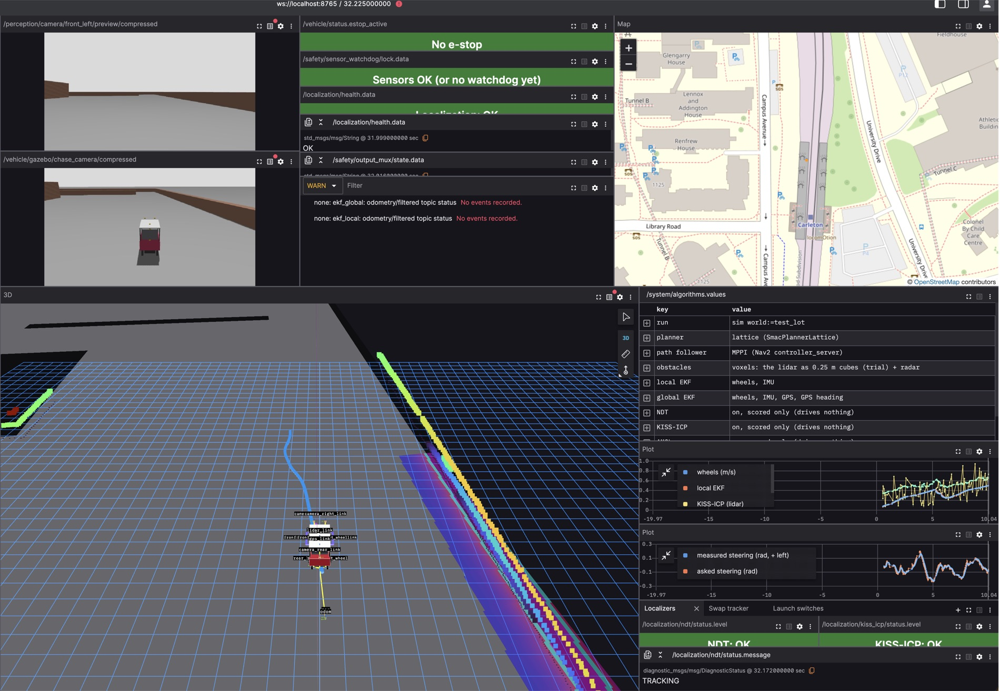

# Watch from a laptop: Foxglove and Lichtblick

Watch the car, or a simulator, from any laptop. No ROS on the laptop: one app, one
WebSocket. Built in on 24 October (Ben asked on 11 Oct; go-ahead 24 Oct).

```text
  car or simulator                                    your laptop
  ROS topics ──> foxglove_bridge (port 8765) ~~WiFi~~> Lichtblick or Foxglove
                 only the small topics                 + a layout from tools/foxglove/
```

## The two apps

| | Lichtblick | Foxglove |
|---|---|---|
| What | the open-source fork of Foxglove Studio, kept by BMW | the company's own app, newer |
| Licence | MPL-2.0: free, open source | proprietary: a free plan with an account |
| Account | none | needed |
| Get it | github.com/lichtblick-suite/lichtblick, Releases (Mac: `...-mac-universal.dmg`) | foxglove.dev/download |
| Our pick | ✅ the default (our rule: open source first, Ben, 15 Oct) | works the same way |

The bridge itself, `foxglove_bridge`, is MIT and already in our Pixi environment.

## Connect from a Mac: 3 steps

| Step | Do |
|---|---|
| 1 | Start a bridge: `pixi run sim foxglove:=true` (or `bench`, `carla-car`); on the car it runs already (the Orin's `foxglove` part) |
| 2 | In the app: **Open connection → Foxglove WebSocket**, then `ws://localhost:8765` (a simulator here) or `ws://<the Orin's IP>:8765` (the car; `pixi run bash tools/net_map.sh` finds it) |
| 3 | **Layouts → Import from file**: pick one from `tools/foxglove/` (below) |

Lichtblick's Mac app isn't notarized: the first time, right-click it in Applications →
Open → Open ([Your Mac](mac.md#watch-without-ros-lichtblick)).

## Which layout

| Layout | File | Shows |
|---|---|---|
| **Driving** | `tools/foxglove/driving.json` | 3D view following the car: its model, the lidar's scan, the local costmap, Nav2's plan and goal, the radar and its clusters, the camera's obstacles, the stop zone. The camera preview. Speed and steering, measured against commanded. E-stop, the sensor watchdog, the output gate |
| **Sensors health** | `tools/foxglove/sensors-health.json` | every `/diagnostics` status: the watchdog's per sensor with its **rate (Hz) and longest gap**; EKFs, twist_mux, the camera streams. Whether every sensor comes from the right source. A timeline of stops and e-stops |
| **Map** | `tools/foxglove/map.json` | the car on a street map: the EKF's position (blue) and the raw GPS (orange); fix or no fix; the street route's status |
| **Cockpit** (the Drive screen) | `tools/foxglove/cockpit.json` | everything for driving on one screen, and which algorithms run ([below](#cockpit)) |

!!! note "The map needs the internet"
    The map panel loads OpenStreetMap's tiles from the web. At the car with no internet,
    it shows the dots on a blank map.

## Cockpit

**The Drive screen** (Ben, 3 Nov: "the gazeboo with nav2 selection with cubes and stuff
all as a single screen and then hardware as a seperate screen. Just the stuff we
control."). Every driving detail on one screen, like Foxglove's nuScenes demo. For
Gazebo, the bench, a replayed bag, and the car (watch only).



*3 Nov, in Lichtblick, live: `pixi run sim world:=test_lot foxglove:=true voxels:=true
ndt:=true kiss_icp:=true amcl:=true`, driving to a goal 18 m ahead.*

```text
┌──────────────┬────────────┬──────────────────┐
│ front camera │ status     │ street map       │
├──────────────┤ (5 panels) │ (GPS and EKF)    │
│ chase camera │            │                  │
├──────────────┴────────────┼──────────────────┤
│                           │ ALGORITHMS table │
│  3D: the car, lidar,      │ speed plot       │
│  cubes, costmap, /map,    │ steering plot    │
│  plan, each localizer     │ tabs: Localizers │
│                           │ · Tracker · Switches │
└───────────────────────────┴──────────────────┘
```

| Panel | Shows | Topic |
|---|---|---|
| Front camera | the front left camera, small, once a second | `/perception/camera/front_left/preview/compressed` |
| Chase camera | Gazebo's picture from behind the car (sim only) | `/vehicle/gazebo/chase_camera/compressed` |
| Status | e-stop, sensor watchdog, localization health (word and text), output gate, `/diagnostics` warnings | `/vehicle/status`, `/safety/...`, `/localization/health`, `/diagnostics` |
| Map | the EKF (blue) and the raw GPS (orange) | `/localization/gps/fix`, `/sensors/gps/fix` |
| 3D | the car, lidar scan, voxel cubes, local costmap, Nav2's `/map`, plan, goal, radar, stop zone | as in Driving, plus `/perception/voxels/cubes`, `/map` |
| 3D: localizers | each one's pose: local EKF blue, global EKF green (arrows over the roof), NDT purple, AMCL orange (with their covariance); NDT's scan (purple dots: the scan where NDT puts the car) | `/localization/odom/local`, `.../global`, `/localization/ndt/pose`, `/localization/amcl/pose` |
| **Algorithms** | which planner, path follower, obstacles, EKF inputs, NDT, KISS-ICP and AMCL this run uses | `/system/algorithms` ([aav_run_info](../ros/bringup/aav_run_info/README.md)) |
| Speed plot | the wheels, the local EKF and KISS-ICP (the lidar's own speed) against the asked speed | `/vehicle/odom`, `/localization/odom/local`, `/localization/kiss_icp/odom`, `/control/cmd_vel` |
| Steering plot | asked against measured | `/vehicle/steering` |
| Tab **Localizers** | NDT and KISS-ICP: green OK, amber WARN, red LOST, grey off; NDT's state in words | `/localization/ndt/status`, `/localization/kiss_icp/status` |
| Tab **Swap tracker** | swaps the path follower live (sim) | calls `/track/set_parameters` |
| Tab **Launch switches** | `planner:=`, `ndt:=`, `voxels:=`...: each needs a restart (`pixi run pick`) | the layout's own script |

!!! note "Two layers come from scripts: not yet working"
    Lichtblick's 3D panel draws no `nav_msgs/Odometry`. Two small scripts inside the
    layout turn the EKFs' poses into arrows, and place the scan at NDT's pose. On 3 Nov
    neither showed in the app yet ([Tested](#tested)): NDT's and AMCL's own poses draw
    without them.
    NDT's own map (a PCD file) and KISS-ICP's cloud have **no topic**: only the debug
    screen shows them, as it reads the file itself.

### Where this is heading

| Screen | 0.2 (now) | 0.3 |
|---|---|---|
| **Drive** (this cockpit) | Gazebo's view, Nav2's goal, the cubes, the localizers, which algorithms run | absorbs the debug screen: NDT's map and match, the kept cubes |
| **Hardware** (the [hardware panel](hud.md#the-hardware-panel)) | every sensor, simple buttons, the steering's ends | stays separate: the lowest level, wired |
| **HUD** and **map** | in the car | stay in the car ([The car's screens](car-screens.md)) |

### Send a goal (sim, bench)

In the 3D panel: the **Publish** tool (top right), set to **Pose**, then click and drag
on the road. It sends `/goal_pose`; Nav2 plans and drives. The car's bridge is watch
only: the click does nothing there.

### Swap the tracker (sim only)

| Step | Do |
|---|---|
| 1 | Start with a tracker: `pixi run sim world:=road foxglove:=true tracker:=pure_pursuit reversing:=false` |
| 2 | In the Tracker panel, write the one you want in `string_value`: `pure_pursuit`, `stanley`, `lqr`, `mpc` or `mpc_full` |
| 3 | Press **Set the tracker**. The answer says `successful: true` |

`none` (Nav2's own MPPI) is a launch switch: with it, there is no `/track` to call. The
car refuses a swap (`live_swap` is on only in `sim.launch.py`).

### The chase camera

A camera fixed 7 m behind the car and 3.5 m up, looking down at the road ahead. Gazebo's
only, in the worlds that render sensors (road, test_lot): `chase_camera:=false` drops it.

| | Without | With |
|---|---|---|
| Gazebo's real-time factor, road world, parked | 0.985 | 0.96-0.98 |
| Gazebo's CPU | 72 % of a core | 83-88 % |

Measured 1 Nov, two runs each, the Mac busy with others' runs. Cheap, so it's **on by
default**. Its JPEG is about 20 kB a picture: **200 kB/s** in the cockpit, on 127.0.0.1.
On the car the topic doesn't exist.

!!! tip "Load the cockpit at start-up"
    Lichtblick also reads every layout in `~/.lichtblick-suite/layouts/` when it starts:
    `cp tools/foxglove/cockpit.json ~/.lichtblick-suite/layouts/`, then
    `open -a Lichtblick --args --defaultLayout=cockpit` loads the layout (seen 1 Nov). To connect, open this link: `open "lichtblick://open?ds=foxglove-websocket&ds.url=ws%3A%2F%2Flocalhost%3A8765"` (seen 1 Nov; it opens a second window, already connected).
    A layout the app already has keeps its old copy (seen 3 Nov): after a change, use
    **Layouts → Import from file**, or copy it under a new name (`drive-cockpit.json`,
    `--defaultLayout=drive-cockpit`).

## Where each bridge listens

| Started by | Listens on | A client may | Topics |
|---|---|---|---|
| `pixi run sim foxglove:=true` | 127.0.0.1 (this computer) | watch, send a goal, drive (`/drivers/keyboard/cmd_vel`), e-stop | WiFi list, plus the camera preview |
| `pixi run bench foxglove:=true` | 127.0.0.1 | the same | the same |
| `pixi run carla-car ... foxglove:=true` | 127.0.0.1: from a Mac, `ssh -L 8765:127.0.0.1:8765 <the CARLA computer>`, then `ws://localhost:8765` | the same | the same |
| the car (`foxglove` part: Orin, `all`) | every network the Orin is on | **watch only**: anyone on the car's WiFi reaches it | WiFi list |

One file does it for all of them: `ros/bringup/aav_bringup/launch/foxglove.launch.py`, with the
list in `ros/bringup/aav_bringup/config/foxglove_bridge.yaml`.

## Bandwidth: the WiFi list

The bridge sends only what a panel opens. The danger is one click on a big topic over the
car's WiFi, about 2.5 MB/s for every laptop together ([Bandwidth](bandwidth.md)). So the
list leaves these out:

| Left out | Size | Watch instead |
|---|---|---|
| raw cameras, `.../image_raw`, and their JPEGs | 93 MB/s; 4.5 MB/s | `/perception/camera/front_left/preview/compressed`: 320 px, once a second, a few kB |
| the detector's and lane finder's pictures | raw pictures | the preview (the car's has the boxes drawn on) |
| the lidar's points and packets | ~7 MB/s | `/sensors/lidar/scan`, 3 kB |
| Nav2's costmap layers one by one | 40-640 kB each | `/local_costmap/costmap`, all layers in one |

Measured, 24 Oct, in Gazebo's road world, while Nav2 drove: **all three layouts open at
once: 170 kB/s (1.4 Mbit/s)**. The costmap is the biggest part (64 kB/s), then the odometry
and the scan. On a cable, `ros2 launch aav_bringup foxglove.launch.py foxglove_topics:=all`
lets everything through.

## Check it without the app

```bash
pixi run python3 tools/layout_check.py                       # the sim here: is every topic served?
pixi run python3 tools/layout_check.py ws://192.168.1.140:8765 --data   # the car: and how much each sends
```

## Tested

| What | Result |
|---|---|
| `pixi run sim world:=road foxglove:=true`, 24 Oct, own domain | bridge on 127.0.0.1 only; 23 of 26 layout topics served, 3 off as expected (ghost, street route); the camera preview at 1 Hz, 13-16 kB/s |
| A goal sent through the bridge (as Lichtblick's 3D panel does) | Nav2 planned and the car drove 20 m |
| `pixi run bench foxglove:=true` | 22 of 26 served; the bench has no lidar unless `lidar:=true` |
| A watch-only bridge (the car's settings) | publishing refused: "Server does not support clientPublish" |
| The layouts in the Lichtblick app | the setting names were checked against Lichtblick 1.29's own code; not yet opened in the app by a person |
| The cockpit, 1 Nov, road world, `foxglove:=true tracker:=pure_pursuit voxels:=true` | `python3 tools/layout_check.py`: every topic served but the GPS route and the scan (`voxels:=true` replaces it) and `/localization/gps/fix` (early); `/track/set_parameters` advertised; the chase camera 10 Hz, 200 kB/s. Opened in Lichtblick, but the Mac was locked: **no screenshot**, and the tracker panel and the switch list are **untested in the app** |
| The Drive cockpit, 3 Nov, test lot, `voxels:=true ndt:=true kiss_icp:=true amcl:=true` (two runs) | `python3 tools/layout_check.py`: every topic served (only the street route, the ghost and the tracker service off, as asked); `/system/algorithms` right for the run. Seen live in Lichtblick: the Algorithms table, KISS-ICP's speed against the wheels', the lights **NDT: OK** and **KISS-ICP: OK**, NDT TRACKING. **Not seen**: the EKFs' arrows and NDT's scan (the two layout scripts; Lichtblick shows 6 alerts, not yet read: a person needs to open Alerts), and the frame labels still show (`transforms.showLabel` ignored) |
| The car | **untested** |
