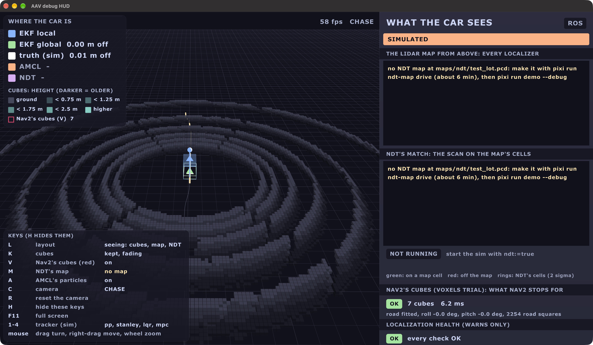
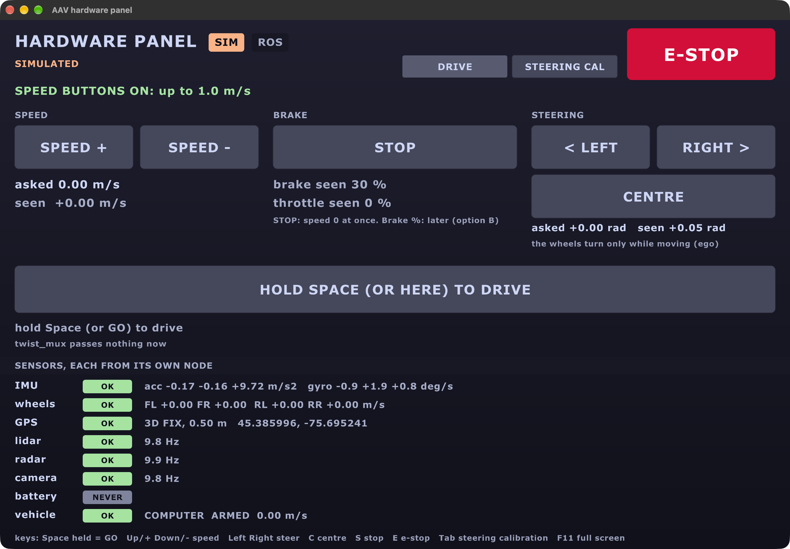

# HUD: the test records

Moved from [HUD](../hud.md) on 18 Nov (TODO 172: shorter pages), word for word: each screen's
dated "Tested" section. In page order: the HUD, the map window, its street map, its search (15 Oct each), the
debug HUD (29 Oct, 29 Oct later, 1 Nov), the hardware panel (29 Oct). Gazebo and Nav2 in
them are the simulator and navigation of that day.

### Tested (15 October, a Mac)

| What | Result |
|---|---|
| `--demo`, in a window and full screen | draws; screenshots checked |
| The node, with `ros2 topic pub` and `image_publisher` (private domain) | speed, faults, RTK FIXED, 2D FIX, STOP SIGN and the camera picture shown |
| Next to bench mode (`bench.launch.py nav:=false`, private domain) | every bench topic OK: status, GPS 3D fix, battery 100 %, the bench camera. `/perception/stop_sign` NEVER (perception is off there) |
| One press, through the real node, to another node (`cargo test`) | exactly 5 trues, no false, each "sent to 1 node" |
| Ctrl-C to `ros2 launch` | the window closes, "finished cleanly" |
| A click on the window's button | not tested: macOS blocks clicks from scripts  |
| The sensor watchdog's banner (15 Oct) | its logic: `cargo test` (hud-core `watchdog`, `state`), shared with the map window. Not seen on screen yet |
| The SIMULATED / BENCH / REPLAY banner (15 Oct) | its logic: `cargo test` (hud-core `origin`, and the message's numbers in hud-app). Not seen on screen yet: the window couldn't open from that session |
| The heartbeat, through the real node (23 Oct, `cargo test`) | none before the first frame; 15-21 beats in 2 s of drawing, each count higher; none once drawing stops, and the e-stop's 5 trues still go out |
| The heartbeat, the real window and the watchdog (23 Oct, private domain) | 9.3 beats a second; `hud NEVER` before it opened, `OK` while it ran; frozen (SIGSTOP) or closed: `hud STALE` and the lock on within about 1 s; thawed: `OK` again |
| The heartbeat in Gazebo (23 Oct, `sim-check --faults`, `hud stop`, twice) | the check beats in the window's place; when it stops, Nav2's car stands still 2.5 s later |
| The GO / STOP panel's logic (24 Oct, `cargo test`, hud-core `gate`, `state`) | every state and reason above; the output mux's lines as its own tests have them, and one from the live output mux next to the turtle (latched by a node announcing a REAL GPS: "GPS is REAL"; cleared by the service) |
| The output mux's line through the real node (24 Oct, `cargo test`, hud-app) | published by another node, it reaches the screen |
| The GO / STOP panel on screen (24 Oct) | ✅ seen: Ben ran `pixi run hud --demo --screenshot docs/img/hud-gate.png` (GO, green, "all REAL"; the picture above). STOP and AUTO STOP seen too (24 Oct, the pictures above) |
| The HUD latch (24 Oct, `aav_safety` tests) | a start-up dropout forgiven; any later one latched until cleared; a crash loop latches the second time; a stalled watchdog latches nothing |
| The HUD latch in Gazebo (24 Oct, `sim-check --faults`, `hud stop`) | stood still 2.4 s after the beats stopped: "hud LOST"; beating again, still held 5 s later; cleared, Nav2 drove again. 25 of 25 faults pass |

### Tested (15 October, a Mac)

| What | Result |
|---|---|
| `cargo test` (map-core 33, map-app 6: the grid message, the demo, the options) | all pass |
| `--demo`, with `--screenshot` | the picture above |
| Gazebo, `world:=test_lot sim_speed:=3`, headless, private domain, two Nav2 goals | the lot, the car, the plan and the goal; SIMULATED; DRIVING, the distance and the time left counting down; both goals SUCCEEDED |
| ARRIVED on screen | only in `--demo` and the unit tests: each live window closed (screenshot) before the car got there |
| The watchdog banner (15 Oct) | its logic: `cargo test` (map-core `state`, hud-core `watchdog`), and `cargo clippy`. Not seen on screen: the window couldn't open from that session |
| Clicks, the wheel, dragging | not tested: macOS blocks input from scripts |

- `/plan` isn't latched: a window opened after the navigator finished shows NO GOAL until the
  next goal.
- Near the goal, the planner may plan a loop to arrive facing the right way; the distance left
  follows the loop.

#### Tested (15 October, a Mac)

| What | Result |
|---|---|
| `cargo test` (map-core 54, map-app 8) | all pass; two tests read the real file when it's there |
| `--demo`, near and far | the pictures above |
| Gazebo, `test_lot`, headless, private domain, a Nav2 goal | the lot over the campus streets, the plan and the car; the goal SUCCEEDED |
| S, the wheel, dragging | not tested: macOS blocks input from scripts |
| On the car with a real GPS | untested |

#### Tested (15 October, a Mac)

| What | Result |
|---|---|
| `cargo test` (map-core 74 with the real file, map-app 11) | all pass |
| Gazebo `test_lot`, headless, private domain: `--send-goal "university drive"` | sent x 59.27, y 11.90 m; `bt_navigator`: "Begin navigating from current location (0.06, 0.09) to (59.27, 11.90)"; then "Goal succeeded" |
| The same, `--send-goal "carleton university"` | nothing sent: every result "Outside the map" (109 m to 700 m away) |
| Typing, clicks, Up/Down, DRIVE HERE and CONFIRM by hand | not tested: macOS blocks input from scripts. The steps are unit-tested in `destination.rs` |
| On the car's touchscreen | untested: the on-screen keyboard (16 Oct) is ready; taps by hand not tried yet |
| The on-screen keyboard (16 Oct) | `cargo test` (map-core `keyboard`: key at a point, scaling, editing, Back on é); `--demo --keyboard` screenshot above. Taps by hand: not tested (macOS blocks input from scripts) |

The sim's datum is the placeholder near Carleton, so in the simulator "University Drive" lands
inside the test lot. On the car, the datum is the real test site.

### Tested (29 October, a Mac)

| What | Result |
|---|---|
| `cargo test`: debug-core 38, debug-app 11 (with ROS: a cloud placed by the pose at its stamp, map -> odom, a swap's answer, through the real node) | all pass |
| `live_sim` against headless Gazebo, test lot, `amcl:=true tracker:=pure_pursuit`, driving a Nav2 goal | 10 scans a second, ~6,000-7,000 cubes from ~16,000-19,000 points, none cut; every panel row OK; EKF global 0.02 m, truth 0.24 m, AMCL 0.70 m from EKF local; key 3's swap to lqr accepted mid-path, which then drove 9 mm off the path |
| The window itself, `pixi run demo --debug`, the 20,000-cube drawing test | **untested** that night: the Mac's screen was locked |

### Tested (29 October, later: step 5, Ben's Mac, screen unlocked)

| What | Result |
|---|---|
| `cargo test`: debug-core 52, debug-app 14 (with ROS) | all pass |
| `--demo` window, screenshot | kept cubes fading, NDT's purple car and section, particles, the lot as NDT's map, the key legend: all drawn |
| `--demo --bench-cubes 20000`, release | **358 fps** (pass mark 30) |
| The node's window against headless Gazebo, test lot, `amcl:=true tracker:=pure_pursuit ndt:=true` (`maps/ndt/test_lot.pcd`), a Nav2 goal at (40, -4) | 58 fps; NDT TRACKING, 3.1-3.2 per point, 1.7-1.8 ms per match, overlap 100%, 0.11-0.12 m from EKF local; AMCL 0.7-1.1 m off with its particles round it; the map's 2,502 cubes sit on the walls; every panel row OK while driving |
| Kept cubes while driving | they hit `max_cubes` (20,000; 11,000 cut): mostly old ground rings |

### Tested (1 November, Ben's Mac): the costmap's cubes and localization health

| What | Result |
|---|---|
| `cargo test`: debug-core (`voxels`, `localization_health`, state, keys), debug-app with ROS (a Nav2 cube cloud placed by the pose at its stamp; a WARN health string read) | all pass |
| `--demo` window, screenshots, seeing screen and panel | red wireframes on the walls and boxes over the teal cubes; both sections drawn, OK and WARN (two checks wrapped); the panel's two new rows fit at 1600 x 900 |
| Against Gazebo with `voxels:=true` and `health:=true` | **untested** |

**Not yet seen:** NDT's LOST and WAITING on the live window (only in `--demo`); `pixi run
demo --debug` itself (RViz, the HUD and the map window as well: run here piece by piece);
the keys pressed by hand (K, M, A, H: their logic is tested, the window wasn't clicked).

### Tested (29 October, Ben's Mac)

| What | Result |
|---|---|
| `cargo test`: panel-core 30 (the buttons, the gate, safety.py's vectors, the readings), debug-core 58 (the footprint, the top-down, key L) | all pass |
| `cargo test` with ROS: panel-app 7 (the real node: no command before the first frame, 15-21 in 2 s of drawing, none once drawing stops with GO still held; the E-STOP is five trues, no false), debug-app 14 | all pass |
| `--demo` windows, screenshots (above) | the seeing screen: the lot's map from above, NDT's ellipses, the scan green on the map; the panel: SIM, buttons on, 0.3 m/s asked and seen, every sensor OK |
| Gazebo, test lot, headless, the real node and the same buttons driven by `gazebo_self_test` (Speed + three times, GO held) | twist_mux passed 0.300; the car reached **0.31-0.35 m/s** in about 2 s; let go: 0 within 1 s |
| Gazebo: the keyboard's zeros through twist_mux (a takeover) while GO is held | zeroed ("someone else drove"); the car stopped and **stayed at 0** after the keyboard let go, GO still held |
| Gazebo: `/safety/estop` true, then cleared, GO held | zeroed ("the e-stop"); **stayed at 0** after the clear |
| Gazebo: the geofence's lock true (its node stopped) | twist_mux passed nothing; the car **never moved** |
| Gazebo: the panel frozen (SIGSTOP) while driving | `/drivers/buttons/cmd_vel` went silent; the car read **0.0 m/s** 2-6 s into the freeze (161 samples). Thawed with GO still held, it drove again |

| Gazebo (`pixi run demo --debug`), **both windows on screen**, 29 Oct 22:50: `hw_panel --self-test 0.3:8` | asked 0.30, twist_mux 0.300, seen 0.30-0.35 m/s; GO let go: 0.00 about 0.5 s later. Pictures below |
| The same run, the seeing screen | NDT TRACKING, 3.3 per point, 3.3 ms a match; the lot's map, every localizer's car and the scan on NDT's cells all drawn, 58 fps |

**Not yet seen:** the keys and the mouse pressed by hand (macOS blocks scripted keys); the bench
check (a person's joystick beats the buttons); key L on the live window. Gazebo's output
mux latched STOP once at start-up (an announcement race) and opened by itself the next
runs; `pixi run clear gate` reopens it.
