# How a self-driving car works: every algorithm, explained

Ben, 19 Nov: "if I was going to teach everything about the car and all the known algos
related to building a self driving car." This page is that lesson. It goes **top to
bottom**, from the sensors to the wheels. Each algorithm gets the same short card: the
idea, how it works, a picture, good at, bad at, and where it is in our car.

Our own scores are not repeated here. They live in [The stack, surveyed](stack-survey.md):
each card below links to it.

> **The short version**
>
> - A self-driving car does six jobs, many times a second: **sense, localize, perceive,
>   plan, control, and keep safe**.
> - **Localize** = "where am I?" Blend wheels, IMU and GPS (the **EKF**), then match the
>   lidar to a saved map (**NDT**, **ICP**, **AMCL**). **SLAM** makes that map.
> - **Perceive** = "what's around me?" Find the ground, group the rest into things, name
>   them with a camera network (**RF-DETR**, **YOLO**), and follow them (**Kalman**, **SORT**).
> - **Plan** has three levels:
>   - **route**: which streets (**Dijkstra**, **A\***);
>   - **path**: a line the car can really drive (**Hybrid-A\***, the **lattice**, **RRT**);
>   - **motion**: the next few seconds (**Pure Pursuit**, **MPC**, **MPPI**, **diffusion**).
> - **Control** turns a speed and a curve into throttle, brake and steering
>   (**Ackermann**, the **bicycle model**, **PID**).
> - **Safety locks** sit under everything and are never swapped out.
> - **We stay modular** (one part per job) rather than end-to-end (one big network).

## Every algorithm on one page

| Level | The question | Algorithms on this page |
|---|---|---|
| [Sensors](#2-sensors-what-the-car-can-measure) | what can I measure? | lidar, cameras, radar, GPS and RTK, IMU, wheel encoders |
| [Localization](#3-localization-where-am-i) | where am I? | dead reckoning, Kalman filter and EKF, ICP, **NDT**, **AMCL**, SLAM, KISS-ICP and KISS-SLAM, place recognition, learned MCL |
| [Perception](#4-perception-whats-around-me) | what is around me? | ground removal, voxels, clustering, YOLO, DETR, Kalman tracking, SORT, lane finding, camera-lidar fusion |
| [Maps](#5-maps-what-the-car-remembers) | what do I remember? | occupancy grids, NDT maps, Lanelet2, costmaps, chunks, multi-drive merging |
| [Route](#61-route-planning-which-streets) | which streets? | Dijkstra, **A\***, OpenStreetMap, Valhalla |
| [Path](#62-path-planning-a-line-the-car-can-drive) | which line? | A\* on a grid, **Hybrid-A\***, state lattice, RRT and RRT\*, Dubins and Reeds-Shepp, smoothing |
| [Motion](#63-motion-planning-and-control-the-next-few-seconds) | the next few seconds? | Pure Pursuit, Stanley, PID, **MPC**, **MPPI**, **diffusion** |
| [Behaviour](#64-behaviour-the-rules-of-the-road) | what should I do now? | state machines, behaviour trees |
| [Control](#7-control-and-the-car) | how do I move the wheels? | Ackermann, bicycle model, transfer functions, feed-forward plus PID, braking with a load |
| [Safety](#8-safety-the-locks-under-everything) | what if it goes wrong? | watchdogs, e-stops, geofences, stop zones, simplex fallback |
| [End-to-end](#9-end-to-end-learning-one-big-network) | why not one network? | UniAD, world models, Tesla, Wayve |

### The status words

Every "In our car" line uses the survey's words ([how to read them](stack-survey.md#how-to-read-this-page)):

| Word | Means |
|---|---|
| **Default** | runs in `stack:=ours`, the simulator's default |
| **Car champion** | what `car.launch.py` runs today, where it differs |
| **In use** | always runs (the EKFs, ego, the safety locks) |
| **Challenger** | built, scored beside the default; swaps in when it wins |
| **Retired** | no longer runs |
| **Studied** | read, not built |

## 1. The big picture

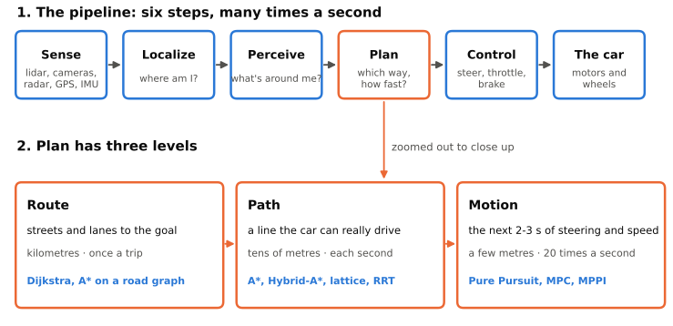

### The pipeline

1. **Sense**: the sensors measure the world and the car.
2. **Localize**: work out where the car is, to centimetres.
3. **Perceive**: find the road, the kerbs, the people and the cars.
4. **Plan**: choose a way to the goal, then the next few seconds.
5. **Control**: turn that plan into steering, throttle and brake.
6. **Safety** watches all of it, and can stop the car at any step.

### Planning's three levels

Ben, 14 Nov: "Zoomed out is routes, middle is how we get from cube to cube and finally
close up is obstical avoidance".

| Level | Size | How often | Question | Example answer |
|---|---|---|---|---|
| **Route** | kilometres | once a trip | which streets? | "University Drive, then left at the library" |
| **Path** | tens of metres | about once a second | which line, round what's parked? | a smooth curve along the right lane |
| **Motion** | a few metres | 20 times a second | which steering and speed now? | "0.12 rad left, 1.4 m/s" |

How our nodes join up: [How it fits](how-it-fits.md).

## 2. Sensors: what the car can measure

No one sensor is enough: each fails in its own way, so the car carries several.
Ours, with rates and topics: [Learn: sensors](learn-sensors.md).

| Sensor | Measures | Good at | Weakness |
|---|---|---|---|
| **Lidar** | a **point cloud**: thousands of 3D dots, by timing laser pulses | exact distances, day or night | rain, snow and dust; costly; sparse far away (our VLP-16 has 16 rings) |
| **Cameras** | pictures | colour: paint, signs, lights; cheap | no direct distance; glare, dark |
| **Radar** | points, and **each point's speed** (Doppler) | speed of other cars; works in rain and fog | few points; blurry shapes |
| **GPS / GNSS** | latitude and longitude from satellites | anywhere with sky; no map needed | 2-5 m alone; trees and buildings block it; it can drift slowly |
| **RTK GPS** | the same, corrected by a base station nearby | 1-2 cm when "fixed" | needs a corrections service; drops to float near buildings |
| **IMU** | turn rate (gyro) and acceleration | fast (hundreds a second); never blocked | drifts when integrated; bias |
| **Wheel encoders** | how far each wheel turned | smooth, exact over short distances | slip; a tyre's size changes; drifts over long ones |

More: [Learn: lidar](learn-lidar.md), [Learn: GPS](learn-gps.md) (fix types and RTK),
[How the car knows how fast it's going](learn-speed.md).

## 3. Localization: "where am I?"

Localization answers three things: **where** the car is, **which way** it faces, and
**how fast** it moves. Our frames follow REP-105: `map → odom → base_link`
([the frames](learn-localization.md#6-frames-map-odom-base_link-rep-105)).

| Kind | Example | Drifts? | Needs a map? |
|---|---|---|---|
| Counting motion | dead reckoning, KISS-ICP | yes, slowly | no |
| Pinned to the earth | GPS | no, but jumpy | no |
| Pinned to a map | NDT, ICP, AMCL | no | yes |
| Blending them | the EKF | no, if one input is pinned | no |

### 3.1 Dead reckoning (odometry)

**The idea:** count your steps. Add up how far the wheels turned and how much the IMU
says you turned.

**How it works**

1. Read the wheel speed: "1.0 m/s".
2. Read the gyro: "turning 0.1 rad/s".
3. Every tick, move the pose forward by speed × time, turned by turn rate × time.
4. Repeat. Small errors add up.

| Good at | Bad at |
|---|---|
| smooth, never jumps | drifts: in Gazebo, wheels and gyro alone drifted to 1.2 m by a tour's end |
| works anywhere, no map, no sky | wheel slip, a wrong tyre size |

**In our car:** `ekf_local` (wheels + IMU), **in use**. More: [Learn: localization](learn-localization.md#1-odometry-counting-your-steps).

### 3.2 The Kalman filter and the EKF

**The idea:** two unsure answers make one surer answer, if you weigh each by how sure it is.

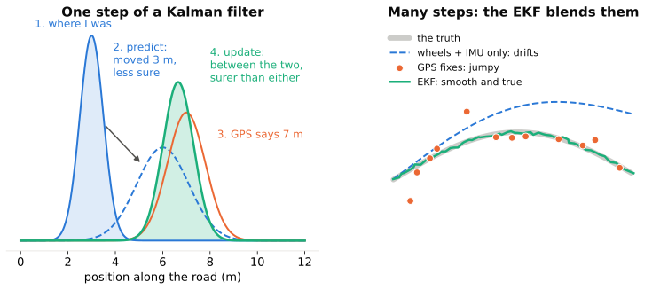

**How it works**

1. **Start** with a guess and how unsure you are (a bell curve).
2. **Predict:** move the guess by the wheels and IMU. The curve gets wider: less sure.
3. **Measure:** a GPS fix arrives, with its own bell curve.
4. **Update:** the new guess lies between the two, nearer the surer one. The curve gets
   narrower: surer than either alone.
5. Repeat for every reading. The **EKF** (extended Kalman filter) does the same for a
   car that turns, by straightening the maths a little around the current guess.

| Good at | Bad at |
|---|---|
| any sensor with a stated uncertainty | only as true as its pinned input (the GPS) |
| carries on when one sensor stops | a slow drift in the GPS goes unnoticed |
| refuses readings far off (ours: 5 sigma) | wrong uncertainties give wrong blends |

**In our car:** two EKFs (robot_localization): `ekf_local` and `ekf_global`, **in use**.


Numbers: [survey](stack-survey.md#3-localization-where-am-i). A worked example in
numbers: [Learn: localization](learn-localization.md#4-the-kalman-filter-in-one-tiny-example).

From: R. E. Kalman, 1960; T. Moore, D. Stouch, IAS-13, 2014 (robot_localization).

### 3.3 ICP: Iterative Closest Point

**The idea:** line up two point clouds by pairing each point with its nearest partner,
moving to close the gaps, and repeating.

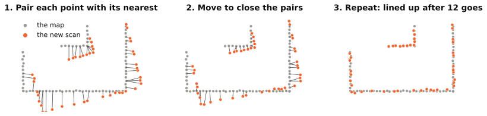

**How it works**

1. Take the new scan (orange) and the map, or the last scan (grey).
2. Pair each scan point with the **nearest** map point.
3. Find the one slide and turn that closes the pairs best.
4. Move the scan. The pairs get better.
5. Repeat until it stops moving. The total slide = how the car moved.

| Good at | Bad at |
|---|---|
| exact when it starts close | starts far off: it locks onto the wrong wall |
| simple; no map needed (scan to scan) | slower as the map grows (every point kept) |

**In our car:** inside KISS-ICP (below), and to merge two drives' maps. More: [Learn: localization](learn-localization.md#8-next-matching-the-lidar-to-a-map-ndt-and-icp).

From: P. J. Besl, N. D. McKay, "A Method for Registration of 3-D Shapes", IEEE T-PAMI, 1992.

### 3.4 NDT: the Normal Distributions Transform

Ben wrote "normilziation". The real name is **Normal Distributions Transform**: each
cube of the map keeps a **normal distribution** (a bell curve, a "blob") of its points.

**The idea:** turn the map's point cloud into **voxels** (cubes), keep one blob per cube,
then slide each new lidar scan until its points sit inside the blobs.

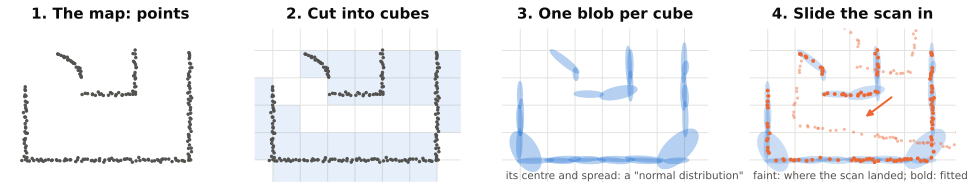

**How it works**

1. **Map once:** drive the place and keep the lidar's points.
2. **Cut into cubes** (voxels). Big cubes first, then smaller: big ones see far, small
   ones are precise.
3. **One blob per cube:** keep only the points' centre and spread (an ellipse in 2D, an
   ellipsoid in 3D). The map gets small and smooth.
4. **A new scan arrives.** The EKF's guess puts it slightly wrong.
5. **Slide and turn the scan** until its points land where the blobs are thickest. Each
   step uses the blobs' slope, so it knows which way to move.
6. The slide = the car's error. The match **score** says how good the fit is.

| Good at | Bad at |
|---|---|
| centimetres, with no RTK GPS | needs a map of every place it drives |
| **GPS dropouts**: it doesn't need the sky | **it can find the wrong place**: a confident match in the wrong spot (below) |
| fast, the same for any map size | places that change (parked cars, snow, building works) |
| its score says how good the match is | a scan that starts far off |

#### NDT's weakness: the right shape, the wrong place

Ben's point: NDT can be **sure and wrong**. If two places look alike to the lidar, a
scan fits both equally well.

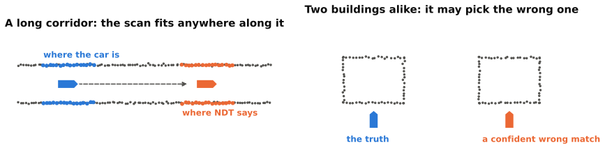

| Where | Why it slips | Our fix |
|---|---|---|
| a long corridor or a road between parallel walls | nothing tells "here" from "2 m on" | the GPS and the wheels check it; ours slipped 0.25-0.4 m along a lane (about 2 % of fits) |
| repeated buildings, rows of trees | two places look the same | start near the right place (GPS); place recognition (3.8) |
| a car parked where the map had none | the scan doesn't match the map | maps from several drives (5.6) |

**In our car:** `aav_ndt` (Rust). NDT into the EKF: **challenger**. NDT leads, the GPS
checks (TODO 210): **challenger**: it drove every GPS fault in Ravensim, 12 of 12 legs.
Numbers: [survey](stack-survey.md#3-localization-where-am-i),
[what we decided](decisions-2026-11-19.md#4-where-am-i-ndt-leads-the-gps-checks).

From: P. Biber, W. Straßer, IROS 2003; M. Magnusson, PhD thesis, Örebro, 2009.

### 3.5 AMCL: Monte Carlo localization

"Monte Carlo" means: **use many random guesses**. AMCL is Adaptive Monte Carlo Localization.

**The idea:** scatter thousands of guesses of the car's pose (**particles**) over a 2D
map, keep the ones that explain what the lidar sees, and let them gather on the truth.

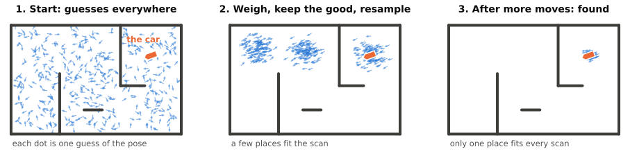

**How it works**

1. **Spread particles:** each is one guess: "I'm at x, y, facing this way".
2. **Move them all** with the wheels and IMU, plus a little random noise.
3. **Weigh them:** for each particle, imagine the scan from its pose. Does it line up
   with the map's walls? Good fit = heavy, bad fit = light.
4. **Resample:** draw a new set, picking heavy particles more often. Bad guesses die out;
   good ones get copied.
5. **Repeat.** After a few moves, only the places that fit **every** scan survive.
6. **KLD sampling** (the "adaptive" part): use many particles while lost, few once found.

| Good at | Bad at |
|---|---|
| finds the car from far off, even when lost ("kidnapped") | wide open spaces give it little to match |
| needs only a 2D map | tuning matters a lot: default settings lost the car (21 m worst) |
| holds several guesses at once | less exact than NDT |

**In our car:** `aav_amcl_rs` (our Rust port of Nav2's `nav2_amcl`), **challenger**
(`amcl:=true`): NDT's restart when it is lost. Tuned: 0.05-0.09 m a leg in Ravensim.
Numbers: [survey](stack-survey.md#3-localization-where-am-i).

From: D. Fox, W. Burgard, F. Dellaert, S. Thrun, AAAI 1999; D. Fox, IJRR 2003 (KLD);
S. Thrun, W. Burgard, D. Fox, *Probabilistic Robotics*, 2005.

### 3.6 SLAM: making the map while you drive

SLAM = **Simultaneous Localization And Mapping**. NDT and AMCL need a map; SLAM makes it.

**The idea:** chain the scans together into a map, and when you come back somewhere you
have been, use that to pull out the drift.

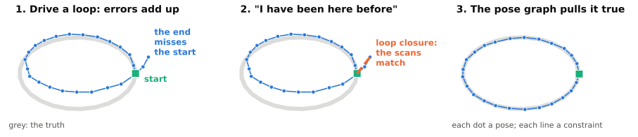

**How it works**

1. **Odometry:** line up each scan with the last few (ICP). Each pose is a dot.
2. **The pose graph:** the dots, joined by lines: "pose 7 is 1.2 m ahead of pose 6".
3. **Loop closure:** the car is back at the start. The scans match: "pose 25 is at pose 0".
   That adds one more line.
4. **Optimise:** bend every line a little, so all of them agree as well as they can. The
   drift spreads out and the loop closes.
5. **Build the map** from every scan at its corrected pose.

| Good at | Bad at |
|---|---|
| maps of real places, from our own drives | loop closure needs features (trees, kerbs); plain walls give few |
| about ten times sharper than maps from the EKF's poses | a false loop closure bends the whole map |

**In our car:** `pixi run map-drive` (KISS-SLAM, offline, on a laptop), **in use** as a
tool. In Ravensim its map was **2.3 cm** off the truth, against 27-33 cm from the EKF's
poses. See [Maps from drives](maps-from-drives.md).

### 3.7 KISS-ICP and KISS-SLAM

**The idea:** "Keep It Small and Simple": ICP done carefully, scan after scan, with few
settings to tune.

| | KISS-ICP | KISS-SLAM |
|---|---|---|
| What | lidar odometry: "how far did I move?" | KISS-ICP + loop closure + a pose graph |
| Map needed? | no | makes one |
| Drift | slow (0.04 m per 100 m on Gazebo's lot) | pulled out by loop closures |
| Ours | `kiss_ekf`, **challenger** | `map-drive`, **in use** offline |

From: I. Vizzo et al., RA-L 2023; T. Guadagnino et al., IROS 2025 (both PRBonn, MIT).

### 3.8 Place recognition: "have I been here before?"

**The idea:** turn one scan into a short **fingerprint**, so two visits to one place can
be matched quickly, even after a long drift.

1. Take a lidar scan.
2. Squash it into a small picture or vector (the fingerprint).
3. Compare it with the fingerprints of every place seen so far.
4. A close match = a loop closure for SLAM, or a restart for NDT when lost.

| Method | Fingerprint |
|---|---|
| **Scan Context** (G. Kim, A. Kim, IROS 2018) | the scan as rings and wedges round the car: the highest point in each |
| **OverlapNet** (X. Chen et al., RSS 2020) | a network that guesses how much two scans overlap |

Good at: finding the place after big drift. Bad at: places that look alike (the same
weakness as NDT). **In our car:** **studied** ([survey](stack-survey.md#studied-only-localization)).

### 3.9 Learned MCL

**The idea:** keep AMCL's particles, but let a **neural network** judge how well a scan
fits each guess.

| Idea | What | Status |
|---|---|---|
| **IR-MCL** (PRBonn, 2023) | AMCL with a network as its scan model | **studied**: no licence stated, so the idea only |
| **Transformer MCL** | a transformer helps the particle filter | **studied**: needs real maps to train on |

Our AMCL's scan model is a swappable part, so one can be tried later
([what we decided](decisions-2026-11-19.md#learned-localization-studied-not-built)).

## 4. Perception: "what's around me?"

The full story: [Perception](perception.md), [Learn: lidar](learn-lidar.md), [Kerbs](kerbs.md).

```text
 lidar points ─▶ remove the ground ─▶ cubes (voxels) ─▶ groups (clusters) ─▶ tracked things
 camera picture ─▶ detector (boxes + names) ──────────────────────▲ names them (fusion)
 camera picture ─▶ lane finder ─▶ the lane's lines
```

### 4.1 Ground removal, voxels and clustering

**The idea:** throw away the road, chop what's left into cubes, and group touching cubes
into things.

**How it works**

1. **Find the ground:** fit the road's surface near the car (it may tilt or slope).
2. **Remove it:** what is more than a few centimetres above is "something".
3. **Voxels:** cut the rest into small cubes (ours: 0.25 m) and keep which are full.
4. **Cluster:** join full cubes that touch. Each group is one thing. **DBSCAN** does the
   same for scattered points: a point with enough neighbours close by starts a group.

| Good at | Bad at |
|---|---|
| finds anything solid, trained on nothing | doesn't know **what** a thing is |
| exact distances | two things touching become one; kerbs hide near the ground |

**In our car:** `aav_voxels` (cubes), the kerb step finder (**default**), radar DBSCAN
(**in use**). Ground finding was learned from Patchwork++ (S. Lee et al., IROS 2022).
Numbers: [survey](stack-survey.md#4-perception-what-is-around-me).

### 4.2 Object detection: YOLO and DETR

**The idea:** a neural network looks at a picture and draws a box round each thing it
knows, with a name: "person, 92 %".

**How it works**

1. The picture goes into a network trained on many labelled pictures.
2. **YOLO** ("You Only Look Once"): one pass predicts boxes on a grid, then removes
   duplicates.
3. **DETR** (DEtection TRansformer): a transformer predicts a short list of boxes
   directly, with no duplicate-removal step. **RF-DETR** is a fast, small DETR.
4. Out come boxes, names and scores.

| Good at | Bad at |
|---|---|
| names things: person, car, stop sign | needs training data; misses what it never saw |
| cheap cameras | guesses distance badly from one picture |

**In our car:** RF-DETR Nano, **default**: saw the stop sign from 20 m, YOLO11n from
10 m. YOLO: **challenger**.

From: J. Redmon et al., CVPR 2016 (YOLO); N. Carion et al., ECCV 2020 (DETR); RF-DETR (Roboflow).

### 4.3 Tracking: Kalman per thing, and SORT

**The idea:** give each thing an id, and guess where it goes next, so one frame's person
is the next frame's same person.

**How it works**

1. Each tracked thing has its own small **Kalman filter**: position and speed.
2. **Predict** where each one will be in the next frame.
3. **Match** the new detections to the predictions (nearest, or the most overlap).
4. **Update** the matched ones; start new tracks; drop tracks unseen for a while.

**SORT** (Simple Online and Realtime Tracking) is exactly this, with boxes: a Kalman
filter each, matched by overlap (A. Bewley et al., ICIP 2016).

| Good at | Bad at |
|---|---|
| speeds and ids: "that person is walking left" | two people crossing can swap ids |
| simple and cheap | one motion model for everything |

**In our car:** the things tracker (`aav_things_rs`), **default**, after AB3DMOT
(X. Weng et al., IROS 2020).

### 4.4 Lane finding

**The idea:** find the painted lines in the picture and fit a curve to each.

1. **Bird's-eye warp:** stretch the picture as if seen from above.
2. **Paint mask:** keep the white and yellow pixels.
3. **Sliding windows:** climb up the picture, following each line.
4. **Fit a curve** (a polynomial) to each line's pixels.

| Good at | Bad at |
|---|---|
| no training; fast | worn paint, snow, shadows, glare |

**In our car:** `aav_lane_finder_rs`, **default**. The lane pose uses it to cut the
sideways error.

### 4.5 Camera-lidar fusion

**The idea:** the **lidar says where**, the **camera says what**.

1. Calibrate where the camera sits on the car.
2. Project each lidar thing's box into the picture.
3. Where it overlaps a detector box, give the thing that name.

Good at: exact distances with names. Bad at: needs exact calibration; one sensor late.
**In our car:** in the things tracker, after Autoware's `roi_cluster_fusion` idea,
**default**. Learned all-in-one fusion (BEVFusion): **studied**.

## 5. Maps: what the car remembers

| Map | What each piece holds | Made by | Used by |
|---|---|---|---|
| **Occupancy grid** | a square: free, full or unknown | SLAM, or drawn | AMCL, planners |
| **NDT map** | a cube's blob | SLAM from drives | NDT |
| **Lane map** (Lanelet2) | lanes, their edges, neighbours, stop lines | drawn or imported | the lane path, the lane pose |
| **Street map** | roads and names | OpenStreetMap | routes |
| **Costmap** | a square's cost, 0 to 254 | the sensors, live | the planners, MPPI |

More: [Maps and position](maps-and-position.md), [Costmaps](costmaps.md).

### 5.1 Occupancy grids

**The idea:** chop the ground into squares (our AMCL's map: 5 cm) and mark each free,
full or unknown. Each lidar beam marks the squares it passed through as free and the one
it hit as full. Good at: simple, fast to search. Bad at: flat (no height); big for big places.

### 5.2 NDT maps

The blobs of 3.4, saved. Small and smooth. Ours are built by KISS-SLAM from our own
drives ([Maps from drives](maps-from-drives.md)).

### 5.3 Lane maps: Lanelet2

**The idea:** the road as small lane pieces (**lanelets**), each with a left edge, a
right edge, the pieces it leads to, and its rules (one way, a stop line).

Good at: planning by lanes, like a driver. Bad at: someone must draw it.
**In our car:** our own Rust reader (`lanelet-map`); `path:=lane_lanelet2`, **challenger**.
From: F. Poggenhans et al., ITSC 2018.

### 5.4 Costmaps: layers and inflation

**The idea:** a grid where each square's number says **how bad it is to drive there**.

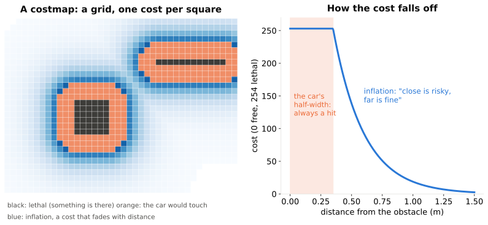

**How it works**

1. **Layers**, each drawing into the grid:
   - the **static** layer: the saved map's walls;
   - the **obstacle** layer: what the lidar sees now;
   - our extra layers: kerbs, lanes.
2. **Lethal** (254): something is there.
3. **Inscribed** (253): the car's centre here means its body touches it.
4. **Inflation:** the cost fades with distance: "close is risky, far is fine". So paths
   keep a margin.
5. The planners and MPPI add up the costs along each path and pick low ones.

| Good at | Bad at |
|---|---|
| any sensor can draw into it | a grid: a lane is only what the layers draw |
| the margin comes for free | too much inflation closes narrow gaps |

**In our car:** `aav_costmap` (Rust, from Nav2), **default**, in 64 m chunks.
Numbers: [survey](stack-survey.md#5-planning-which-way-and-how-fast).

### 5.5 Map chunks

**The idea:** keep only the map near the car in memory, in tiles (ours: 64 m), and load
the next ones as it drives. Good at: big maps on a small computer (memory 474 → 145 MB).
Bad at: a seam between tiles must match. From: Autoware's map loading idea.

### 5.6 Removing moving things across several drives

**The idea:** a parked car or a walker is in **one** drive, not in all. Keep only what
every drive saw.

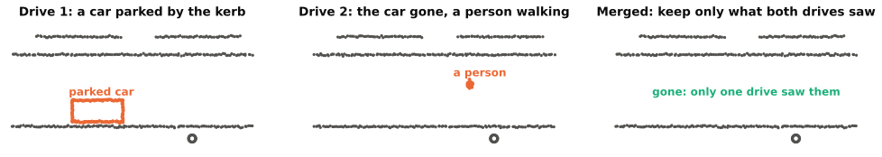

**How it works**

1. Drive the same route twice or more, on different days.
2. Build a map from each drive (SLAM).
3. Line the maps up (ICP).
4. Keep each point only if the other drive has a point near it (ours: within 25 cm).
5. A person checks the result in the map editor (TODO 251).

| Good at | Bad at |
|---|---|
| no network needed; parked cars and walkers drop out | anything only one drive saw drops out too: drive the same route |
| | a car parked in the same spot every time stays |

**In our car:** `pixi run map-drive --merge`, **in use** for two drives; more than two
is next. Learned methods (MapMOS, PRBonn): **studied**.

## 6. Planning

### 6.1 Route planning: which streets?

The road network is a **graph**: crossings are dots, roads are lines, each line has a
cost (length, or time).

#### Dijkstra and A\*

**The idea:** grow outwards from the start, always from the cheapest place found so far,
until you reach the goal. **A\*** adds a guess of the distance left, so it leans toward
the goal and looks at far fewer places.

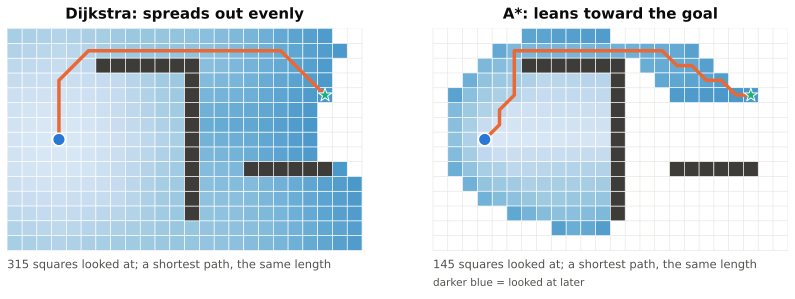

**How it works**

1. Put the start in a list, with cost 0.
2. Take the place with the lowest **score** from the list.
   - Dijkstra: score = cost so far.
   - A\*: score = cost so far + a guess of the cost left (straight-line distance).
3. Look at its neighbours. If this way to one is cheaper, note it and add it to the list.
4. Repeat until the goal comes out of the list.
5. Walk back from the goal to read the path.

| Good at | Bad at |
|---|---|
| always finds the shortest way | a grid ignores the car's turning circle |
| A\*: fast, if the guess never overestimates | big maps need many squares |

The same search works on a road graph (route), on a grid (path), and on car moves
(Hybrid-A\*, the lattice).

**In our car:** Dijkstra on the campus road graph (`aav_routes`), **in use**. From:
E. W. Dijkstra, 1959; P. Hart, N. Nilsson, B. Raphael, 1968.

#### OpenStreetMap and Valhalla

| | What |
|---|---|
| **OpenStreetMap** | the world's free street map, drawn by volunteers (ODbL) |
| **Valhalla** | a router: A\* style search on OpenStreetMap's roads, offline |

Ask "drive to Lansdowne", get waypoints every 10-30 m. Good at: real streets, offline.
Bad at: streets, not lanes. **In our car:** Valhalla, **in use**, on request
([Routes](routes.md)).

### 6.2 Path planning: a line the car can drive

A car can't turn on the spot. Our tightest turn is about **2.9 m** radius
(wheelbase 1.56 m, steering at most 0.5 rad). A path planner must respect that.

#### A\* on a grid

As in 6.1, on the costmap's squares. Good at: fast, simple. Bad at: **ignores the
turning circle**: in Gazebo, Smac 2D planned a U-turn as a straight line back.
**In our car:** Smac 2D, NavFn, Theta\*: **retired** with Nav2 on 17 Nov.

#### Hybrid-A\*

**The idea:** A\*, but each step is a **real car move** (full left, straight, full right),
so every path can be driven.

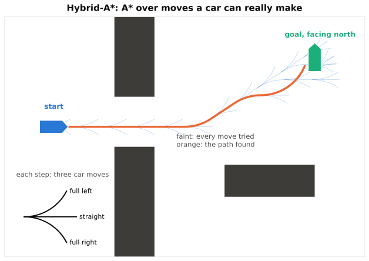

**How it works**

1. From the car's pose, try three short arcs: full left, straight, full right (and the
   same in reverse, if allowed).
2. Throw away arcs that hit something on the costmap.
3. Score each end as A\* does: cost so far + a guess of the cost left.
4. Keep one pose per small cell and heading, so it doesn't explode.
5. Near the goal, try a **Reeds-Shepp** curve straight to it (below); if it's free, done.

| Good at | Bad at |
|---|---|
| smooth paths in open space, parking lots | slower than a grid |
| reversing | knows no lanes: on roads it took the wrong side (74 % over the centre line) |

**In our car:** `path:=hybrid_rs` (ported from Nav2's Smac Hybrid), **challenger**.
From: D. Dolgov, S. Thrun, M. Montemerlo, J. Diebel, IJRR 2010.

#### State lattices

**The idea:** work out a **list of car moves** once, each ending on a grid dot and
heading, then join them with A\*.

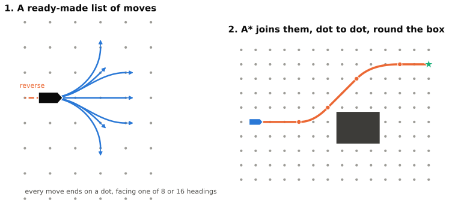

**How it works**

1. **Offline:** for each heading (ours: 16), make short moves that end exactly on a grid
   dot and heading: straight, gentle curves, sharp ones, reverse.
2. Check each is drivable: never tighter than full lock.
3. **Online:** A\* joins moves, end to start, round the costmap's obstacles.
4. A smoother rounds off the joins.

| Good at | Bad at |
|---|---|
| fast (3-5 ms a plan in ours) | only as good as its list of moves |
| every path drivable, reversing too | knows no lanes on its own |

**In our car:** `aav_planner`, `path:=lattice_rs`, **car champion**; the default joins
it to the lane's centre. Our moves: [Controllers](controllers.md).
From: M. Pivtoraiko, R. Knepper, A. Kelly, J. Field Robotics 2009.

#### RRT and RRT\*

**The idea:** grow a tree of random steps from the start until a branch reaches the goal.

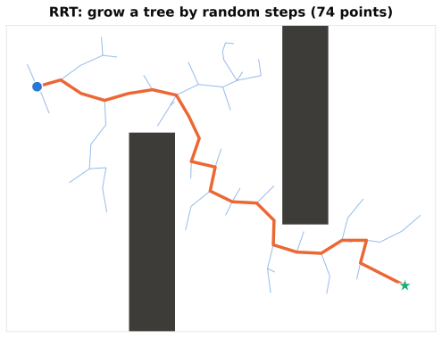

1. Pick a random spot on the map (sometimes the goal itself).
2. Find the tree's nearest point to it.
3. Step a little toward the spot. If the step is free, add it to the tree.
4. Repeat until a branch is near the goal.
5. **RRT\*** also rewires nearby branches when a shorter way appears, so the path
   improves the longer it runs.

| Good at | Bad at |
|---|---|
| big, many-dimension spaces (robot arms) | wiggly paths that need smoothing |
| no grid needed | random: a different path each time |

**In our car:** not built; on roads a lattice suits better. From: S. M. LaValle, 1998
(RRT); S. Karaman, E. Frazzoli, IJRR 2011 (RRT\*).

#### Dubins and Reeds-Shepp curves

**The idea:** the shortest way between two poses for a car with a fixed turning circle
is always a few simple pieces: **turn, straight, turn**.

| | Dubins (1957) | Reeds-Shepp (1990) |
|---|---|---|
| Moves | forward only | forward **and** reverse |
| Pieces | 3: such as left-straight-left | up to 5, with cusps (stop, change direction) |
| Used for | joining poses quickly | finishing Hybrid-A\*, parking |

```text
 Dubins:       ◯──────────◯         Reeds-Shepp:   forward ──▶ ╮
             turn  straight  turn                    reverse ◀──╯ (a cusp)
```

Good at: exact and instant. Bad at: ignore obstacles (check them after); the curvature
jumps where pieces meet. **In our car:** inside Hybrid-A\*.

#### Smoothing

**The idea:** a searched path is jagged; bend it gently, keeping clear of obstacles and
within the steering's limits.

| Way | What |
|---|---|
| move each point toward its neighbours, away from obstacles | Nav2's smoother; ours |
| **clothoids**: curvature that ramps, not jumps | our smooth lattice moves (T. Fraichard, A. Scheuer, 2004) |
| an optimisation along the lane (piecewise-jerk) | Apollo's; **studied** |

### 6.3 Motion planning and control: the next few seconds

These run 20 times a second. They take the path and decide **the steering and the speed
now**.

#### Pure Pursuit

**The idea:** pick a point on the path a little ahead, and steer the circle arc that
reaches it.

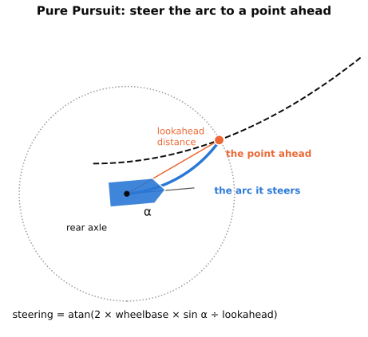

**How it works**

1. Draw a circle of radius **lookahead** (for example 2-3 m) round the rear axle.
2. Where it meets the path: the **point ahead**.
3. Measure α, the angle from the car's heading to that point.
4. Steer: δ = atan(2 × wheelbase × sin α ÷ lookahead).
5. Next tick, do it again.

| Good at | Bad at |
|---|---|
| very simple, very stable | cuts corners; a short lookahead wobbles, a long one cuts more |
| easy to explain | knows nothing of obstacles or the car's lag |

**In our car:** `aav_track`, **challenger**; **in use** in drive-to-point (A to B).
From: R. C. Coulter, CMU, 1992.

#### Stanley

**The idea:** steer by the heading error, plus a correction for the sideways error at the
front axle that is strong at low speed and gentle at high speed.

δ = heading error + atan(k × sideways error ÷ speed).

Good at: close tracking, no lookahead to tune. Bad at: noisy at very low speed; forward only.
**In our car:** `aav_track`, **challenger**. From: S. Thrun et al., J. Field Robotics 2006
(the DARPA Grand Challenge winner).

#### PID

**The idea:** push in proportion to the error (**P**), to the error that has built up
(**I**), and to how fast the error changes (**D**).

| Term | By feel |
|---|---|
| P | "I'm 0.5 m/s too slow: press harder" |
| I | "I've been slow for a while: press harder still" (beats a hill) |
| D | "I'm catching up fast: ease off" (stops overshoot) |

Good at: everywhere, cheap, no model. Bad at: no look ahead; tuning by hand.
**In our car:** the speed loop (PI), the steering motor's own PID.
[Learn: control](learn-control.md#2-pid-by-feel) teaches it with our numbers.

#### MPC: Model Predictive Control

**The idea:** with a model of the car, plan the best steering for the next few seconds,
**send only the first step**, then plan again.

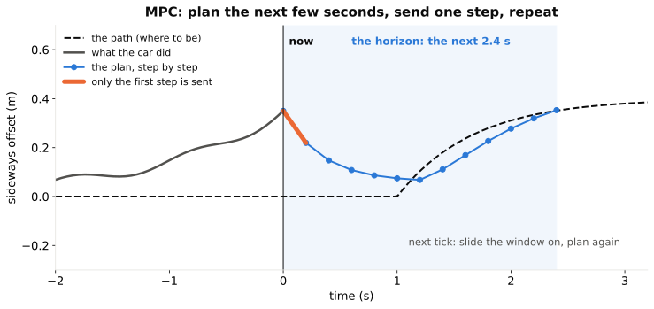

**How it works**

1. Look at where the car is, and the path for the next N steps (the **horizon**).
2. Use the car's model to predict where each choice of steering takes it.
3. Solve a small optimisation (a **QP**): stay close to the path, steer gently, respect
   the limits.
4. Send only the **first** step.
5. Next tick, slide the window on and solve again (**receding horizon**).

| Good at | Bad at |
|---|---|
| closest to the path; knows the limits and the lag | needs a good model |
| plans ahead for bends | ours sways and can't reverse yet (TODO 213) |

**In our car:** `mpc_lag_rs`, **challenger**: followed 2-7 times closer than MPPI, but
swayed more. Numbers: [survey](stack-survey.md#5-planning-which-way-and-how-fast).

#### MPPI: Model Predictive Path Integral

**The idea:** try **thousands of random futures** through a model of the car, score each,
and send the **weighted average** of the good ones.

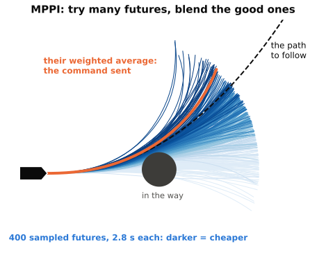

**How it works**

1. Start from last tick's plan of steering and speed.
2. Add random wobbles to it: thousands of slightly different plans (ours: 2000, 2.8 s long).
3. Run each through the car's model, lag included: a possible future.
4. **Score** each: far from the path, near obstacles on the costmap, jerky steering = costly.
5. **Weigh:** cheap futures count a lot, costly ones almost nothing.
6. The **weighted average** is the new plan. Send its first step; repeat.

| Good at | Bad at |
|---|---|
| avoids obstacles and reverses, with no special case | heavy: thousands of futures each tick |
| any cost, any model, no derivatives | many settings; random, so a little noisy |

**In our car:** `aav_mppi_lag` (ported from Nav2, with our lag model),
`steer:=mppi_lag_calm`: **default**. Every leg of every tour in the league; it predicts
the car 70 times better with the lag. Numbers:
[survey](stack-survey.md#5-planning-which-way-and-how-fast), [MPPI with lag](mppi-lag.md).
From: G. Williams, A. Aldrich, E. Theodorou, J. Guidance, Control, and Dynamics 2017.

#### The diffusion planner (learned)

**The idea:** a small network, trained on our planners' paths, **draws** paths from noise;
a guard checks every one before use.

**How it works**

1. **Train:** show it thousands of good paths (from our lattice and Hybrid-A\*) on many maps.
2. **Run:** start from random noise; the network removes the noise, step by step, into
   a path (diffusion; ours uses **flow matching**, a faster cousin).
3. Draw 16 paths at once.
4. **The guard:** each path must pass eight checks (no collision, never tighter than full lock...).
5. Use the cheapest that passes; if none, use the lattice's path.

| Good at | Bad at |
|---|---|
| quick tours (171-175 s against 180-185 s, 8 Nov) | copies its teachers: at best it equals them |
| learns what is hard to write as rules | needs a GPU on the car |

**In our car:** `planner:=diffusion`, **challenger**, a **path** planner, not a rival to
MPPI ([what we decided](decisions-2026-11-19.md#mppi-and-diffusion-are-not-rivals)).

#### Which follower, at a glance

| | Pure Pursuit | Stanley | MPC | MPPI |
|---|---|---|---|---|
| Needs a car model | no | no | yes | yes |
| Avoids obstacles itself | no | no | not ours | **yes** |
| Reverses | no (ours) | no | not yet | **yes** |
| CPU | tiny | tiny | small | big |
| Ours | challenger | challenger | challenger | **default** |

### 6.4 Behaviour: the rules of the road

**The idea:** above the planners, decide **what kind of driving** to do now: drive,
slow for a stop sign, wait for a person, go.

#### State machines

A short list of **states** and the **events** that move between them.

```text
 DRIVE ──stop sign ahead──▶ APPROACH ──stopped──▶ STOPPED ──4 s──▶ GO ──▶ DRIVE
   │                                                ▲
   └──something moving in the lane──▶ WAIT ─────────┘ (until it's gone)
```

Good at: simple, every state can be tested. Bad at: grows messy with many rules.
**In our car:** the behaviour planner (`aav_behaviour_rs`), **default**, and the
navigator, **default**. [How the car stops](stopping.md).

#### Behaviour trees

A tree of small tasks, ticked from the top: "**try** these in order until one works",
"**do** these in sequence". Good at: big behaviours from small reusable parts. Bad at:
harder to follow than a short state machine. **In our car:** Nav2's `bt_navigator`
used one; **retired** with Nav2. Our navigator is a state machine that drove the same.

## 7. Control and the car

The full story: [Learn: control](learn-control.md), [Car model](car-model.md),
[The car as a linear model](vehicle-model.md), [Learn: state space](learn-state-space.md).


### 7.1 Ackermann steering

**The idea:** in a turn, the inner front wheel turns more than the outer one, so both
roll round the same centre, on the line of the rear axle. The steering linkage does this
by itself; our software sends **one** angle. [Learn: control](learn-control.md#4-ackermann-and-the-bicycle-model)
has the picture and our numbers.

### 7.2 The bicycle model

**The idea:** merge the two front wheels into one in the middle, and the two rear wheels
likewise. Then:

```text
 turn rate  ω = v × tan(δ) ÷ L          steering  δ = atan(L × ω ÷ v)
```

v = speed, δ = steering angle, L = wheelbase (1.56 m, `vehicle.yaml`). Good at: right at
our low speeds. Bad at: no tyre slip (fine below a few m/s). **In our car:** ego
(`aav_ego_rs`), **in use**, and inside MPPI, MPC and Ravensim.

### 7.3 Transfer functions: dead time plus a lag

**The idea:** each actuator is modelled as **wait, then ease toward the command**.

```text
 command ─▶ dead time (nothing happens) ─▶ first-order lag (eases in) ─▶ what the car does
            e.g. 0.1 s                      time constant T: 63 % there after T
```

1. Send a step: "throttle to 30 %".
2. For the **dead time**, nothing happens.
3. Then the speed rises toward its new value, 63 % of the way after one **time constant**.
4. Fit both numbers to a recorded run. Every planner that knows them predicts the car better.

**In our car:** the shared car model (Python and Rust); `car-test --hallway` measures
them, with error bars. **Untested on the car**: the numbers in `vehicle.yaml` are guesses
until then ([testing plan, phase B](testing-plan.md#phase-b-the-transfer-functions-in-the-hallway)).

### 7.4 Feed-forward plus PID

**The idea:** **feed-forward** gives the push you expect to need, from the car's model
("this speed on the flat needs this much throttle"); **PID** fixes what's left.

1. Feed-forward from the model: speed wanted → throttle.
2. PI on the error: wanted speed − measured speed.
3. Add them; a negative answer becomes brake.

Good at: fast and calm, since PID only fixes the small error. Bad at: a wrong model
makes PID work harder. **In our car:** the speed loop, **default**; it overshoots 14 %
today ([survey](stack-survey.md#6-control-and-the-car)).

### 7.5 Braking with a heavier load

**The idea:** the same brake slows a heavier car less (a = F ÷ m). Measure how well the
brake works, and press harder.

1. Measure the slowing from the wheel speed.
2. Compare with what the **empty** car would do: the brake's **effectiveness**.
3. Brake harder by 1 ÷ effectiveness, never above the safe limit.
4. Remember it from stop to stop: a person aboard stays aboard.

With 150 kg aboard our 181 kg car brakes at 55 % of its empty strength. In the simulator
this cut a 0.87 m overrun to 0.21 m, then 0.05 m on the next stop.
**In our car:** the adaptive brake, a switch ([How the car stops](stopping.md#4-a-heavier-car-the-adaptive-brake)).

## 8. Safety: the locks under everything

**The idea:** no planner is trusted alone. Simple, separate checks can always stop the car.

| Lock | The idea | Ours |
|---|---|---|
| **Watchdog** | if a sensor or a command goes quiet, frozen or wild: stop | the sensor watchdog; ego's 0.3 s timeout; the firmware's 100 ms |
| **E-stop** | a person, a button or a program stops everything, at once | the joystick deadman, `/safety/estop`, the hardware stop |
| **Geofence** | a fence on the map: stop before the stopping path reaches it | `geofence`: stops every program, never a person |
| **Stop zone** | anything in the box just ahead: stop | `aav_stop_zone` (from Nav2's collision monitor) |
| **Simplex fallback** | a clever controller runs, but a simple, proven one takes over if it misbehaves | the diffusion planner's guard falls back to the lattice; the locks override every driver |

All **in use**; never swapped (`CLAUDE.md`). Layer by layer: [The safety case](safety-case.md),
[survey](stack-survey.md#7-safety-the-locks-that-are-never-swapped).

## 9. End-to-end learning: one big network

**The idea:** skip the separate parts; train one large network from **pictures to steering**,
on huge amounts of human driving.

| Idea | In general terms |
|---|---|
| **UniAD** (Y. Hu et al., CVPR 2023) | one network whose parts (perceive, predict, plan) are trained together, for the plan |
| **World models** (such as Wayve's GAIA-1) | a network that imagines the next seconds of video, to learn and test in |
| **Tesla** (FSD v12 and later) | cameras only; a network trained on its fleet's driving |
| **Wayve** | end-to-end learned driving, tested on city streets |

### Why we stay modular

| | Modular (us) | End-to-end |
|---|---|---|
| Testing | each part alone, scored the same way | the whole car at once |
| Explaining a mistake | look at the part | hard |
| Data needed | little | fleets of cars, many GPUs |
| Safety rules | written down, never swapped | learned |

Ben, 4 Nov: "we can't use end to end like tesla because we are a school project". We use
learning in parts, behind a guard (the detector, the diffusion planner).
More: [survey](stack-survey.md#two-schools).

## Where to go next

| To | Read |
|---|---|
| see our scores for each algorithm | [The stack, surveyed](stack-survey.md) |
| see how the parts join up | [How it fits](how-it-fits.md) |
| learn one area slowly | [Learn: localization](learn-localization.md), [Learn: lidar](learn-lidar.md), [Learn: control](learn-control.md), [Learn: navigation](learn-nav2.md) |
| know where each idea came from | [Acknowledgements](acknowledgements.md) |

The pictures on this page are drawn by `tools/teach_figures.py`, from small made-up
worlds: `pixi run python3 tools/teach_figures.py` rebuilds them.
