# The HUD (in-car screen)

Four raylib programs in one package, `ros/hud/aav_hud`, each also its own ROS node:

| Program | Node | Screen | Shows |
|---|---|---|---|
| [The HUD](#the-hud-in-rust-raylib) | `hud` | the small ~7" touchscreen | speed, GO / STOP, the e-stop button, the camera, the topics |
| [The map window](#the-map-window-big-screen) | `map` | the big ~15" monitor | the navigation map over Ottawa's streets, the plan, place search |
| [The debug HUD](#the-debug-hud) (the seeing screen) | `debug_hud` | a laptop | the lidar's cubes in 3D, NDT's map and match from above, where each localizer puts the car; key L: every sensor |
| [The hardware panel](#the-hardware-panel) | `hw_panel` | a wired laptop | every sensor's number, and simple buttons for the actuators (Ravensim and the bench for now); the steering calibration; the graphs of the Pi-to-ESP32 path |

**Where each runs (Ben, 5 Nov):** the HUD and the map stay raylib, on the dash Pi. The
Orin runs no graphics, so the other two run on a laptop. Laptop screens can be Bevy: the
**developer window** (`ros/hud/aav_dev_window`, `pixi run dev-window`; not a ROS package)
is one, live on the simulators since 5 Nov, and `debug_hud` retires once it covers the
same ground ([design](designs/2026-11-05_one-window.md)). It has no section on this page
yet: its README is the reference.

An easter egg hides in three of them: [the little robot](#the-little-robot-easter-egg).

**Two screens for testing (Ben, 29 Oct evening):** "one screen just to test all the
sensors and operate all the actuators and another screen to show off the voxels". The
seeing screen is `debug_hud`; the hardware screen is `hw_panel`. Design:
[2026-10-29_two-screens.md](designs/2026-10-29_two-screens.md).

**Decided 11 October (Ben):** the HUD is Rust, raylib and rclrs. Its first screen runs
since 15 October. It replaced the 2025-26 team's Flutter app (Q29), which is now
[archived](#the-flutter-app-2025-26-archived).

**Two screens (Ben, 15 Oct):** a small ~7" touchscreen is the instrument cluster (the
HUD), and a big ~15" monitor shows the map: [the map window](#the-map-window-big-screen),
a second program. Each opens full screen on its own monitor at boot:
[The two screens](car-screens.md).

## The HUD in Rust (raylib)

`ros/hud/aav_hud`: one window, which is also the ROS node `hud`.

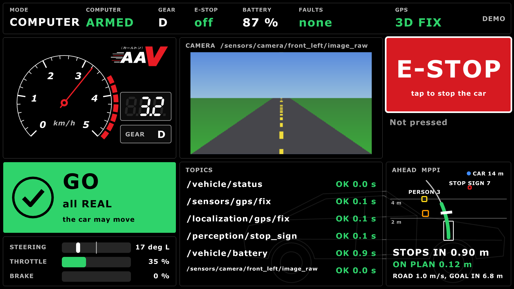

| Panel | Shows |
|---|---|
| Top strip | mode, armed, gear (D/R/P), e-stop on/off, battery, faults, the GPS fix (NO GPS, SILENT, NO FIX, 2D, 3D, DGPS, RTK FLOAT, RTK FIXED) |
| Speed | km/h, big. Grey with "OLD" when `/vehicle/status` stops |
| GO / STOP (24 Oct) | may the car move? A colour, an icon, a word, the one main reason: [below](#may-the-car-move-the-go-stop-panel) |
| Controls | steering (left of centre = left), throttle, brake: one row each |
| Camera | the picture (rgb8, bgr8, rgba8, bgra8, mono8); a STOP SIGN banner over it; a big orange **SIMULATED** / **BENCH** / **REPLAY** band along its bottom when `/system/source` says any data isn't the real car's; the sensor watchdog's banner (15 Oct): red **STOP: gps STALE (...)** while it holds navigation, amber for a warning, red **SENSOR WATCHDOG SILENT** if it stops talking (twist_mux then holds navigation for its silence) ([simulation](simulation.md#sensor-failures-on-purpose)); the boot self-test (20 Nov, [below](#ready-the-boot-self-test)) |
| E-STOP | the button: `/safety/estop` true 5 times, 0.1 s apart. Never false. Says whether anything heard it |
| (nothing on screen) | the heartbeat, `/hud/heartbeat`: below |
| Topics | every topic it listens to: OK, STALE (quiet for 1 s) or NEVER, and how long ago; a REAL / SIM / BENCH / REPLAY tag where `/system/source` names it |
| AHEAD (7 Nov) | the squiggly line: where the car will go, what the planner wants, where a full brake stops it: [below](#the-squiggly-line-ahead). Until 7 Nov this panel was the GPS's |

### The squiggly line (AHEAD)

Ben, 7 Nov, of his Tesla: "the squiggly line gets shorter when braking and longer when
accelerating and it curves to show the predictive path and what it's avoiding ... We also
want that to compare to the map and the localization information to show that we will stop
based on the model in the correct location." He chose both lines and a stop marker, on the
HUD and on the developer window.


| On screen | Means | From |
|---|---|---|
| **bold line** | where the car WILL go in the next 2 s, from the car model: shorter when braking, longer when speeding up, bent where it turns | `/ego/trace` (ego) |
| its colour | **green**: within 0.3 m of the plan. **amber**: within 0.6 m. **red**: further. White: no plan (a person drives) | `/ego/ahead` |
| thin grey line | what the planner WANTS: MPPI's own future, or the planner's plan ahead | `/ego/plan_ahead` |
| white bar across | where the **front bumper** stops if the car brakes fully now | `/ego/stop_point` |
| red bar | the first obstacle in the local costmap the bumper would meet | `/ego/ahead` |
| the box | the car, from `vehicle.yaml` (sent by `look_ahead`, never copied) | `/ego/ahead` |
| STOPS IN | how far a full brake now takes the car | `/ego/ahead` stop_m |
| ON PLAN / OFF PLAN / FAR OFF | how far the bold line strays from the grey one: "have we turned enough, slowed enough?" | gap_m |
| GOAL: SHORT / PAST, OBSTACLE, HITS | room left between the stop and the goal (along the plan), or the obstacle; HITS in red when a full brake now still reaches it | goal_m, room_m |
| ROAD 0.6 m/s, SIGN IN 12 m | with `behaviour:=true`: the road ahead's speed here and its end (the nearest stop: sign, obstacle, fence, goal). It takes the third line, unless an obstacle is within 1 m of the stop point; `ROAD: STOP` in amber at the end | road_mps, road_m, road_why |
| coloured boxes, PERSON 3 | with `things:=true`: each thing near the car, its box in its kind's colour (person yellow, car blue, stop sign red, other names green, unknown orange, grey unseen now); a named one has its name over it (TODO 192) | `/world/things`, placed with `/localization/odom/local` |
| STOP SIGN 12 m (top right) | the nearest two named things ahead past the 6 m drawing, within 30 m | the same |

The road line, on Ben's Mac (14 Nov, `pixi run hud --demo`): "ROAD 1.0 m/s, GOAL IN 3.2 m" under STOPS IN and ON PLAN:

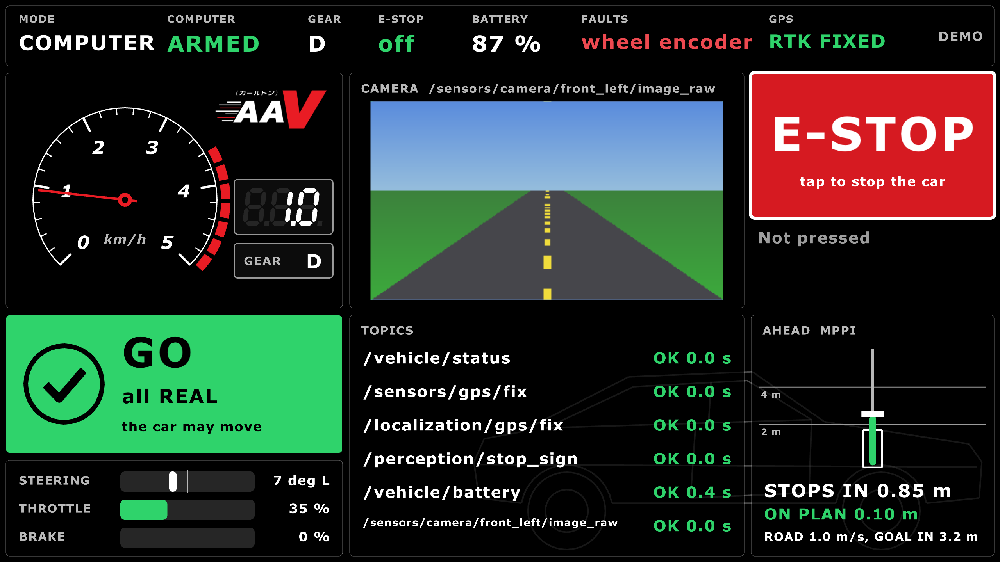

While braking for the goal, the bold line shrinks to the bar and goes green:


**Live, 8 Nov** (Ravensim, `simulator:=own world:=test_lot`, a goal (then Nav2's) at
(14, 3), which succeeded): the faint line is MPPI's own future (Nav2's then)
(`/drivers/nav/local_plan`). `/ego/ahead` said ON PLAN 0.01-0.18 m and "13.4 m short of
the goal" while it drove; here the trace runs 0.31 m off MPPI's future (amber): MPPI plans
without the lag, ego's model has it.


**One answer for every screen.** The maths lives in ROS, once; the screens only draw:

```text
ego ──▶ /ego/trace       (base_link)  the car model, 2 s ahead
    └─▶ /ego/stop_point  (base_link)  the car model, full brake now   (stop_ahead.py)
look_ahead ──▶ /ego/plan_ahead (base_link)  the plan, moved with TF, cut ahead
           └─▶ /ego/ahead      the gap, the stop, the goal, the room  (look_ahead.py)
```

All four are in base_link, so the screens need no TF. The stop-point check in `sim-check`
reads the same `/ego/stop_point`. The faint line is `/drivers/nav/local_plan` while a
follower sends one (`mppi_lag`, the default), else the planner's `/plan`.

The GPS fix moved into the top strip (GPS: 3D FIX, RTK FIXED, NO GPS, SILENT) to make room.
Its lat, lon and accuracy are on the hardware panel and the map window.

**Not yet:** stop lines (no topic says where one is); the camera picture with the line
drawn on the road (it needs the camera's calibration, Q22). Every number of the car model
is a guess until car tests 3.10-3.12 and 4.1-4.5.

### May the car move? (the GO / STOP panel)

For the safety drivers (Ben, 24 Oct: "fix the hud?"). Under the speed, the whole panel in
one colour:

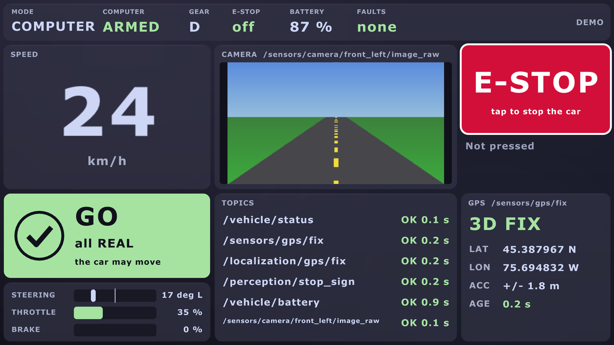

| STOP: a simulated camera on the car's network (latched) | AUTO STOP: the GPS went quiet |
|---|---|
| 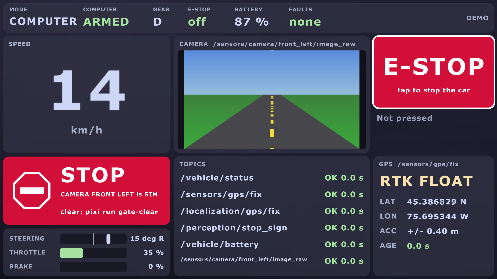 | 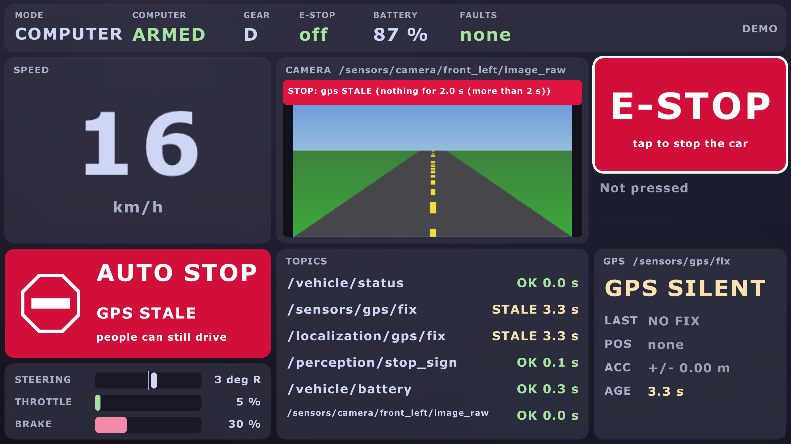 |

Taken with `pixi run hud --demo --screenshot FILE --screenshot-after 50` (STOP) and `37.5`
(AUTO STOP): the demo goes round GO, WAIT, AUTO STOP and STOP every minute.


```text
 +-------------------------------+   +-------------------------------+
 |  (tick)   GO                  |   |  (stop    STOP                |
 |           all REAL            |   |   sign)   GPS is SIM          |
 |           the car may move    |   |           clear: pixi run     |
 +-------------------------------+   |           clear gate          |
        green                        +-------------------------------+
                                            red
```

| Colour and icon | Word | Means |
|---|---|---|
| green, a tick | **GO** | the gate is open; nothing holds the drivers |
| amber, a pause sign | **WAIT** | the gate is shut for now; it opens by itself |
| red, a stop sign | **STOP** | nothing reaches the car (people's commands too), until fixed or cleared |
| red, a stop sign | **AUTO STOP** | navigation and the AI slot are held; people can still drive |
| grey, a question mark | **NO GATE** | no output mux heard: nothing reaches the car |

The one main reason, the first that applies:

| # | Who says no | Reason on screen | Small line |
|---|---|---|---|
| 1 | the car's e-stop (`/vehicle/status`) | E-STOP ON | clear: pixi run clear estop |
| 2 | the output mux, latched ([sources and targets](sources-and-targets.md)) | GPS is SIM, 2 sources: IMU, sensor mux wants SIM... | clear: pixi run clear gate |
| 3 | the output mux, silent 2 s | gate silent | nothing reaches the car |
| 4 | the sensor watchdog, silent | watchdog silent | people can still drive |
| 5 | the sensor watchdog's lock: its first input that stops | GPS STALE, HUD LOST, WHEELS DISAGREE... | people can still drive; latched ones: clear: pixi run clear watchdog |
| 6 | the output mux, waiting | settling, sensor mux quiet, unsure: GPS... | opens by itself |
| 7 | nothing heard from the output mux | no output mux heard | nothing reaches the car |
| - | none of these | all REAL (or all SIM, in a simulator) | the car may move |

- The logic: `hud-core` `gate` (no ROS), with tests. It reads the two one-line states,
  `/safety/output_mux/state` and `/safety/sensor_watchdog/state`. A line it doesn't
  know shows as it is, never as GO.
- The camera's red watchdog banner stays: it has every input's detail.
- `--demo` walks through GO, WAIT, AUTO STOP (the GPS silent) and STOP (a SIM camera).

### Run it

```bash
pixi run hud --demo                  # pretend data: no ROS, no car, any Mac
pixi run build && pixi run hud     # the real node (ros2 launch aav_hud hud.launch.py)
pixi run hud fullscreen:=true      # full screen; F11 switches too
pixi run hud fullscreen:=true monitor:=HDMI-2   # on that monitor, by name or number
```

Without Pixi: `cargo run -p hud-app --no-default-features -- --demo`, in
`ros/hud/aav_hud`. The first build compiles raylib (cmake, about a minute).

### How it's built

| Part | What it does |
|---|---|
| `crates/hud-core` | the logic, no ROS, no raylib: state, GPS kinds, OK/STALE/NEVER, the e-stop burst. `cargo test -p hud-core` (in `tools/test.sh`) |
| `crates/hud-app` | the window (raylib, main thread) and the node (rclrs, its own thread, news over a channel). `--demo` swaps the node for pretend data |
| `config/hud.yaml` | every topic name, the only place they're written. Rename one there, or `--ros-args -p gps_topic:=/x` |

- The GPS panel reads `/sensors/gps/fix`, the receiver itself, not `/localization/gps/fix`: it answers
  "does the GPS work?". navsat_transform marks every `/localization/gps/fix` message as RTK.
- NavSatFix can't tell RTK float from fixed. The HUD calls it fixed at 5 cm or better.
- Not in `car.launch.py`: on the car it starts at login by itself
  ([The two screens](car-screens.md)). On Linux without X11's headers, colcon skips it
  with a warning.
- `--monitor NAME|N` picks the monitor (its name exactly, or its number);
  `--list-monitors` prints them. A missing monitor is an error, never a guess.

### The heartbeat

The safety drivers rely on this screen, so the sensor watchdog must know it's alive
(23 Oct, PLAN T9.8).

```text
 window draws a frame --> count + 1
 every 10 ms, the e-stop's timer (ROS thread):
     0.1 s since the last beat, and the count rose?  --> /hud/heartbeat = count (10 Hz)
 sensor_watchdog, input hud:  quiet 1 s, or the count stuck 1 s  --> STOP: nav and the AI slot
```

| What fails | What happens |
|---|---|
| The window freezes | the count stops rising: no more beats |
| The ROS thread freezes | the timer stops: no beats, and no e-stop either. The watchdog stops navigation |
| The program dies | no beats. systemd restarts it in 5 s; navigation stays held (**latched**, below) |
| The HUD never started | the watchdog says `hud NEVER`: navigation never drives |

**Latched (Ben, 24 Oct: a HUD that keeps crashing holds Nav2 until a person clears it):**

```text
 first beat ──► 5 s grace ──────────────► running
   one dropout in the grace: forgiven      any dropout: hud LOST, latched
   (held only while it lasts)              (held even once it beats again)

 a person checks the screen ──► pixi run clear watchdog ──► nav may drive
```

| Case | What happens |
|---|---|
| A slow first frame, within 5 s of the first beat | held while it lasts, then drives by itself (once) |
| A crash, a freeze or a closed window after that | `hud LOST`: held, even once systemd restarts it |
| A HUD that keeps crashing while it starts | the second dropout latches |
| `pixi run clear watchdog` | navigation drives again, if the HUD beats; the grace starts again |
| The watchdog itself stalled (a busy computer) | not the HUD's fault: nothing latches |

The rule is `latch: true` on the `hud` input (`sensor_watchdog.yaml`, `latch_grace: 5.0`),
in `aav_safety` `watchdog.py`, with tests. The HUD shows it: **AUTO STOP, HUD LOST**.

| Profile | Watched? |
|---|---|
| Car | yes: `car.launch.py watch_hud:=true`, the default. `watch_hud:=false` for a session with no HUD screen |
| Ravensim | with `hud:=true` (the window), or `watch_hud:=true` (something else beats) |
| Bench, turtle, CARLA | no: no HUD window there |

- People, the joystick and the e-stop are never held by it: only navigation and the AI slot.
- The e-stop button doesn't depend on it. It's the same timer, so a beat also proves the
  e-stop's sender runs.
- The logic: `hud-core` `heartbeat` (no ROS). The watchdog's side: `kind: heartbeat` in
  `aav_safety`'s `sensor_watchdog.yaml`.

### Tested (15 October, a Mac)

Moved to [the hud log](history/hud-log.md#tested-15-october-a-mac) on 18 Nov (a dated record).

### What it shows with each backend

The HUD reads topics, so it works next to anything that publishes them. Start the backend,
then `pixi run hud` in another terminal (the same `ROS_DOMAIN_ID`).
In Ravensim, one command does both: `pixi run sim world:=test_lot hud:=true`.

| HUD panel | Turtle (`pixi run turtle`) | Sim (`pixi run sim world:=road`; Ravensim, Gazebo until 16 Nov) | Bench (`pixi run bench`) | Car |
|---|---|---|---|---|
| Speed, steering, mode, armed | ✅ from the turtle's motion (15 Oct) | ✅ 50 Hz, from the simulated wheels | ✅ | the backend's `/vehicle/status` |
| GPS panel | NEVER: no GPS | ✅ 3D fix, about 5 Hz | ✅ | the ZED-F9R, once it runs |
| Camera | NEVER: no camera | ✅ road world, about 9 Hz | ✅ the drawn road | the camera Pis |
| Stop sign | NEVER | with `perception:=true` (`pixi run -e ml sim ...`) | with `--perception` | YOLO |
| Battery | NEVER | NEVER: not simulated | ✅ | the battery monitor |
| Orange banner (`/system/source`, 15 Oct) | SIMULATED | SIMULATED | BENCH | none: `spine_bridge` and `legacy_uart_bridge` say REAL |

Checked on 15 Oct by listening to each topic while the backend drove a scripted goal
(the window itself couldn't open from that session). NEVER on a panel is the honest answer:
nothing publishes that topic there.


## READY: the boot self-test

The car's boot self-test (`aav_self_test_rs`, TODO 255) says whether everything that keeps
the car safe is here. `spine_bridge` won't arm until it says READY. The HUD shows it on
the camera panel, under the watchdog's banner (`self_test_topic`, `/safety/self_test/status`).

| The self-test says | The HUD shows |
|---|---|
| nothing, ever (Ravensim, the bench) | nothing |
| level OK | **READY**: a small green tag, top right |
| any other level | a red banner: **NOT READY: sensors (STOP: gps STALE ...)** |
| nothing for 2 s, after speaking | a red banner: **SELF-TEST SILENT** |

The logic: `hud-core` `self_test` (no ROS). `--demo` pretends NOT READY for 6 s, then READY.
Seen only in code and tests so far: untested on a real screen.

## The map window (big screen)

`ros/hud/aav_hud`, binary `map`: its own window, which is also the ROS node `map`.
Step 1 (15 October): what navigation already knows, drawn north up. Step 2 (15 October): an
offline street map of Ottawa under it ([below](#the-street-map-under-it)). Step 3
(15 October): [search for a place](#search-for-a-place-and-drive-there) and send it to
navigation.

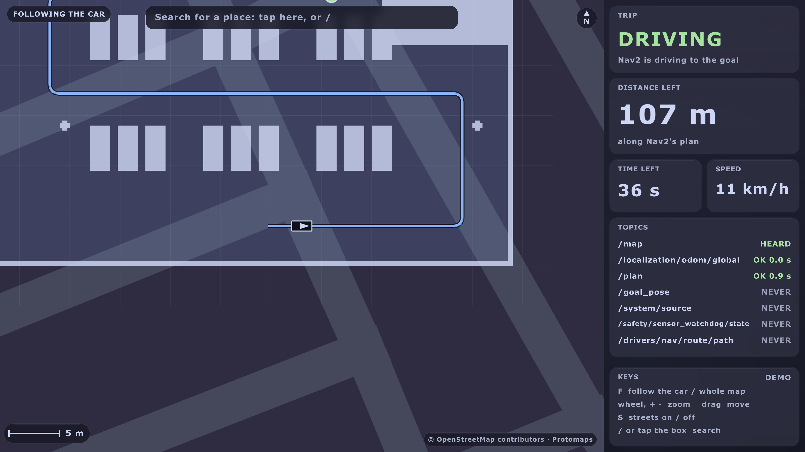

| On screen | From |
|---|---|
| The map: free light, occupied dark, unknown grey; grid lines every round number of metres | `/map` (latched) |
| The car: its outline to scale (`vehicle.yaml`), with an arrow; grey when its position is old | `/localization/odom/global` (map frame) |
| The plan: a blue line | `/plan` |
| The goal: a green dot | the plan's last point; RViz's `/goal_pose` until the planner plans for it |
| TRIP | NO GOAL, DRIVING, ARRIVED (within 1 m), WAITING FOR A PLAN, NO NEW PLAN (the navigator stopped replanning: cancelled or failed), NO POSITION |
| DISTANCE LEFT | along the plan, from the point nearest the car |
| TIME LEFT, SPEED | distance / speed; km/h from the odometry |
| TOPICS | each topic: OK, STALE or NEVER |
| Orange band | SIMULATED / BENCH / REPLAY, as on the HUD (`/system/source`) |
| Watchdog banner (15 Oct) | across the bottom of the map: the sensor watchdog's verdict, as on the HUD: red **STOP: ...** while it holds navigation, or **SENSOR WATCHDOG SILENT**; amber for a warning (`/safety/sensor_watchdog/state`) |
| Scale bar, N | bottom left; north is always up |

### Keys

| Key | Does |
|---|---|
| / | search for a place ([below](#search-for-a-place-and-drive-there)) |
| F | follow the car (the start: 60 m across) / the whole map (`--whole-map` starts there) |
| S | the street map on / off |
| mouse wheel, + and - | zoom |
| drag | move the map (a free view; F goes back to the car) |
| D | the [debug page](#the-debug-page-who-is-driving) over the map, and back |
| F11 | full screen |

### The debug page (who is driving)

Our professor's idea (TODO 247): the map screen doubles as a debug screen, like the
hardware panel. **Press D.** The map goes behind frosted glass and two columns of cards
show who drives the car and what may stop it. Press D again for the map.

```text
 THE COMMAND, STEP BY STEP          WHAT MAY STOP IT
 ┌ WHO DRIVES   NAVIGATOR (AI) ┐    ┌ LOCKS    NONE         ┐
 ▼ IT ASKS      0.80 m/s       │    ├ SENSORS  OK           │
 ▼ EGO SENDS    0.80 m/s       │    └ DATA     SIMULATED    ┘
 ▼ GATE         OPEN           │
 └ THE CAR DID  0.78 m/s       ┘
```

| Card | Says | From |
|---|---|---|
| WHO DRIVES | JOYSTICK, RC REMOTE, KEYBOARD, PANEL BUTTONS (a person); ACTUATOR TEST, SCRIPT, REPLAY, DRIVE TO POINT, NAVIGATOR (AI), AI SLOT (a program); NOBODY. The navigator's line names its path follower (`mppi_lag`...) | `/control/command_mux/state` ([`aav_mux_state`](../ros/command_mux/aav_mux_state/README.md)); `/system/algorithms` |
| IT ASKS | its speed (m/s) and turn (rad/s, left or right) | `/control/cmd_vel` |
| EGO SENDS | speed, steering angle, braking or speeding up | `/ego/actuator_cmd` |
| GATE | OPEN, WAIT or STOP, and why | `/safety/output_mux/state` |
| THE CAR DID | its speed; steering, throttle %, brake %, mode; E-STOP or FAULT | `/vehicle/status` |
| LOCKS | NONE, or each lock on (E-STOP, SENSORS, GEOFENCE, STOP SIGN...) and whom it holds | `/control/command_mux/state` |
| SENSORS | OK, WARN, or STOP and the sensor | `/safety/sensor_watchdog/state` |
| DATA | REAL, or SIMULATED / BENCH / REPLAY | `/system/source` |

Each card has one colour, on its big word and down its left edge:

| Colour | Means |
|---|---|
| green | all is well |
| amber | held, waiting, or not real |
| red | stopped, silent, a fault, the e-stop |
| grey | nothing to say: nobody sending, never heard |

**Who is driving** is new: twist_mux passes on one driver but never says which.
`command_mux_state` reads twist_mux's own files and applies its rule beside it
([its README](../ros/command_mux/aav_mux_state/README.md)). The developer window shows
the same line in its status strip: **DRIVING: keyboard (90)**.

| Run it | |
|---|---|
| `pixi run map --demo --debug-page` | pretend data, a 30 s loop: the navigator, a person on the keyboard, the sensors lock holding the navigator, the navigator again |
| `pixi run sim map:=true`, then D | live, beside Ravensim |

### Run it

```bash
pixi run map --demo                          # pretend data: no ROS, no car
pixi run build && pixi run map             # the real node (ros2 launch aav_hud map.launch.py)
pixi run sim world:=test_lot map:=true     # the simulator, our stack and the map window together
pixi run map fullscreen:=true monitor:=HDMI-1   # full screen on that monitor
```

### How it's built

| Part | What it does |
|---|---|
| `crates/map-core` | the maths, no ROS, no raylib: map to screen and back, zoom, the grid's pixels, the nearest point and the distance left, the trip's status, the debug page's cards (`debug`). `cargo test -p map-core` (in `tools/test.sh`) |
| `crates/map-app` | the window and the node, built like the HUD's. `--demo`, `--screenshot FILE`, `--vehicle FILE` |
| `config/map.yaml` | every topic name, the limits: `stale_after`, `plan_stale_after` (3 s; 25 s, `plan_kept_for`, within `final_approach` 8 m of the plan's end, where the navigator keeps its path), `arrive_within` (1 m), and `street_map`, the street map's file |

- The distance comes from `/plan` and the car, not from the navigator's action feedback: simpler,
  and it works for a goal sent from anywhere.
- The car's size: `vehicle.yaml`, built in, and the installed one at launch (`--vehicle`).

### Tested (15 October, a Mac)

Moved to [the hud log](history/hud-log.md#tested-15-october-a-mac-1) on 18 Nov (a dated record).

### The street map under it

OpenStreetMap's streets, water, parks and buildings, drawn under the navigation map, so the car
and its path sit on real streets. It works with no internet: the map is a file.

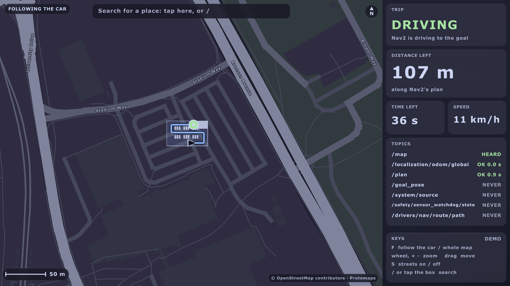

| Get it, once | |
|---|---|
| `pixi run get street-map` | 40 MB into `maps/streets/ottawa.pmtiles` (git ignores `maps/`) |
| What it is | Ottawa, lon -76.0 to -75.4, lat 45.2 to 45.55, zoom 0 to 15: vector tiles |
| From | [Protomaps](https://docs.protomaps.com/basemaps/downloads)' world basemap, build 20260811 (OpenStreetMap of 11 Aug 2026) |
| How | go-pmtiles' `pmtiles extract`: only the tiles in the box, never the 139 GB file |
| Checked | the tool and the file, each against a pinned SHA-256 |
| Newer streets | `STREET_MAP_BUILD=latest pixi run get street-map` (delete the old file first; no checksum then) |

No file: the window still runs, and says **No street map: pixi run get street-map**.

#### Licence and credit

| Part | Licence | Asks for |
|---|---|---|
| The map data | OpenStreetMap, [ODbL](https://www.openstreetmap.org/copyright) | "© OpenStreetMap contributors" wherever it's shown |
| The tiles (Protomaps basemap) | data ODbL, code BSD-3-Clause | nothing more; we credit "Protomaps" too |
| go-pmtiles (the download tool) | BSD-3-Clause | |
| mvt-reader, earcut, flate2 (Rust) | MIT, MIT or Apache-2.0 | |

The window writes **© OpenStreetMap contributors · Protomaps** bottom right whenever the
streets show. Don't remove it.

#### Why this way

| Choice | Instead of | Why |
|---|---|---|
| A Protomaps extract (vector) | downloading tile.openstreetmap.org's pictures | their [tile policy](https://operations.osmfoundation.org/policies/tiles/) forbids bulk and offline downloads |
| Vector tiles, drawn by us | ready-made pictures | our own dark colours, sharp at any zoom, 40 MB for the whole city |
| Our own PMTiles reader (150 lines) | the `pmtiles` crate | it reads only through tokio (async); `pmtiles2` brings brotli and zstd |
| The datum from `navsat.yaml` | a second copy in `map.yaml` | one place: the window uses what navsat_transform uses (`--navsat`, from the launch file) |

#### Where the streets go

navsat_transform puts map (0, 0) at its datum (`aav_localization/config/navsat.yaml`), x
east, y north. map-core's `earth` does the same sums: UTM in the datum's zone, less the
datum, turned by the meridian convergence (-0.495 degrees at Carleton).

| Check (15 Oct) | Result |
|---|---|
| UTM against GeographicLib (`GeoConvert`) | within 1 mm (unit test) |
| Carleton (45.3835, -75.6974) on the map | ours (-109.607, -277.746) m; navsat_transform's `/fromLL` in the sim (-109.607, -277.746) |
| Parliament Hill (4 km north) | ours (-93.875, 3944.025) m; `/fromLL` the same to 1 mm |
| Without the convergence turn | 34 m off at Parliament Hill: why it's there |

The sim's datum is the placeholder near Carleton, so in the simulator the test lot sits on
campus streets that aren't really there: the streets only match the world on the car.

#### How it draws

| Part | Where |
|---|---|
| Lat/lon to map metres and back | `map-core/src/earth.rs` |
| Which tiles, which zoom | `map-core/src/tiles.rs` |
| Reading the file | `map-core/src/pmtiles.rs` |
| One tile to triangles and lines | `map-core/src/streets.rs` (mvt-reader, earcut) |
| What to keep, load, forget | `map-core/src/tilecache.rs` (160 tiles; a parent tile stands in while one loads) |
| The loader thread, the colours, the names | `map-app/src/streets.rs` (rlgl: one batch per colour) |

- Order: streets, then the navigation map see-through (unknown clear, free a faint blue,
  occupied near-white), then the plan, the goal and the car.
- Roads by class: paths and service roads dim, residential grey, major roads (Bronson,
  Colonel By) brighter and wider, highways (the 417) amber. Zoomed in, roads are their
  real width.
- Street names from about 1.5 km across the window, along the street.
- `--zoom 0.12` starts zoomed out (about 10 km across); the wheel goes out to 50 m a
  pixel.


#### Tested (15 October, a Mac)

Moved to [the hud log](history/hud-log.md#tested-15-october-a-mac-2) on 18 Nov (a dated record).

### Search for a place, and drive there

Type a name or an address, pick a result, and send it to the navigator as the goal. Two presses
(DRIVE HERE, then CONFIRM), so a stray tap never moves the car.

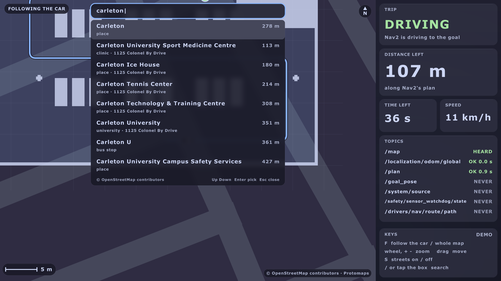

| Key | Does |
|---|---|
| `/` or a click on the box | open the search box (a tap or click also opens the [on-screen keyboard](#the-on-screen-keyboard-touchscreen)) |
| letters, Backspace | type (the map's own keys, F S + -, are letters while typing) |
| Up, Down, Enter, or a click | pick a result: the map centres on it, with a magenta pin |
| Enter, or a click | **DRIVE HERE**, then **CONFIRM: send goal** |
| Esc | back one step: CONFIRM to the place, the place to the list, the list closed |

#### The on-screen keyboard (touchscreen)

The car's screen has no keyboard. **Tap the search box**: a keyboard opens along the
bottom. A mouse click counts as a tap, so it works the same on a Mac.

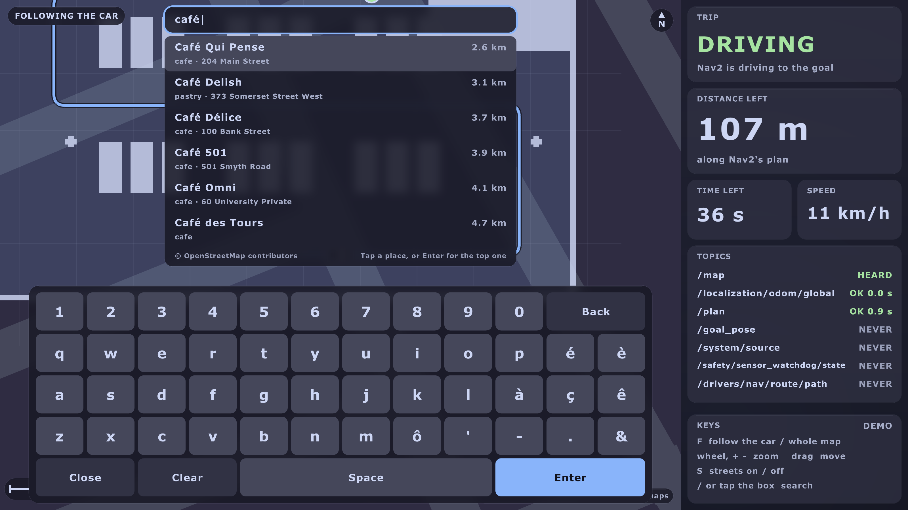

| Key | Does |
|---|---|
| letters, digits, `' - . &` | type (lower case: the search ignores case) |
| é è à ç ê ô | the accents in Ottawa's French names |
| Space | a space |
| Back | remove the last letter (a whole letter, even é) |
| Clear | empty the box |
| Enter | pick the top result (the map centres on it, then DRIVE HERE) |
| Close | hide the keyboard; the results stay, tap one |

| | |
|---|---|
| Key size | 84 px at 1600 x 900, grows with the window, never under 60 px |
| Results | only the rows that fit above the keyboard |
| A real keyboard | works as before; `/` opens the box without the on-screen keyboard |
| Code | `map-core/src/keyboard.rs` (the keys, which one a tap hit: unit-tested), `map-app/src/ui.rs` (drawing) |
| Screenshot | `--keyboard` opens it at the start |


| | |
|---|---|
| Message | `geometry_msgs/PoseStamped` on `/goal_pose` (`goal_topic` in `config/map.yaml`), as RViz's "2D Goal Pose": `bt_navigator` starts a navigate_to_pose |
| Frame | the map frame (`map`), from the place's lat/lon by the same sums as navsat_transform (`earth.rs`) |
| Facing | from the car toward the place |
| Refused | outside the navigation map (`/map`) (**Outside the map: 3.8 km away**, from its edge), no `/map` yet, or no car position |
| `--demo` | no ROS: the goal shows, and the pretend car stops |

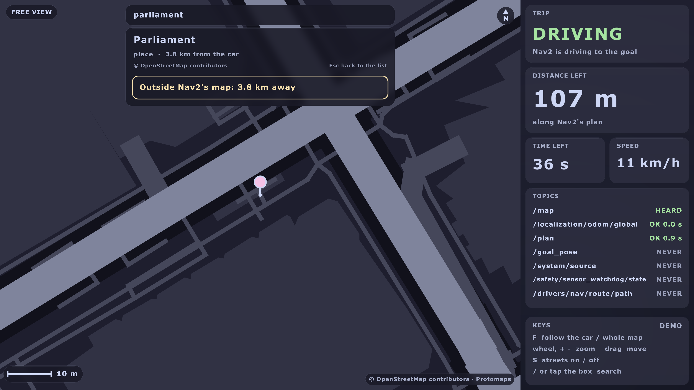

On the car, the navigation map is only the test site, so most of Ottawa is "outside" until a
bigger map (or GPS waypoints over a road map) exists. That's the right answer, not
a bug.

#### How the search works

| | |
|---|---|
| File | `maps/places/ottawa.db` (`places` in `config/map.yaml`, or `--places FILE`): `pixi run get places` |
| Opened | read-only |
| Matches | a name that starts with the words (any case), an address ("580 rideau"), then names with the words inside |
| Left out | street lamps, benches, crossings, footways, service roads, link roads... (a deny-list, `NOT_DESTINATIONS` in `places.rs`: over 300 types, so a new one should show up) |
| Ranked | exact name, then starts with, then a word starts with, then inside; nearest first in each; a street's many pieces count once |
| Shows | at most 8 |
| Speed (a Mac, release build) | 0.3 to 19 ms on the real file |
| Credit | "© OpenStreetMap contributors" under the results and the place (ODbL) |
| Code | `map-core/src/places.rs` (search), `destination.rs` (the steps, the goal check), `map-app/src/search.rs` (keys, sending) |
| Library | `rusqlite` with SQLite built in (MIT; SQLite is public domain) |

Try a search from a terminal: `cargo run --release -p map-core --example search -- tim hortons`
(in `ros/hud/aav_hud`, with `PLACES=` the file's path).

#### For tests and screenshots

| Option | Does |
|---|---|
| `--search TEXT` | starts with TEXT typed |
| `--pick N` | with `--search`: picks result N |
| `--keyboard` | opens the box with the on-screen keyboard showing |
| `--send-goal TEXT` | once `/map` and the car are known: sends the first result inside the navigation map, and says so on the terminal |
| `--debug-page` | starts on the [debug page](#the-debug-page-who-is-driving) (D switches) |

#### Tested (15 October, a Mac)

Moved to [the hud log](history/hud-log.md#tested-15-october-a-mac-3) on 18 Nov (a dated record).

## Themes: the screens' colours

All four screens share one set of colours, a **theme**: the HUD, the map window, the
debug screen and the hardware panel.

| Date | What changed |
|---|---|
| 1 Nov | Ben found the old look "kind of ugly": too many bright primary colours. Soft Catppuccin colours, **frosted glass** panels |
| 2 Nov | "Something nicer than Catppuccin": Ben chose **Initial D red and black**, on every screen. Now the default |

| | Before | Mocha (1 Nov) | **Initial D (2 Nov, the default)** |
|---|---|---|---|
| HUD | 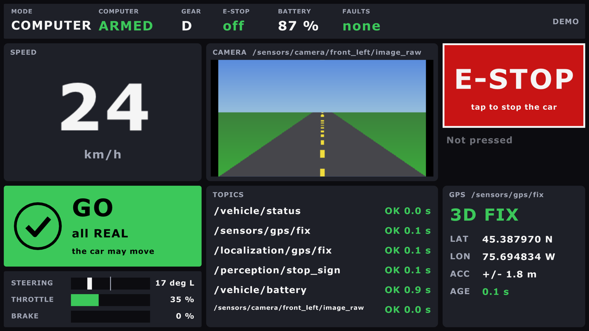 |  |  |
| Map | 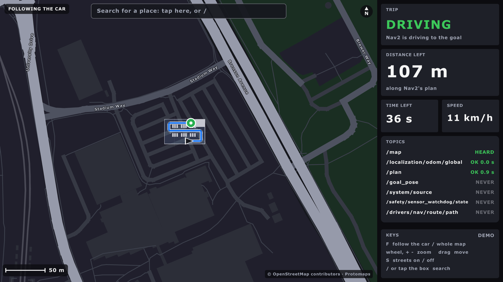 |  | 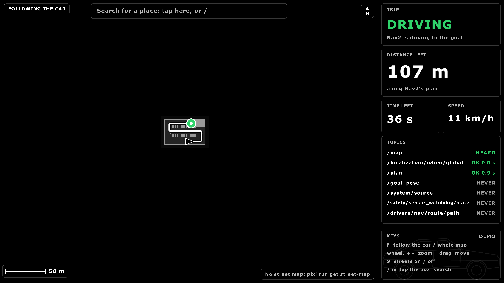 |
| Debug screen | 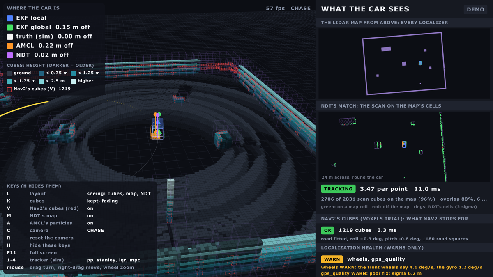 | 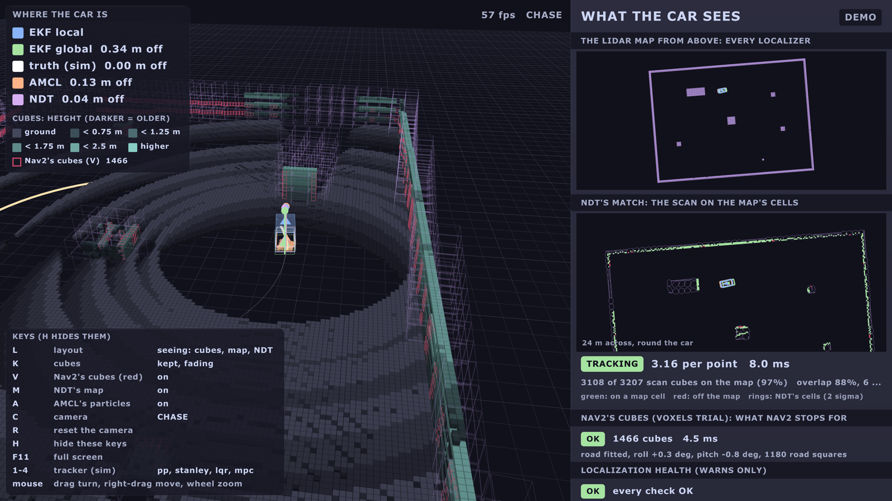 | 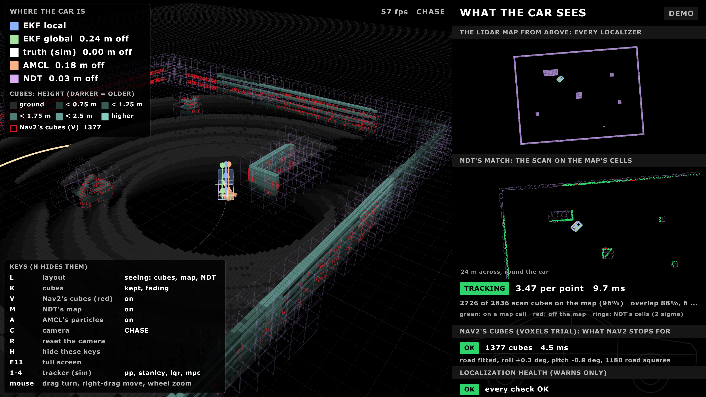 |
| Hardware panel | | | 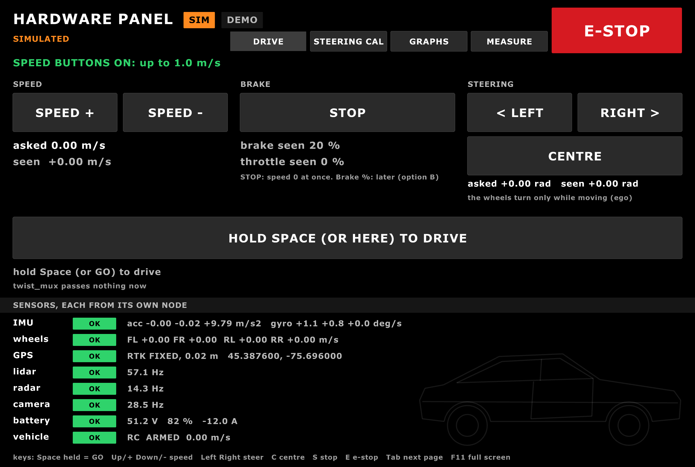 |
| Hardware panel | 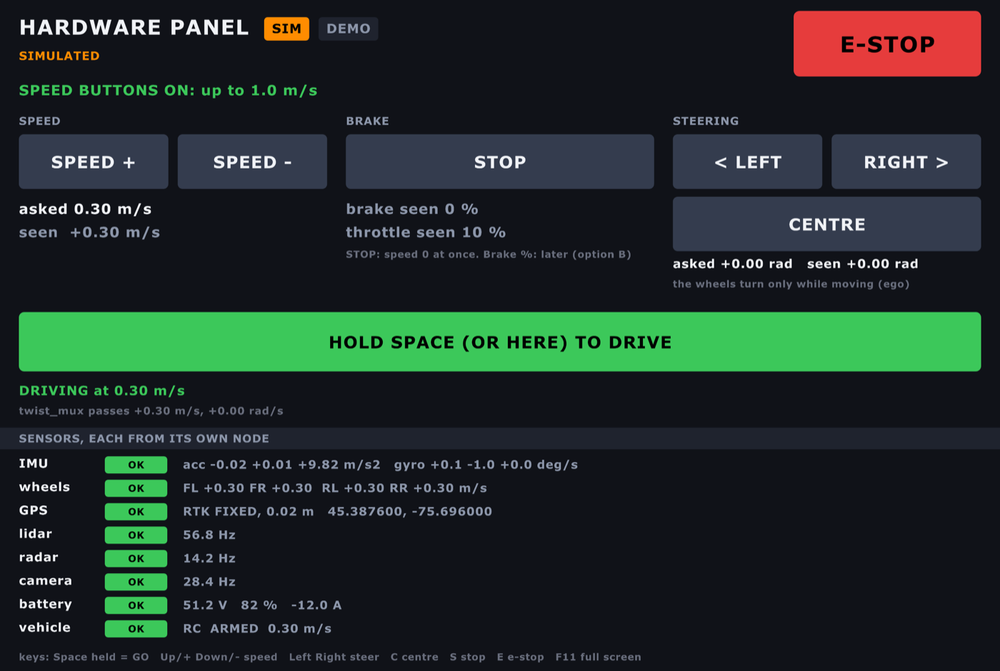 | 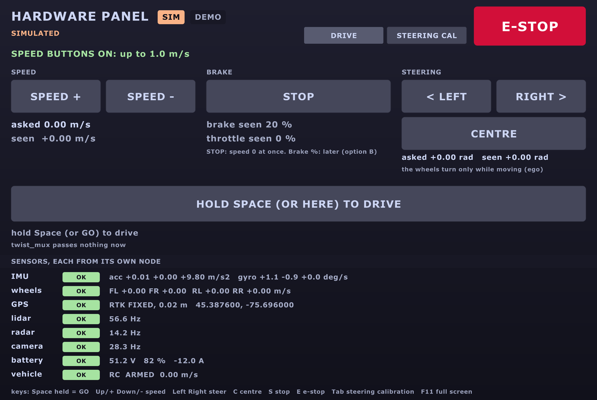 |  |

### The themes

| Theme | When | Picture |
|---|---|---|
| `initial_d` (**default**, every screen) | the car, day or night: black, white and Carleton's red | the "Initial D" pictures above |
| `mocha` | night, and glare in the cabin: dark and soft | the "Mocha" pictures above |
| `latte` | daytime: light | 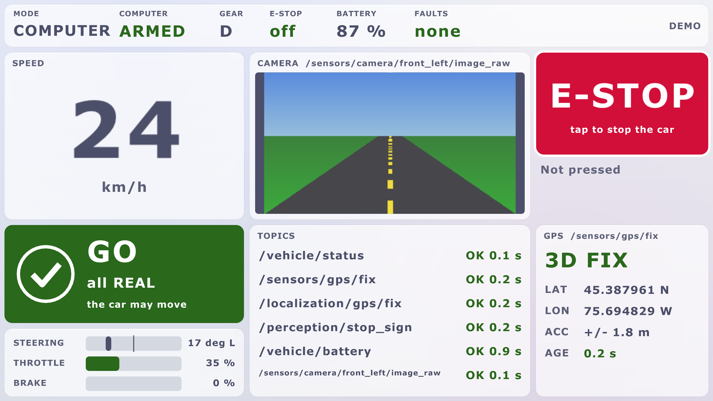 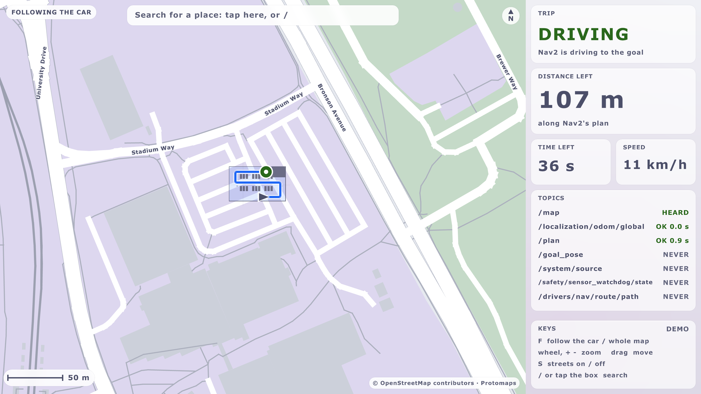 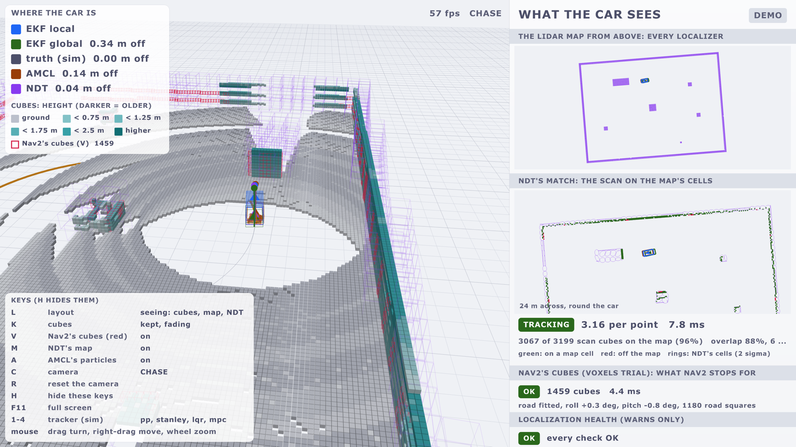 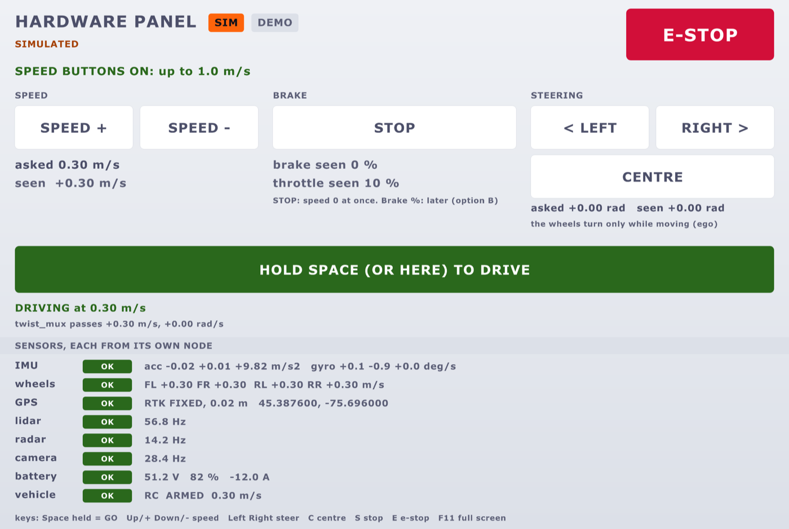 |

Mocha and Latte are [Catppuccin](https://catppuccin.com)'s palettes (MIT licence), with
its official colour values. The code still accepts `calm`, an old name for a copy of
Mocha: no Calm theme is coming (Ben, 3 Nov).

### Initial D: what each screen looks like

A tribute to the arcade gauges of Initial D, in Carleton's red (RGB 233, 28, 36, from
Carleton's logo guide). Sharp, not glass: black panels, thin white edges, small corners,
no glow.

| Screen | In `initial_d` |
|---|---|
| HUD | the speed as an arcade gauge (white ticks, a red needle, red redline blocks), 7-segment digits, our logo, a faint car in lines behind |
| Map | a night street map in greys; highways dark red; Carleton's campus a faint red; the plan **white**, the street route **red**; black boxes with white edges; the faint car at the foot of the right panel |
| Debug screen | black 3D view, grey ground grid, the lidar's cubes teal, the costmap's cubes red wireframes; black side panel with a white edge; the faint car at its foot |
| Hardware panel | white words on black, dark grey buttons with white edges, square pills; the faint car bottom right |

### The faint car

A mid-80s hatchback in thin lines (`hud_core::silhouette`), behind every Initial D
screen (Ben, 3 Nov: "there was an outline of the car in the background before. I
liked that"). The other themes don't draw it.

| Screen | Where it stands | What goes over it |
|---|---|---|
| HUD | low right, behind TOPICS and GPS | the panels |
| Map | the foot of the right column | the TOPICS and KEYS cards |
| Debug screen | the foot of the right side | the side's glass |
| Hardware panel | bottom right, right of the sensors' words | nothing: drawn as faint as under a panel |

One function draws it on all four: `hud_app::paint::faint_car`. The theme tests check
that dim and red words still read on it (4.5 : 1), and that it still shows. The little
robot is drawn after it, so it always goes in front.

Only the localizers keep Catppuccin's colours (blue, green, orange, purple, yellow), so
a picture means the same in every theme. Corners come from `Style::corner`: soft in the
glass themes, under a third as round in Initial D.

The pictures (2 Nov; the Initial D ones again 15 Nov, with the faint car on all four, and the hardware panel's added; Ben's Mac, pretend data): `pixi run hud --demo --screenshot FILE`;
`pixi run map --demo --zoom 2.5 --screenshot FILE`; `pixi run debug-hud --demo
--screenshot FILE --after 8`; `pixi run hw-panel --demo --screenshot FILE --after 12`.

### Switch theme

| Where | How |
|---|---|
| The car (ROS) | `theme: mocha` (or `latte`) in `config/hud.yaml`, `map.yaml`, `debug_hud.yaml` or `hw_panel.yaml` (each screen has its own), or `--ros-args -p theme:=mocha` |
| A demo | `--config FILE`, a copy of the yaml with `theme: mocha` |
| Blur off (map) | `blur: false` in `config/map.yaml`, or `-p blur:=false` |

### Status colours keep their meaning

GO green, WAIT amber, STOP and the e-stop red, in every theme. The e-stop is a deep red
with white words and a white ring: Carleton's red in Initial D, Catppuccin Latte's red
in Mocha and Latte (Mocha's own red is a soft pink, and an e-stop must shout).

A unit test (`hud_core::theme`) checks every pair against WCAG: **4.5 : 1** for words,
**3 : 1** for big words and shapes. It checks words on the glass over the window and
over every street colour.

| Pair | Initial D | Mocha | Latte |
|---|---|---|---|
| Text on a panel | 21 | 9.4 | 7.7 |
| Green / amber / red words on a panel | 10.7 / 13.0 / 5.7 | 9.2 / 10.8 / 5.9 | 6.5 / 6.1 / 5.2 |
| GO's words on green | 10.7 | 12.6 | 6.8 |
| E-STOP's white words on red | 5.2 | 5.4 | 5.4 |
| The e-stop button on the window | 4.0 | 3.0 | 4.8 |

For Initial D the tests also check every line and mark on each screen (2 Nov): the plan,
the goal and the street route on the map's ground, walls on free cells, the bars on
their tracks, the 3D view's lines; that its surfaces are plain greys with no Catppuccin
left; and that the e-stop's red stays far from amber, orange and the red roads.

Latte's own green, yellow and peach are too light for words on white, so the theme
darkens them (the test caught it).

### Frosted glass

In Initial D the boxes are near-solid black with a white edge and no shine: the same
code, with the arcade style's colours and corners.

| Screen | Glass |
|---|---|
| HUD | see-through panels over a soft gradient; no blur (nothing behind them moves) |
| Map | the search box, results, keyboard, chips and scale bar show the map **blurred** behind them (`blur: true`) |
| Debug screen | the legends over the 3D view (where the car is, the keys) |
| Hardware panel | none: words sit straight on the window, so they read best |

How the blur works (`map-app/src/frost.rs`): once the map is drawn, the graphics card
copies the screen, shrinks it to a quarter and blurs it (two Gaussian passes, twice).
Each glass box draws its piece of it, cut to its round corners. If the card refuses the
shaders, the window says so and keeps see-through glass.

`map --demo --bench 6` prints the frame rate. Ben's Mac (M4 Max), 1 Nov:

| View | Blur on | Blur off |
|---|---|---|
| Window, zoomed in | 238 fps | 345 fps |
| Full screen, zoomed in, keyboard open | 140 fps | 191 fps |
| Full screen, zoomed out (`--zoom 0.3`), keyboard open | 27 fps | 28 fps |

The blur costs little. Zoomed far out the street map itself is slow, blur or not (many
tiles); the window asks for 30 fps.

### The debug screen's colours

Each localizer keeps its colour in every theme, so a picture means the same by day and
by night:

| What | Colour |
|---|---|
| EKF local (the car) | blue |
| EKF global | green |
| Gazebo's truth | white (dark grey in Latte) |
| AMCL, its particles | orange |
| NDT, its map | purple |
| The plan | yellow |
| The costmap's cubes | red wireframes |
| The lidar's cubes | Catppuccin teal, standing out more the higher they are (in Initial D, the first band grey) |

Tests (`hud_core::theme`) check that these marks stand out on the 3D view, stay apart
from each other and from the cubes (a colour distance, OKLab), and keep their hue.
The pills (OK, STALE, WARN, LOST, E-STOP) are the same on both screens.

## The debug HUD

`ros/hud/aav_hud`, binary `debug_hud`: what the car **sees** and what it **thinks**, in
one window. It only listens: it never touches an actuator. Ben, 29 Oct: "the low level
hud ... should connect directly to the ros node at the sensor". Design:
[2026-10-29_debug-hud.md](designs/2026-10-29_debug-hud.md).

### What it shows

It opens as the **seeing screen** (two screens, 29 Oct): the cubes big on the left, and
on the right two views from above. Key **L** swaps the right side for the sensor panel.


| Right side, from above | Shows | From |
|---|---|---|
| Top: the lidar map | NDT's map's points (thinned to one per 15 cm), fitted to the box; every localizer's car in its colour | `ndt_map` (the PCD); each localizer, local EKF through map -> odom |
| Bottom: NDT's match | 24 m round the car: NDT's 1 m cells as **ellipses** (each column's points, 2 sigma); the latest scan's cubes over them, **green** on a cell, **red** off the map; the cars | the map; the lidar's cubes, through map -> odom |
| Under it: the score | TRACKING / WAITING / LOST, score per point, ms per match; how many scan cubes landed on the map; overlap | `/localization/ndt/status`; the scan |
| The costmap's cubes | the road's fit (**OK** green, **WARN** amber: taken as flat), how many cubes, ms per cloud; "off (voxels:=false)" when none came; STALE when quiet | `/perception/voxels/status`, `/perception/voxels/cubes` |
| Localization health | **OK** green, or **WARN** amber and each check that isn't OK, wrapped; "not running (health:=false)"; STALE after 3 s (it comes once a second) | `/localization/health` (Betsi's `aav_localization_health_rs`) |

No map file: both boxes say where it looked and how to make one (`pixi run ndt-map
drive`). No map -> odom yet: only the map-frame cars are drawn.

The 3D view, in both layouts:

| On screen | From | Frame |
|---|---|---|
| Cubes (20 cm), coloured by height: the theme's teal, standing out more the higher. **Kept** for 2 s and fading darker (key K: this scan's only). The ground is hidden (key G shows it, grey): the road, and flat ground a little higher, such as the campus's grass a kerb up, whose lidar rings filled the screen (17 Nov). A low cube beside the road (a kerb) or under a taller one stays | `/sensors/lidar/points` | lidar_link -> base_link -> odom |
| **The costmap's cubes**: red 0.25 m wireframes over the screen's own (key V), the newest cloud only; dimmer when STALE. What the car stops for (`voxels:=true`), beside what the lidar sees | `/perception/voxels/cubes` | base_link -> odom, EKF local's pose at the cloud's stamp |
| The car: a blue box to scale (`vehicle.yaml`) | `/localization/odom/local` (EKF local) | odom |
| EKF global (green), AMCL (orange), **NDT (purple)**, truth (white, sim): an outline, an arrow, a pole | their topics (NDT's: `/localization/ndt/pose`, good fits only) | map, through map -> odom |
| AMCL's particles: small orange arrows (key A) | `/localization/amcl/particles` | map, through map -> odom |
| NDT's map: faint purple 1 m wireframe cubes (key M) | `maps/ndt/test_lot.pcd` (`ndt_map`) | map, through map -> odom |
| The plan (yellow), the car's trail (grey) | `/plan`; EKF local | map; odom |
| Legend, top left | each localizer's distance from EKF local, in metres | - |
| Panel (key L): IMU, GPS, lidar, costmap cubes, wheels, wheel odom, vehicle, each estimate, map -> odom, loc. health (amber when WARN), tracker | each topic: OK, STALE or NEVER, and what it said | - |
| Panel, NDT: TRACKING / WAITING / LOST, score per point, ms per match; or "no NDT map at ...: make it with pixi run ndt-map drive" | `/localization/ndt/status` | - |
| Keys, bottom left: each key and its layer's state (key H hides them) | - | - |

It publishes nothing. Its one call: keys 1-4 ask aav_track's parameter service for
another tracker, in the simulator only (the design's D3: never an actuator).

### How the cubes are placed

```
cloud (stamp t) --/tf_static--> base_link --EKF local's pose AT t--> odom --> 20 cm cubes
```

| Rule | Why |
|---|---|
| The pose at the cloud's **own stamp**, interpolated from the last second of poses | the cloud arrives late: at 3 m/s, 50 ms off moves walls 15 cm |
| Clouds go through a newest-only slot to their own thread, never the shared queue | a slow window shows the newest scan, never a backlog |
| Stamps are only compared with stamps | Gazebo stamps sim time; the window runs on wall time |
| Over `max_cubes` (20,000), the nearest stay; the panel says how many were cut | a full VLP-16 at 100 m makes more |
| Heights are above base_link; the VLP-16's 0.1 s sweep is ignored | the EKF is 2D; Gazebo's lidar has no sweep |

### Keys

| Key | Does |
|---|---|
| drag | turn the view round the car, tilt it |
| right-drag (or shift-drag) | move (leaves the car: a FREE view) |
| wheel | zoom |
| L | the seeing screen (the default: the map and NDT's match from above) or the sensor panel |
| K | cubes: kept and fading (the default), or this scan's only |
| V | The costmap's cubes (red wireframes): on by default |
| M | NDT's map as wireframes (on when the file is there) |
| A | AMCL's particles |
| H | hide or show the key legend |
| C | CHASE (behind the car) / FOLLOW (fixed angle) / FREE |
| R | back to CHASE |
| 1 2 3 4 | swap the trial tracker: pure pursuit, Stanley, LQR, MPC. **Sim only**: refused unless `/system/source` says SIM, and the track node refuses unless `live_swap` is on (`sim.launch.py`). The answer shows under TRACKER |
| F11 | full screen |

### Run it

```bash
pixi run demo --debug               # the simulated car, RViz, the HUD, the map window and the debug HUD
pixi run debug-hud --demo          # pretend data: no ROS (a walled lot, a ray-cast lidar)
pixi run build && pixi run debug-hud    # the node alone, beside a running sim
```

`demo --debug` is `demo` with `amcl:=true`, on the default stack (ours), so AMCL has
something to show; and `ndt:=true` too when `maps/ndt/test_lot.pcd` is there. No map yet:
`pixi run ndt-map drive` once (about 6 min, headless; the map stays out of git). To swap a
tracker live, start it with one of `aav_track`'s, forward only:
`pixi run demo --debug tracker:=pure_pursuit reversing:=false`; then keys 1-4, or
`ros2 param set /track tracker lqr` (sim only, both ways).

### How it's built

| Part | What it does |
|---|---|
| `crates/debug-core` | the maths, no ROS, no raylib: the pose buffer, the frames, the cubes, the camera; the map's footprint from above (`ndt::Footprint`: thinned points, one ellipse per column) and `topdown` (map metres to window points). `cargo test -p debug-core` |
| `crates/debug-app` | the window and the node; the cubes drawn **instanced** (one mesh, one draw per height band) |
| `config/debug_hud.yaml` | every topic name, the frames, `cube_size`, `max_cubes`, `pose_window`, `stale_after`, `keep_cubes_for`, `ndt_map`, `ndt_map_cell`, `voxels_cube_size` (0.25 m), `health_stale_after` (3 s) |
| The costmap's cubes | their own newest-only slots and thread (`nav2_cubes`), as the lidar's; `debug-core`'s `voxels` moves each centre into odom (no second snap) |
| PointCloud2 reader | `aav_radar_clusters`' own (`radar-clustering`), shared |

On the car: not yet from a Mac over WiFi (about 9 MB/s of reliable lidar): a laptop on
the car's cable. Not the Orin's own screen: it runs no graphics (Ben, 5 Nov).

### Tested (29 October, a Mac)

Moved to [the hud log](history/hud-log.md#tested-29-october-a-mac) on 18 Nov (a dated record).

### Tested (29 October, later: step 5, Ben's Mac, screen unlocked)

Moved to [the hud log](history/hud-log.md#tested-29-october-later-step-5-bens-mac-screen-unlocked) on 18 Nov (a dated record).

### Tested (1 November, Ben's Mac): the costmap's cubes and localization health

Moved to [the hud log](history/hud-log.md#tested-1-november-bens-mac-the-costmaps-cubes-and-localization-health) on 18 Nov (a dated record).

## The hardware panel

`ros/hud/aav_hud`, binary `hw_panel`: one screen to **test every sensor** and **work
every actuator** with very simple buttons (Ben, 29 Oct: "We need very simple buttons").
The only screen that drives, and only through twist_mux, ego and the spine. Design:
[2026-10-29_two-screens.md](designs/2026-10-29_two-screens.md).


### The buttons

| Button (key) | Does |
|---|---|
| SPEED + / SPEED - (Up or +, Down or -) | the asked speed, 0.1 m/s a press; never below 0 (no reverse), never above the cap |
| HOLD SPACE (OR HERE) TO DRIVE (Space held) | the car moves **only while it is held**; let go: 0.5 s of zeros, then nothing |
| < LEFT / RIGHT > (Left, Right) | the steering, 0.05 rad a press, sent as a turn rate (ω = v · tan δ / L): it moves only while creeping |
| CENTRE (C) | the wheels straight at a creep (0.1 m/s), then speed 0; with GO let go, everything 0 at once |
| STOP (S) | the asked speed 0 at once |
| E-STOP (E) | `/safety/estop` true 5 times, 0.1 s apart. Never false |

Brake: read-only for now ("brake seen"); a brake percentage needs the spine's test
mode (option B in the design).

### Where it may drive

| `/system/source` | Speed buttons |
|---|---|
| SIM, BENCH | **on**, up to 1.0 m/s |
| REAL, `stands:=true` | the preflight's refusal: **off** until a driven-wheel speed exists (TODO 49b), the Rust ESP32 and `speed_loop.mode open`; **off** while no wheel speed is seen (none, stale or NaN); then 0.3 m/s, stopped after 4 s of unseen speed. Today: off, and the screen says why |
| REAL on the ground, nothing announced, REPLAY | **off** |

The rules are `aav_actuator_tests/safety.py`'s, ported to Rust (panel-core `rules`) with
the same test vectors. One difference, towards safety: a source number it doesn't know
counts as REAL. It doesn't read the legacy bridge's `speed_loop.mode` yet: on stands it
relies on `speed_wheels` and the no-timeout lock (both refuse today's car anyway).

### How a press reaches the car

```text
press --> panel-core (cap, hold-to-drive) --> /drivers/buttons/cmd_vel --> twist_mux (45)
      --> /control/cmd_vel --> ego (2 m/s2, steering limits) --> backend / spine
```

| Rule | Why |
|---|---|
| twist_mux slot **45** | below people (90-100), the tests (60) and a script (50); the geofence (51) and no-timeout (60) locks hold it; the stop-sign and sensor locks (30) don't, so it works on stands |
| Sent at 10 Hz, **only while the window draws** (hud-core's heartbeat) | a frozen window sends nothing: twist_mux (0.5 s) and ego (0.3 s) stop the car |
| An e-stop, a takeover (twist_mux passing someone else's command for 0.3 s), a source change | everything to 0; GO must be let go and pressed again, and Speed + again: the joystick's release never hands back an old speed |
| Every sensor from its own node | a fault shows where it starts, not after the muxes |
| On stands, the wheel speed says "front, not driven" | the wheel sensors are on the front; the motor drives the rear (TODO 49b) |

### Run it

```bash
pixi run hw-panel --demo                 # a pretend car: no ROS, any laptop
pixi run sim world:=test_lot           # the simulator (or: pixi run demo --debug) ...
pixi run hw-panel                      # ... and the panel beside it, localhost-only
pixi run tools/ros.sh ros2 launch aav_hud hw_panel.launch.py stands:=true   # the car on stands, from a laptop on its network (pixi run hw-panel stays on this computer)
```

Run it from a wired laptop, not a Mac over WiFi (and not the Orin: it runs no graphics, Ben, 5 Nov). For checks,
`hw_panel --self-test 0.3:8` presses Speed + to 0.3 m/s and holds GO for 8 s, through the
same buttons and rules, and prints what was asked and seen.

### The steering calibration page

Tab (or the STEERING CAL tab) opens it: find the steering actuator's ends and centre,
set equal limits, then check them lock to lock (Ben, 1 Nov). The procedure, and the
bridge's settings it needs: [actuator-tests.md, way B](actuator-tests.md#way-b-the-hardware-panel-rust-firmware).

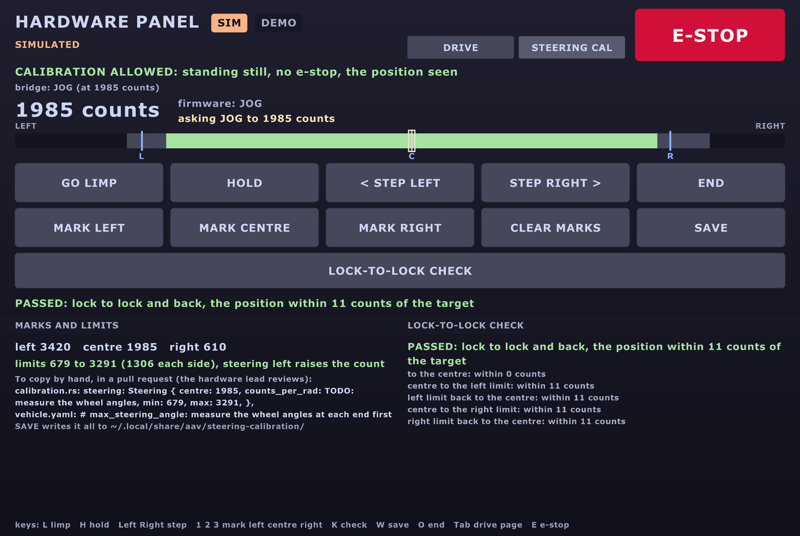

| Part of the page | Shows |
|---|---|
| top line | **SOFTWARE ALLOWS** (never "safe": people check the rest), or **NOT ALLOWED** and every reason: the e-stop, the car moving, the speed unknown, the position not seen |
| bridge | the bridge's own line (`/vehicle/steering_actuator/calibration`): what it does, or REFUSED and why |
| big number | the position now, in counts (`/vehicle/steering_actuator/raw`); the firmware's state; what the page asks |
| the bar | 0 to 4095, the steering's **left on the left**: the jog range, the limits (green), the marks L C R, the target (box), the position (arrow) |
| MARKS AND LIMITS | the three marks, the equal limits, the warnings, the lines to copy |
| LOCK-TO-LOCK CHECK | running: the leg, target and position; then PASSED, or STOPPED and why |

| Button (key) | Does |
|---|---|
| GO LIMP (L) | the steering actuator's motor off: turn the wheels by hand |
| HOLD (H) | jog to where the wheels are now: they stay there |
| < STEP LEFT, STEP RIGHT > (Left, Right) | jog 25 counts that way; never outside 400-3500 (the firmware's software limits) |
| END (O) | stop asking: the firmware moves the wheels back slowly |
| MARK LEFT, MARK CENTRE, MARK RIGHT (1, 2, 3) | the position now is that end, or the centre |
| CLEAR MARKS | forget the three marks |
| SAVE (W) | write the result to a file (below) |
| LOCK-TO-LOCK CHECK (K) | centre to the left limit, back, to the right limit, back, at 100 counts a second |
| ON STANDS, STILL (no key) | a person's word that the car is on stands and still, for when nothing measures the speed. Press again to withdraw it |

**When the speed is unknown.** On today's ESP32 the uplink has no wheel speed, so
`/vehicle/status` says NaN all the time. NaN means **unknown, never stopped**:

| Speed | Top line | Can the page ask? |
|---|---|---|
| measured, under 0.05 m/s | SOFTWARE ALLOWS: speed +0.00 m/s ... | yes |
| measured, 0.05 m/s or more | NOT ALLOWED: the car moves | no, whatever a person said |
| NaN, stale or none | NOT ALLOWED: the speed isn't known ... press ON STANDS, STILL | no |
| NaN, stale or none, and ON STANDS, STILL pressed | SOFTWARE ALLOWS, ON A PERSON'S WORD (amber) | yes |

The word is forgotten on an e-stop, a measured movement, pressing the button again, or
leaving the page. The speed buttons (the throttle) get no such word: on the real car's
stands they stay off while no wheel speed is seen.

**What it sends:** `/drivers/buttons/steering_calibration` at 10 Hz, only while the window
draws: limp, or jog to a target. END sends "off" for 0.5 s, then nothing. Not allowed, or
the page left (Tab): it ends at once. GO never drives on this page.

**The lock-to-lock check stops and holds** (HOLD where the wheels are) at the first of:

| Sign | Default (`hw_panel.yaml`) |
|---|---|
| the position more than this behind the target | 150 counts (`sweep_max_error`) |
| no movement while the target moves | 0.6 s (`sweep_stall`) |
| a leg's end not reached | within 20 counts in 2 s |
| no position | 0.3 s |
| the firmware not jogging: refused, holding, returning | at once (refused), or after 0.5 s |

It only asks for targets between the limits, and won't start with the wheels outside them.

**Save, and where the numbers go.** SAVE writes a new file,
`~/.local/share/aav/steering-calibration/steering-<UTC time>.txt` (or under
`$XDG_DATA_HOME`), and prints the same to the log. It holds the marks, the check's
result, and the lines for `calibration.rs` (`Steering`) and `vehicle.yaml`. **It never
writes `vehicle.yaml` or the firmware**: a person copies the lines, in a pull request, with
the sheet; the hardware lead reviews it. `max_steering_angle` and the gain need the wheel
angles: the file has the `steering_limits` command to run with them.

**Try it without a car:** `hw_panel --demo --page calibration`. The demo's actuator has
ends at 3420 and 610 and a centre at 1985 (it steers right). `--cal-self-test` drives the
page itself (limp, mark, hold, check); `--demo-bind 2800` adds a stiff spot, which the
check must find:

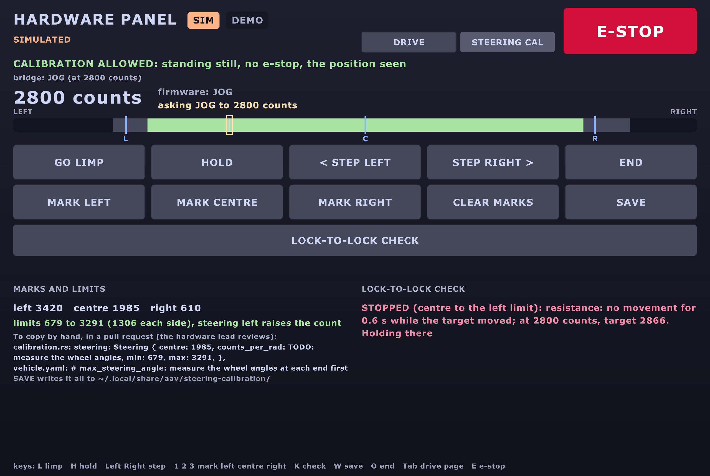

### The graphs page

Tab twice (or the GRAPHS tab). One question: **does the Pi pass ego's commands on to the
ESP32?** Design: [the ESP32 debug link](designs/2026-11-07_esp32-debug-link_brief.md),
"The plan now" (Ben, 7 Nov: graphs in `hw_panel`).


```text
ego ──► mux ──► Pi wrote ──► ESP32 got
/ego/actuator_cmd   /control/car/actuator_cmd   /control/car/link_frame   the ESP32's status lines
```

**The hop chain.** Each hop gets one word:

| Word | Means |
|---|---|
| OK | fresh, its value changed in the last 60 s, and it matched the hop before |
| DIFFERENT | it didn't match, or frames were bad, skipped or failed to write |
| STALE | heard, but not for over a second |
| NO DATA | nothing in 60 s |
| NOT TESTED | the value never changed, or nothing to compare with. **A parked car is NOT TESTED, never OK** |

| Hop | Compared with | How |
|---|---|---|
| ego | nothing | fresh and changing |
| mux | ego | paired by the header's stamp (the mux copies it): equal |
| Pi wrote | mux | it must change when the mux's does, the same way (correlation 0.5 or more): no key pairs them |
| ESP32 got | Pi wrote | paired by counter and check byte: equal within the JSON's rounding (0.01) |

Ego has no brake value, so only the ESP32 hop tests the brake.

**The graphs.** Steering, brake and throttle, in the frame's own units (-1..1), over the
last 60 s. Two lines each, told apart by style and a label at the end:

| Line | From |
|---|---|
| Pi wrote (a line) | `/control/car/link_frame`, a sample (10 a second) |
| ESP32 (dots) | the ESP32's status lines (`rx`, with `--esp32`); without them, the uplink's brake and throttle outputs (`/vehicle/brake`, `/vehicle/throttle`'s command), labelled "what it drives, not what it got" |

Beside each: now, avg, low and high for both lines. A gap where status lines were lost,
a red line where the board restarted. Below: the IMU's turn rate as a small graph, and the
IMU and GPS rows from their own topics.

**The status strip** is the real proof of the wire (review 2, M2): frames the Pi wrote
(and their rise in 60 s), write failures, the ESP32's own `frames`, `bad`, `skipped` and
`repeats`, the uplink's frames, lost and bad, and status lines lost. The graphs only
sample: the page says "sampled N frames", never "every frame".

**FREEZE (P)** keeps a copy to read while the car carries on; press again to go live. An
e-stop freezes it by itself, to read what led to it.

**The ESP32's own lines (`--esp32`).** Read only:

```bash
hw_panel --esp32 ws://192.168.4.1:81/             # beside ROS
ros2 launch aav_hud hw_panel.launch.py esp32:=ws://192.168.4.1:81/
hw_panel --demo --page graphs                     # a pretend path, every hop OK
```

| Rule | Why |
|---|---|
| Its own thread, its own queue | a slow board never slows the window; a full queue drops lines, and the gap in `seq` shows |
| Sends only the WebSocket's opening, a pong or a close | it never commands anything |
| Feeds the graphs and the strip only | never the buttons, the gate or the calibration page's rules |
| Tries again every 2 s; 5 s silent is lost | the board sends a heartbeat each second |
| `ws://` only | no TLS (`wss://`) |

The lines' format is `firmware/status/README.md`; the reader is tested on its
`golden.jsonl`.

### How it's built

| Part | What it does |
|---|---|
| `crates/panel-core` | the logic, no ROS, no raylib: `buttons`, `gate`, `rules` (safety.py's), `state` (every sensor's number), `config`, `vehicle`; the calibration page's `calibration`, `steering_limits` (steering_limits.py's, on shared vectors) and `sweep` (the lock-to-lock check); the graphs page's `graphs` (the lines, the numbers, the verdicts, FREEZE), `esp32` (the status lines) and `ws` (the WebSocket's frames). `cargo test -p panel-core` |
| `crates/panel-app` | the window (raylib) and the node (rclrs): the 10 ms timer sends the buttons' command and the calibration request (heartbeat-gated) and the e-stop burst; `esp32.rs` reads the ESP32's WebSocket on its own thread |
| `config/hw_panel.yaml` | every topic name, the steps (0.1 m/s, 0.05 rad), the creep, the caps (1.0, 0.3 m/s); the calibration page's jog step and range, and the check's speed and stops |

### Tested (29 October, Ben's Mac)

Moved to [the hud log](history/hud-log.md#tested-29-october-bens-mac) on 18 Nov (a dated record).

## The little robot (easter egg)

A small robot hides in three of the screens: a boxy body on two tank treads, a neck,
and two big round eyes. **A tribute to WALL-E** (Ben, 1 Nov: "a huge fan of wall-e and
his round eyes"). It is our own drawing, made only of shapes, so it takes the theme's
colours and grows with the window. No picture files.

### Where it shows

| Screen | What it does | When |
|---|---|---|
| Map window | the car **is** the robot, from above, a little tilted; its treads roll as it drives | `car_marker: robot` (off by default) |
| Hardware panel | its eyes peek over the bottom edge, look left and right, and blink | 60 s with no input, nothing changing, the car still |
| Hardware panel | it drives across the bottom, under the page | at start-up, and when a lock-to-lock check PASSES |
| Debug screen | its eyes peek over the bottom of the 3D view | 60 s with no input, nothing changing, the car still |

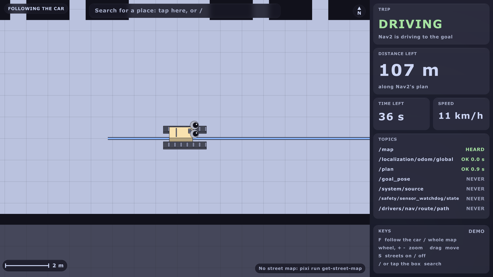

| Peeking (hardware panel) | Driving across (after a check passed) |
|---|---|
| 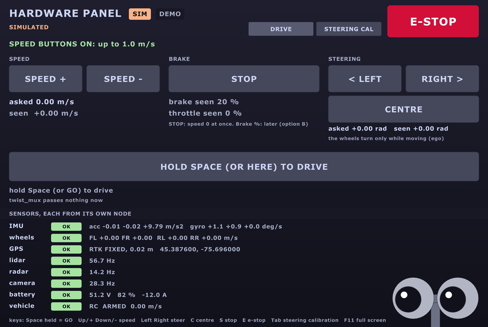 | 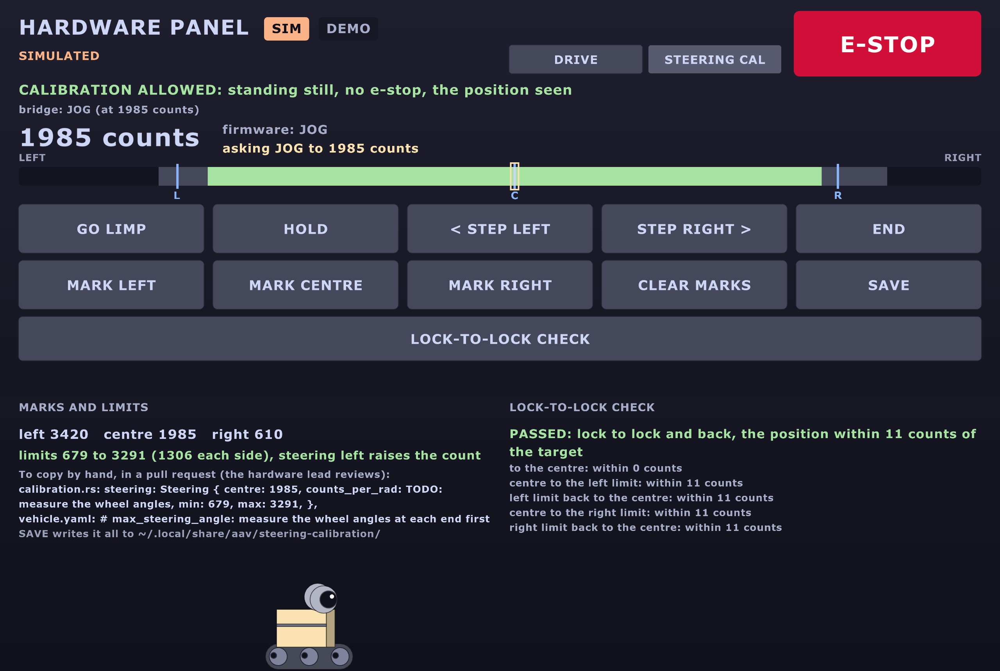 |

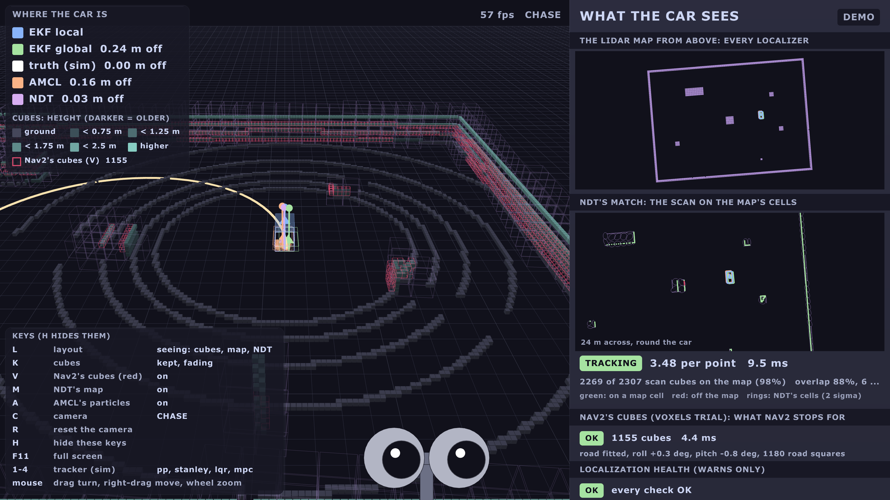

### The rules it keeps

- It **never** covers a button, the e-stop or a line of words: it only goes in a strip
  the page left empty (no room: it doesn't show).
- It **never** shows while the car moves, the buttons ask for speed, the check sweeps,
  an e-stop is on, or a warning shows (a STALE sensor, a zero, the health checks' WARN).
- It **hides at once** on any key, click, mouse move, or change on the screen.
- On the map, the robot sits exactly on the car's outline from `vehicle.yaml`: the same
  position and heading as the plain marker. Its eyes face the way the car faces.

### Turn it on or off

| Screen | Setting | Default |
|---|---|---|
| Map window | `car_marker: robot` or `outline` in `config/map.yaml` (or `-p car_marker:=robot`) | `outline` |
| Hardware panel | `easter_egg: false` in `config/hw_panel.yaml`; `easter_egg_after` (s) | on, 60 s |
| Debug screen | `easter_egg: false` in `config/debug_hud.yaml`; `easter_egg_after` (s) | on, 60 s |

For screenshots, `--robot-now` shows it at once (the debug demo parks its car):

```sh
pixi run map --demo --robot-now --zoom 70 --screenshot $PWD/docs/img/robot-map.png
pixi run hw-panel --demo --robot-now --screenshot $PWD/docs/img/robot-eyes-panel.png --after 12
pixi run hw-panel --demo --cal-self-test --screenshot $PWD/docs/img/robot-driving.png --after 71
pixi run debug-hud --demo --robot-now --screenshot $PWD/docs/img/robot-eyes-debug.png --after 8
```

### How it's built

| Part | Where |
|---|---|
| Its shapes (from above, peeking, from the side) and when it shows (`EasterEgg`) | `hud-core/src/robot.rs`, unit tests |
| Its colours (`Theme::robot()`: an amber body, grey treads, dark glass) | `hud-core/src/theme.rs` |
| The map's robot on the car's outline (`car_marker`) | `map-core/src/robot.rs`, unit tests |
| Still? A warning? Did the screen change? | `panel-core/src/easter_egg.rs`, `debug-core/src/easter_egg.rs`, unit tests |
| Drawing it | `map-app/src/ui.rs`, `panel-app/src/robot.rs`, `debug-app/src/robot.rs` |

Not yet on the in-car HUD: it is being restyled (the Initial D look); the eyes go there
after that lands.

## The Flutter app (2025-26): archived

| | |
|---|---|
| What it was | the 2025-26 team's touchscreen app (Flutter) and its back end, `hud_server` (a ROS node with Flask), ported to our topics on 10-11 Oct |
| Where it is now | `archive/2026-27-flutter-hud/`: the app, the back end and their scripts. Nothing builds, tests or starts it |
| Why | Q29: the raylib HUD replaced it (Ben, 15 Oct); archived on 25 Oct (Ben) |
| What stayed | its place database, `ottawa.db`: the map window's search reads it (below) |

GPS routes it used to send now come from `street_router` and the language tools
([Routes](routes.md)).

## The place database

The map window's [place search](#search-for-a-place-and-drive-there) reads `ottawa.db`:
51 MB of SQLite, 606,628 named places around Ottawa. It's too big for git, so a task
downloads it:

```bash
pixi run get places      # into maps/places/ottawa.db
```

| | |
|---|---|
| From | the 2025-26 team's public repo, `AAV-2025-2026/User-Interface`, at `ea5adc3`: the last commit that changed it |
| Checked | by its SHA-256, so a changed file is refused |
| Data | from OpenStreetMap: © OpenStreetMap contributors, under the ODbL. The map window shows that credit |

**Foxglove** works as the operator's screen too: `foxglove_bridge`, on port 8765, shows
speed, the map, paths and costmaps ([Watch from a laptop](foxglove.md)).
