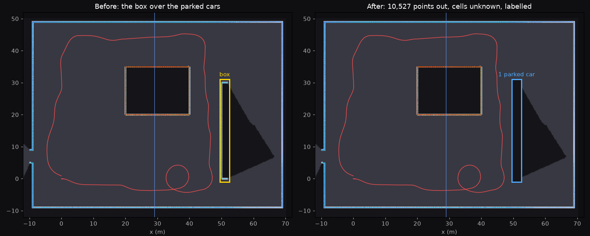

# The map editor

A person checks **our map** from a drive over the street map, lines it up, removes what
won't be there next time (parked cars), labels what is, then **approves** it. Phase E of
the [testing plan](testing-plan.md) (TODO 251). The maps come from
[Maps from drives](maps-from-drives.md).

```sh
pixi run map-drive bags/<drive>              # the drive's maps, into bags/<drive>/map/
pixi run map-edit bags/<drive>/map           # the editor: no ROS, a laptop
```

!!! warning "Not yet looked at on a screen"
    Built 19 Nov. Its logic is tested, and the proof below ran in Ravensim. The window
    itself was only started and closed (the Mac's screen was locked, so its own screenshot
    came out black). Untested on a real drive.

## What it looks like

```text
┌ tools ──────────────────┬ the map ──────────────────────────────────────┐
│ Layers: Streets  NDT    │   streets and buildings (OpenStreetMap)        │
│   2D map  chunks  ...   │     our 2D map (white = something there)       │
│ Tool: Pan  Box  Align   │       NDT's points from above, by height       │
│ Align: x  y  yaw        │         64 m chunks, labels, the drive's path  │
│ Box: Delete  Label      │                                                │
│ Labels: 1 parked car    │   [ a box being drawn ]                        │
│ Edits: ...   Undo       │                                                │
│ Approve and save…       │ Box (B)  moved by hand: x 0.00 m ...           │
└─────────────────────────┴────────────────────────────────────────────────┘
```

The proof's edit, drawn from the saved files (not the window):



## The layers

| Layer | Shows | From |
|---|---|---|
| Streets (OSM) | roads, buildings, parks | `maps/streets/` (`pixi run get street-map`), placed by the map's datum |
| NDT points | each 10 cm cell's highest point, blue (low) to red (high) | `ndt.pcd` |
| 2D map | occupied white, free grey, unknown clear | `map2d.pgm` |
| 64 m chunks | the chunks a save will write | `map-chunks`' grid |
| Labels | each label's box and class | `labels.yaml` |
| Path | the drive, red | `poses.tum` |

## The tools

| Do | How |
|---|---|
| move the view | Pan tool (P) and drag; or a right or middle drag in any tool |
| zoom | the wheel, or a pinch |
| draw a box | Box tool (B) and drag; "turn (°)" turns it |
| delete in the box | Delete or Backspace, or **Delete in box**: NDT's points go; the 2D cells become unknown, free or stay |
| only some heights | tick **only heights** (a parked car: 0 to 2 m; keep the tree above it) |
| label the box | pick tree, building, parked car, pole or other, then **Label box** |
| change or remove a label | its row in **Labels** |
| line our map up | Align tool (A): drag; arrows 5 cm (shift 50 cm); Q / E turn 0.1° (shift 1°); or type x, y, yaw and **Apply** |
| undo | Cmd/Ctrl+Z, or **Undo** |
| approve | **Approve and save…**, check the summary, **Approve and save** |

## What a save writes

A **new** folder, `<map>-edit-1` (then `-2`...) beside the map, or the one typed. The
map opened is never written over; a folder already there is refused.

| File | What |
|---|---|
| `ndt.pcd`, `ndt.yaml` | NDT's map; the YAML's `edited:` says from where and how many edits |
| `map2d.pgm`, `map2d.yaml` | the 2D map (unknown as grey 128, as `map-drive` writes it) |
| `poses.tum` | the path, moved with the map |
| `labels.yaml` | the labels, in the map frame |
| `edits.yaml` | every edit, in order, and what each changed |
| `chunks/` | cut again, by the same code as `map-drive` (`map-chunks`, `ndt-core`) |
| `closures.yaml`, `poses_slam.tum` | copied |

**Lining up never moves points silently.** The map in memory stays as read. The move is
one edit in the log. On save, the points, the 2D map, the path and the labels move
together, and both YAMLs say so: `placed: aligned_by_hand: {x_m, y_m, yaw_deg}`, and
`slam_to_map` becomes SLAM's move followed by the hand's. A moved 2D map gets new cells,
on whole metres (NDT's chunks need 1 m edges).

## The proof in Ravensim

The loop drive's map (`bags/2026-11-19_061817_simloop/map`, from
[Maps from drives](maps-from-drives.md)). The test lot has a row of parked cars: a box
2 m x 30 m at (51, 15). Deleted with a 3 m x 32 m box, then labelled:

```sh
cd ros/bringup/aav_description/map-edit
cargo run --release --bin map-edit-batch -- <drive>/map \
    --delete 49.5,-1,52.5,31 --label parked_car:49.5,-1,52.5,31 --out <drive>/map-no-cars
```

| | Before | After |
|---|---|---|
| NDT's points | 131,291 | 120,764 (10,527 out) |
| 2D cells changed | | 478, to unknown |
| chunks | | 2 fine, 2 coarse, 2 NDT |

`map-edit-batch` runs the same `Editor` and save as the window, so the proof needs no
screen.

**NDT on the edited map** (the parked cars are still in the world, so the lidar sees
things the map no longer has):

```sh
pixi run measure controllers --ndt --ndt-map <drive>/map-no-cars/ndt.pcd --tours lot \
    --controllers mppi --runs 2
```

Two runs each, the lot tour (4 legs, 152 m), 19 Nov:

| NDT's map | Off the truth, mean per leg (run 1 / run 2) | Worst | Clouds with a pose | Restarts | Legs reached |
|---|---|---|---|---|---|
| **edited** (no parked cars) | 3.6 / 3.7, 4.3 / 4.3, 4.5 / 4.4, 4.8 / 4.9 cm | 15 cm | 99-100 % | 0 | 8/8 |
| unedited (`map/ndt.pcd`) | 3.5 / 3.5, 4.3 / 4.2, 4.3 / 4.4, 4.9 / 5.0 cm | 29 cm | 98-100 % | 0 | 6/8 |

NDT on the edited map is as good as on the unedited one: within 0.2 cm a leg, each match
1.1-1.5 ms. The two legs missed on the unedited map were the path follower (it aborted;
a costmap went quiet for 0.7 s), not NDT: its numbers on those legs are like the others.
Results in `bags/proof/` (not in git).

## Labels, and what comes next

```yaml
labels:
- id: 1
  class: parked_car          # tree, building, parked_car, pole, other
  region: {centre_m: [51.0, 15.0], size_m: [3.0, 32.0], yaw_rad: 0.0}
  band: {min_m: 0.0, max_m: 2.0}   # optional: all heights if left out
  source: person             # who made it: person, passes (map-area) or camera
  seen_in: [2026-11-19_181817_simbox]   # map-area: the drives that saw it
```

### `seen_in`: what only one drive saw

`pixi run map-area` ([Maps from drives](maps-from-drives.md#many-drives-of-one-area))
merges several drives of one area. What one drive hit and another saw through (a car
that left) is already gone. What **only one drive saw**, and no other saw through, stays
in the map, and gets a label for a person to judge:

| Field | Value |
|---|---|
| `class` | `other`: relabel it (`parked_car`, `pole`...) or delete it |
| `source` | `passes` |
| `seen_in` | the one drive that saw it |
| `band` | 0.3-2 m, the 2D map's |

Open the area's folder (`pixi run map-edit maps/<area>`): the labels are drawn with the
rest. A box-delete with its label's box takes it out; a relabel makes it `person`'s.

Room is left for the camera's labels, and the editor reads their fields already:

| Next | How it plugs in |
|---|---|
| Camera labels (TODO 252, built 19 Nov) | `pixi run label-drive` writes them: OWLv2's boxes on the lidar points, with `source: camera`, a `confidence` and `seen_in`; a person keeps, fixes or removes them here (a relabel makes it `person`). Then `label-train` learns from the file as the person left it ([Labelling](labelling.md)) |
| Occupancy across passes (TODO 259) | built 19 Nov: `map-area` writes `labels.yaml` with `source: passes` and `seen_in` (above) |

## Code

| Where | What |
|---|---|
| `ros/bringup/aav_description/map-edit/` | the logic, no ROS, no window: load, the edits, undo, save, the layers' pictures; `map-edit-batch` |
| `ros/hud/aav_dev_window/src/map_edit/` | the window (Bevy and egui, the developer window's setup), the binary `map_edit` |
