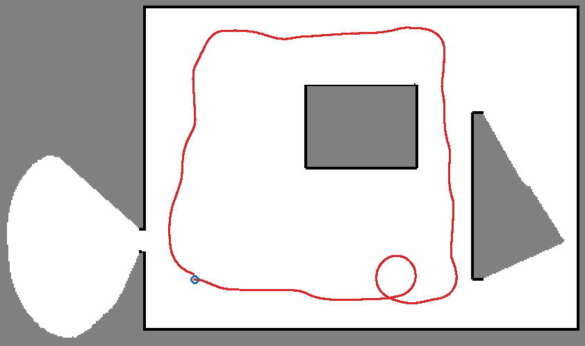

# Maps from drives

A recorded drive becomes **our own map**: NDT's 3D map and a 2D map for the planner, made
with SLAM, not from the EKF. Phase D of the [testing plan](testing-plan.md) (TODO 250).

```sh
pixi install --locked -e slam                       # once (x86_64 Linux, Apple-silicon Macs)
pixi run record-drive --name lot --note "the lot"   # the drive (Recording a mapping drive)
pixi run map-drive bags/<drive>                     # its maps, into bags/<drive>/map/
pixi run map-drive --merge <map A> <map B> [<map C>...] --out maps/lot   # quick merge
pixi run map-area lot bags/<drive 1> bags/<drive 2> bags/<drive 3>   # the whole job
```

!!! warning "Not yet run on the car"
    Built and proved in Ravensim (19 Nov). A real drive, its GPS and its lidar's sweep
    are untested. Loop closures were never found in the sim (below).

## Why SLAM

The recording kit's first NDT map was placed by the EKF's poses: each wall drawn several
times, **33 cm** off the truth's map (median; 1.2 m at 95 %). SLAM places each cloud by
matching it to the others, so the walls land once.

## What it does

```
 bag (MCAP) ──▶ lidar clouds ──▶ KISS-SLAM ──▶ poses ──▶ fit to GPS ──▶ poses in the map
  no ROS        base_link,        odometry,              (or the start       │
                ground cut        loop closures,          pose)              ▼
                                  pose graph                     NDT map + 2D map + chunks
```

| Step | How |
|---|---|
| Read | the drive's MCAP files, with `mcap-ros2-support`: no ROS needed |
| SLAM | KISS-SLAM: KISS-ICP's odometry in local maps every 30 m (`--split`), MapClosures' loop closures, g2o's pose graph. The ground (below 0.3 m) is cut out, as `aav_kiss_icp` does |
| Flatten | x, y, yaw only: the stack is 2D. With the ground cut, a 3D path sank 1 m in 91 m |
| Place | the path fitted to the good GPS fixes by least squares (`slam_map.georeference`); too few fixes: the EKF's start pose; neither: left local |
| NDT map | the same rules as `ndt-map`: ground out, 45 m, one point per 10 cm |
| 2D map | 0.25 m cells. Occupied: hit 0.3-2 m above the ground in 2 clouds or more. Free: the lidar's rays crossed it. Else unknown |
| Chunks | the 64 m chunks (`chunk-map`, `ndt-chunks`), when `cargo` is here |
| Score | a Ravensim drive only: against the truth (below) |

A good GPS fix: status 0 or more, at most 0.5 m standard deviation (`--gps-sd`). The fit
needs 20 of them, 15 m apart. The map's YAML says how it was placed, and the move from
SLAM's frame to the map (`placed: slam_to_map`).

## What it writes

| File | What |
|---|---|
| `ndt.pcd`, `ndt.yaml` | NDT's map: give it to `ndt:=true ndt_map:=` |
| `map2d.pgm`, `map2d.yaml` | the 2D map, a map server's trinary map (`aav_costmap`'s `map_server`) |
| `chunks/` | `chunks.yaml`, `fine/`, `coarse/` (the 2D map), `ndt/` (NDT's) |
| `poses.tum` | the path in the map frame, TUM format (`t x y z qx qy qz qw`) |
| `poses_slam.tum` | the path in SLAM's own frame |
| `closures.yaml` | the loop closures found, and where |
| `report.md` | all of this, and the scores |
| `truth.pcd`, `ekf.pcd` | Ravensim only: the same clouds on the truth's and the EKF's poses |

`ndt-map build <bag> --poses-file poses.tum` builds NDT's map from any file of poses too.

## The proof in Ravensim

Two drives on the test lot, recorded with `record-drive --sim` (the short one: two legs)
and `record-drive --sim --loop` (the whole route, back home: 208 m, 225 s).



**The maps against the truth's map** (the same clouds placed by Ravensim's truth):

| Drive | Poses | Path off: median | 95 % | Map off: median | 95 % |
|---|---|---|---|---|---|
| short (91 m) | **KISS-SLAM** | 3.1 cm | 6.5 cm | **2.3 cm** | 10 cm |
| short | EKF, with GPS | 8.6 cm | 20 cm | 33 cm | 1.2 m |
| loop (208 m) | **KISS-SLAM** | 3.7 cm | 7.2 cm | **2.3 cm** | 11 cm |
| loop | EKF, with GPS | 8.9 cm | 20 cm | 27 cm | 1.1 m |

Placed by the GPS (Ravensim's fixes are noisy: 0.5 m off the fit, median): the fit was
1 cm and 0.02° from the truth. **The 2D map**: every occupied cell of a map made the same
way on the truth's poses found within one cell, and every one of ours right.

**Placed by the start pose instead** (`--no-gps`): 11 cm off (the EKF's start was 10 cm
out), so the GPS fit is the default.

**Two drives merged** (short onto loop's, ICP, then only points both saw within 25 cm):
109,000 points, 3.1 cm off the truth (median), 11 cm at 95 %. Moved 1 m and 3° on
purpose first, ICP put it back (-0.96 m, 0.56 m, -3.03°).

## NDT on the SLAM map

`ndt:=true` in Ravensim's test lot, the lot tour (4 legs, 152 m), the loop drive's maps:

```sh
pixi run measure controllers --ndt --ndt-map bags/<drive>/map/ndt.pcd --tours lot --controllers mppi
```

| NDT's map | Off the truth, mean per leg | Worst | Clouds with a pose | Restarts |
|---|---|---|---|---|
| **KISS-SLAM's** (`ndt.pcd`) | 3.5 / 4.2 / 4.4 / 4.7 cm | 11 cm | 100 % | 0 |
| the same clouds on the truth (`truth.pcd`) | 0.3 / 0.4 / 0.3 / 0.3 cm | 8 cm | 100 % | 0 |

NDT on our map is as steady as on the truth's, and as far off as the map is: about 4 cm,
mostly where the GPS fit put it (Ravensim's GPS wanders). Each match: 1.1-1.4 ms. All four
legs reached.

## Loop closures

None were found on the test lot, at any `--split` (15, 30, 50 m) or density-map cell (0.2,
0.25, 0.5, 1 m): MapClosures matches ORB features on a picture of each local map seen
from above, and drops features that look like others. The lot's plain walls and boxes give
it almost none. KISS-ICP alone stayed within 11 cm over 208 m there, so nothing needed
closing. **A real place (trees, kerbs, parked cars) should give it features: untested.**

## Many drives of one area

Ben, 19 Nov: "multiple passes gives us bags of points ... then we can remove dynamic
objects like cars that might be currently static". One command does it, offline:

```sh
pixi run map-area <area> bags/<drive 1> bags/<drive 2> bags/<drive 3>   # into maps/<area>/
pixi run map-edit maps/<area>                                            # then a person checks
```

```
 drive 1 ─┐  map-drive    ┌──────────┐  ICP onto    ┌───────────────────┐
 drive 2 ─┼─ each ───────▶│ 3 maps,  │─ drive 1 ───▶│ each drive's rays │
 drive 3 ─┘  (KISS-SLAM)  │ 3 paths  │  (x, y, yaw) │ again, one grid   │
                          └──────────┘              └─────────┬─────────┘
                                                              ▼
            cell by cell:  hit in one drive, seen through in another ─▶ gone (a parked car)
                           hit by one drive only, never seen through ─▶ kept, seen_in
                           hit, never seen through                    ─▶ kept
                                                              │
                                                              ▼
     maps/<area>/: ndt.pcd · map2d.pgm · chunks/ · labels.yaml · passes.yaml · report.md
```

| Step | How |
|---|---|
| 1. Each drive | `map-drive` into `maps/<area>/drives/<drive>/` (reused next time; `--redo`) |
| 2. Align | each drive's NDT map onto the first's: point-to-plane ICP, x, y and yaw |
| 3. Passes | each drive's clouds again, on its fitted path, into one 0.25 m grid: per drive, the cells it hit (0.3-2 m up, 2 clouds or more) and the cells its rays crossed (3 rays or more, almost never hit) |
| 4. Judge | **dynamic**: hit in one drive, crossed in another. **Seen once**: hit by one drive only, never crossed. Free is kept one cell off that drive's own hits (pose error at a wall's edge) |
| 5. Remove | NDT's points over a dynamic cell, up to 3 m (`--top`: a tree over a car stays), and over the seen-once cells it touches (the car's far side, `--grow`) |
| 6. Write | NDT's map (every drive's points, less the removed); the 2D map (removed cells free); chunks; `labels.yaml` (the seen-once clusters, `seen_in`, for the [map editor](map-editor.md#seen_in-what-only-one-drive-saw)); `passes.yaml`; `report.md` |

Drive the **same route** each time, at different times: what one drive never looked at
can't be judged.

### The proof in Ravensim

Three loops of the test lot (`record-drive --sim --loop`). The second had a parked car, a
4.5 x 1.8 x 1.5 m box at (22, -6.5) beside the south side (`--sim-box 22 -6.5`). Scored
against the truth map of the first drive (no box):

| Map | NDT points | On the box | Truth's points found (0.2 m) | Points off the truth (0.3 m) |
|---|---|---|---|---|
| drive 1 (no box) | 131,291 | 0 | 100 % | |
| drive 2 (**the box**) | 132,121 | **2,550** | 100 % | |
| drive 3 (no box) | 129,648 | 0 | 100 % | |
| all three, nothing removed | 145,951 | 2,550 | 100 % | 2,934 |
| **`map-area`** | **143,430** | **0** | **100 %** | **413** |

| 2D cells | Drive 2 alone | `map-area` |
|---|---|---|
| on the box | 32 occupied, 111 unknown | **all 144 free** |
| on the south wall (behind the box) | 240 occupied | **240 occupied** |

The drives fitted onto the first by 4-6 mm and 0.01°. 48 cells were dynamic, all the
box's. 33 cells, seen by drive 3 only (the building's north face from its line), stay,
as two labels with `seen_in`; `map-edit-batch` opens the folder and keeps them. 103 s on
an M4 Max, with the drives' own maps already made.

**Untested:** real drives (the car's lidar, real parked cars and people, trees), drives
far apart in time (ICP from no move: a GPS-placed map must start within about 1 m), and
an area bigger than one 45 m lidar reach round the path in memory.

### `--merge`: the quick way

`--merge A B C...` works on map folders alone, without the drives: each NDT map onto the
first by ICP; NDT keeps the points at least two maps have within 25 cm (`--min-maps`,
`--radius`); the 2D maps moved onto one grid and judged by the same rule as above (a map's
occupied cell another map has free is gone). Coarser than `map-area`: no rays again, and a
thing only one drive saw drops out of NDT's map.

**Two drives merged** (short onto loop's): 109,000 points, 3.1 cm off the truth (median),
11 cm at 95 %. Moved 1 m and 3° on purpose first, ICP put it back (-0.96 m, 0.56 m,
-3.03°). Three map folders of the plain lot: no dynamic cells.

Next: the camera's labels (TODO 252) tell a car parked in the same place every time from
a wall.

### Learned from

| Project | Licence | What we took |
|---|---|---|
| Removert (Kim and Kim, IROS 2020) | CC BY-NC-SA 4.0 | the idea: a map point another scan sees through is gone |
| ERASOR (Lim et al., RA-L 2021) | GPL-3.0 | the idea: judge the column over a cell, not single points |
| DUFOMap (Duberg et al., RA-L 2024) | BSD-3-Clause | the idea: space seen empty is empty, with a margin for error |

Ideas only, no code: our version is 2D cells (the stack is 2D), numpy, in `tools/passes.py`.

## Licences

| Part | Licence | Note |
|---|---|---|
| KISS-SLAM, KISS-ICP, MapClosures (PRBonn) | MIT | |
| g2o (in KISS-SLAM's wheel) | BSD | its CHOLMOD solver: SuiteSparse's, LGPL-2.1+ |
| Open3D | MIT | from conda-forge: PyPI's Linux wheel needs a newer glibc than the workspace's |
| mcap, mcap-ros2-support | MIT | |

The LGPL part is linked into a wheel we install from PyPI and run on a laptop; we never
ship it on the car, so that is fine. No GPL.

**Platforms:** x86_64 Linux and Apple-silicon Macs. kiss-slam and map-closures have no
wheel for 64-bit ARM Linux (the Orin): make maps on a laptop, copy the files to the car.

## Code

| File | What |
|---|---|
| `tools/map_drive.py` | the command: reads the bag, runs KISS-SLAM, writes the maps (the slam env) |
| `tools/slam_map.py` | its maths, no ROS: poses, UTM and the GPS fit, the 2D map, scores, merging (`tools/tests/test_slam_map.py`) |
| `tools/ndt_map.py` | NDT's map rules, shared; `--poses-file` |
| `tools/record_drive.py` | `--sim --loop`: the whole route, for a loop; `--sim-box`: a parked car for one drive |
| `tools/map_area.py` | `map-area`: many drives of one area (the slam env) |
| `tools/passes.py` | its maths, no ROS: occupancy across passes, the merged 2D map, the labels (`tools/tests/test_passes.py`) |
