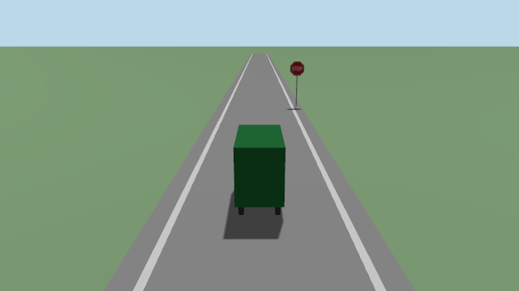
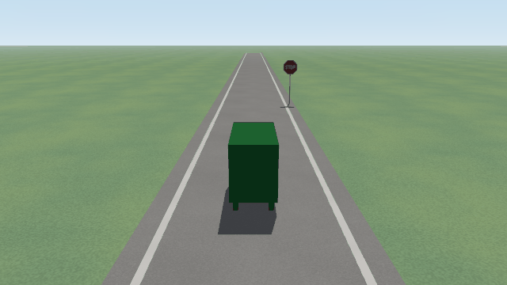
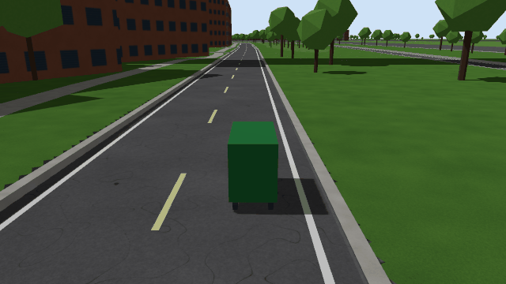
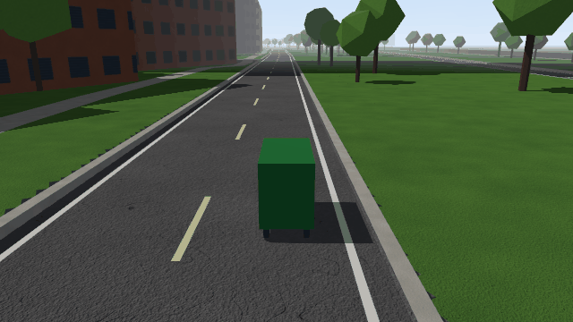

# Ravensim

**Ravensim** is our own simulator, in Rust (Ben named it, 16 Nov). Ben, 7 Nov: "merge in
everything from gazebo so its standalone in rust". This page is the simulator's **core**: the world, the car, the lidar, the radar, the IMU, the GPS, the wheels
and the clock. The cameras are their own program ([its page](own-simulator-cameras.md)),
started beside it. The plan: [the design](designs/2026-11-05_own-simulator.md).
Every argument, the worlds and `sim-check`: [Simulation](simulation.md).

```sh
pixi run sim world:=test_lot rviz:=false               # Ravensim (simulator:=ravensim)
pixi run sim-check                                     # the road world's checks
tools/software_gl.sh pixi run sim-check                # no GPU: the cameras in lockstep
```

## Watch it

One command starts Ravensim and the developer window on it (scene and console on the left;
lidar, map with RavenTiles, keys and algorithms on the right):

```sh
pixi run ravensim                    # pixi run sim's world
pixi run ravensim world:=campus      # Carleton, with its RavenTiles and lanes
```

Any `sim.launch.py` switch (`name:=value`) goes to the sim. It runs on this computer only.
Ctrl-C, or closing the window, stops both. RViz stays off (`rviz:=false`).

| Part | Package | Language |
|---|---|---|
| the world, the car, the rays, the IMU, GPS, wheels, clock | `aav_simulator` (`sim-core`, `sim-node`) | Rust |
| the cameras | `aav_sim_cameras` (Bevy, offscreen) | Rust |
| the worlds, models, `ravensim.launch.py`, the car's nodes (`sim_adapter`, `sim_imu`...) and the shared sim models | `aav_sim_models` | Python |
| big maps in 64 m chunks: **RavenTiles** | `maps/<place>/chunks/` (`pixi run campus`) | data |

**The default since 8 Nov, the only simulator since 16 Nov**: it passed every `sim-check`
leg Gazebo passed (below); Gazebo was removed then ([Gazebo, as it
was](history/gazebo-as-it-was.md)). `simulator:=own`, its old name, works for one release.

**No GPU:** the cameras draw in software, on Mesa's lavapipe, and the clock waits for each
picture (**camera lockstep**, 16 Nov): `tools/software_gl.sh pixi run sim-check`. See
[No GPU](#no-gpu-15-nov) below.

## In one picture

```text
 ego ─> output mux ─> sim_adapter ──/vehicle/sim/cmd_vel──> simulator (Rust)
                      (actuator model)                      │ world: SDF files      
                                                            │ car, rays, IMU, GPS, clock
 sim_imu, sim_gps, sim_radar, sim_adapter <─────┘ /vehicle/sim/*: Gazebo's rates, QoS
   └─> /sensors/*, /vehicle/*  ─> localization, navigation, safety: unchanged
```

It replaced `gz sim` **and** its bridges. Every node above them is the one Gazebo used.

## What it gives

| Topic | Rate | Same as Gazebo was? |
|---|---|---|
| `/clock` | 1 kHz | yes: one per step |
| `/vehicle/sim/odom`, `/vehicle/sim/truth` | 50 Hz | yes; the wheels' odometry can also drift: `wheel_noise:=0.05` (m/s on each reading) and `wheel_slip:=0.02` (2 % too far), seeded by `noise_seed:=`, off by default (TODO 179) |
| `/vehicle/sim/imu` | 50 Hz, noise 0.02 rad/s, 0.2 m/s² | yes (the xacro's) |
| `/vehicle/sim/navsat` | 5 Hz, noise 4.5e-6° (0.5 m) | yes; exact WGS84 from the world's datum |
| `/joint_states` | 100 Hz | Gazebo sends 1 kHz; the car's wheels 100 Hz |
| `/sensors/lidar/points` | 10 Hz, 1800 x 16, 0.5-100 m, 3 cm | yes: packed as Gazebo's, organised, `inf` misses |
| `/vehicle/sim/radar/points` | 10 Hz, 61 x 3, 0.3-8.4 m, 5 cm | yes; and better: a person walking gets their own Doppler speed (a `speed` field Gazebo's cloud lacks; `sim_radar` adds it). Gazebo's radar says everything stands still (TODO 194) |
| the three car cameras, the chase camera | 10 Hz, 640 x 360 | yes: `aav_sim_cameras` draws the same world file |

## The worlds

| World | Read | Triangles |
|---|---|---|
| `empty`, `road`, `test_lot` | `aav_sim_models/worlds/*.sdf`, with `model://stop_sign` | 2 to 118 |
| `campus` | `maps/campus/campus.sdf` and its OBJ meshes (`pixi run campus`) | 595,845, read in 1.2 s |

The rays see what Gazebo's lidar sees: the **visuals**. One roof-lidar scan takes 1.7 ms in the
test lot and 15 ms on the campus (Ben's Mac, 4 threads).

## Looks: `graphics:=pretty` (17 Nov)

Ben, 16 Nov: "its pretty ugly and flat looking" (TODO 244). The cameras now draw more:

| Before (`graphics:=simple`) | After (`graphics:=pretty`) |
|---|---|
|  |  |
|  |  |

| Added | How |
|---|---|
| Grain on grass, asphalt, concrete and paint | small pictures made from noise in code (`camera_core::pretty`), laid in metres; each keeps its surface's average colour |
| A sky | haze at the horizon, bluer overhead, a glow round the sun (a skybox, made in code) |
| Haze far off | none nearer than 50 m; a fifth at the cameras' 150 m edge |
| Light | a warm sun, a blue-grey sky light, sharper shadows out to 120 m |
| The campus's bumps | its bump maps (`normal_map` in the SDF), drawn at last |
| Stop lines on the campus | a white bar where the Lanelet2 map's stop line is (`pixi run campus` again) |

The campus already had OpenStreetMap's building heights, roofs, trees and lane lines.
No downloads: every picture is made in code.

**Only the cameras change.** The lidar and radar read the same shapes. Pretty or simple,
the pictures keep the lens, size, rate and noise.

| `graphics:=` | Draws | Default |
|---|---|---|
| `auto` | pretty on a GPU, simple drawn in software (`tools/software_gl.sh`, CI) | yes |
| `pretty` | all of the above | - |
| `simple` | plain colours, a flat sky: as Gazebo drew | - |

`pixi run sim-cameras --graphics simple|pretty` draws either one without ROS.

Checked (17 Nov, Ben's Mac, pretty unless it says):

| Check | Simple | Pretty |
|---|---|---|
| `sim-check --obstacle --lane` (road) | passed before | all pass; stopped 0.80 m from the box |
| The lane finder, from the truth | 1.0 cm; both lines in 299 of 299 | **0.8 cm**; 299 of 299 |
| Stop sign, RF-DETR, 7 to 20 m | 0.75 to 0.93 | 0.88 to 0.92 |
| Stop sign, YOLO, 7 to 15 m | 0.41 to 0.92 | 0.44 to 0.93 |
| 4 cameras, one round, GPU (road / campus) | 14.7 / 19.4 ms | 22.7 / 27.2 ms |
| 4 cameras, one round, software (lavapipe, road) | 44.5 ms | 105 ms: so `auto` draws simple there |
| `tools/software_gl.sh --force pixi run sim-check --obstacle` | all pass; cameras 10 Hz in sim time, real-time factor 0.98-1.00 (lockstep) | not drawn: `auto` is simple there |

The stop sign 25 m off and the lane lines sit inside the 50 m with no haze, so the
detectors see the same red and white. The lane finder did a little better on real grain.

## The car

| Part | How |
|---|---|
| Today | `sim_adapter`'s actuator model, then `TwistFollower` (Gazebo's AckermannSteering, copied: ±10 m/s², the wheels steer at once), then the bicycle |
| Hitting things | the outline (`vehicle.yaml` `body:`) stops at what it meets, at 0.35, 0.8 and 1.3 m up, as Gazebo's physics did. The log says "the car hit something" |
| The ground (8 Nov) | each wheel finds the ground below it (a ray straight down). The car rides up a slope and tilts on it; a step up to 0.1 m (`ground_step`) it rolls up; a higher one (a 0.3 m kerb) stops it, as a wall does. The truth carries the height and tilt, so the cameras follow |
| The trait | `sim-core` `CarModel`: `step`, `state`, `reset`, `hold`. The shared `car-model` crate goes in behind it at the merge |
| `ActuatorCar` | the actuator model itself, to `car-model`'s rules (exact lags, rate-limited motor, deadband, dead time). Tested; not wired in yet |

## Noisy wheels (S4)

The car's wheel odometry drifts; by default Ravensim's doesn't, as Gazebo's didn't. Turn
it on to see whether the EKF, NDT and the watchdog cope (Ben, 14 Nov: seeded, off by
default).

```sh
pixi run sim wheel_noise:=0.05 wheel_slip:=0.02 noise_seed:=7
pixi run sim-check --with wheel_noise:=0.05 --with wheel_slip:=0.02
```

| Setting | Off | Try | Why that value |
|---|---|---|---|
| `wheel_noise` | 0 | 0.05 m/s | jitter on each wheel reading while the wheels turn. Well under the watchdog's wheel checks (0.3 m/s against the IMU, 0.15 m/s against the GPS), so a healthy car never trips them |
| `wheel_slip` | 0 | 0.02 (2 % too far) | a tyre's rolling radius moves a few per cent with pressure and load; the wheels then read too far, and the odometry drifts about 2 m a 100 m |
| `noise_seed` | 1 | any | the same seed, the same drift: a run repeats |

Standing still, the wheels read nothing (no noise). The truth (`/vehicle/sim/truth`) never
drifts. **Not measured on the car yet**: the values are picks; replace them with a bag's
numbers (the wheels against the GPS on a straight).

## The IMU (S3, 18 Nov)

What `/sensors/imu/data_raw` gives, the car against Ravensim:

| | The car (`imu_node`, Yahboom) | Ravensim (`simulator` → `sim_imu`) |
|---|---|---|
| Turn rates | x, y and z | x, y and z: how the car turned since the last reading (slopes and kerbs too). Before 18 Nov: z only |
| Acceleration | what it feels: speeding up, the turn's pull, gravity | the same: the mean since the last reading, the pull at the sensor's place, gravity as the tilted car feels it. Before: an instant's, which read 10 or 0 m/s² while the car model caught each command, so `sim_imu` replaced it with dv/dt of the odometry (noisy with `wheel_noise`, and no gravity on a slope) |
| Orientation | none (covariance -1) | none, the same |
| Noise | 0.02 rad/s, 0.2 m/s² (its covariances) | the same numbers, added once (before: twice on the acceleration) |
| Rate | 200 Hz (if set up, `aav_imu_yahboom`) | 50 Hz, as Gazebo's |

`sim_imu accel_from:=odometry` gives the old way back.

## Plug-in points

| For | Where | What it gets |
|---|---|---|
| Cameras, as their own program | `/vehicle/sim/truth` | the car's pose, 50 Hz, on sim time |
| Cameras, in the loop | `sim-core` `SensorPlugin` | the world, the car, `base_link`, the time, at its own period |
| The cameras' world | `World::shapes` | every shape as SDF draws it: box, cylinder, plane, mesh file; pose; colour |
| Placing things | `/vehicle/sim/spawn_entity`, `delete_entity` | `simulation_interfaces`: an SDF model, a pose |

`ravensim.launch.py` starts the cameras (`sim_cameras --ros --pose truth --world <the
world>`) and sets `sim_adapter`'s `cameras` to true, so `/system/source` announces them.

### Camera lockstep (16 Nov)

With `camera_lockstep:=true` (or `auto` under `tools/software_gl.sh`) the clock waits for
the pictures, as Gazebo's sensors did:

```text
 sim_cameras ──/vehicle/sim/cameras/free_until (the next picture's sim time)──> simulator
 simulator: at each truth (50 Hz) stamped that late, hold /clock until a later one comes
            (10 s with no word: run free until the cameras speak again)
```

The logic is `sim-core` `lockstep.rs` (`CameraGate`), tested without ROS. Measured: [the
cameras' page](own-simulator-cameras.md#camera-lockstep-16-nov).

## Head to head, with the cameras (8 Nov, Ben's Mac, quiet: load 4-15)

The same `sim-check` legs on both, one run after the other, nothing else running.

| Check | Ours | Gazebo |
|---|---|---|
| `sim-check` (start-up, contract, sensors, all 3 cameras, lidar, scan, scripted drive, EKF, wheels) x 3 | **3 of 3 pass**; 43-49 s a run; EKF vs truth 0.11-0.40 m | 2 of 3: once the EKF never came up in 120 s; 45-46 s; 0.10-0.14 m |
| `--obstacle` (the box) | pass: 0.36 m before it, goal reached after | pass: 0.28 m |
| `--lidar-obstacle` (the post) | pass: 0.33 m | pass: 0.25 m |
| `--speed-steps`: overshoot | 15.9, 15.2, 10.1 %; within 5 % after 10.9-13.3 s | the same to 0.1 % and 0.1 s |
| Those three legs together | 4 min 5 s | 4 min 22 s |
| `--lane-only` (road) | pass: within 5 cm in 5.4 s, overshoot 3 cm | pass: 5.1 s, 5 cm |
| `measure lane`, a campus road, 120 s | 171 m, error mean 4 cm, lane lost in 0-1 % | 60 m, ended in the other lane, lost in 68 % |
| `drop-in`, road world | every camera, the lidar, the radar at 10 Hz: pass. `/perception/voxels/cubes` silent (the voxels trial is off) | not run |
| `--perception` (RF-DETR and the stop-sign lock) | **fail**: the detector saw the sign but the lock never came on while driving | pass: locked at 68 px, stood 3.9 m before it |

**The stop sign on ours, what we know:** parked 6 m from it (`start_x:=19`), RF-DETR finds
it (score 0.93, 62 px tall: the watcher wants 55) and the lock comes on. Still pictures
along the road: 0.84-0.94 from 19 m to 4 m away. Gazebo's box at the same place is taller
(68 px against our 52). While driving, the lock never came on. [[untested]] why.

### Three times each, then the switch (8 Nov, quiet Mac)

| Check, on ours | Runs | Result |
|---|---|---|
| `--perception` (RF-DETR, the stop-sign lock) | 3 | **3 of 3 pass**: locked at x = 17.7-18.2 m (56-71 px), stood 3.9-4.4 m before the sign. Before them, 4 of 5 with a listener |
| `--faults` (14 faults, the watchdog's own two) | 3 | **3 of 3**: 25 of 25 checks each |
| `--drive-to-point-only` (1 and 3 m/s, cancel, e-stop, GPS fault) | 3 | **3 of 3**: 17 of 17 checks each; B within 0.09-0.27 m |
| `--obstacle` with the box drawn in the pictures | 1 | pass: 0.35 m before it; the cameras drew it ("placed models: [obstacle]") |

**The stop sign:** the lock never came on while driving in 1 of the first 5 runs, and in
none of the next 3. A listener logged every box: a picture every 0.1 s, no gaps, the
detector's box 50 ms after each picture's stamp, growing smoothly as the car came near.
No fault found in the sign's size, height or pose, or the camera's mount; the one failure's
cause is not known. Our box is smaller than Gazebo's at the same place (52 px against 68);
the lens's own sum gives about 49 px, so ours is the nearer.

**Found and fixed on the way:** with `faults:=true` our front left camera_info went to the
relay's topic too, so `--faults` waited for the lens and failed; now only the picture moves
(`--image-topic`), as Gazebo's bridge does.

So on 8 Nov `DEFAULT_SIMULATOR` became `own`. `sim-check` says which simulator it runs, every
time (`simulator:=`).

## Results (7 Nov, Ben's Mac, other agents running: load 30-40)

| Check | Ours | Gazebo |
|---|---|---|
| `drop-in`, test lot | odom, status, IMU, GPS, radar, lidar: pass. Cameras: nothing (none yet) | pass (5 Nov) |
| A goal (then Nav2's), (14, 0) in the test lot | succeeded; the truth 0.4 m short, 0.9 m aside | succeeded (5 Nov) |
| `sim-check`: start-up, contract, lidar, scan, scripted drive, EKF vs truth (0.05-0.20 m), wheels vs IMU | pass | pass |
| `--lidar-obstacle` (the post) | pass: stopped 0.20 m before it | pass |
| `--obstacle` (the box) | stopped **0.33 m** before it; then the goal failed: a TF lookup ran late on the loaded Mac | 0.23 m (3 Nov) |
| `--speed-steps` (-0.5, 1, 2 m/s): overshoot | 15.8, 15.2, 10.1 %; within 5 % after 10.9-13.3 s | 15.9, 15.2, 10.1 %; 11-13 s (TODO 27) |
| `--drive-to-point`, 1 m/s | 7 of 8 pass, B within 0.11-0.34 m; the +150° leg refused (B inside the tightest turn from where the last leg stopped) | pass (0.2) |
| `--drive-to-point`, 3 m/s | 3 of 4 pass, B within 0.05-0.12 m; one leg held by the sensor watchdog (a stale sensor on the loaded Mac) | pass (0.2) |
| Real-time factor | 0.71-1.00 under that load | not run here: its renderer didn't load in this worktree |

## No GPU (15 Nov)

The cameras are the only part that draws; the rest of Ravensim never needed a GPU.
Their own page has the details: [the cameras, with no GPU](own-simulator-cameras.md).

| What | Works? |
|---|---|
| The cameras on Mesa's lavapipe (software Vulkan), a Mac, forced (`software_gl.sh --force`) | yes: 4 cameras at 10 Hz in the road world, pictures as the GPU's |
| `sim-check` (road world), the cameras in software, a Mac (`software_gl.sh --force`) | **pass**, every leg: all 3 cameras at 10.0 Hz, EKF vs truth 0.10 m |
| `sim-check --obstacle`, the same way | **pass**: the stop zone stopped the car 0.92 m from the box; the goal reached after |
| The same on Linux, no GPU (CI, oirp-spss) | [[untested]]: CI's nightly `sim` job runs it, in lockstep since 16 Nov |
| The campus world in software | no: 1.3 s a picture round. Campus needs a GPU |

| Command | Where |
|---|---|
| `tools/software_gl.sh pixi run sim-check` | Linux, no GPU: our cameras on lavapipe |
| `tools/software_gl.sh --force pixi run sim-check` | a Mac or a Linux computer with a GPU: CI's way |
| `pixi run sim-check --no-cameras` | anywhere: no pictures at all |

## Not there yet

| Missing | Why it matters |
|---|---|
| Hills in a world | the ground works on any mesh; none of our worlds has a slope yet |
| The car's own body in the lidar | Gazebo's lidar may see the car; ours doesn't |
| The Bevy window drawing ours | `pixi run ravensim` starts it on Ravensim (17 Nov); a person still has to look it over |
| `ActuatorCar` driving the node | the Python actuator model stays in front |
