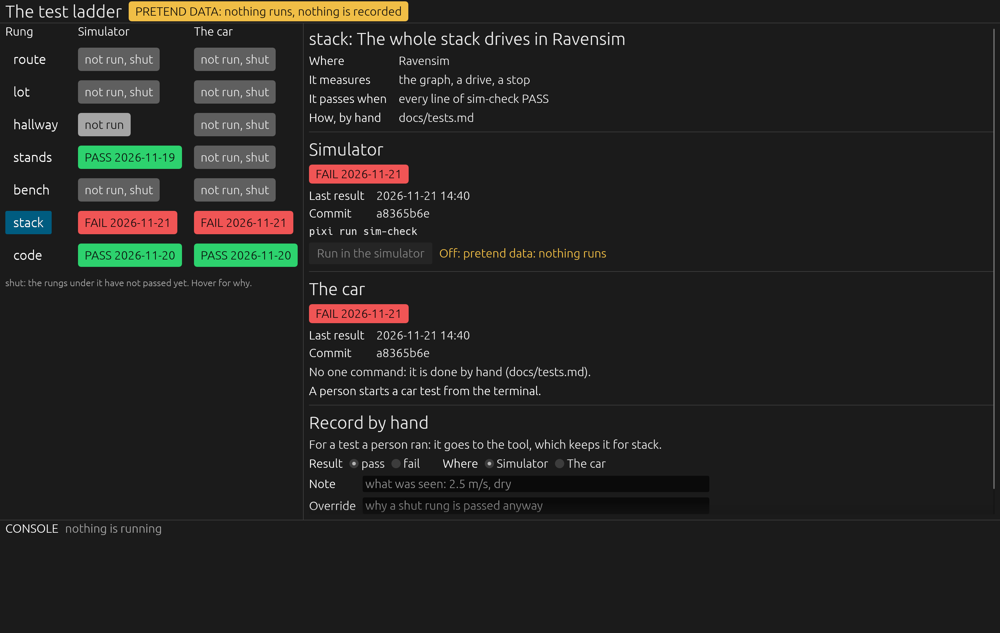

# Proving it: how the tests fit together

**One page for the question "how do we know?"** We have two sets of tests. This page says
what each is for, how one step proves the step before, and how the same test runs on the
car and in the simulator. Written 22 November 2026 by Ben Woodhead (Ben: "Testing. Proofs.
Not just feelings. Systematic").

The detail is in [the testing plan](testing-plan.md), [Every test](tests.md),
[Actuator tests](actuator-tests.md) and [the league](league.md). This page adds nothing to
run: it is the map, and the list of what is missing.

> **The short version**
> 1. **Set 1, the ladder:** does the *car* work? Ten rungs, named for what the car can do
>    ([the plan](wrap-up.md), 23 Nov); each answers one question with a graph. **Rung 1 is
>    built**; the others are listed as "not built yet".
> 2. **Set 2, the algorithm tests:** which *algorithm* is best? Every one drives the same
>    tests and is scored the same way.
> 3. **Every car test has a twin in the simulator**, with the same command and the same
>    report. Where the two differ, we fix the simulator's numbers.
> 4. **The rules of evidence** (below) apply to both sets.
> 5. Nothing here has run on the car yet. "Built" means it passes in Ravensim.

## Where we are: `pixi run ladder`

Since 23 Nov the rungs are [the plan's ten](wrap-up.md#1-the-rungs). The one list of them
is `tools/ladder/rungs.yaml`: number, name, the question, its graphs, the pass mark, the
simulator's command, the car's command, the report chapter it feeds.

```bash
pixi run ladder                      # every rung: the simulator's side and the car's
pixi run ladder next                 # the next open rung and its command (--car: the car's)
pixi run ladder run 1                # run rung 1 in the simulator (or: run stands); recorded,
                                     # and its report page saved
pixi run ladder run 1 --only estop   # one part of it alone; not recorded
pixi run ladder session 1            # the newest run: its answer and each step
pixi run ladder report 1 --open      # that run's report page, in the browser
pixi run ladder run code             # a "before you start" check: code, stack or bench
pixi run ladder record --from-report ~/aav-tests/<run>      # a car-test run
pixi run ladder record 1 pass --car --note "on stands, dry" # a rung done by hand
pixi run ladder all --sim            # the full suite on the virtual car: one report
```

| # | Rung | State |
|---|---|---|
| 1 | On stands: accelerate, brake, turn | **built**: [below](#rung-1-on-stands-accelerate-brake-turn) |
| 2 to 9, S | [the plan's table](wrap-up.md#1-the-rungs) | **not built yet**: listed, never runnable, never passed or failed |

| Rule | |
|---|---|
| Progress is one file, `~/aav-tests/ladder.yaml` | a line a result, with its date, commit and who; never rewritten |
| The simulator and the car are kept apart | a pass in Ravensim never marks the car's rung |
| A rung is shut until the rungs under it have passed | a car rung also needs its own simulator run |
| A rung not built is not a rung you can run | `run` and `record` refuse it, with what exists today; no override |
| A pass on a shut rung needs `--override "why"` | and the why is kept |
| It never moves the car | for a car rung it prints the command; a person runs it |
| A simulator run uses the simulator that is open | the rung's command carries `--attach`: `car-test` listens to `/system/source` on this computer; SIM: it tests that one, the car you see; nothing heard: it starts its own, with no picture; anything else (REAL...): refused |
| One part alone never moves the ladder | `run <rung> --only <test>` records nothing: a rung passes whole |

### The full suite: `pixi run ladder all --sim`

Every built rung in turn, bottom first, on the virtual car (wrap-up step 5).

| What | How |
|---|---|
| Each rung | run and recorded as `ladder run <rung>` does, its report page saved |
| One at a time | one lock for the whole session: nothing else runs between the rungs |
| Not built yet | skipped, and the report says so (today: rungs 2 to 9 and S) |
| Shut | skipped, with which rung under it failed |
| Ctrl-C | the rung's own command stops its simulator and is waited for; nothing is recorded for it; the rest are skipped |
| The report | one page: `~/aav-tests/<time>-all-sim/ladder-all.html` (and `.yaml`): each rung, its result, its time, a link to its own page |
| The car | `ladder all --car` is refused: the car's rungs are run by a person, one at a time |

### Before you start: the checks that move no car

The old bottom rungs moved no car you could see. They are not rungs any more: one line,
still runnable, and they never open or shut a rung.

| Check | Runs | `pixi run ladder run ...` |
|---|---|---|
| the code's own tests | `tools/test.sh` | `code` |
| the whole stack drives in the simulator | `pixi run sim-check` (its own simulator, no picture) | `stack` |
| the bench stand-in: the real boards, no car | `pixi run bench-check` | `bench` |

### What happened to the old rungs and their saved results

Until 23 Nov the rungs were named after places. The progress file is **never rewritten**;
old lines are read like this:

| Old rung | Now | Its old results |
|---|---|---|
| `stands` | rung 1 (the same run, the same pass mark) | still rung 1's |
| `code`, `stack`, `bench` | the checks above, under the same names | still theirs |
| `hallway`, `lot`, `route` | gone | kept in the file, **not shown**; `pixi run ladder` says how many. Not mapped forward: those passes were judged by their own sessions' pass marks, which are not the pass marks of rungs 2 to 4 |

Their commands still work from a terminal (`pixi run car-test --hallway --sim`, `--lot`,
`pixi run measure controllers --tours lot`); rungs 2 to 4 will read their runs.

## Rung 1: On stands: accelerate, brake, turn

**The question: do the actuators follow a command, the right way?**

| | |
|---|---|
| What runs | the stands run that existed already: `car-test --stands --sim --attach --no-manual` ([Actuator tests](actuator-tests.md#the-simulated-car-on-stands-pixi-run-jacks)). Nothing new is measured: the answer is read from the run's own files |
| What you see | the car in the simulator's picture is lifted onto stands; the steering sweeps, the wheels spin; the car stays where it is. About 5 minutes |
| Passes when | every step of the run passes: the wheels reach each speed step up within 25 % (or 0.05 m/s), the steering tests give their numbers, every fault tried stops the car inside its limit (2 to 3 s) |
| After it | the last step presses the e-stop, and it stays pressed, as on the car: `pixi run clear estop --sim` before the next run |
| Feeds | the final report's chapter "The car and its model" (and "Safety": the faults) |

**The answer, top to bottom:**

| Part | Shows | From |
|---|---|---|
| The verdict | one line: `PASS: the wheels follow each speed step up (a step down is not judged); the steering follows its commands; 5 of 6 faults tried were caught in time (2 stopped the car by themselves; for 3 the watchdog named the lost sensor and the test stopped the car); NOT SHOWN: ...`; then the pass mark | `report.yaml`: each step's result |
| Graph 1, the wheels | the speed asked for (dashed) and measured (solid) over time; a row a speed step: delay, 10 to 90 %, measured at the end, off at the end | step 4 `wheel-steps`, `log.csv`: `cmd_speed`, `speed` |
| Graph 2, the steering | the angle asked for and measured over the sweep; over its 16 steps: the middle, smallest and largest delay, 10 to 90 %, off at the end; and "asked to the left, it went to the left" | step 3a `steer-sweep`, `log.csv`: `cmd_steer`, `steer` |
| Graph 3, the brake | how hard the brake was asked to press and how hard it did (0 to 1): let go, then pressed; and how long the wheels took to stand still | step 4, `log.csv`: `brake_cmd`, `brake`, `speed` |
| Faults on purpose | a row a fault: was the car stopped (**yes**: by itself; **caught; the test stopped it**: the watchdog named the lost sensor, then the test stopped the car; **not shown**; NO; not tried), in how long, the time allowed | `report.yaml`: each fault step, and the times in the runner's own sentence |
| Every step of the run | the full table, folded away | as before |

| The numbers | |
|---|---|
| delay | the time until the measured line has moved 10 % of the way to the new value |
| 10 to 90 % | the time it then takes to get 90 % of the way |
| off at the end | the mean of the last quarter of the step, less the value asked for |
| never finer than | the log's sample gap, 0.02 s |
| nothing invented | no fit, no smoothing. A number the files do not hold is **"not measured"**, with what is missing: a step down the free wheels did not finish, a run that left a step out, a brake that reports no position |
| where the maths is | `tools/step_response.py` (tested, no ROS); the answer and the page: `tools/rung_answer.py` |

The brake has no pass mark of its own in the stands run: its graph is shown, not judged.

**The saved report.** Each run of the rung writes one page into its own folder,
`~/aav-tests/<time>-stands-sim/rung-1-report.html`: the question, the verdict, the graphs,
the numbers, the commit, the command and the date. The ladder's line for the run keeps
where it is (`report_file`). **Open the report** on the tests screen, or
`pixi run ladder report 1 --open`.

| Why one HTML page, not Markdown and pictures | |
|---|---|
| one file a run | the graphs are inside it (SVG): nothing to lose, nothing to build |
| it opens with a double-click | on any laptop, with no tool |
| it pastes | plain headings, tables and figures, no script: into the final report's chapter |

**The simulator beside the car.** Every graph and the faults table have two columns: "In
the simulator", filled, and "On the car", which says **no car run yet**. No car data is
drawn until a car run exists; laying the two curves on one graph is step 5 of
[the plan](wrap-up.md#6-the-order).

**Run on 24 Nov, Ben's MacBook** (`AAV_LADDER_FILE=/tmp/... pixi run dry-run`, then the
tool's own command, the one the **Run** button starts):

| What | Result |
|---|---|
| The run | 12 PASS, 2 SKIPPED (a Pi's link, a cable: not in the simulator), exit 0 |
| The car in the picture | on stands for the whole run; the wheels reached 0.33 m/s; its true position moved 0.0000 m; lowered at the end |
| The wheels | asked 0.10, 0.20, 0.30 m/s: reached each within 25 %. Asked down to 0.15: not reached (they coast), and not judged |
| Faults | caught in time, 5 of 6: the commands lost and the e-stop stopped the car by themselves; for GPS, IMU and lidar the watchdog named the lost sensor and **the test** stopped the car |
| The camera | **not shown**: the watchdog already called it frozen before it was lost (TODO 274). The step itself says PASS |
| A second run started over it | refused: one car, one run at a time (`tools/ladder.py` `only_run`). Found on 24 Nov: a Run pressed in the window during a run from a terminal stopped both, and the result went under the wrong run's folder; both fixed |

## The dry run: `pixi run dry-run`

**Everything we will do with the real car, done first with the simulated one you can see**
(Ben, 22 Nov: "control the car in ravensim the same way we would control the actual car
... a dry run of everything we will do in real life"; TODO 273).

```bash
pixi run dry-run                     # three screens: Ravensim's, the hardware panel, the tests
pixi run dry-run --nav --debug       # and the navigation view alone, and the debug screen
pixi run dry-run --no-panel          # without the hardware panel
pixi run clear estop --sim           # a person clears the e-stop a test left set
```

Which window is which screen, and why no RViz opens:
[RViz and ours](hud.md#rviz-and-ours) (since 23 Nov the hardware panel opens by default).

| It opens | What it is | For |
|---|---|---|
| the simulator | `sim.launch.py`, no window of its own; its lines go to `/tmp/aav-dry-run/sim-launch.log` | the car |
| the simulator's picture | the developer window, live (`pixi run dev-window --live`) | watching the car while a test runs |
| the tests screen | below | running a rung, reading its answer |
| `--panel` | the hardware panel (`pixi run hw-panel`) | every sensor's number; the buttons |
| `--debug` | the debug screen (`pixi run debug-hud`) | the lidar, the localizers |

Ctrl-C, or closing the ladder window, stops every process group it started; it says
"nothing is left running", or names what is. It refuses to start beside another simulator,
or anything else that announces on `/system/source`.

**The world it picks.** The tests' own simulators differ (the stands test takes the road
world with cameras; the hallway and the lot an empty world without). The dry run needs one
world for all of them:

| Switch | Why |
|---|---|
| `world:=road` | the stands test waits for a camera's picture, and its faults break the camera and the lidar: both need something to see; the picture shows a road |
| `nav:=false` | nothing else drives, as in every actuator test's simulator |
| `faults:=true` | the stands test's step 5 breaks sensors on purpose |
| `sim_speed:=3` | ego's cap, for the lot's tests at 2 and 3 m/s |
| `start_x:=-150`, `geofence_radius:=340` | nobody turns the simulated car round: every pass drives on from where the last one stopped. 340 m of flat ground ahead; the fence ends 10 m before the ground does |

Any `sim.launch.py` switch can follow the command (`pixi run dry-run world:=empty`); yours win.

| As on the car | In the dry run |
|---|---|
| the stands test's last step sets the e-stop, and it stays set | the same. The next test is **refused** until a person clears it: `pixi run clear estop --sim` (`--sim`: this computer only) |
| a person puts the car on stands, and takes it off | the runner does: up for phase A, down after; down first for the hallway and the lot. The window's switch does it by hand |
| a person puts the car back on the start line | nobody does: after about 340 m of passes the geofence stops the test. Stop the dry run and start it again |
| the heartbeat fault: a cable pulled | the runner pauses the output mux of **this** simulator (the dry run tells it which process group is its own) |

**Tested, 22 Nov, Ben's MacBook.** See [what can be dry-run](#what-can-be-dry-run-from-the-screen).

### The tests screen: `pixi run ladder-window`

```bash
pixi run ladder-window               # the tests screen (the first time: cargo builds Bevy)
pixi run ladder-window --pretend     # sample data: nothing runs, nothing is recorded
pixi run dry-run                     # the screen beside a simulator you can watch (above)
```



The picture is the window's own screenshot, 24 Nov, beside the dry run's simulator, after
rung 1 ran.

| Part | Shows | Does |
|---|---|---|
| top: **Before you start** | the three checks that move no car, each in words: "the code's own tests: passed 23 Nov" | a small **Run** each; they block no rung |
| top: **The simulated car** | "on the ground" or "ON STANDS", asked every 5 s; off, with the reason, unless a simulator runs on this computer | **Put it on stands** / **Lower it to the ground** (`pixi run jacks up --sim`, `down`); a run does this by itself |
| left: the ladder | rung 9 at the top, rung 1 at the bottom, S under them; **Simulator** and **The car** side by side; each cell in words: PASS or FAIL with the date, not run, shut, **not built yet** | click a rung |
| middle: the rung | its question, the graphs that answer it, when it passes, the report chapter it feeds. A rung not built: "NOT BUILT YET", and what exists today | |
| **Run rung 1 in the simulator** | on when the rung is built, open, and nothing else runs; else it says why. Under it: where it will run ("in the simulator that is open: watch the car in its picture"), and what to do after | `pixi run ladder run <rung>`; one run at a time |
| **One part of it at a time** (folded) | the rung's own tests (from `car-test`'s list, not a copy), a **Run** each; simulator only | not recorded |
| **On the car** | its command as text, and "A person starts a car test from the terminal" | **Copy** only |
| **Write down a result by hand** (folded) | pass or fail, simulator or car, a note, why a shut rung is passed anyway | `pixi run ladder record ...`; a refusal is shown in the tool's words |
| right: **The answer** | while a run goes: **RUNNING NOW** and its step. Then [rung 1's answer](#rung-1-on-stands-accelerate-brake-turn): the verdict line and its pass mark, **Open the report**, each graph with its numbers beside the car's slot, the faults table | **Show**: the newest run, or the run that counted on the ladder |
| under it: **Every step of the run** (folded) | the table of steps there was before: PASS / FAIL / SKIPPED / NOT RUN, what happened, the `vehicle.yaml` lines; a step's own graph and numbers | click a step |
| the console | the run's last lines, "running..." with the step, how it ended | **Stop** ends the run and all it started |

| Rule | |
|---|---|
| The window never moves the car | it has no control that starts a car test; every run it starts is the tool's simulator run (`--sim`); the jacks switch is the simulator's only (`--sim`, `--local`, refused when `/system/source` says REAL) |
| The tool is the only writer, and the only reader of a run's files | the window reads `ladder --json` every 2 s and `ladder session <rung> --json` when a rung is chosen or a run ends; every rule stays in `tools/ladder.py`, and every number on the screen is `tools/rung_answer.py`'s, already in words |
| Colour is never the only signal | every result is a word; the graph's lines differ by their dashes, and the legend says which is which |
| Closing the window stops its run | a simulator it started is not left behind; one that was already open stays, as its owner's |

The code: `ros/hud/aav_dev_window` (`src/ladder_window/`, and the logic in `crates/ladder-core`).

**Also on the hardware panel (25 Nov, the test bench, [wrap-up step 3](wrap-up.md#4-the-screens-eight-become-four)).**
The hardware panel has a **LADDER** tab: the ten rungs, a rung's question, Run in the
simulator and Stop, the answer's verdict, its graphs and numbers, the faults, and the
jacks switch. The same `ladder-core`, so the same rules; the car's command is only shown.
It is there in `hw_panel` and in the map window's HARDWARE page
([the LADDER page](hud.md#the-ladder-page-the-test-bench)). Not there yet: the checks'
Runs, one test at a time, Record by hand, Open the report: those are still this window's.

## What can be dry-run from the screen

**This section is the record of 22 Nov, under the old rungs' names** (bench, stands,
hallway, lot, route); the ladder has been [the ten rungs](#where-we-are-pixi-run-ladder)
since 23 Nov, and of these only the stands run is a rung today.

Ben, 22 Nov: "so I can figure out if we are testing everything". Filled from what was
built and **run on 22 Nov** (Ben's MacBook, `pixi run dry-run --panel --debug`, the tests
started by the ladder tool's own commands, the ones the window's buttons run). "From the
screen" = the ladder window beside the simulator you can see.

**The session cards** ([the testing plan](testing-plan.md#the-sessions-as-cards)):

| Card | From the screen? | What ran, and what is missing |
|---|---|---|
| 0: after the install | 🟡 partly | the **bench** rung runs `bench-check` (its own stand-in, no picture; not run tonight). The boxes on the real boards have no twin |
| 1: the boot self-test | ❌ no | no rung runs `pixi run check` or reads `/safety/self_test/status`. The stands preflight counts every sensor's rate; the e-stop press is stands step 5h |
| 2: stands (phase A) | ✅ yes, 12 of 14 steps | **ran: 12 PASS, 2 SKIPPED**, the heartbeat fault included. Skipped: a Pi's link, a cable (no Pi, no cables). Not there: the steering's ends on the hardware panel (B1-B9), the wheel watcher with a tachometer |
| 3: map the hallway | ❌ no | `record-drive --sim` starts its own simulator from a terminal; no rung, no button |
| 4: the hallway, empty (phase B) | ✅ yes | **ran: 12 of 12 passes, the fitted model matched all 12**. Not as the car: nobody turns the car round (no slope from both ways), no NDT, the "hallway" is open ground |
| 5: the hallway, a person aboard | 🟡 partly, not run | `pixi run dry-run payload:=80` then the hallway rung should do it; nothing records the weight (TODO 257) |
| 6: the lot | ✅ yes, in the simulator | the whole session passes with the `default` speed loop, 6 of 6 (23 Nov), since `speed-up`, `brake` and `throttle-map` hold their top speed 2.5 s before slowing ([why](actuator-tests.md#why-it-fails-23-nov), TODO 275). Not as the car: no room limit, and nobody turns it round |
| 7: a campus mapping drive | ❌ no | a person drives it; `record-drive --sim` is a terminal's |
| 8: offline processing | ❌ no | no car and no simulator in it: laptops, hours |
| 9: the car drives itself | 🟡 partly | the **route** rung runs one scored drive round the test lot through the whole stack (**ran: every goal reached, exit 0**), in its own simulator with **no picture**, not on the campus, not on a map of ours |

**Every test** ([Actuator tests](actuator-tests.md#the-tests)):

| Test | From the screen? | Ran 22 Nov, attached to the simulator in view |
|---|---|---|
| `preflight`, the sensors alone | ✅ | PASS, in the stands session |
| `steer-sweep`, `steer-rate`, `steer-centre` | ✅ | PASS, in the stands session; `steer-sweep` alone too, with its graph |
| `wheel-steps` | ✅ | PASS |
| the faults: heartbeat, GPS, IMU, camera, lidar, e-stop | ✅ | PASS. The camera's passes on FROZEN, not on lost (TODO 274) |
| the faults: a Pi's link, a cable | ❌ | no Pi and no cables in Ravensim |
| `hall-coast`, `hall-speed-up`, `hall-brake`, `hall-steer` | ✅ | 3 passes each, all PASS; `hall-brake` alone too |
| `coast`, `circles`, `straight` | ✅ | PASS, each alone |
| `speed-up`, `brake`, `throttle-map` | 🟡 they run, and stop themselves | FAIL: "the speed rose ... while the command fell" at 3, 2 and 1.5 m/s. Up to 1 m/s, the real car's cap, they pass |
| hold a speed, a steering step on the ground, a lane change | ❌ | not built (TODO 266) |

| Not run by a person yet | |
|---|---|
| the window's buttons | every command above was typed as the tool's command (`pixi run ladder run <rung> [--only <test>]`), with the windows open; a click on **Run** starts the same command (the window's tests cover that), but nobody has clicked it beside a simulator |
| the picture while a test runs | the developer window was open; nobody watched it |

## The rules of evidence

| Rule | Means |
|---|---|
| Write the claim first | one sentence a run could show to be wrong |
| Fix the pass mark first | the number that decides, before the run, not after |
| Always a baseline | the same run without the new thing |
| Repeat | one run is a story; three or more give a spread (mean ± sd) |
| Keep everything | the commit, the command, the settings, the recording |
| A failure is a result | written down the way a pass is |

## Set 1: the ladder

The chain of evidence below still holds. Since 23 Nov its steps are run as
[the ten rungs](wrap-up.md#1-the-rungs): steps 0 to 2 are the checks before you start,
step 3 is rung 1, steps 4 and 5 feed rungs 2 and 3, step 6 rungs 4 to 6.

Each step **uses** the numbers of the step before, and **proves** them by getting the
result the model said it would.

| Step | Where | It measures | It proves the step before by | Hands on |
|---|---|---|---|---|
| 0 | laptops: unit tests, the pretend car | nothing: it checks the code against the maths | — | code that does what we wrote |
| 1 | Ravensim, the whole stack | the scores of a drive | the code works together, not only in parts | a stack fit to put on the car |
| 2 | bench: the real boards, no car | messages, timing, the locks | the stack talks to the real electronics as it did to the simulator's | a car safe to switch on |
| 3 | stands (phase A) | steering: angle, rate, centre; the wheels follow a speed | the bench's commands move the real actuators, the right way | steering numbers → `vehicle.yaml` |
| 4 | hallway (phase B) | speed up, coast, brake: dead time, lag, stopping distance | the model with step 3's numbers predicts the real run | throttle and brake numbers → `vehicle.yaml` |
| 5 | lot | the same at 2 to 3 m/s; circles; a straight line | the hallway's numbers still hold at speed | a model good to 3 m/s |
| 6 | a route, the car driving itself | the same scores as step 1 | the simulator's drive (step 1) predicted the car's | the capstone's result |

**The loop that closes it:** after steps 3 to 5 the new numbers go into `vehicle.yaml`,
the simulator runs steps 0 and 1 again with them, and step 6's scores are compared with
step 1's. The pass mark that exists today: the model's speed within 10 % of the car's, its
stop within 0.2 m ([the model against the car](actuator-tests.md#the-model-against-the-car)).

## The same test, on the car and in the simulator

One command, with `--sim` for the twin. The report has the same form both ways.

| Test | The step input | What we read | Measured by | Tunes | Built |
|---|---|---|---|---|---|
| `speed-up` | speed: 0 to the cap | time to each speed, acceleration | wheels, IMU | `max_accel`, `throttle_lag` | ✅ |
| `brake` | speed: 1, 2, 3 m/s to 0 | stopping distance, deceleration | wheels, IMU | `max_brake`, `brake_lag` | ✅ |
| `coast` | pedals off at 2 m/s | how fast it slows | wheels | `drag` | ✅ |
| `throttle-map` | speed: ¼, ½, ¾, all of the cap | acceleration per throttle | wheels, IMU | `throttle_deadband` | ✅ |
| `steer-sweep`, `steer-rate`, `steer-centre` | steering: lock to lock, small steps | angle, rate, centre | the steering sensor (or by hand) | `steer_rate`, `steer_lag`, `steer_offset` | ✅ |
| `circles` | a fixed steering angle at 1 m/s | the circle's radius | the local EKF, GPS | the real angle per command | ✅ |
| `straight` | steering straight, 10 m | drift to the side | the local EKF, GPS | `steer_offset` | ✅ |
| `car-test --hallway` | all of the above, several passes | each number **with an error bar**; the model over the run | wheels, IMU, NDT | the transfer functions | ✅ |
| Hold a speed | 1 m/s for 30 s, then 2 | how far the speed wanders | wheels, GPS | the speed loop | ⬜ to build |
| A steering step on the ground | 0 to 0.1 rad at 1 and 2 m/s | yaw rate: delay, overshoot, settling | IMU, the local EKF | `steer_lag` on the ground; the model's yaw | ⬜ to build |
| A lane change | 2 m to the side over 15 m, by the follower | sway: metres side to side, how often the steering changes side | the local EKF, GPS | the follower's tuning | ⬜ to build (the scorecard has the sway number) |

**The stands twin is on stands too** (TODO 272, 22 Nov). `car-test --stands --sim` starts
its Ravensim with the car on jacks and lowers it at the end: the rear wheels spin and steer,
the car stays put, and the wheels disagree with the IMU and the GPS, as on the real stands
([how](actuator-tests.md#the-simulated-car-on-stands-pixi-run-jacks)). Before, the simulated
car crawled in arcs and the stands checks ran backwards.

| The first honest run found | Fixed |
|---|---|
| "GPS still" failed on a still car: the receiver's noise passes 0.1 m/s one reading in seven | the median decides, not the largest |
| the live IMU watch stopped a still car one run in three (Ravensim's IMU noise, 0.2 m/s²) | the mark allows for the IMU's own noise at rest, never over 0.25 m/s; a quiet IMU keeps 0.15 |

Both would have shown up first on car day.

GPS and NDT are the **outside witnesses**: they do not pass through the wheels or the IMU,
so they catch a wrong wheel size or a drifting IMU.

## Set 2: the algorithm tests

Every algorithm for a job (a path follower, a planner) is a drop-in for the others, so
every one takes the same tests.

| Test | The question | Scored by | Built |
|---|---|---|---|
| The league's routes | which drives the route best? | `tools/score_drive.py`: time, metres off the plan, sway, holds; 3 or more runs | ✅ |
| A sideways step | started 1 m off the path, how does it come back? Overshoot, settling time | the same harness for every follower | ⬜ exists for `mpc_lag_rs` only |
| A speed step | asked from 1 to 2 m/s, how does it get there? | the same | ⬜ |
| A stop at the goal | how far from the mark, how hard the brake? | the scorecard | ✅ |
| A ghost ahead | does it stop, and how far before? | `sim-check --ghost` | 🟡 runs; it reports FAIL for every follower (it listens for the costmap on an old name) |
| The time of a tick | does it answer inside its period? | the follower's status | ✅ per follower; ⬜ one table |

A challenger replaces the default only by [the league's rules](league.md#how-a-challenger-wins).

## What is missing

| # | Gap | TODO |
|---|---|---|
| 1 | The three tests marked "to build" above: hold a speed, a steering step on the ground, a lane change | 266 |
| 2 | One step-test harness for every follower (sideways step, speed step), with one table | 267 |
| 3 | `sim-check --ghost` listens on the costmap's old name | 268 |
| 4 | A run log: every test run's commit, command, settings and result in one place | 269 |
| 5 | Step 6 against step 1: the car's scores beside the simulator's for the same route | 270, after the car drives |
| 6 | ~~The lot and route rungs have no one-command simulator twin~~ built 22 Nov: `car-test --lot --sim`, `measure controllers --tours lot`. Left: the lot's twin does not judge the 10 % / 0.2 m rule; the route's is scored by the league's table, not by `score_drive.py` on a recording, and runs with no picture | 273 |
| 7 | ~~One command for the screens side by side~~ built 22 Nov: `pixi run dry-run` | 273 |
| 8 | The hardware panel and the debug screen do not show "on stands" (the ladder window and `pixi run jacks status --sim` do) | 273 |
| 10 | ~~The stage-4 tests stop themselves above 1 m/s in Ravensim~~: done 23 Nov, the tests hold their top speed 2.5 s; the runaway rule and the speed loop unchanged. Left: the `default` loop still overshoots (11 % at 1 m/s), TODO 27 | 275 |
| 11 | Nobody turns the simulated car round or puts it back on the start line: a dry run has 340 m of passes, then needs a restart | 273 |
| 9 | On stands the simulator's free-wheel mass (20 kg) and drag are guesses; its odometry reads the rear wheels, today's car the front | 49b, and a stands measurement |
