# AAV 0.2: the guide

What each part of release 0.2 does, how to run it, and how far to trust it. It carries
on from [What's new](whats-new.md) (22 October to 1 November), which stays as history.

> **The short version**
> - **0.2 = sim-complete, car-ready.** Everything runs in Gazebo and every test passes. **Nothing has moved the real car yet**: that's 0.3.
> - **Screens:** the HUD, the map, the debug screen, the hardware panel (with the steering calibration) and the cockpit; Initial D red and black on all of them.
> - **Safety:** the joystick-alive check, and in the Rust ESP32 firmware the heartbeat brake and the state machine.
> - **Car day:** Day A destroys nothing; Day B upgrades, once a restore is proven.
> - **Commands:** 45, in groups. New here? Start at [Your first hour](#your-first-hour).
> - **Next:** the 4 Nov meeting, then car day A. [The plan](#the-plan).

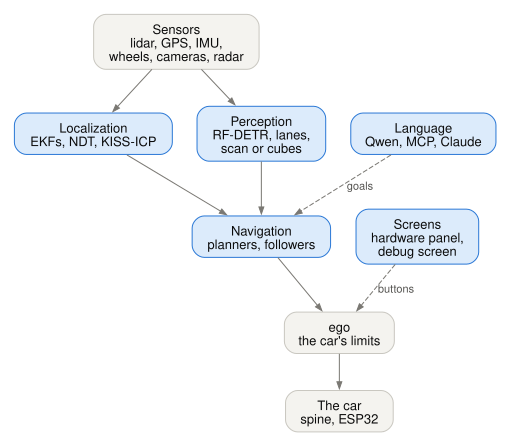

The whole stack on one page. Blue: built from 22 October on. Grey: there before.
{: .caption }

## How to read this page

Each part has one small table:

| Row | Says |
|---|---|
| **What it does** | in plain words |
| **Run it** | the exact command, from the repo folder |
| **Tips** | what trips people up |
| **How solid** | one of the words below |

| Word | Means |
|---|---|
| **sim** | works in Gazebo (or the bench), tested |
| **built** | built and tested on its own, not yet in a full run |
| **written** | a runbook or a sheet, no code to run |
| **trial** | runs beside the default, off unless you turn it on |
| **not on the car yet** | nothing here has run on the real car |

## Contents

| Part | Sections |
|---|---|
| Start | [Your first hour](#your-first-hour) · [0.2 in one page](#02-in-one-page) · [The plan](#the-plan) · [The defaults](#the-defaults) |
| Screens | [HUD](#the-hud) · [Map](#the-map-window) · [Debug screen](#the-debug-screen) · [Hardware panel](#the-hardware-panel) · [Steering calibration](#steering-find-the-ends-and-the-centre) · [Cockpit](#the-cockpit) · [Colours](#the-colours-and-the-little-robot) |
| Driving by hand | [The joystick](#the-joystick-and-the-joystick-alive-check) |
| Firmware | [The Rust ESP32](#the-rust-esp32-firmware) · [The state machine](#the-state-machine) |
| How the car thinks | [Localization](#localization-where-am-i) · [Why the EKFs don't talk](#why-dont-the-two-ekfs-talk) · [Perception](#perception-whats-around) · [Planning](#planning-drawing-the-path) · [Following](#following-steering-along-the-path) |
| Safety | [The safety layers](#safety-the-layers-that-stop-the-car) |
| At the car | [car_setup.sh](#car_setupsh-one-computer-at-a-time) · [Car day](#car-day-in-two-days) · [Measurements](#the-measurements) · [Recording](#recording) |
| Tools | [Foxglove and Lichtblick](#foxglove-and-lichtblick) · [MCP server](#the-mcp-server) · [The commands](#the-commands) |
| Honest | [Which parts are Python](#which-parts-are-python-and-is-that-ok) · [Kept for 0.3](#kept-for-03-and-later) · [How solid is 0.2?](#how-solid-is-02) |

## Your first hour

New to the team? Run these in order, on a Mac or on Linux. The setup before step 1
(Pixi, your fork): README's "Your first day".

| # | Run | You should see | Time |
|---|---|---|---|
| 1 | `pixi install` | ROS 2 Jazzy, Gazebo, Rust: about 7 GB | the first time, minutes |
| 2 | `pixi run build` | every package built | a few minutes |
| 3 | `pixi run test` | every test green | a few minutes |
| 4 | `pixi run turtle`, then in a second terminal `pixi run keyboard --local` | a turtle that steers like the car: hold `i` to drive, `u` or `o` to turn | 2 min |
| 5 | `pixi run hud --demo`, then `pixi run hw-panel --demo` | the in-car screen and the hardware panel, with pretend data (no ROS) | 1 min |
| 6 | `pixi run pick` | a menu: Gazebo, the planner, the path follower, where-am-I. It prints the command and runs it | 5 min |
| 7 | `pixi run sim-check` | Gazebo's road world, headless, and the whole graph checked | 2 min |
| 8 | `pixi run docs`, then open `docs/html/index.html` | these pages in a browser | 1 min |

**Tips**

- Something fails? [Run it](run.md) lists the usual causes.
- Gazebo shows goals accepted but the car never moves: stop everything, then
  `pixi run fastdds shm clean`, then start again.
- "This computer only" commands (`turtle`, `sim`, `bench`...) never reach a real car on
  the same network. `keyboard` with no flag does: use `--local` or `--sim`.

## 0.2 in one page

| Area | What 0.2 has | How solid |
|---|---|---|
| Screens | HUD, map, debug screen, hardware panel (2 pages), cockpit; Initial D on every screen | sim |
| Steering calibration | find the steering actuator's ends and centre: limp or jog, mark, equal limits, a lock-to-lock check | built |
| Joystick | the joystick-alive check: a dead pad stops the car | sim (bench 11 of 11) |
| Rust ESP32 | the heartbeat brake (100 ms), link versions 1-3, the state machine | built (QEMU) |
| Localization | two EKFs (default); AMCL, NDT, NDT-EKF, KISS-ICP as trials | sim |
| Perception | RF-DETR Nano on the camera stream; the lidar as a flat scan (default) or cubes | sim |
| Planning, following | the lattice or Hybrid-A*, MPPI; trials: diffusion, RPP, our trackers | sim |
| Safety | e-stops, watchdogs, the output mux, the geofence | sim |
| Car day | Day A and Day B, the people, sign-offs, `car_setup.sh` | written; dry run only |
| Commands | 45, grouped | done |

### When is 0.2 done?

When every box on [the 0.2 checklist](car-day.md#ready-for-car-day-the-02-checklist) is
ticked. Where it stood on 2 November:

Where it stands on 3 November:

| Check | State |
|---|---|
| Every test green (`pixi run test`) | ✅ 1575 tests, 0 failures (3 Nov); GitHub's CI green on #21 (Linux, ARM, the car kit on 24.04 and 22.04) |
| The kit ready (`car-day-check`) | ✅ 18 OK; 1 missing until #21 merges (GitHub hasn't the commits yet); 6 to tick by hand |
| The ESP32's emulator check (`esp qemu-check`) | ✅ PASS (3 Nov): brakes 112-119 ms after the heartbeat stops, 6 of 6 |
| `car_setup.sh`'s dry run, every role | ✅ only the two planned refusals (3 Nov) |
| The first-move gaps (TODO 74) | ✅ the joystick-alive check (bench 11 of 11), its car test in A9b; ⬜ the throttle cap's number |
| The people named | ⬜ Ben and the team |
| The hardware lead's answers (H1, C1, `.211`, the router) | ⬜ the hardware lead |

## The plan

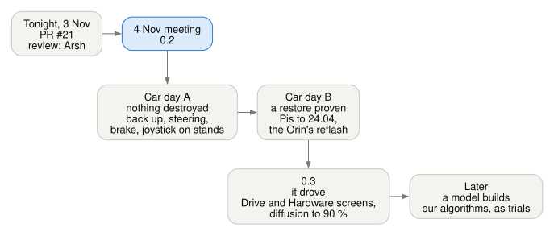

From tonight to 0.3 and after. Blue: where we are.
{: .caption }

| When | What | Who decides |
|---|---|---|
| **Tonight, 3 Nov** | PR #21 from the fork's `main`, after the full tests (TODO 91); review by Arsh. The people named, the hardware lead's OK for A8 and H1, the restore test's spare SD card (TODO 92) | Ben; Arsh reviews |
| **4 Nov meeting** | 0.2: this guide, on screen | the team |
| **Car day A** (nothing destroyed) | back up every machine; our stack beside theirs; the steering's ends; the brake on stands; the Rust ESP32, if the hardware lead agrees; the joystick on stands; walking pace; measure; record all day | the hardware lead for the hardware; an approver signs each step you can't undo |
| **Car day B** (later) | a restore proven first; the Pis to Ubuntu 24.04; the Orin's reflash, once JetPack 7.2 is confirmed | the hardware lead; the approver |
| **0.3 = it drove** | one screen per concept: **Drive** and **Hardware** (TODO 90); the hardware panel's pages; brake and throttle setting; diffusion to 90 % and on the Orin; Rust where the Orin's timing says so; the cubes and the post (TODO 93) | the team; the hardware lead for the hardware |
| **Later** | a model builds our algorithms from the recordings, each one a trial beside the default (TODO 96) | the team, after car day's data |

The car day steps, one by one: [Car day, the order](car-day.md#the-order).

## The defaults

What runs when you give no switch. Every switch: [Switches](switches.md).

| System | In Gazebo (`sim`, `demo`) | On the car (`car`) | Set in | Trials beside it |
|---|---|---|---|---|
| Planner | lattice; Hybrid-A* when forward only | the same; the car refuses every other planner | `vehicle.py`: `DEFAULT_PLANNER`, `default_planner()` | diffusion, smac2d, navfn, theta_star |
| Path follower | MPPI | MPPI | `vehicle.py`: `DEFAULT_CONTROLLER` | RPP; our trackers (`tracker:=`) |
| Where am I | the two EKFs: wheels, IMU, GPS | the same | `aav_localization/config/ekf_*.yaml` | AMCL, NDT, NDT-EKF, KISS-ICP |
| Obstacles for Nav2 | the lidar as a flat scan | the same | `voxels:=false` in the launch files | the cubes (`voxels:=true`) |
| Speed loop | `default` (PI) | the Motor Pi bridge's, open loop (no wheel speed on the ESP32) | `speed_loop:=`; `aav_legacy/config/legacy.yaml` | `lqi`, `smooth` |
| Geofence | on, 30 m round the start | on | `geofence:=`, `geofence_radius:=` | |
| Serial link to the ESP32 | | **version 1** (the C++ firmware): programs locked out, only people and the actuator tests drive | `legacy.yaml`: `frame_version` | version 2 (heartbeat), 3 (calibration) |
| CAN bridge | | Rust (`aav_spine_bridge`) | `bridges.py`: `DEFAULT` | `bridge:=python` |
| Screens' colours | Initial D | Initial D | each screen's yaml: `theme:` | `mocha`, `latte` |

**Why these** (Gazebo's lot tour, reversing on, 3 runs each, 3 Nov; [trials](trials.md)):

| Candidate | Legs | Tour time | Global EKF off | Default? |
|---|---|---|---|---|
| today's defaults | 12 of 12 | **183.4 ± 0.7 s** | 0.174 m | yes |
| NDT into the EKF (`ndt_ekf:=true`) | 12 of 12 | 193.8 ± 18.1 s | **0.018 m** | not yet: it needs the lot's NDT map (`maps/ndt/test_lot.pcd`), which isn't in git, so a new laptop or the road world can't start it. Next: the default of the test-lot demos, which already need that map; on the car after the lot is recorded |
| the cubes (`voxels:=true`) | 12 of 12 | 199.9 ± 14.1 s | 0.175 m | **no**: slower, and once in 3 runs the car drove 1.30 m into a post (`sim-check --lidar-obstacle --voxels`); to find out why |
| diffusion (`planner:=diffusion`) | 12 of 12 | 208.5 ± 53.4 s (177, 179 and one 270) | - | no: 73 % of plans from the model (the goal 90 %) |

The lattice is the quickest round the lot with reversing; Hybrid-A* keeps the U-turn when
the car may only go forward. MPPI finished the most legs of Nav2's two. Every one of the
23 switches started and finished a leg (3 Nov).

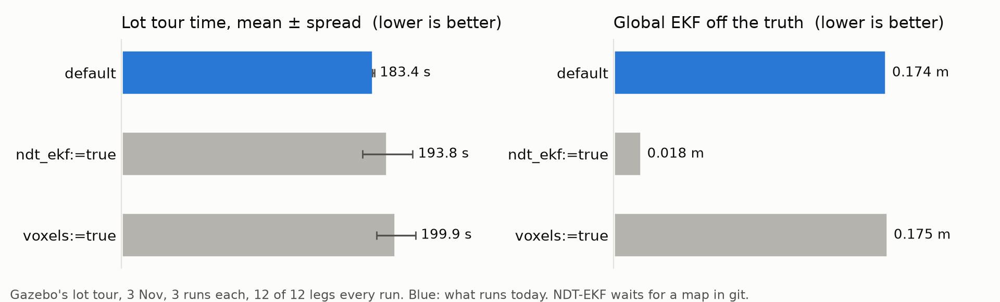

Today's defaults are the quickest; NDT-EKF is 10 times closer to the truth, but needs a map that isn't in git.
{: .caption }

## The screens

| Screen | Where | For |
|---|---|---|
| **HUD** | the car's small screen | speed, may the car move, the camera |
| **Map** | the car's big screen | the route on Ottawa's streets |
| **Debug screen** | a laptop or the lab | what the car sees, in 3D |
| **Hardware panel** | the Orin's screen or a wired laptop | every sensor's number, simple buttons, the steering's ends |
| **Cockpit** (Lichtblick): the Drive screen | the lab or a laptop | every driving detail on one screen, and which algorithms run |

### The HUD

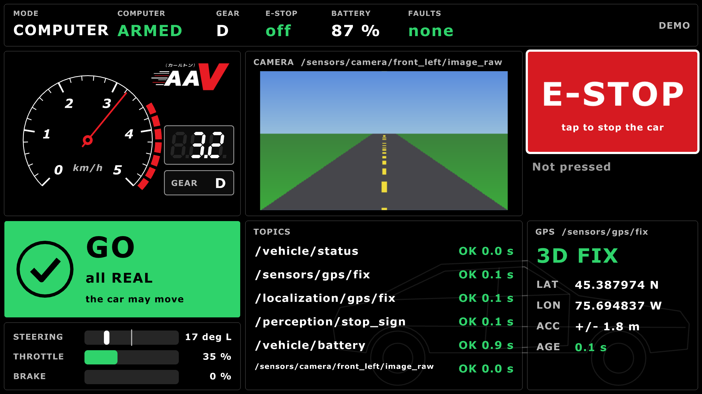

| | |
|---|---|
| **What it does** | the in-car screen: speed, mode, gear, the GO / STOP panel (may the car move, and the one main reason), the camera with stop-sign and SIMULATED banners, the GPS, every topic's age, the E-STOP button |
| **Run it** | `pixi run hud --demo` (pretend data, no ROS); `pixi run hud` beside `sim`; on the car it starts at login ([The two screens](car-screens.md)) |
| **Tips** | grey speed with "OLD" means `/vehicle/status` stopped. The E-STOP button only ever sends true: clear it with `pixi run clear estop`. Full screen: `fullscreen:=true monitor:=HDMI-2` |
| **How solid** | sim; Rust and raylib. Not on the car yet (its Pi still runs Humble) |

More: [HUD](hud.md).

### The map window

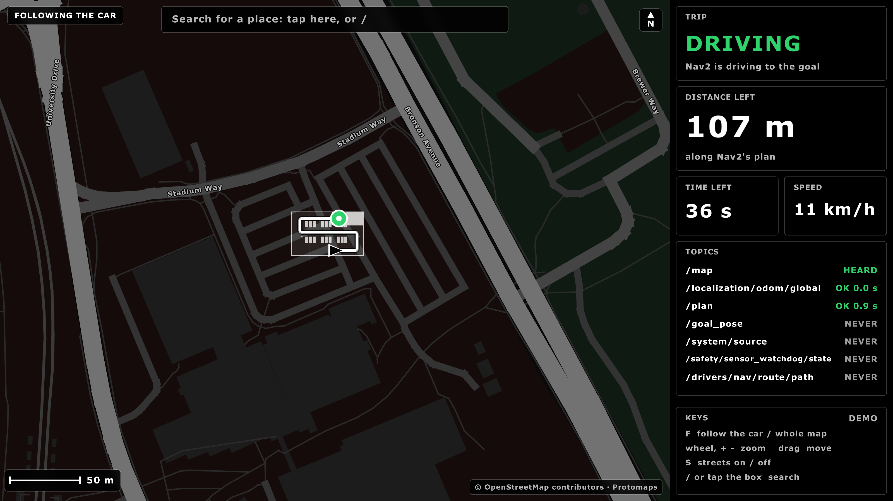

| | |
|---|---|
| **What it does** | the car on Nav2's map over Ottawa's streets; search for a place and drive there |
| **Run it** | `pixi run map --demo`; with Gazebo: `pixi run sim world:=test_lot map:=true` |
| **Tips** | the streets need `pixi run get street-map` once, the search `pixi run get places` |
| **How solid** | sim. Not on the car yet |

### The debug screen

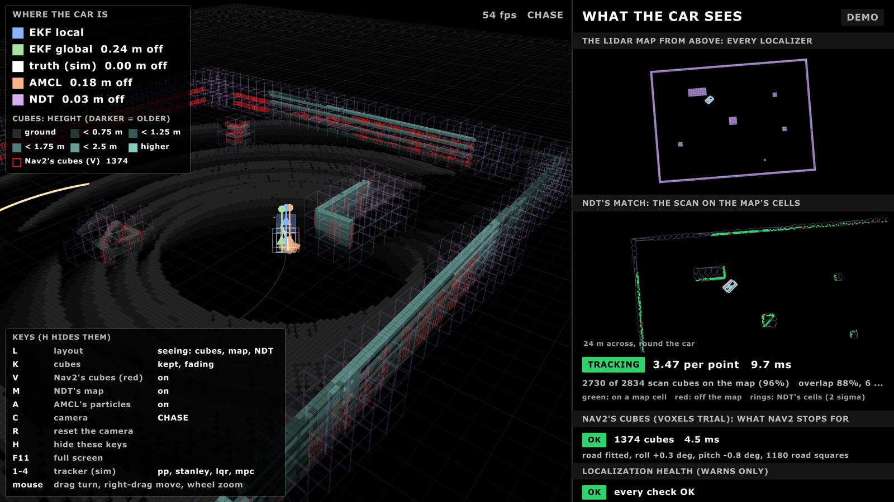

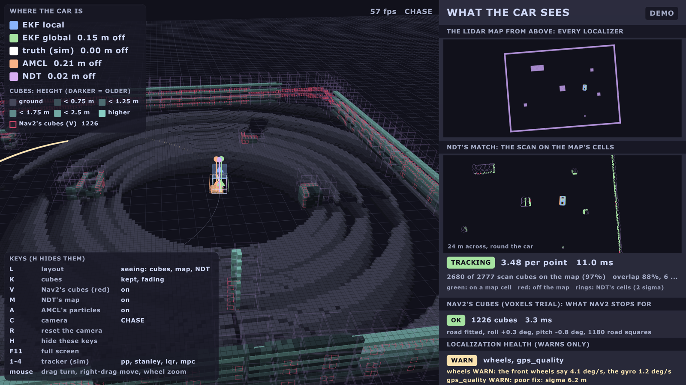

The debug screen, 1 Nov: Nav2's cubes in red (key V), where each localizer puts the car, and the localization health checks.
{: .caption }

| | |
|---|---|
| **What it does** | what the car sees, in 3D: the lidar's cubes, where each localizer puts the car (EKF, AMCL, NDT), Nav2's own cubes, the localization health checks |
| **Run it** | `pixi run demo --debug` (Gazebo, RViz, the HUD, the map and this); `pixi run debug-hud --demo` (no ROS) |
| **Tips** | keys 1-4 swap the path follower live (sim only). NDT shows only once its map exists: `pixi run ndt-map drive` (about 6 min) |
| **How solid** | sim |

### The hardware panel

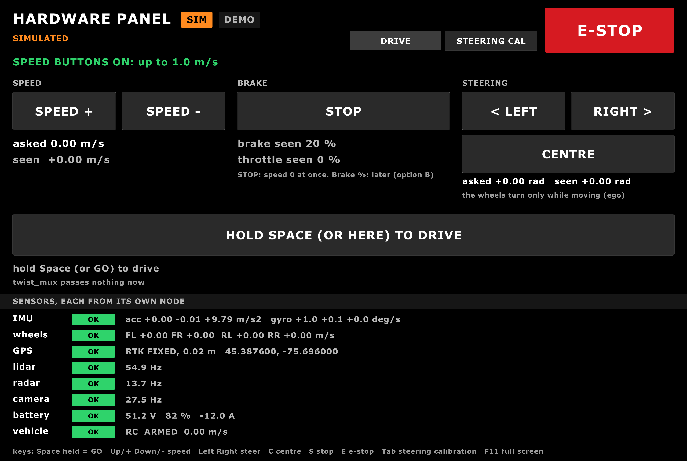

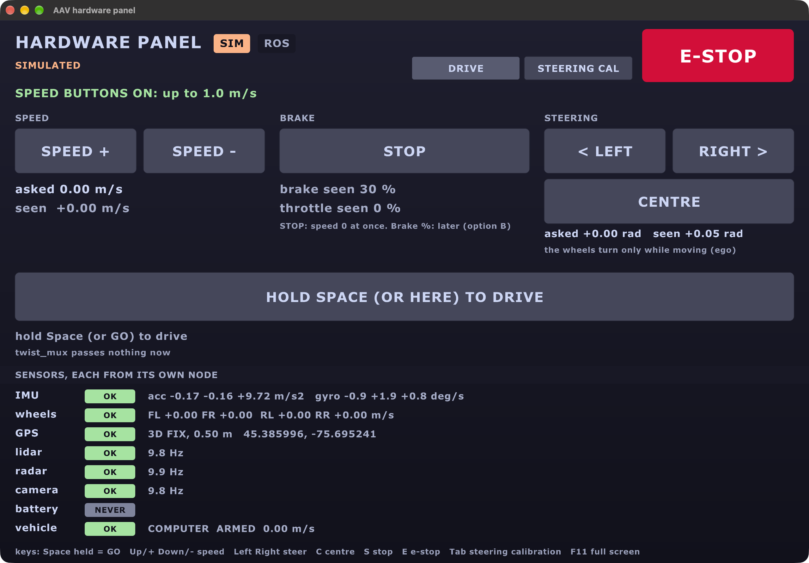

The hardware panel driving Gazebo's car: every sensor's number, and the simple buttons.
{: .caption }

| | |
|---|---|
| **What it does** | the hardware at the lowest level: every sensor from its own node, and very simple buttons. The car moves **only while you hold Space** |
| **Run it** | `pixi run hw-panel --demo`; with Gazebo: `pixi run sim world:=test_lot`, then `pixi run hw-panel`; on stands: `pixi run hw-panel stands:=true` |
| **Tips** | run it from the Orin's screen or a wired laptop, not over WiFi. On the real car the speed buttons stay **off**, and the screen says why: no driven-wheel speed yet (TODO 49b) |
| **How solid** | sim. Not on the car yet |

### Steering: find the ends and the centre

The panel's second page, **STEERING CAL** (Tab). The steering pulls right: its centre is
probably off. This page finds the steering actuator's two ends and its centre, then sets
**equal limits** on both sides.

```text
  laptop (hardware panel)  ──►  Orin bridge  ──►  ESP32  ──►  steering actuator
       GO LIMP / STEP          link version 3     limp, or       (Jrk G2 board)
       MARK left/centre/right                     small steps
       ◄── the raw position (counts), 10 times a second ──┘
```

| Step | What you do | What it does |
|---|---|---|
| 1 | **GO LIMP** | the motor lets go; you turn the wheels by hand |
| 2 | or **STEP LEFT / RIGHT** | small steps, inside today's limits |
| 3 | **MARK** left, centre, right | it works out equal limits: the smaller side less 5 % |
| 4 | **LOCK-TO-LOCK CHECK** | slowly centre → left → centre → right → centre; **stops and holds** at any resistance |
| 5 | **SAVE** | writes the numbers to a file; a person copies them in a pull request |

| Passed | Stopped on a stiff spot |
|---|---|
| 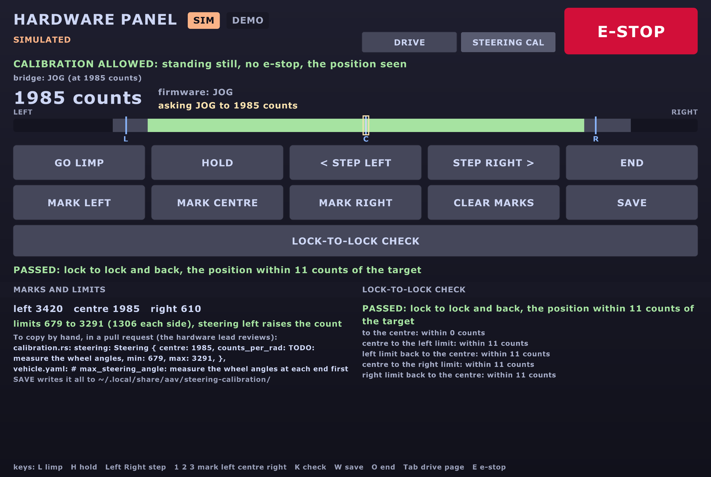 | 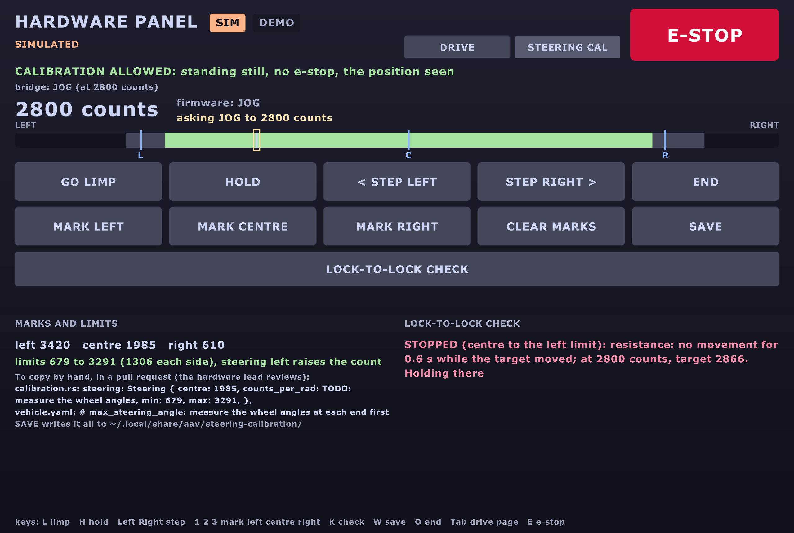 |

| | |
|---|---|
| **Run it** | `pixi run hw-panel --demo`, then Tab. On the car: the Rust firmware, `frame_version: 3`, `uplink: true` and `steering_calibration: stands` in `legacy.yaml` |
| **Tips** | only while stopped, with the brake on; throttle held at 0. Losing the Orin's heartbeat for 100 ms ends it. It never writes the firmware or `vehicle.yaml` |
| **How solid** | built. **On car day the first way is Pololu's own program over USB** (Way A): today's C++ firmware can't do this page |

More: [Actuator tests](actuator-tests.md#find-the-steering-actuators-ends-and-centre).

### The cockpit

The **Drive** screen: every driving detail on one screen (Ben, 3 Nov: "the gazeboo with nav2 selection with
cubes and stuff all as a single screen"): both cameras, the status lights, the street
map, the 3D view with the cubes, the plan and **each localizer**, the speed and steering
plots, and a new **Algorithms** table: which planner, path follower and localizers this
run uses. Live in Gazebo's test lot, 3 Nov:

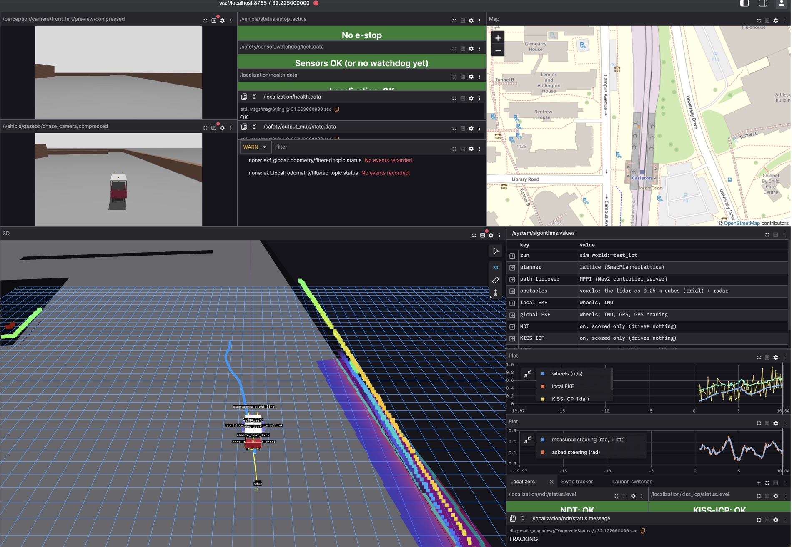

| Panel | New on 3 Nov |
|---|---|
| Algorithms | planner, path follower, obstacles, the EKFs' inputs, NDT, KISS-ICP, AMCL (`/system/algorithms`) |
| 3D | `/map`; NDT's and AMCL's poses; the EKFs' arrows and NDT's scan (scripts: not showing yet) |
| Speed plot | KISS-ICP's speed and the local EKF's beside the wheels' |
| Tabs | Localizers (NDT, KISS-ICP lights) · Swap tracker · Launch switches |

| | |
|---|---|
| **What it does** | everything for driving on one screen: Gazebo's view or the car's cameras, Nav2's goal, the cubes, the localizers, which algorithms run |
| **Run it** | `pixi run sim world:=test_lot foxglove:=true` (add `voxels:=true ndt:=true kiss_icp:=true` to see them), then in Lichtblick: Foxglove WebSocket `ws://localhost:8765`, and import `tools/foxglove/cockpit.json` |
| **Tips** | send a goal with the 3D panel's **Publish** tool, set to **Pose**. Lichtblick keeps its old copy of a layout it already has: import under a new name. On the car it is watch only. The street map needs the internet |
| **How solid** | sim, seen live 3 Nov. Not showing yet: the EKFs' arrows and NDT's scan (two layout scripts); NDT's map and KISS-ICP's cloud have no topic yet |

More: [Watch from a laptop](foxglove.md#cockpit). Where it's going (0.3): one **Drive**
screen that takes in the debug screen's views, and the **Hardware** panel apart (TODO 90):

| Screen | 0.2 | 0.3 |
|---|---|---|
| **Drive** (the cockpit) | driving, Nav2, cubes, localizers, algorithms | absorbs the debug screen |
| **Hardware** (the panel) | sensors, buttons, steering's ends | stays separate |
| **HUD** and **map** | in the car | stay in the car |

### The colours and the little robot

Ben, 2 Nov: "something nicer than Catppuccin". **Initial D red and black** is the default
on every screen. Change it with `theme:` in the screen's yaml.

| Theme | For |
|---|---|
| `initial_d` (the default) | the car, day or night: black, white, Carleton's red |
| `mocha` | dark and soft: night |
| `latte` | light: daytime |

| Initial D | Light (Latte) |
|---|---|
|  | 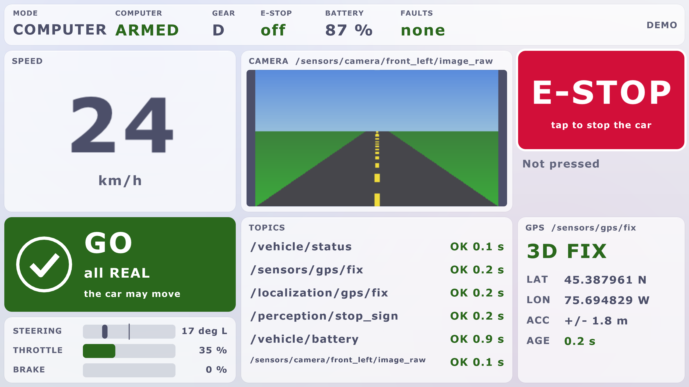 |

**The little robot** (a tribute to WALL-E): the car on the map (`car_marker: robot`), and
eyes that peek after 60 s of quiet on the panel and the debug screen. Never while the car
moves or anything warns. Off: `easter_egg: false`.

| On the map | Peeking |
|---|---|
| 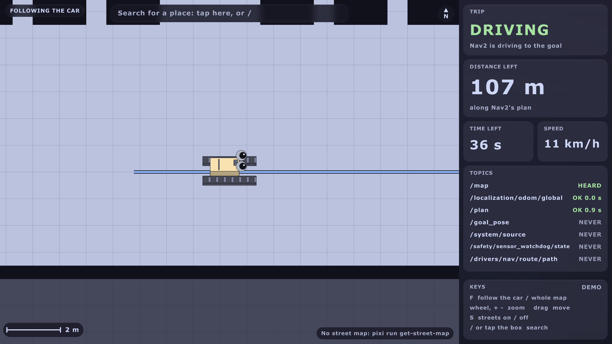 | 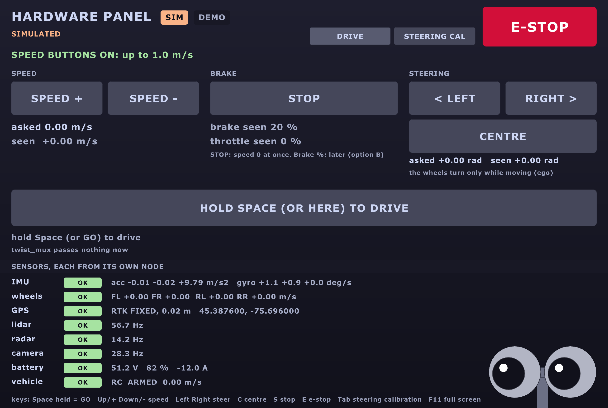 |

## The joystick and the joystick-alive check

```text
joystick (USB, on the Pi) ─► joy_alive ─► teleop ─► twist_mux ─► ego ─► output mux ─► legacy bridge ─► ESP32
                             silent 0.5 s  hold-to-   0.5 s       0.3 s   the heartbeat   0.3 s           brakes 100 ms
                             frozen 2 s    drive      timeout     timeout counter         stale→brake     after it stops
```

| | |
|---|---|
| **What it does** | drive with the joystick, all on the Motor Pi (`machine:=motor_pi_alone`). `joy_alive` stops it when the pad goes **SILENT** (nothing for 0.5 s) or **FROZEN** (every value the same for 2 s while driving: a dead pad's receiver repeats them). It latches until you release the trigger |
| **Run it** | sim: `pixi run sim teleop:=true` with the pad plugged in. On stands: `~/aav-jazzy/aav.sh ros2 launch aav_bringup car.launch.py machine:=motor_pi_alone max_speed:=0.3` |
| **Tips** | watch `ros2 topic echo /drivers/joy/alive`: `WAITING` until the trigger is released once. A stick pinned at its edge trips FROZEN too: release, press again. Button and axis numbers: change `teleop_twist_joy.yaml` and `joy_alive.yaml` together |
| **How solid** | sim, bench-check 11 of 11. The real pad: car day A9b. **The Rust firmware only**: the C++ has no timeout |

More: [Car day, A9b](car-day.md#a9b-the-joystick-on-stands).

## The Rust ESP32 firmware

Today's car runs the 2025-26 C++ on its ESP32. **It has no command timeout**: if the Pi
dies mid-command, the last throttle stays. Our Rust firmware (`boards/esp32-umod`, on
`spine-core`) fixes that. It is not flashed yet: that's car day A8, with the hardware
lead's OK.

### The heartbeat brake

```text
 Orin output mux ──counter +1 per command──► Motor Pi bridge ──copies it, 50 Hz──► ESP32
                                             (never makes one)                    counter unchanged
                                                                                  100 ms → brake full,
                                                                                  throttle 0, latched
```

| | |
|---|---|
| **What it does** | the ESP32 counts a frame as a command only if the Orin's counter changed. 100 ms without a new one: brake full, throttle 0, latched until a stop with a **new** counter |
| **Run it** | `pixi run esp tools` and `pixi run esp qemu-tools` (once), then `pixi run esp qemu-check` |
| **Tips** | the Pi relays, it never makes a counter: a stuck Pi resending frames still brakes the car |
| **How solid** | built: QEMU braked 111-120 ms after the counter froze. Never on a real ESP32 |

### The throttle cap

| | |
|---|---|
| **What it does** | the throttle's top is DAC 700 of 1023, rising at most 600 a second (`spine-board` `calibration.rs`). The test mode caps it at 0.15 |
| **Tips** | the ESP32 can't see the speed, so it can cap only the throttle, not the speed. ego's `max_speed:=0.3` caps the speed |
| **How solid** | built. **The first moves' number is open** (TODO 74b): Ben and the hardware lead decide it |

### Link versions

| Version | Frame | Who speaks it | Use |
|---|---|---|---|
| 1 | 13 bytes, no heartbeat | the C++ and the Rust (`--features link-v1`) | **today's car** (`frame_version: 1`) |
| 2 | 17 bytes: the Orin's counter, armed and e-stop bits, CRC-8 | the Rust | the day the Rust is flashed |
| 3 | 20 bytes: version 2 plus the steering calibration (limp, jog) | the Rust (reads 2 and 3 alike) | the hardware panel's STEERING CAL |

**Tip:** the C++ can misread a version 2 stream, so `frame_version` changes only with the
firmware. More: [Rust firmware](rust-firmware.md#the-heartbeat-version-2-of-the-serial-frame-24-oct).

## The state machine

Arsh's `fsm.rs` (`firmware/spine/crates/spine-core/src/fsm.rs`, PR #15). Five regions,
each answering one question, worked out once a tick in this order.

```text
 [1] Lifecycle    Boot ──► SelfTest ──(every device answers)──► Running
                                                                    │
 [2] Safety       Estop  >  Faulted  >  Latched  >  Ok        the highest wins
                    │          │           │
                    │          │           └─ after boot, a timeout, leaving test mode;
                    │          │              released by: disarm, then arm
                    │          └─ a steering, brake, throttle or encoder fault
                    └─ the hardware loop open, or an e-stop frame
                                                                    │
 [3] Authority    Rc  >  Test (Armed ⇄ Active)  >  Drive  >  Idle   whose commands count
                                                                    │
 [4] Motion       Forward ◄──► StandstillHold ◄──► Reverse          watched: direction
                                                                    changes only through a stop
 [5] Confidence   Full (a wheel speed)   or   Degraded (none: today's ESP32)
```

**What each state means for the actuators**

| State | Throttle | Brake | Steering |
|---|---|---|---|
| Safety **Estop** or **Faulted** | 0 | full (the stop brake) | held where it is |
| Latched, after a timeout or fault (nobody driving) | 0 | full | held |
| Authority **Idle** (after boot) | 0 | 0: the brake lets go (`IDLE_BRAKE`, proposed) | held |
| Authority **Rc** (RC direct) | from the sticks, up to the speed caps | from the speed loop; the gear switch's brake: speed 0 | from the stick, up to full lock |
| Authority **Drive** (the computer, armed, fresh) | from the speed loop (open loop today) | from the speed loop | the command, at most `max_steer_rate` |
| **Test, Armed** | 0 | full | held |
| **Test, Active** | one actuator: throttle ≤ 0.15, forward only, brake off | or brake 0-1 | or an angle inside the limits |
| Motion **StandstillHold** | 0 | the hold brake | as asked |

**Leaving test mode:** above 0.5 m/s, an e-stop, a fault, RC direct, an Exit, or a
request older than 100 ms. Leaving always latches: the computer must re-arm.

### The gap

| Gap | What it means | What the code does |
|---|---|---|
| **Today's board has no wheel speed** (Confidence = Degraded) | the "faster than 0.5 m/s" exit can never fire, and there's no overspeed check | the test mode **refuses a throttle test** (holds still); the brake and steering tests still work (test `without_a_wheel_speed_the_test_mode_refuses_the_throttle`) |
| No way in from outside yet | no CAN frame or serial bit carries a test request | only `spine-core`'s tests reach the test mode today |

| | |
|---|---|
| **Run it** | `cd firmware/spine && cargo test -p spine-core` (the state machine's own tests) |
| **How solid** | built: tested on a laptop and in QEMU. Not on the car (needs A8) |

## Localization: where am I?

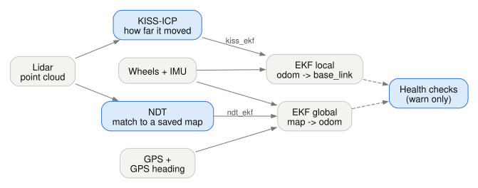

The point cloud feeds NDT and KISS-ICP (blue, trials) beside the two EKFs.
{: .caption }

### The two EKFs (the default)

| | |
|---|---|
| **What it does** | `ekf_local` blends the wheels and the IMU: smooth, never jumps, drifts slowly; Nav2 steers by it. `ekf_global` adds the GPS (through `navsat_transform`) and the GPS heading: knows where on the map, may jump a little; Nav2 plans by it |
| **Run it** | in every profile: `pixi run sim`. Alone: `ros2 launch aav_localization localization.launch.py` |
| **Tips** | about 17 cm off the truth in Gazebo. Check the heading: `pixi run tools/ros.sh --local python3 tools/heading_check.py` |
| **How solid** | sim. Stock `robot_localization` |

### The sensors

| Sensor | Where it comes from | Node | How solid |
|---|---|---|---|
| GPS | u-blox on the localization Pi | stock `ublox` driver, then `navsat_transform`; `gps_heading` (ours) | sim |
| IMU | Yahboom IMU | `aav_imu_yahboom` (Rust) | sim; the driver built |
| Wheels | the hardware lead's Arduino, CAN 0x200 and 0x201 | `spine_bridge role:=sensors` (Rust) | built; the Arduino's frames untested |

### AMCL, NDT, NDT-EKF, KISS-ICP (trials)

| | AMCL | NDT | NDT-EKF | KISS-ICP |
|---|---|---|---|---|
| **What it does** | many guesses; keeps those that match the walls | slides the lidar onto a saved map of the lot | NDT, and the global EKF **uses** it beside the GPS | how far the car moved, from the lidar alone (no map) |
| **Run it** | `pixi run sim world:=test_lot amcl:=true` | `pixi run sim world:=test_lot ndt:=true ndt_map:=maps/ndt/test_lot.pcd` | `... ndt_ekf:=true ndt_map:=maps/ndt/test_lot.pcd` | `pixi run sim world:=test_lot kiss_icp:=true` (`kiss_ekf:=true`: into the local EKF) |
| **Off the truth (Gazebo)** | 6-11 cm | 1-3 cm, 2 ms a match | the EKF 1.6 cm | 0.04 m per 100 m |
| **Tips** | needs `world:=test_lot` | make the map once: `pixi run ndt-map drive` (about 6 min, not in git) | the winner, but off: the real lot needs its own map first | once: `pixi install --locked -e kiss` |
| **How solid** | trial, sim | trial, sim | trial, sim | trial, sim |

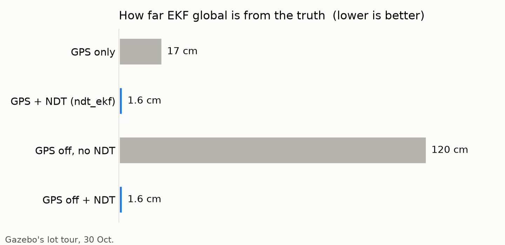

With NDT, the global EKF stays within 2 cm, with or without the GPS.
{: .caption }

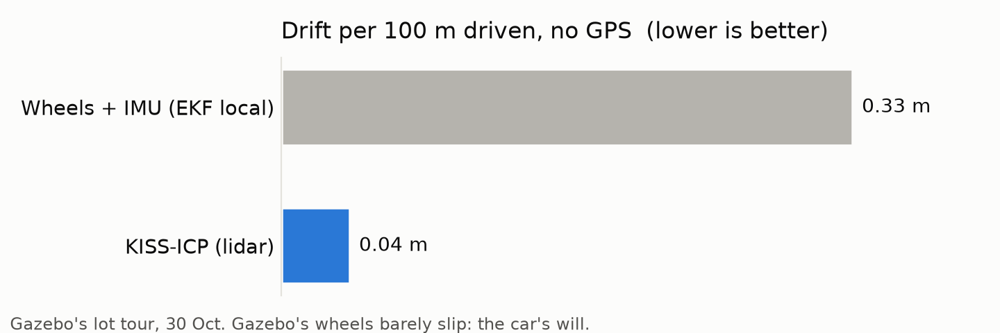

KISS-ICP drifts 8 times less than the wheels, with no GPS (Gazebo's wheels barely slip).
{: .caption }

| NDT | ICP (KISS-ICP's idea) |
|---|---|
| 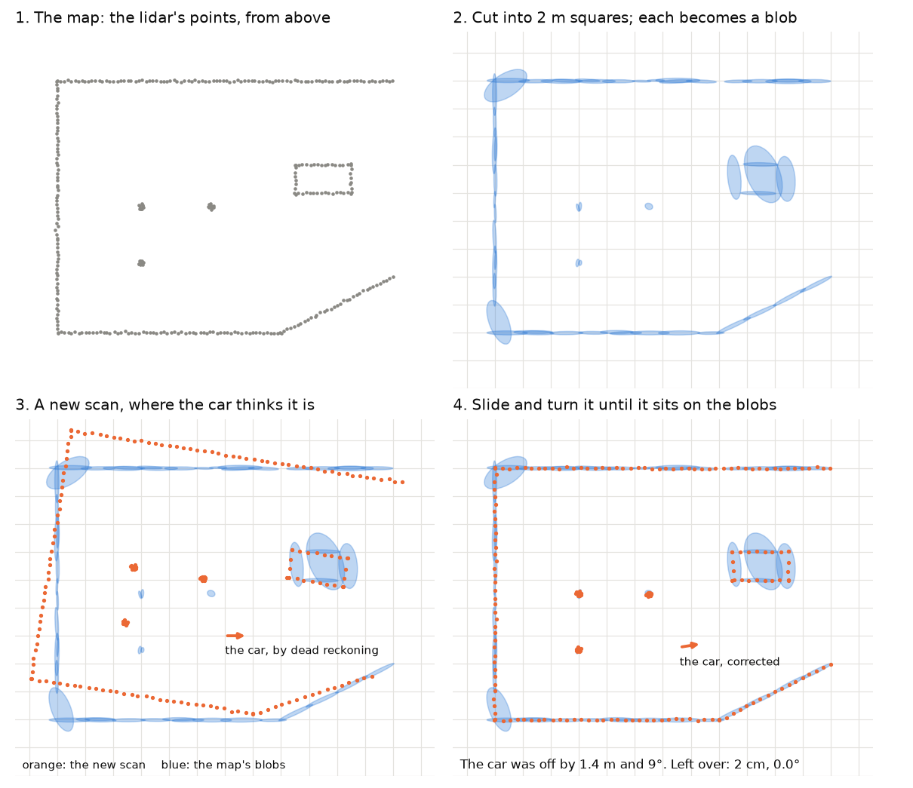 | 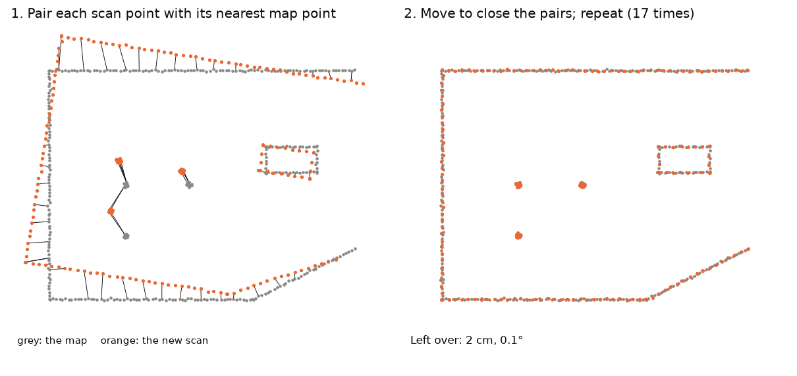 |

Left: NDT turns the map into blobs and slides the scan onto them. Right: ICP pairs each point with the nearest, then moves to close the pairs.
{: .caption }

More: [Trials](trials.md), [Learn: localization](learn-localization.md).

## Why don't the two EKFs talk?

Ben, 1 Nov. **On purpose.** Checked in `ekf_local.yaml`, `ekf_global.yaml` and
`localization.launch.py`: neither EKF reads the other's topic. They meet in **TF**.

```text
 wheels  /vehicle/odom ──────┬──────────────► ekf_local  ──► TF odom → base_link      (Nav2 steers by it)
 IMU     /sensors/imu/data ──┤                  (world_frame: odom)
                             │                       │
                             │                       │ TF: odom → base_link
                             │                       ▼
                             └──────────────► ekf_global ──► TF map → odom           (Nav2 plans by it)
 GPS ─► navsat_transform ─► /localization/gps/odom ─►  (world_frame: map)
 GPS heading ───────────────────────────────────────►       │
          ▲                                                  │
          └──────────── /localization/odom/global ◄──────────┘   (navsat needs it to place the GPS)
```

| | `ekf_local` | `ekf_global` |
|---|---|---|
| Fuses | wheel speed (x, y speed, turn rate), IMU turn rate | the same, **plus** GPS x, y and the GPS heading |
| Its frame | `odom` | `map` |
| Publishes | `odom → base_link`, `/localization/odom/local` | `map → odom`, `/localization/odom/global` |
| Used by | Nav2's path follower | Nav2's planner, the map window |

**Why not feed one into the other?**

| If `ekf_global` read `ekf_local`'s output | Why that's bad |
|---|---|
| the wheels and the IMU would count twice | it would be too sure of itself, and ignore the GPS |

So each fuses the raw sensors itself; that's `robot_localization`'s standard setup
(REP-105). `ekf_global` works out only the **correction** `map → odom`, on top of
`ekf_local`'s `odom → base_link`. `rqt_graph` shows no line between them; the TF tree
(`ros2 run rqt_tf_tree rqt_tf_tree`) shows the chain. More:
[Topic areas](naming.md#why-the-two-ekfs-dont-talk).


## Perception: what's around?

| | RF-DETR Nano and the camera stream | The cubes (voxels) |
|---|---|---|
| **What it does** | the camera Pi streams H.264 (MediaMTX); on the Orin, one `camera_stream` per camera unpacks, undistorts and runs RF-DETR Nano: objects and stop signs (Apache-2.0, not YOLO) | turns the lidar's points into 0.25 m cubes for Nav2, in place of a flat scan |
| **Run it** | `pixi run get models` once; `pixi run detect picture:=<file>`; the whole stream: `pixi run get mediamtx`, then `pixi run measure stream` | `pixi run sim world:=road voxels:=true`; see them in `demo --debug` |
| **Tips** | on the Orin it needs its TensorRT engine, built there: `python3 tools/build_engine.py`. A Mac: 27 ms from picture to detections | stopped 0.44 m before a post (the scan 0.36 m); 6 ms a cloud |
| **How solid** | sim and bench; the Orin's engine untested | trial, sim |

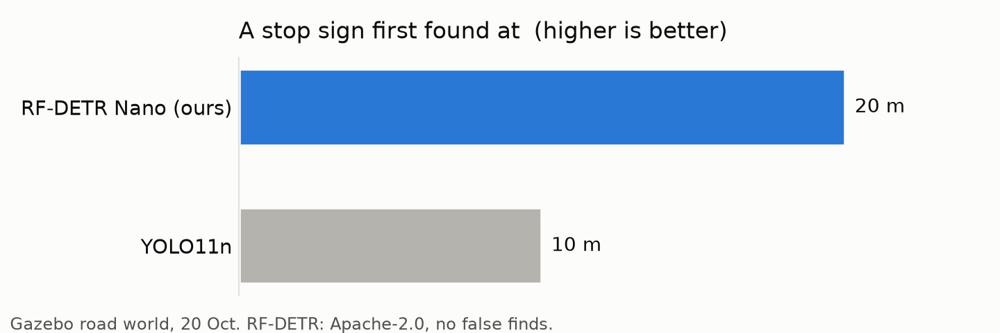

RF-DETR Nano finds a stop sign at 20 m; YOLO11n at 10 m.
{: .caption }


The lane finder (OpenCV): the camera, and its bird's-eye view.
{: .caption }


The roof lidar from above, one sweep: what the flat scan and the cubes are made from.
{: .caption }

More: [Perception](perception.md), [Camera pipeline](camera-pipeline.md).

## Planning: drawing the path

A **planner** draws the path; a **path follower** steers along it.

| Planner | What it does | Run it | Lot tour (Gazebo) | How solid |
|---|---|---|---|---|
| **State Lattice** (default) | joins short moves the car can really make, forwards and backwards | `pixi run sim world:=test_lot` | every leg, 184 s | sim, the default |
| **Hybrid-A*** (forward only) | searches forward moves only | `... planner:=hybrid` | every leg, 213 s | sim, the default when forward only |
| **Diffusion** | a small model draws 16 paths; a guard checks each; the lattice's path if none passes or it's late | `... planner:=diffusion` | every leg; 177, 179 and 270 s; 73 % of plans from the model (3 Nov) | trial; the car refuses it |
| smac2d, navfn, theta_star | grid planners: ignore the turning circle | `... planner:=smac2d` | 2 of 4 (smac2d) | sim only; the car refuses them |

**Diffusion, the tips**

- Once: `pixi install --locked -e learn`, `pixi run diffusion data`, `pixi run diffusion train`.
- Not a winner yet: the design asks for 90 % from the model. The U-turn is its weakest leg
  (52 % from the model there), though 5 s quicker than the lattice's.
- Model and guard take 119-126 ms (mean) of a 150 ms budget beside Gazebo on a Mac: too close.

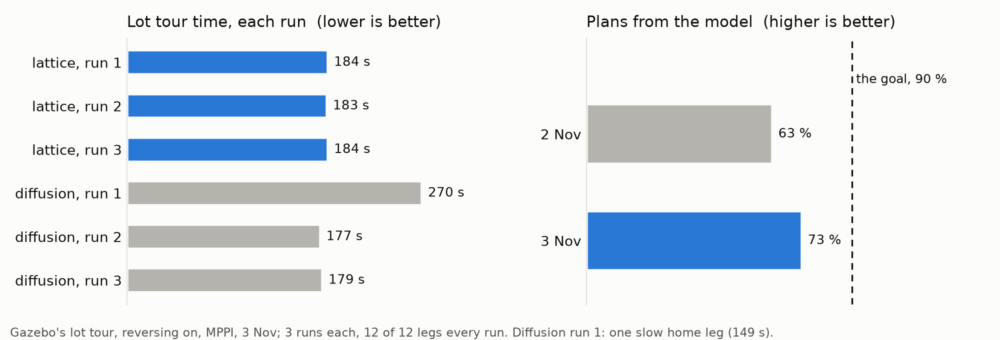

3 Nov: diffusion beat the lattice in 2 of 3 runs; one slow home leg made its first run 270 s. The model drew 73 % of the plans (2 Nov: 63 %); the goal is 90 %.
{: .caption }

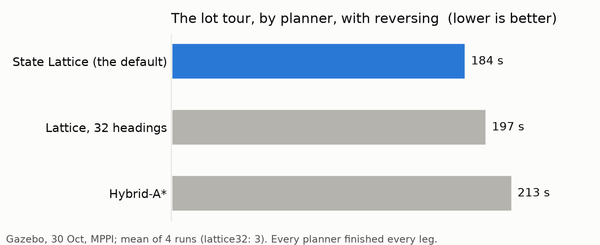

30 Oct: the lattice drives the lot tour 29 s quicker than Hybrid-A*.
{: .caption }

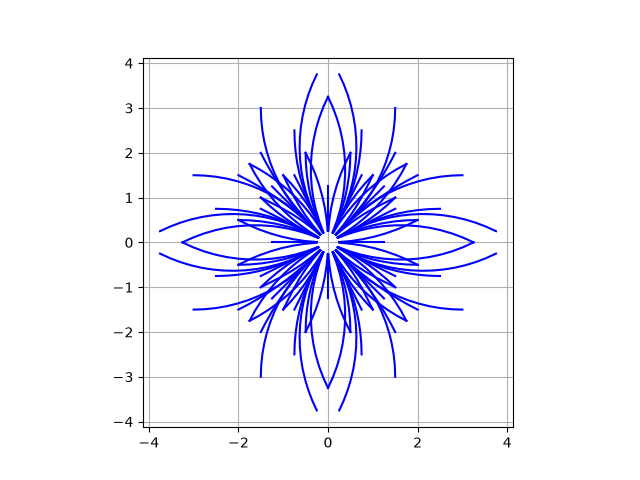

The lattice's moves: short arcs our car can really drive, forwards and backwards.
{: .caption }

More: [Switches](switches.md#who-draws-the-route), [Trials](trials.md#diffusion-2-nov-a-model-draws-the-lattice-guards).

## Following: steering along the path

| Follower | What it does | Run it | Gazebo, 29 Oct | How solid |
|---|---|---|---|---|
| **MPPI** (default) | tries hundreds of short futures, keeps the best; reads the costmap | `pixi run sim world:=test_lot` | 8-10 of 12 legs | sim, the default |
| RPP | aims at a point ahead, slows in bends | `... controller:=rpp` | 10 of 12 | trial |
| pure pursuit, Stanley (ours) | aim ahead; or fix the distance and heading off the path | `... tracker:=pure_pursuit reversing:=false` | 12 of 12 | trial |
| LQR (ours) | a formula for the best steering each moment | `... tracker:=lqr reversing:=false` | 10 of 12 | trial |
| MPC (ours) | tries the next 1.5 s of steering, keeps the best | `... tracker:=mpc reversing:=false` | 12 of 12 | trial |

**Tips**

- Our trackers drive forward only: always with `reversing:=false` (`pick` does it).
- Compare them on the same routes: `pixi run measure controllers`.

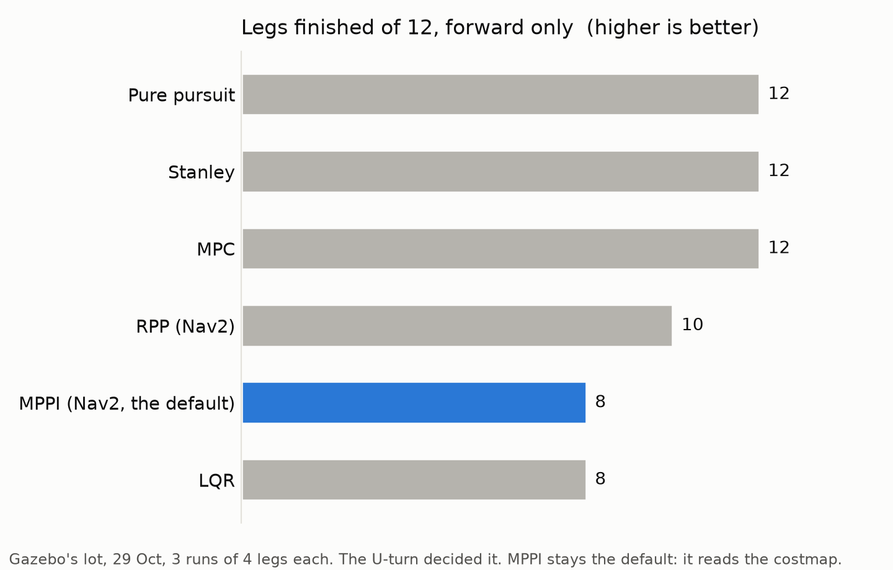

29 Oct, forward only: MPPI finished the fewest, but stays the default: it reads the costmap.
{: .caption }


Reversing allowed: both followers make the U-turn by backing up (a three-point turn); MPPI's turn is the wider.
{: .caption }

More: [Controllers](controllers.md), [Switches](switches.md#who-steers-along-the-path).

## Safety: the layers that stop the car

From the person outward. Each works even if the ones after it fail.

| Layer | Stops the car when | Run it, or clear it | How solid |
|---|---|---|---|
| **The Kar-Tech stop** (hardware) | the e-stop person presses it: the main stop | | the car's own |
| **E-stop** (`/safety/estop`) | anyone presses: the HUD, the joystick's button 2, the panel | `pixi run estop`; `pixi run clear estop` | sim |
| **Hold-to-drive** | the joystick's trigger or the panel's Space is let go | | sim |
| **ego's timeout** | no command for 0.3 s | | sim |
| **The output mux** | any data isn't the real car's (sim, bench, replay on the network): sends nothing, latched (`STOP`) | `/safety/output_mux/state`; `pixi run clear gate` | sim |
| **The sensor watchdog** (Nav2 and the AI only) | a sensor or an EKF goes quiet, sends NaN, freezes or jumps; the HUD dies | try: `pixi run sim-fault gps stop`; `pixi run clear watchdog` | sim |
| **collision_monitor** (Nav2 only) | lidar or radar points in the stop zone ahead | try: `pixi run ghost ahead 10` | sim |
| **The geofence** (programs only, never people) | the stopping path would leave the fence (30 m round the start) | `pixi run bench-check --geofence`; `pixi run clear geofence` | bench |
| **The firmware's watchdog** | 100 ms without a new heartbeat | `pixi run esp qemu-check` | QEMU only |

**Tips**

- `clear` is always a person's job: nothing clears itself after a STOP.
- With `frame_version: 1` (today's C++ ESP32), the bridge locks every program out: only
  people and the actuator tests drive.

More: [How it fits, safety layers](how-it-fits.md#7-safety-layers), [Sources and targets](sources-and-targets.md), [The geofence](geofence.md).

## At the car

### car_setup.sh: one computer at a time

| | |
|---|---|
| **What it does** | on one car computer: back up, upgrade, install our code, start it at boot, check. It only prints the steps unless given `--apply` and the role typed in |
| **Run it** | copy it over (`scp tools/car_setup.sh <user>@<address>:`), log in, `tmux new -s setup`, then `bash car_setup.sh motor_pi` (a dry run) and `bash car_setup.sh motor_pi backup --apply` |
| **Tips** | a STOP line ends the run before anything changes: a pending reboot, the wrong hostname, an upgrade too early. `motor_pi` and `localization` refuse to upgrade on purpose until their way back is proven |
| **How solid** | dry run passes for all six roles. `--apply` untested on the car |

More: [Car setup](car-setup.md).

### Car day, in two days

| Day | What | Can you undo it? |
|---|---|---|
| **Day A** | back up every machine (checked); the steering's ends (Way A); the brake on stands; the Rust ESP32 and the joystick on stands; walking pace once a named person signs; the car tests and the map | yes: nothing destroyed |
| **Day B** (later) | the Pis to Ubuntu 24.04; the Orin reflashed to JetPack 7.2; the lab desktop | only from the backups, so a restore is proven first |

| Role | Does |
|---|---|
| Hardware lead | decides on the hardware; OKs the ESP32 flash |
| E-stop person | holds the Kar-Tech stop, always |
| Safety driver | in the seat |
| Laptop person | runs the commands |
| Approver | signs the steps you can't undo |

| | |
|---|---|
| **Run it** | the night before: `pixi run car-day-check` until it says 0 missing; `pixi run car-day-build` |
| **Tips** | every step you can't undo has a sign-off line (who, time). Record all day |
| **How solid** | written. The runbook: [Car day](car-day.md) |

### The measurements

| | |
|---|---|
| **What it does** | every car number lives in one file, `ros/bringup/aav_description/config/vehicle.yaml` (many marked GUESS). Each car test fixes one: lock to lock, a fixed-steering circle, 10 m by tape (the wheel size), a speed step, a brake, a coast-down |
| **Run it** | the sheet: [Measure the car](measure-the-car.md) (`pixi run python3 tools/measure_map.py` for the tape route); the tests: `pixi run actuator-test --list`; the order: [Know the car](know-the-car.md) |
| **Tips** | steering first, then the wheels, then speed and brake. The wheel size is 0.36 m or 0.42 m today: a 17 % speed error until it's taped. See a change's effect: `pixi run python3 tools/vehicle_model.py --set <key>=<value>` |
| **How solid** | written; the tests run in Gazebo (`actuator-test <test> --sim`) |

### Recording

| | |
|---|---|
| **What it does** | records a drive to `bags/<date>_<name>/` (MCAP): raw inputs, commands, what the stack decided. No camera pictures |
| **Run it** | `tools/record.sh --lidar <name>` (on the car: `~/aav-jazzy/aav.sh tools/record.sh --lidar <name>`) |
| **Tips** | `--lidar` is about 9 MB/s (10 min is about 5 GB), but the same drives build the lot's NDT map: `pixi run ndt-map build`. Bags stay out of git |
| **How solid** | sim |

## Tools

### Foxglove and Lichtblick

| | |
|---|---|
| **What it does** | watch the car or a simulator from any laptop, with no ROS on it: one app, one WebSocket (`foxglove_bridge`, port 8765) |
| **Run it** | `pixi run sim foxglove:=true` (on the car it runs already); in the app: Foxglove WebSocket `ws://localhost:8765` (or the Orin's address); import a layout from `tools/foxglove/` |
| **Tips** | Lichtblick is our pick (open source, no account). Its Mac app isn't notarized: right-click → Open the first time. Layouts: driving, sensors health, map, cockpit |
| **How solid** | sim. On the car: watch only |

More: [Watch from a laptop](foxglove.md).

### The MCP server

| | |
|---|---|
| **What it does** | lets an AI app such as Claude Code read the docs, the topic contract and the running ROS graph. **It only reads**: it can't move the car |
| **Run it** | start Claude Code in the repo folder: it loads the server (`.mcp.json`). By hand: `pixi run -e mcp mcp` |
| **Tips** | it sees the ROS network it was started on: the car's, if your laptop is on it |
| **How solid** | works; `tools/tests/test_mcp_parts.py` checks it never writes |

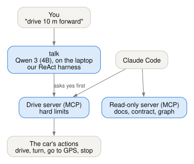

Two ways to talk to the car: `pixi run talk` (Qwen, on the laptop, asks yes first) and Claude Code through the drive server. Both go through the drive server's hard limits.
{: .caption }

More: [AI apps (MCP)](mcp.md).

### The commands

89 commands became 45. Each is `pixi run <command>`; a family is one command and a word
after it (`pixi run get models`). The source, with more words: README's "Every command".

| Group | Command | One line |
|---|---|---|
| **Every day** | `build` | compiles our ROS packages |
| | `test` | every test and the style check, this computer only |
| | `lint` | checks our Python against ROS's style rules |
| | `docs` | rebuilds the web pages and the PDFs |
| **Try it, no car** | `turtle` | turtlesim plays the car |
| | `keyboard` | drive from the keyboard: `--local` with `turtle` or `bench`, `--sim` with `sim` |
| | `sim` | Gazebo plays the car (`world:=road`, `hud:=true`...) |
| | `demo` | Gazebo, RViz, the HUD and the map at once; `--debug` adds the debug screen |
| | `pick` | a menu of the switches: prints the command and runs it; `pick last` again |
| | `bench` | the real car's software, stand-ins for the hardware |
| | `view` | the car's model in RViz |
| | `carla-car` | CARLA plays the car: `host:=<the CARLA computer>` |
| | `drive-to-point` | drive to one point and stop smoothly: `--sim --ahead 20` |
| | `ghost` | a pretend person in Nav2's view: `ghost ahead 10` |
| | `sim-fault` | make a Gazebo sensor fail: `sim-fault gps stop`, then `gps ok` |
| **Screens** (`--demo`: no ROS) | `hud` | the in-car screen |
| | `map` | the big screen's map window |
| | `debug-hud` | the debug screen: cubes, localizers, every sensor |
| | `hw-panel` | the hardware panel: every sensor, simple buttons, hold Space to drive |
| | `rviz` | RViz with the driving layout |
| | `graph` | a live picture of the nodes and topics |
| **Check it works** | `check` | the running graph against the contract: `check sim` (or `turtle`, `road`, `spine`, `car`, `replay`, `bench`) |
| | `bench-check` | bench mode, the whole graph tested (2 min) |
| | `sim-check` | Gazebo's road world, headless, the whole graph tested (2 min) |
| | `measure` | `controllers`, `timing`, `stream`, `atob <bag>`, `bandwidth` |
| | `diffusion` | the diffusion trial: `data`, `train`, `score` |
| | `ndt-map` | NDT's map of the test lot: `drive` or `build` |
| **At the car** | `car` | the real car: `car orin` (or `motor_pi`, `laptop`, `all`) |
| | `estop` | block every driver: the car brakes |
| | `clear` | a person clears a latch: `estop`, `gate`, `geofence`, `watchdog` |
| | `actuator-test` | the actuator tests, on stands and in a lot: `--list` |
| | `calibrate-camera` | calibrate a streamed camera |
| | `doctor` | can this computer join the car's ROS network? |
| **Before car day** | `car-day-check` | is this laptop ready? Until 0 missing |
| | `car-day-build` | builds what the laptop takes to the car |
| | `car-kit` | our Jazzy for the car's computers, on a USB stick |
| | `get` | downloads what git doesn't keep: `vendor`, `models`, `mediamtx`, `places`, `street-map`, `carla-osm`, `routes`, `all` |
| **Firmware** (bench only) | `pico` | our Rust Pico 2 boards: `pico <board> <tools, build or flash>` |
| | `esp` | the Rust ESP32: `tools`, `build`, `flash`, `qemu-tools`, `qemu-check` |
| | `-e firmware legacy-esp32` | today's C++ ESP32 firmware (PlatformIO) |
| **Perception, AI, maps** | `detect` | the object detector on a picture or the cameras |
| | `laptop-bench` | your laptop's detector against bench mode |
| | `talk` | tell the car what to do in plain English (turtle, sim or bench) |
| | `-e mcp mcp`, `-e mcp drive-server` | the MCP servers: read-only, and the drive tools |
| | `-e routes router` | the street router (needs `get routes`) |

| Old | New |
|---|---|
| `hud-demo`, `debugdemo` | `hud --demo`, `demo --debug` |
| `estop-clear`, `gate-clear` | `clear estop`, `clear gate` |
| `esp-build`, `spine-flash` | `esp build`, `pico spine flash` |
| `get-models`, `vendor` | `get models`, `get vendor` |
| `controller-compare`, `timing-test` | `measure controllers`, `measure timing` |

**Tip:** a family run with no word lists its choices (`pixi run get`).

## Which parts are Python, and is that OK?

Ben, 1 Nov: "I don't want performance critical code running in python".

**The short answer:** the hard timing isn't in Python. The 100 ms brake lives in the Rust
firmware. In the Python nodes, the heavy maths runs in C, C++ or Rust libraries (NumPy,
ONNX Runtime, TensorRT, GStreamer, KISS-ICP's core). Every number below fits its budget
on a Mac. **Nothing is measured on the Orin yet** (TODO 76: `pixi run measure timing` on
car day).

| Node (on the car) | Language | Must keep up with | Measured (where) | 0.3 |
|---|---|---|---|---|
| The ESP32 firmware (`spine-core`) | **Rust** | 100 ms watchdog | brakes 111-120 ms after the heartbeat stops (QEMU) | stays |
| `spine_bridge` (CAN) | **Rust** | 50 Hz | | stays |
| IMU driver, radar clusters, NDT, the screens | **Rust** | 50 Hz; 10 Hz clouds | NDT 2 ms a match, worst 6.3 (Gazebo) | stay |
| twist_mux, the EKFs, `navsat_transform`, Nav2, the u-blox and lidar drivers | **C++** (stock) | 30-50 Hz | the lattice 4-11 ms a plan, mean (Gazebo) | stay |
| ego | Python | 50 Hz (20 ms) | not measured: a few sums a tick | a candidate, once the car drives |
| output mux, the heartbeat | Python | every command, 50 Hz | not measured; the ESP32 brakes if it stalls | stays: a stall is caught downstream |
| `legacy_uart_bridge` (Motor Pi) | Python | 50 Hz frames | not measured; the same catch | stays |
| `joy_alive` | Python | 20 Hz; decides over 0.5-2 s | | stays |
| sensor watchdog, geofence, stop hold | Python | 10 Hz | | stay |
| `camera_stream` + RF-DETR | Python glue; GStreamer and TensorRT do the work | 15 fps (67 ms) | 27 ms picture to detections (Mac, Core ML: 10 ms a picture) | stays; the Orin to measure |
| flat scan (`aav_lidar`) | Python, NumPy | 10 Hz clouds (100 ms) | 0.18 ms a cloud | stays |
| **the cubes** (`aav_voxels`, trial) | Python, NumPy | 10 Hz clouds (100 ms) | 6.1 ms mean, 12.7 worst | **Rust first, if the Orin takes over 20 ms** (TODO 76) |
| KISS-ICP (trial) | Python node; C++ core | 10 Hz | about 1 ms a scan (Mac, 4 threads) | stays |
| our trackers (`aav_track`, trial) | Python, SciPy | 20 Hz (50 ms) | MPC 2-3.5 ms mean, 16 ms worst; 21-32 % CPU, mostly rclpy | Rust only if one wins |
| **the diffusion planner** (trial) | Python node; the model in ONNX Runtime (C++) | a plan in 150 ms | the model 75 ms (Mac CPU); the guard 19 ms in NumPy; both 126-145 ms beside Gazebo | **the guard to Rust** (`diffusion-guard`, in its design) |

**Is it OK?** For 0.2, yes: nothing that must react in under 100 ms depends on Python
alone, and the Python trials are off on the car. The two to watch are the diffusion
planner (too close to its 150 ms) and the cubes (if the Orin is slow).

More: [Languages](languages.md).

## Kept for 0.3 and later

Every idea is kept (Ben, 1 Nov: "I do like the 23 ideas? lets keep them around").

| Idea | State |
|---|---|
| **Car day itself** (0.3 = it drove) | runbook ready |
| One screen per concept: **Drive** (Gazebo, Nav2, the cubes, the algorithms) and **Hardware** | Ben, 3 Nov: TODO 90 |
| The diffusion planner: 90 % of plans from the model, the U-turn, the guard in Rust, the Orin | trial in 0.2 |
| The talking model: explains, never drives | idea |
| The little robot on the in-car HUD | idea |
| The cockpit's algorithm switch; one screen from the cockpit and the debug screen | in 0.2: the cockpit shows which algorithms run (3 Nov); the switch and the debug screen's views for 0.3 |
| More hardware panel pages: measurements, joystick, the car tests | idea |
| Python speed on the Orin (the cubes to Rust if too slow) | measure on car day |
| Brake and throttle: measure, then set | after the steering |
| Day B: Ubuntu 24.04 on the Pis, JetPack 7.2 on the Orin | after a restore is proven |

The list: [TODO](../TODO.md), "0.3 and later".

## How solid is 0.2?

| | |
|---|---|
| **Solid** | every test green; every profile runs in Gazebo; the screens seen live against it |
| **Untested** | anything on the real car: the steering page, `car_setup.sh --apply`, the boot service, the joystick path, the Rust ESP32 |
| **Open** | the joystick-alive check on the real pad (A9b), the throttle cap's number, the people, the hardware lead's answers |

## The checks run for this page

Run on Ben's Mac, 2 November:

Run on Ben's Mac, 3 November:

| Check | Result | What's left |
|---|---|---|
| `pixi run test` | ✅ 1575 tests, 0 failures, 4 skipped; lint clean | nothing |
| GitHub's CI on #21 | ✅ Linux, ARM, the car kit on Ubuntu 24.04 and 22.04 | the Mac and Gazebo jobs run at night |
| `pixi run sim-check`, `bench-check` | ✅ 9 of 9, 11 of 11 | nothing |
| Every switch, one leg of the lot tour | ✅ 23 of 23 | ([trials](trials.md)) |
| `pixi run measure timing` (Gazebo, 5 min parked, 5 driving, Cyclone) | ✅ 0 messages over 0.5 s late; the watchdog 0 STALE, 0 locks; worst gaps IMU 0.12-0.17 s, GPS 0.39-0.44 s; simulated time 0.97-0.98x. A busy Mac (load 17-18): 23 short stalls (0.1-0.3 s) parked, 3 driving | the real number: the Orin, car day (TODO 76) |
| `bash tools/car_setup.sh <role>`, all six roles (dry run) | ✅ no STOP except the two planned refusals (`motor_pi` and `localization` won't upgrade yet) | nothing |
| `pixi run car-day-build` | ✅ the Rust ESP32 (v1, v2, v2 with the uplink), the C++ way back, the QEMU check: PASS | nothing |
| `pixi run car-kit` | ✅ 2.7 GB, today's code | copy it to a stick, or `scp` it at the car |
| `pixi run car-day-check` | ✅ 18 OK, 1 missing (GitHub hasn't #21 yet), 6 to tick by hand | merge #21; the stick, Cyclone's card at the car, the printed sheet, the kit bag, the hardware lead |
| `pixi run esp qemu-check` | ✅ PASS: 6 of 6 heartbeat cycles, 112-119 ms; RC modes 6 of 6 | nothing |
