# The 0.4 guide: what is in it, with pictures

For the team meeting on Wednesday 18 Nov. **0.4 is a phase, not a formal release**
(Ben, 17 Nov). Each section is one area: a picture, then what it is, why, and how to
see it. About 15 minutes to read.

!!! warning "Almost all of this has run only in our simulator"
    Every number here comes from **Ravensim** (our simulator), bench mode, QEMU or
    unit tests. The real car last drove on 13 Nov, with only the localization update
    installed. What nobody has tried on the car: [Untested on the car](#untested-on-the-car).

## 0.4 on one page

| Area | New since 0.3 (7 Nov) |
|---|---|
| Simulator | Ravensim is the only one (Gazebo deleted 16 Nov); `graphics:=pretty` |
| Screens | the developer window: scene, console, lidar, the map with its chunks |
| Maps | RavenTiles: the map in 64 m chunks; three planning levels |
| Driving | our own stack is the default; Nav2 deleted 17 Nov |
| Road rules | lanes (keep right), kerbs, stop for anything moving, the behaviour planner |
| Safety | the stop zone, the watchdog's STUCK and OVERSPEED latches |
| Speed | 7 heavy nodes in Rust; the detector through ONNX |

The words: a **champion** is the default; a **challenger** runs beside it and takes over
only when it wins on the same routes ([the league](league.md)).

## Ravensim, our simulator

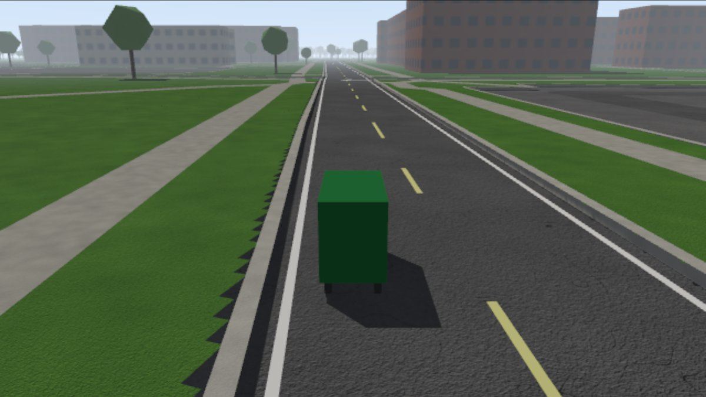

| Question | Answer |
|---|---|
| **What it is** | Our own simulator, in Rust: the world, the car, lidar, radar, IMU, GPS, wheels, cameras and the clock, on the car's own topics |
| **Why** | Ben, 14 Nov: "We want to run everythign ourselves". It passed every check Gazebo passed, so Gazebo went on 16 Nov |
| **New in 0.4** | `graphics:=pretty` (17 Nov): grain, a sky, haze, a warm sun, sharper shadows, painted stop lines. The sensors read the same world: the checks pass as before |
| **Also new** | seeded wheel noise and slip (`wheel_noise:=`, `wheel_slip:=`), wheels that find the ground (a kerb stops the car), `clock_hz:=` |
| **How to see it** | `pixi run ravensim` (an empty world; `world:=road` for the road), or `pixi run campus` once, then `pixi run ravensim world:=campus` |
| **Without a GPU** | put `tools/software_gl.sh` in front: the clock waits for each camera picture |

The campus before `graphics:=pretty`, for comparison ([Looks](own-simulator.md#looks-graphicspretty-17-nov)):

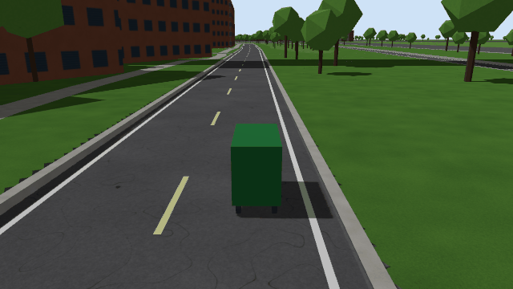

## The developer window

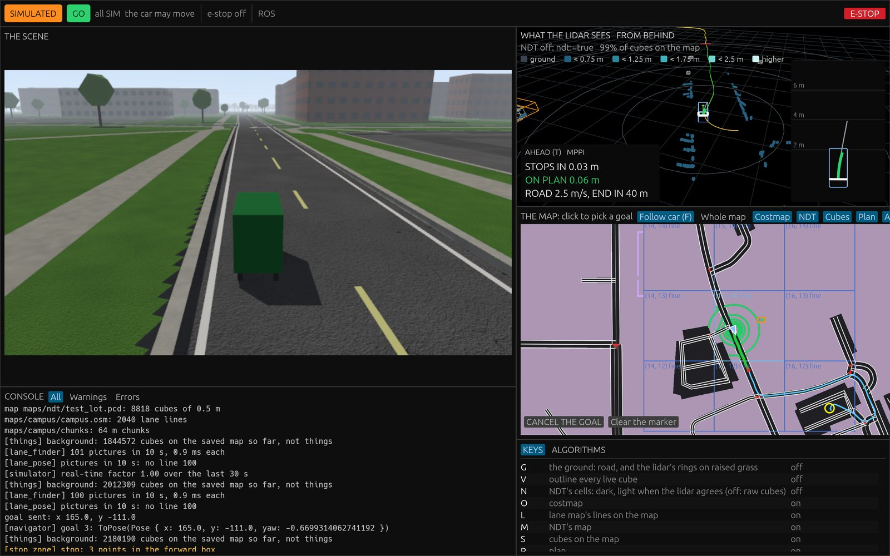

| Panel | What it shows |
|---|---|
| **The scene** (top left) | the 3D world, the car, its plan |
| **The console** (bottom left) | every node's log; All, Warnings, Errors |
| **What the lidar sees** (top right) | the cubes, by height; the squiggly line ahead; "stops in", "on plan" |
| **The map** (middle right) | the costmap, NDT's map, the plan; RavenTiles chunks and lanes on the campus. Click to send a goal |
| **Keys** (bottom right) | every layer on or off (G ground, H chunks, L lanes, K things, F follow) |

| Question | Answer |
|---|---|
| **Why** | everything at once on a laptop, so a bug is seen, not guessed |
| **Language** | Rust, Bevy (laptops only; the Orin runs no graphics) |
| **How to see it** | `pixi run ravensim` starts it with the sim; `pixi run dev-window` alone shows pretend data |
| **New on 17 Nov** | the ground hidden (key G): no more rings of "obstacles" on raised grass; the map pans, zooms and follows the car |

## RavenTiles: the map in chunks

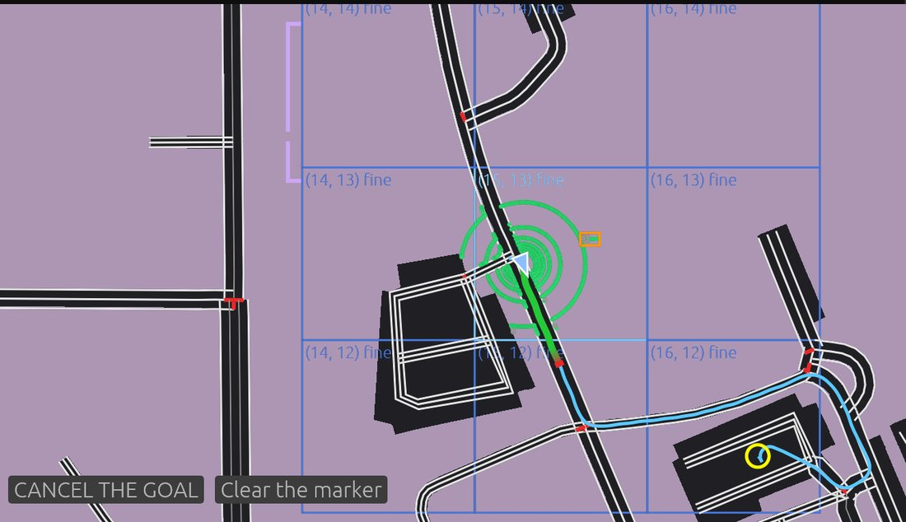

| Question | Answer |
|---|---|
| **What it is** | The map cut into fixed 64 m squares. Only the 3 x 3 round the car and those along the route are loaded |
| **Why** | the whole campus at once was slow and big. With chunks: NDT ready in **0.02 s** (was 2.5 s); the costmap **145 MB** (was 474 MB); the planner 65 MB (was 403) |
| **Who uses it** | NDT, our costmap, the things tracker, the planner, the developer window (key H) |
| **How to see it** | `pixi run campus` once (makes `maps/campus/chunks/`), then `pixi run ravensim world:=campus` |

## The three planning levels

```text
 ZOOMED OUT  route planner   "which roads"
             the street graph / Lanelet2, once a goal
                  │ the route: a line of roads
                  ▼
 MIDDLE      path planner    "cube to cube"
             chunks along the route, ~100 m ahead
                  │ the path (/plan), and the road ahead's line
                  ▼
 CLOSE UP    local planner   "don't hit it"
             a 20 x 20 m costmap at 0.1 m, MPPI;
             the stop zone underneath, always
```

| Question | Answer |
|---|---|
| **What it is** | Three planners, each on its own scale. The behaviour planner reads all three |
| **Why** | one planner over the whole campus was too slow and too big; each level now looks only as far as it needs |
| **Numbers** | the middle level: 20 of 20 legs, the same as the whole map; Lanelet2 routes in under 1 ms (998 lanes on the campus) |
| **Left** | far campus goals in steps stay a challenger (TODO 175) |
| **Read more** | [Three levels](designs/2026-11-15_three-levels.md) |

## Lanes: keep right

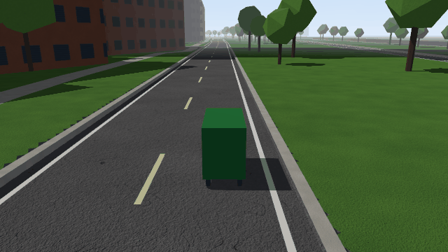

| Question | Answer |
|---|---|
| **What it is** | `path:=lane`: on mapped road, the plan is the right lane's centre. Something parked is passed only as far and as long as needed, then back (`pass.rs`) |
| **Why** | Ben: "we want to stick to the right side of the lane unless we need to for obstical avoidance" |
| **Numbers** | University Drive: **0 %** of the time over the centre line (61 % before; other planners 45-74 %); 0.11 m off the lane's centre. A 1 m box: over the line 4.8 s, back in 9 m |
| **Default?** | yes, in `stack:=ours` since 16 Nov. The lot has no lanes: there the lattice plans |
| **How to see it** | `pixi run ravensim world:=campus`; key L shows the lane lines |

## Kerbs

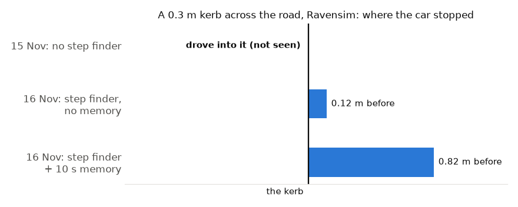

| Question | Answer |
|---|---|
| **What it is** | The **step finder**: in the lidar's cubes, a rise of more than 0.10 m is a kerb. A 10 s memory keeps it once it is out of sight |
| **Why** | Ben, 15 Nov: "we don't want to hit a curb". The flat scan keeps only what stands 0.3 m up, so it never saw one |
| **Numbers** | a 0.3 m kerb seen 8.4 m out; a 0.15 m kerb from 4.7 m; a 0.10 m kerb: not seen |
| **Default?** | yes, in `stack:=ours` (sim) since 16 Nov. Not on the car yet |
| **How to see it** | `pixi run sim-check --kerb-only` |
| **Read more** | [Kerbs](kerbs.md) |

## Things, and stopping for moving things

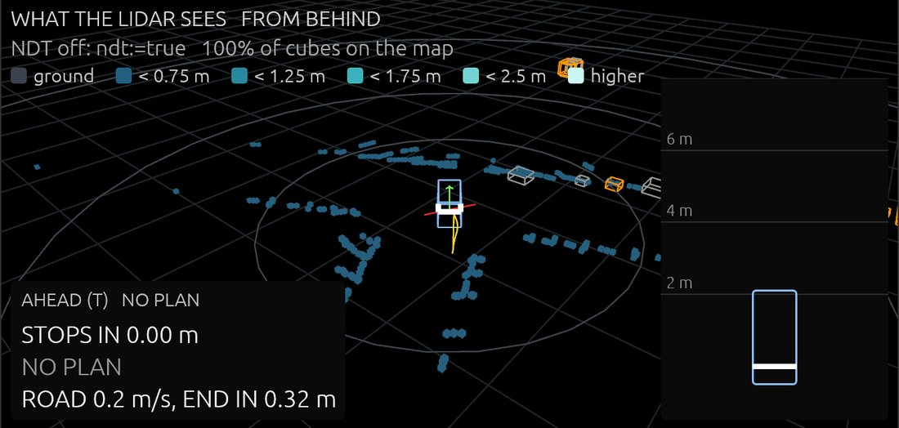

| Question | Answer |
|---|---|
| **What it is** | The **things tracker**: the lidar's cubes grouped into things, each with a speed. Cubes on the map's own walls are dropped |
| **Stop for moving** | a thing moving 0.3 m/s or more within 10 m, or onto the road ahead within 3 s, holds the car (WAIT) until 1 s after it has gone. Only a still thing is passed |
| **Why** | Ben, 16 Nov: "if we see a car people or stuff moving around us we should likely just stop" |
| **Numbers** | false things 9.9 → 1.7 a moment, every walker still found within 0.2 s; held for a car, a person crossing and cross traffic every run; the parked box never |
| **How to see it** | `pixi run sim-check --movers` |

## Behaviour: the rules of the road

```text
   DRIVE ── a stop line, an obstacle, the road's end ──► APPROACH
     ▲                                     (slows by the stopping law)
     │                                                   │
     │                                                   ▼
     └──── GO ◄──── WAIT (until clear) ◄──────────── STOPPED

   ASK: held too long; a person decides
```

| Question | Answer |
|---|---|
| **What it is** | One state machine for the road rules: stop signs, the end of the road, things moving, something parked |
| **The stopping law** | one law S(v) for every planned stop, from the car model |
| **The road ahead** | `/world/road_ahead`: the line, edges, speed limits and the end. Ego holds every follower to it, so no follower can drive past it |
| **Numbers** | Rust: 1.3 % of a core against 9.0 % in Python |
| **How to see it** | `pixi run sim-check --behaviour`; the HUD's state line |

## Safety: the locks

```text
   a driver ──► twist_mux ──► ego ──► the spine ──► the car
                    ▲                     ▲
   e-stop ──────────┤                     │ brakes if commands
   stop zone ───────┤ (ahead, behind)     │ stop for 100 ms
   watchdog ────────┤ (STUCK, OVERSPEED)
   geofence ────────┘ (outside the area)
```

| Lock | What it does | Number (sim) |
|---|---|---|
| **Stop zone** (`aav_stop_zone`, Rust) | stops for anything in a box ahead or behind; took the lock from Nav2 on 17 Nov | stops 0.16-0.55 m before a post; matched 24 of 24 of Nav2's stops, never later |
| **Watchdog**: STUCK steering | steering more than 0.15 rad off its command for 1 s: latched | noticed in 3.6 s (was: 19 m, nothing) |
| **Watchdog**: OVERSPEED | the wheels 0.2 m/s over ego's speed while not slowing, 2 s: latched | a stuck throttle caught 4.6 s after; healthy stops never |
| **Watchdog**: our own nodes | warns when one stops; never stops the car for it | - |
| e-stop, geofence, the spine's 100 ms timeout | as in 0.3 | the spine brakes 111-120 ms after (QEMU) |

The locks are **never swapped out**. A latch is cleared only by a person: `pixi run clear watchdog`.
`sim-check --faults`: 14 of 14 fault cases, 3 runs in a row (17 Nov).

## Localization: where am I

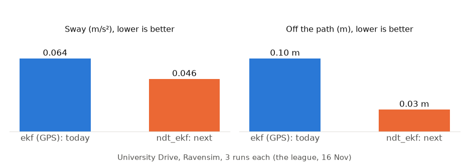

| Question | Answer |
|---|---|
| **Today** | two EKFs (wheels, IMU, GPS), plus **lane pose**: the painted lines correct the side-to-side error (9.2-9.9 → 6.9-7.8 cm) |
| **NDT** | matches the lidar to a saved map, loading only the chunks round the car |
| **`ndt_ekf`** | NDT fed into the global EKF: calmer on every tour, but stopped once on University Drive in 2 of 3 runs. **Recommended next**, not yet the default |
| **New on 17 Nov** | both EKFs take the car's command, so a quiet wheel sensor no longer lets them run on (the 9 m jump is gone) |
| **How to see it** | `pixi run sim world:=test_lot ndt_ekf:=true` (NDT has a map of the test lot); `pixi run measure controllers --ndt-ekf` scores it |

## Our own stack, in place of Nav2 and Gazebo

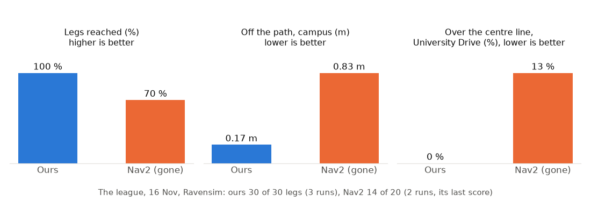

| Replaced | By | When |
|---|---|---|
| Nav2's costmap, planner, navigator, controller, smoother | our costmap (on chunks), lattice planner, navigator, `mppi_lag_calm`, smoother: all Rust | default 14 Nov; Nav2 deleted 17 Nov |
| Nav2's collision monitor | our stop zone | 17 Nov |
| Gazebo | Ravensim | 16 Nov |

| Question | Answer |
|---|---|
| **Why** | Ben, 14 Nov: "We want to run everythign ourselves in rust and/or python" |
| **Drop-in** | our navigator serves the same action names, so no goal sender can tell |
| **Kept** | small, proven stock parts: `robot_localization`, `twist_mux`, teleop |
| **What it was** | [Nav2, as it was](history/nav2-as-it-was.md), [Gazebo, as it was](history/gazebo-as-it-was.md) |

## Rust ports

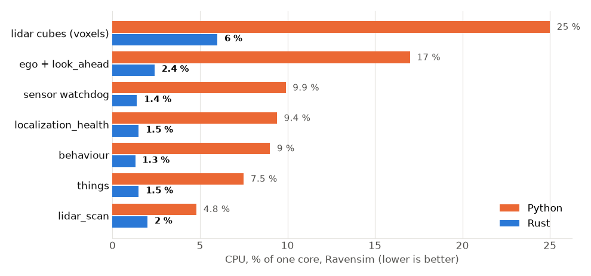

| Node | Rust package | Default in Rust |
|---|---|---|
| ego + look_ahead | `aav_ego_rs` | sim and car |
| behaviour | `aav_behaviour_rs` | sim and car |
| sensor watchdog | `aav_watchdog_rs` | sim and car |
| localization_health | `aav_localization_health_rs` | sim and car |
| lidar_scan | `aav_lidar_rs` | sim and car |
| things | `aav_things_rs` | sim and car |
| lidar cubes | `aav_voxels_rs` | built; the car next |

| Question | Answer |
|---|---|
| **Why** | Ben, 16 Nov: "I trust rust more then python" |
| **How we know they match** | each one gives the Python's answers on shared test vectors (thousands of ticks, often bit for bit) |
| **Fall back** | one switch: `ego_impl:=python`, `lidar_impl:=python`... ([on the car](release-0.4-rc1.md#check-first-on-the-car)) |

## The detector through ONNX

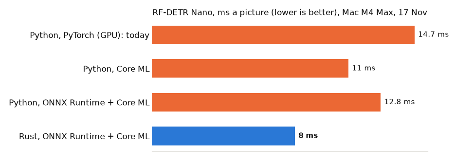

| Question | Answer |
|---|---|
| **What it is** | The stop-sign detector (RF-DETR Nano), exported once to ONNX, run from Rust (`aav_detector_rs`) with ONNX Runtime; on a Mac through Core ML |
| **Why** | one model file for every computer; train in PyTorch, run anywhere; TensorRT on the Orin later |
| **Numbers** | the same boxes as Python (overlap 0.9999); **8.0 ms** a picture against 14.7 ms today; the GPU does the work |
| **Default?** | no: a challenger. It builds on macOS only for now; the Python detector stays the default |
| **Read more** | [ONNX from Rust](onnx.md) |

## The league's scores

The league scores every option of every level on the same tours (lot, campus,
University Drive), with everything else at `stack:=ours`. A challenger wins by a margin on
3 or more runs, with no column worse.

| Level | Champion | Closest challenger |
|---|---|---|
| pose | `ekf` | `ndt_ekf`: calmer, one stop to find |
| costmap | `ours_chunks` | - |
| path | `lane` (+ pass) | Hybrid-A*: least sway, but the wrong lane |
| steer | `mppi_lag_calm` | `mpc_lag_rs`: 2-7 times closer to the path, but sways, can't reverse |
| speed loop | `default` | `smooth`: a tie |

**16 Nov: no champion changed.** The full table: [the league, 16 Nov](league-results-2026-11-16.md).

## Tools

| Tool | What it does | Run |
|---|---|---|
| **sim-check** | the whole graph headless, then a drive; every line PASS | `pixi run sim-check` (2 min); modes `--kerb`, `--movers`, `--faults`, `--three-point`... |
| **measure** | scores stacks on tours: legs, time, sway, off the path | `pixi run measure controllers` |
| **car kit** | our Jazzy for the car's ARM computers, offline, on a stick | `pixi run car-kit` (68 s, 1.9 GB, 804 Rust crates) |
| **ravensim** | the sim and the developer window in one go | `pixi run ravensim` |
| **record, score** | record any drive; one scorecard for sim or car | `tools/record.sh`, `tools/score_drive.py` |

On 17 Nov every `sim-check` mode passed in a row on Ben's Mac, and CI was green on
Linux x86, ARM and both car-kit builds ([0.4-rc1 on the car](release-0.4-rc1.md#checked-on-17-nov-bens-mac)).

## Untested on the car

| Item | Since | Tried in |
|---|---|---|
| Our own stack as the only stack | 14-17 Nov | Ravensim, the league |
| The Rust defaults | 16-17 Nov | Ravensim, unit tests |
| `path:=lane`, kerbs, stop for moving things | 16-17 Nov | Ravensim |
| The behaviour planner and the stopping law | 14 Nov | Ravensim |
| RavenTiles for NDT, the costmap, the things | 16 Nov | Ravensim (campus) |
| The watchdog's OVERSPEED latch | 16 Nov | Ravensim, unit tests |
| The Rust ESP32 firmware | - | QEMU only; never flashed |
| The kit on the Orin and the Motor Pi | - | CI's ARM runner only |

Before any of it drives the car: the **seven hardware blockers** (the firmware timeout,
the brake, wheel speed, clocks, the steering's centre, a truth for "1 m"). The hardware
lead decides each ([the list](release-0.4-rc1.md#the-seven-hardware-blockers)).

## What's next

The queue of 17 Nov night, as it stands on 18 Nov:

| # | Next | Why | 18 Nov |
|---|---|---|---|
| 1 | **Six more ports to Rust** | the rest of the heavy Python (TODO 185) | ✅ the lane finder, `joy_alive`, the stop-sign watcher, the point driver, `arm_when_open`, `camera_stream` |
| 2 | **NDT in the EKF** (`ndt_ekf`) | find its one stop, add a fall back where a world has no NDT map, score again, swap (TODO 210) | ⬜ |
| 3 | **Slow down for still obstacles** | today the behaviour slows only for things that move; a still wall is stopped by the stop zone alone | ⬜ |
| 4 | **AMCL in Rust** | the last Nav2 node (TODO 231) | 🟡 `aav_amcl_rs` is the default, a tie with stock on the lot; `nav2_amcl` leaves `pixi.toml` after more runs (232) |
| 5 | **The survey's picks** | smooth MPPI (212), an MPC that reverses (213), passing with a jerk limit (214), the ground ring by ring (215), Kinematic-ICP (216), a motion model per thing (217) | ⬜ |

The newest order is at the top of `TODO.md` ("What is next"), and the testing plan
([The testing plan](testing-plan.md)) is what the car does next.

Then the car: the blockers, car day, one drive recorded and scored ([Car day](car-day.md)).

## Read more

| Page | For |
|---|---|
| [What we built](what-we-built.md) | the whole stack, every area's numbers |
| [0.4-rc1: start here](release-0.4.md) | one command per job |
| [0.4-rc1 on the car](release-0.4-rc1.md) | install, check first, the blockers |
| [Features](features.md) | every feature, why, and who built it |
