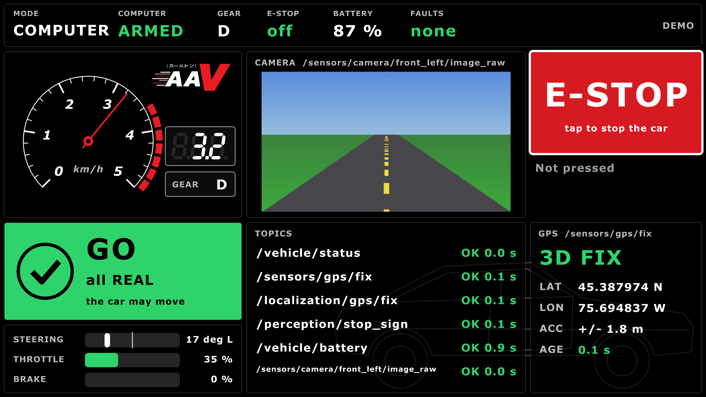
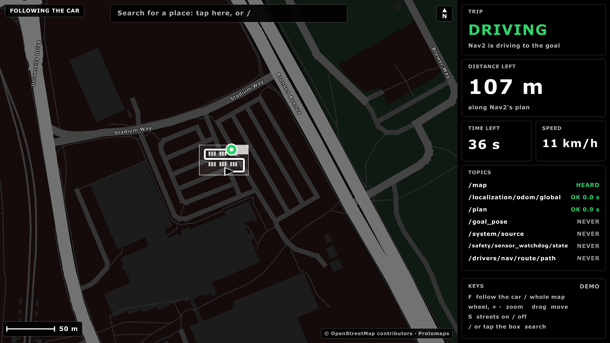
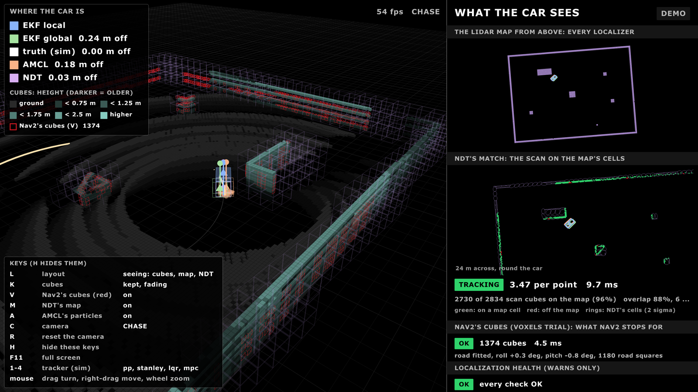
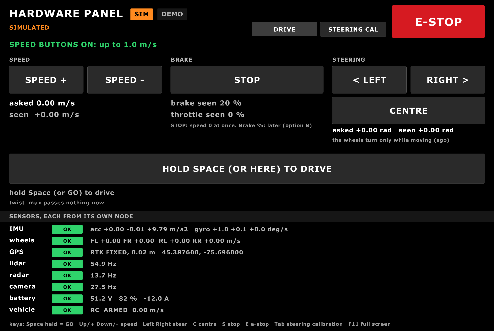
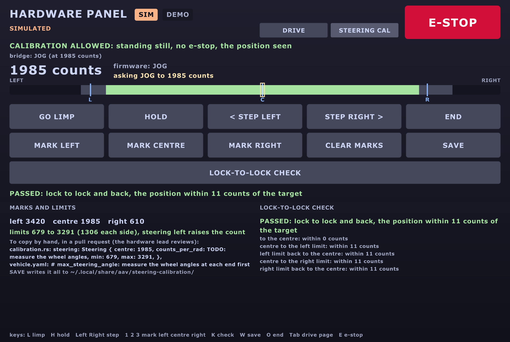
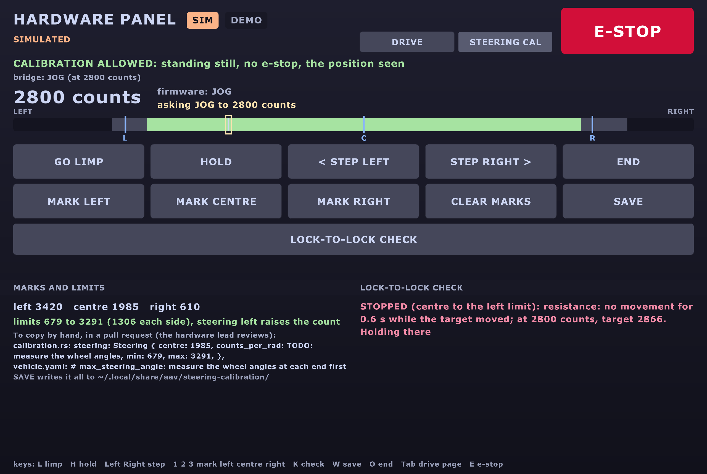
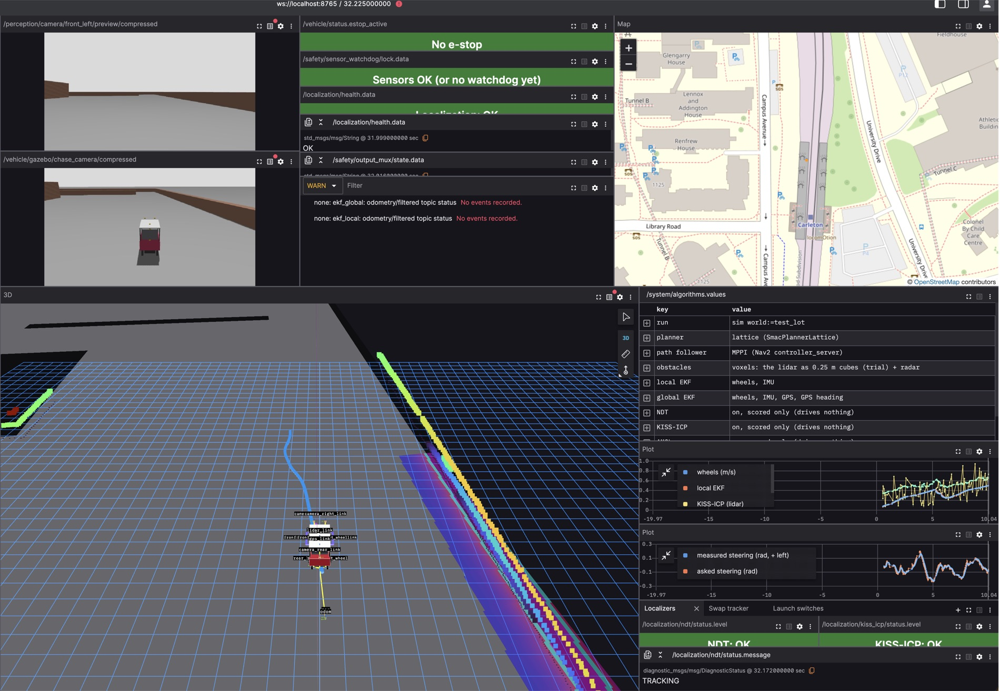
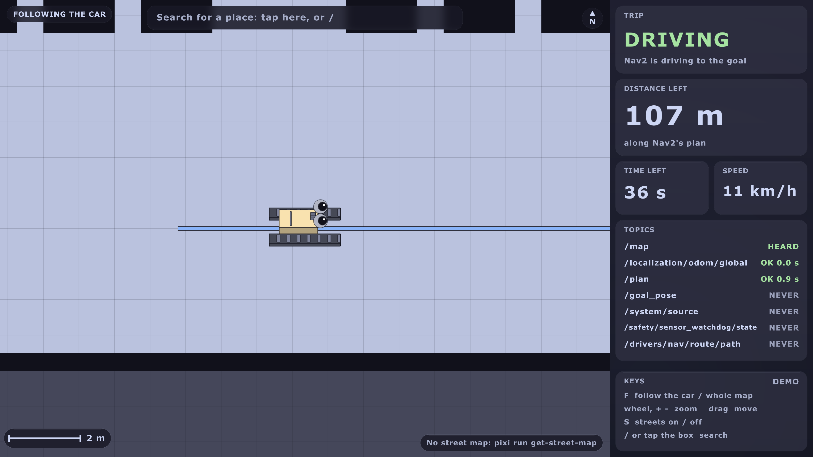
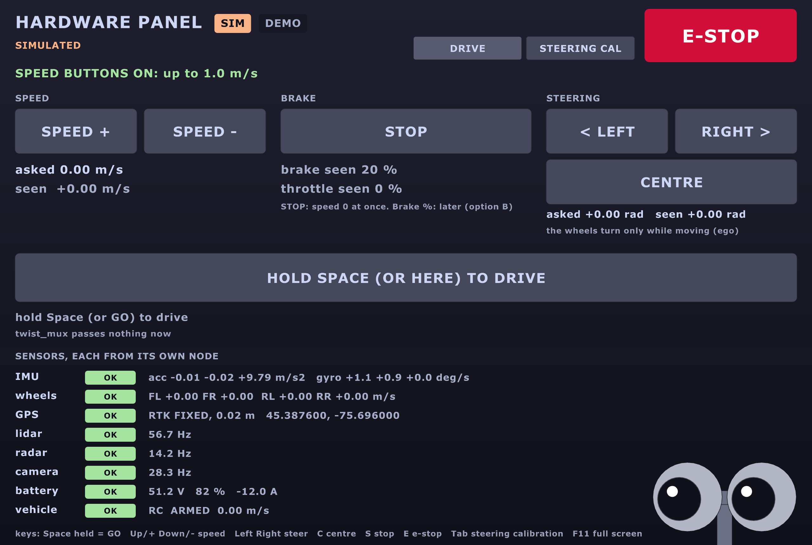
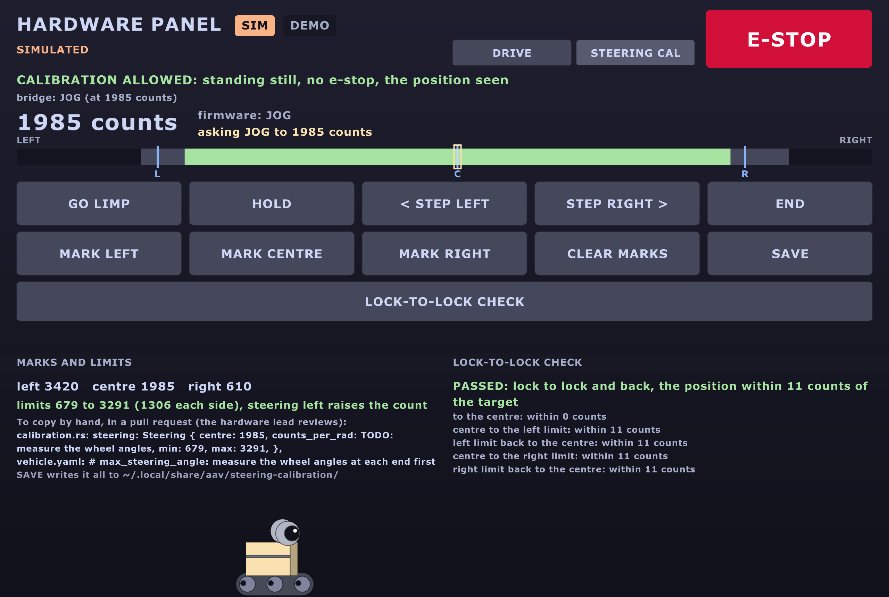

# Release 0.2: ready for the car

<p class="release-line">The AAV 2026–27 autonomy stack · 3 November 2026</p>

<div class="pitch"><p><b>Sim-complete, car-ready.</b> Four screens of our own, a cockpit
in Lichtblick, a joystick that stops when the pad dies, a Rust ESP32 that brakes in
0.1 s, new ways to know where the car is and to plan its path, and a car-day runbook
that destroys nothing. Every part runs in Gazebo; every test passes. Next: the real
car.</p></div>

<div class="tiles">
<div class="tile"><b>1575</b><span>tests, 0 failures (3 Nov)</span></div>
<div class="tile"><b>23 / 23</b><span>launch switches each drove a leg in Gazebo</span></div>
<div class="tile"><b>5</b><span>screens: HUD, map, debug, hardware panel, cockpit</span></div>
<div class="tile"><b>112 ms</b><span>the Rust ESP32 brakes after the heartbeat stops (QEMU)</span></div>
<div class="tile"><b>4</b><span>new localizer trials: AMCL, NDT, NDT-EKF, KISS-ICP</span></div>
<div class="tile"><b>0</b><span>moves of the real car so far: that's 0.3</span></div>
</div>

**The detail behind every line:** [the 0.2 guide](release-0.2.md) (its own PDF,
`docs/html/aav-0.2.pdf`). The words in capitals are spelled out in
[The words, spelled out](#the-words-spelled-out).

## Highlights

- **Five screens, one look:** the HUD, the map, the debug screen, the hardware panel and
  the cockpit, in Initial D red and black.
- **The hardware panel:** every sensor's number and very simple buttons; the car moves
  only while you hold Space.
- **Steering calibration:** find the steering actuator's two ends and its centre, then a
  lock-to-lock check that stops at the first stiff spot.
- **The cockpit:** every driving detail on one Lichtblick screen, with a table of which
  algorithms this run uses.
- **The joystick-alive check:** a joystick that goes silent or freezes stops the car.
- **The Rust ESP32 firmware:** brakes fully 0.1 s after the Orin's heartbeat stops (the
  C++ never does), with Arsh's state machine.
- **Where am I:** two EKFs by default; AMCL, NDT, NDT-EKF and KISS-ICP as trials. NDT-EKF
  is 10 times closer to the truth.
- **Planning:** the State Lattice by default (it reverses and makes the U-turn);
  Hybrid-A* forward only; a diffusion planner as a trial.
- **Perception:** RF-DETR Nano on the camera stream sees a stop sign at 20 m (YOLO: 10 m);
  the lidar as a flat scan or as cubes.
- **Safety in layers:** e-stops, hold-to-drive, timeouts, the output mux, the sensor
  watchdog, collision_monitor, a 30 m geofence.
- **Car day, written:** Day A destroys nothing, Day B upgrades. Named roles, sign-offs,
  and `car_setup.sh` for each computer.
- **45 commands,** down from 89, and `pixi run pick` to choose the switches from a menu.
- **The little robot:** a tribute to WALL-E, peeking from three of the screens.

## The screens

Five screens. Each one: the picture, the command, what it shows, what it's for.

| Screen | Where it runs |
|---|---|
| HUD | the car's small screen |
| Map | the car's big screen |
| Debug screen | a laptop or the lab |
| Hardware panel | the Orin's screen or a wired laptop |
| Cockpit (Lichtblick) | any laptop, no ROS needed |

### The HUD



| | |
|---|---|
| **Run it** | `pixi run hud --demo` (pretend data, no ROS); `pixi run hud` beside `pixi run sim` |
| **What it shows** | speed, gear, mode, the camera, and the GO / STOP panel: may the car move, and if not, the one main reason |
| **Use it for** | the safety driver's view in the seat; its E-STOP button stops the car |

### The map



| | |
|---|---|
| **Run it** | `pixi run map --demo`; with Gazebo: `pixi run sim world:=test_lot map:=true` |
| **What it shows** | the car on Ottawa's streets, with Nav2's route |
| **Use it for** | search for a place, and send the car there. Once: `pixi run get street-map`, `pixi run get places` |

### The debug screen



| | |
|---|---|
| **Run it** | `pixi run debug-hud --demo` (no ROS); `pixi run demo --debug` (with Gazebo) |
| **What it shows** | what the car sees, in 3D: the lidar's cubes, where each localizer puts the car, the health checks |
| **Use it for** | finding out why the car did something. Keys 1-4 swap the path follower (sim only) |

### The hardware panel



| | |
|---|---|
| **Run it** | `pixi run hw-panel --demo`; with Gazebo: `pixi run sim world:=test_lot`, then `pixi run hw-panel` |
| **What it shows** | every sensor's number, straight from its own node; very simple buttons |
| **Use it for** | the hardware test in front of the car ([recipe B](#b-the-hardware-test-in-front-of-the-car)) |

### The steering calibration page

The hardware panel's second page: press **Tab**.

| Passed | Stopped on a stiff spot |
|---|---|
|  |  |

| | |
|---|---|
| **Run it** | `pixi run hw-panel --demo`, then Tab |
| **What it shows** | the steering actuator's position in counts, the three marks (left, centre, right), the equal limits, the check |
| **Use it for** | the steering pulls right: this finds its true centre. Needs the Rust firmware (a later day) |

### The cockpit (the Drive screen)



| | |
|---|---|
| **Run it** | `pixi run sim world:=test_lot foxglove:=true`, then Lichtblick ([step by step](#the-cockpit-step-by-step)) |
| **What it shows** | both cameras, the status lights, the street map, a big 3D view, the speed and steering plots, which algorithms run |
| **Use it for** | watching a drive from any laptop, and sending Nav2 a goal (sim) |

### The little robot

| On the map | Peeking on the panel | After a passed check |
|---|---|---|
|  |  |  |

| | |
|---|---|
| **Run it** | `pixi run hw-panel --demo --robot-now`; on the map, `car_marker: robot` in `map.yaml` |
| **What it shows** | a tribute to WALL-E: big round eyes after 60 s of quiet; never while the car moves or anything warns |
| **Use it for** | a smile. Off: `easter_egg: false` |

## The cockpit, step by step

**Yes, it runs.** Seen live in Gazebo's test lot on 3 November.

| # | Do |
|---|---|
| 1 | Start Gazebo with the bridge, and the trials you want to see: `pixi run sim world:=test_lot foxglove:=true voxels:=true ndt:=true kiss_icp:=true amcl:=true` (NDT needs its map once: `pixi run ndt-map drive`, about 6 min) |
| 2 | Get **Lichtblick** (free, open source): github.com/lichtblick-suite/lichtblick, Releases. On a Mac, the first time: right-click it in Applications → Open |
| 3 | In Lichtblick: **Open connection → Foxglove WebSocket**, `ws://localhost:8765` |
| 4 | **Layouts → Import from file**: `tools/foxglove/cockpit.json` |
| 5 | Send a goal: in the 3D panel, the **Publish** tool (top right), set to **Pose**, then click and drag on the road. Nav2 plans and drives |

```text
┌──────────────┬────────────┬──────────────────┐
│ front camera │ status     │ street map       │
├──────────────┤ (5 lights) │                  │
│ chase camera │            │                  │
├──────────────┴────────────┼──────────────────┤
│                           │ ALGORITHMS table │
│  3D: the car, lidar,      │ speed plot       │
│  cubes, costmap, plan,    │ steering plot    │
│  each localizer           │ tabs             │
└───────────────────────────┴──────────────────┘
```

**Panel by panel: what it tells you**

| Panel | It tells you |
|---|---|
| Front camera | what the car's front left camera sees, once a second |
| Chase camera | Gazebo's view from behind the car (sim only) |
| Status | e-stop, sensor watchdog, localization health, output gate, warnings: green is good |
| Street map | the EKF's position (blue) against the raw GPS (orange) |
| 3D | the car, the lidar, the cubes, the costmap, Nav2's plan and goal, and each localizer's guess: local EKF blue, global EKF green, NDT purple, AMCL orange |
| Algorithms | which planner, path follower, obstacles and localizers this run uses |
| Speed plot | the wheels, the local EKF and KISS-ICP against the speed asked |
| Steering plot | the steering asked against measured |
| Tab: Localizers | NDT and KISS-ICP lights: OK, WARN, LOST, or off |
| Tab: Swap tracker | swap the path follower live (sim, with `tracker:=`) |
| Tab: Launch switches | what each switch does; changing one needs a restart (`pixi run pick`) |

**Tips**

- Changed the layout? Lichtblick keeps its old copy: import it under a new name.
- On the car the cockpit is **watch only**: a click sends nothing.
- The street map needs the internet.

**Not showing yet**

- The EKFs' arrows and NDT's scan (two scripts inside the layout).
- NDT's map and KISS-ICP's cloud: no topic yet. The debug screen shows them.

More: [Watch from a laptop](foxglove.md#cockpit).

## How to use it

### (a) Try it on a laptop

| # | Do | You see |
|---|---|---|
| 1 | `pixi install`, `pixi run build` | everything built (the first time, minutes) |
| 2 | `pixi run hud --demo`, then `pixi run hw-panel --demo` | two screens with pretend data, no ROS |
| 3 | `pixi run demo` (`--debug` adds the debug screen) | Gazebo's test lot, RViz, the HUD and the map at once |
| 4 | `pixi run pick` | a menu: planner, path follower, where-am-I. It prints the command and runs it |
| 5 | In RViz or the cockpit, send a goal | the car plans and drives there |

Goals accepted but the car never moves? Stop everything, `pixi run fastdds shm clean`,
start again.

### (b) The hardware test in front of the car

**On stands: all four wheels off the ground.** From [Car day](car-day.md), A6-A9b.

**Who stands where**

```text
                 ┌───────────── the car, on stands ─────────────┐
   E-STOP PERSON │  front wheels           rear wheels (driven) │ HARDWARE LEAD
   Kar-Tech stop │  (steering)                                  │ at the actuators
   in hand,      └──────────────────────────────────────────────┘
   nothing else            LAPTOP PERSON: the wired laptop        APPROVER signs ✍ steps
```

| Role | Does |
|---|---|
| E-stop person | holds the **Kar-Tech stop**, the main stop, whenever the car has power. Nothing else |
| Hardware lead | decides every hardware question; sets the actuators |
| Laptop person | runs the commands; keeps the recordings |
| Safety driver | in the seat, for every move on the ground |
| Approver | signs each step you can't undo; not the laptop person |

**The order on the day**

| Step | What | With |
|---|---|---|
| A6 | the steering actuator's ends and centre | Pololu's program over USB (Way A; the Jrk G2's); the [sheet](actuator-tests.md#the-sheet) |
| A7 | the brake holds, with the power on and off | by hand |
| A8 | the Rust ESP32 flashed, then 14 checks; roll back on the first failure | the hardware lead's OK, Ben on a call |
| A9 | the keyboard: forward, back, left, let go, every e-stop | `pixi run keyboard` |
| A9b | the joystick ([recipe c](#c-the-joystick-on-the-motor-pi-alone)) | the Motor Pi alone |

**The hardware panel at the car**

| # | Do |
|---|---|
| 1 | On the Orin: `~/aav-jazzy/aav.sh ros2 launch aav_bringup car.launch.py machine:=orin max_speed:=0.3 gps:=false lidar:=false stands:=true` |
| 2 | On the wired laptop: `export ROS_DOMAIN_ID=42`, then `pixi run tools/ros.sh ros2 launch aav_hud hw_panel.launch.py stands:=true` (or on the Orin's own screen) |
| 3 | **Read each sensor:** every row has its own number and age. A grey or STALE row: check that sensor's cable and driver |
| 4 | **The buttons** (Gazebo and the bench today; on the car once a driven-wheel speed exists, TODO 49b) |

| Button (key) | Does |
|---|---|
| SPEED + / SPEED − (Up, Down) | the asked speed, 0.1 m/s a press; never reverse, never above the cap |
| Hold **Space** | the car moves **only while it's held**; let go and it stops |
| LEFT / RIGHT (Left, Right) | steer 0.05 rad a press, while creeping |
| CENTRE (C) | wheels straight at a creep, then stop |
| STOP (S) | the asked speed to 0 at once |
| E-STOP (E) | the e-stop; clear it with `pixi run clear estop` |

On the real car today the speed buttons are **off**, and the panel says why: the wheel
sensors are on the front, the motor drives the rear. On stands the keyboard drives (A9).

**The steering calibration page** (Tab), on a later day with the Rust firmware:

| # | Do | What it does |
|---|---|---|
| 1 | **GO LIMP** (L) | the motor lets go; turn the wheels by hand |
| 2 | or **STEP LEFT / RIGHT** | small steps, 25 counts a press |
| 3 | **MARK** left (1), centre (2), right (3) | equal limits: the smaller side, less 5 % |
| 4 | **LOCK-TO-LOCK CHECK** (K) | centre → left → centre → right → centre; stops and holds at any stiff spot |
| 5 | **SAVE** (W) | a file with the numbers; a person copies them in a pull request |

The sensor check without driving: `pixi run actuator-test preflight --stands --no-drive --skip steering gps lidar`
(on the Orin): one PASS or FAIL per sensor, nothing moves.

### (c) The joystick on the Motor Pi alone

Car day A9b. The Rust ESP32 only (the C++ has no timeout). No Orin.

| # | Do | You see |
|---|---|---|
| 1 | Stands; Kar-Tech stop in hand; theirs stopped (`aav_serial_bridge` inactive) | |
| 2 | On the Motor Pi: `~/aav-jazzy/aav.sh ros2 launch aav_bringup car.launch.py machine:=motor_pi_alone max_speed:=0.3` | |
| 3 | `~/aav-jazzy/aav.sh ros2 topic echo /drivers/joy/alive` | `WAITING`, then `OK` once the trigger is released |
| 4 | Hold the trigger (button 0), a little throttle | the wheels turn |
| 5 | **Turn the joystick off** while driving | the wheels stop within 3 s: `SILENT` or `FROZEN` |
| 6 | Unplug the receiver while driving | stops within 1 s; stays stopped until the trigger is released and pressed |

Try it in Gazebo first: `pixi run sim teleop:=true` with the pad plugged in.

### (d) Record a drive

| # | Do |
|---|---|
| 1 | On the car: `~/aav-jazzy/aav.sh tools/record.sh --lidar <name>`; in Gazebo: `tools/record.sh --lidar <name>` |
| 2 | It writes `bags/<date>_<name>/` (MCAP): sensors, commands, what the stack decided. About 5 GB per 10 min |
| 3 | The same drives build the lot's NDT map: `pixi run ndt-map build bags/<name> --poses /localization/odom/global --out maps/ndt/<lot>` |

Bags stay out of git. Record all of car day.

### (e) Score a trial

| # | Do | Gives |
|---|---|---|
| 1 | `pixi run measure controllers --tours lot` | each planner and follower on the same routes: legs finished, time |
| 2 | `pixi run measure controllers --planners lattice diffusion --reversing --tours lot` | two planners side by side |
| 3 | `pixi run measure atob <bag>` | one A-to-B run scored |
| 4 | Replay a car-day bag with a trial on and off (`ndt_ekf`, `kiss_ekf`, `voxels`) | the best, on real data ([tests 4.22](tests.md#4e-record-the-lot-the-maps-and-the-scores)) |

A trial becomes the default only with its numbers ([Trials](trials.md)).

## The words, spelled out

| Short | Full name | In one line | Where we use it |
|---|---|---|---|
| **Ackermann** | Ackermann steering (Rudolph Ackermann) | the front wheels turn by different angles, so every wheel circles one point | ego's commands; Gazebo's car |
| **AMCL** | Adaptive Monte Carlo Localization | many guesses of where the car is; keeps those that match the walls | a localizer trial (`amcl:=true`) |
| **CAN** | Controller Area Network | the car's two-wire bus: short frames between boards | the spine; the wheel sensors (0x200, 0x201) |
| **Core ML** | Apple's Core ML | runs a model on a Mac's GPU and Neural Engine | the detector on MacBooks |
| **Costmap** | (Nav2's costmap) | a grid of how bad it is to drive over each cell | Nav2's planner and follower |
| **Cubes (voxels)** | voxel: volume pixel | the lidar's points sorted into 0.25 m boxes | a trial in place of the flat scan (`voxels:=true`) |
| **DAC** | Digital-to-Analog Converter | turns a number into a voltage | the throttle (0-1023) |
| **DDS, Cyclone** | Data Distribution Service; Eclipse Cyclone DDS | how ROS 2 nodes find each other and send messages | Cyclone on the car |
| **Diffusion planner** | (a denoising diffusion model) | a small model draws 16 paths from noise; a guard checks each | a planner trial (`planner:=diffusion`) |
| **EKF** | Extended Kalman Filter | blends noisy sensors into one best guess, with how sure it is | `ekf_local`, `ekf_global`: the default |
| **ESP32** | (Espressif's ESP32, a name) | a small microcontroller board | drives the throttle, brake and steering actuators |
| **FSM** | Finite State Machine | a fixed set of states and the rules to move between them | Arsh's `fsm.rs` in the spine |
| **Foxglove, Lichtblick** | (app names) | watch ROS from any laptop; Lichtblick is the open-source one | the cockpit |
| **Gazebo** | Gazebo Harmonic | a 3D robot simulator with physics and sensors | `pixi run sim` |
| **GPS, RTK GPS** | Global Positioning System; Real-Time Kinematic | where on Earth; RTK uses a base station to reach about 2 cm | `ekf_global`; RTK: the ground truth, later |
| **HUD** | Head-Up Display | the driver's screen | the in-car screen |
| **Hybrid-A\*** | Hybrid A-star search | searches moves a car can make, cell by cell | the planner when forward only |
| **I2C** | Inter-Integrated Circuit | a two-wire bus for chips on one board | the ESP32 to the Jrk boards |
| **ICP** | Iterative Closest Point | pairs each lidar point with the nearest old one, then moves to close the pairs | inside KISS-ICP |
| **IMU** | Inertial Measurement Unit | measures turning and acceleration | the Yahboom IMU, into both EKFs |
| **Jrk** | (Pololu's Jrk G2, a name) | the motor controller board in each actuator | the steering and brake actuators |
| **KISS-ICP** | Keep It Small and Simple ICP | how far the car moved, from the lidar alone, no map | a localizer trial (`kiss_icp:=true`) |
| **Lidar** | Light Detection and Ranging | a spinning laser that measures distances all round | the roof lidar: scan, cubes, NDT |
| **LQR** | Linear Quadratic Regulator | a formula for the best steering at each moment | a path-follower trial (`tracker:=lqr`) |
| **LQI** | Linear Quadratic Integral | LQR with a memory of the error, so it ends exactly on the speed | a speed-loop trial (`speed_loop:=lqi`) |
| **MCP** | Model Context Protocol | lets an AI app read tools and data | our read-only server for Claude Code |
| **MPC** | Model Predictive Control | tries the next 1.5 s of steering, keeps the best, repeats | a path-follower trial (`tracker:=mpc`) |
| **MPPI** | Model Predictive Path Integral | tries hundreds of random short futures, blends the best | Nav2's path follower: the default |
| **Nav2** | Navigation 2 | ROS 2's navigation: maps, planners, followers | plans and drives to a goal |
| **NDT** | Normal Distributions Transform | turns a saved map into blobs and slides the lidar's scan onto them | a localizer trial (`ndt:=true`) |
| **NDT-EKF** | NDT into the EKF | the global EKF uses NDT beside the GPS | a trial: 1.8 cm off, against 17 cm |
| **ONNX** | Open Neural Network Exchange | one file format for a model, any runtime | the diffusion model |
| **PI, PID** | Proportional-Integral(-Derivative) | pushes harder the further off it is, and the longer | the default speed loop |
| **QEMU** | Quick Emulator | runs the ESP32's firmware on a laptop | `pixi run esp qemu-check` |
| **REP-103, REP-105** | ROS Enhancement Proposals 103 and 105 | metres, radians, x forward, left positive; the `map → odom → base_link` frames | every node |
| **RF-DETR** | Roboflow's DEtection TRansformer | finds objects in a picture, in real time | the detector: RF-DETR Nano |
| **RPP** | Regulated Pure Pursuit | aims at a point ahead on the path, slows in bends | a path-follower trial (`controller:=rpp`) |
| **Simplex guard** | (the Simplex architecture) | a clever part proposes; a simple, trusted part checks, or takes over | the diffusion planner's guard |
| **Smac** | (Steve Macenski's planners) | Nav2's planners for cars: Hybrid-A\*, State Lattice, 2D | `SmacPlannerHybrid`, `SmacPlannerLattice` |
| **State Lattice** | (a lattice of motion primitives) | joins short moves the car can really make, forwards and backwards | the default planner |
| **TensorRT** | NVIDIA TensorRT | runs a model fast on NVIDIA's GPU | the detector on the Orin |
| **TF** | Transform (ROS's tf2) | where each frame is against the others, over time | `map → odom → base_link` |
| **UART** | Universal Asynchronous Receiver-Transmitter | a plain serial wire | the Motor Pi to the ESP32 |
| **YOLO** | You Only Look Once | finds objects in one pass over the picture | the old detector; RF-DETR replaced it |

## What's left

**Before car day**

| What | Who |
|---|---|
| The people named, with phones (hardware lead, e-stop person, safety driver, laptop person, approver) | Ben and the team |
| The hardware lead's OK for the ESP32 flash (A8) and H1 (is CORTEX the Motor Pi?) | the hardware lead |
| A spare SD card for the restore test | Ben |
| PR #21 merged (Arsh reviews) | Ben, Arsh |
| The throttle cap's number for the first moves (TODO 74b) | Ben and the hardware lead |

**At the car**

| What | TODO |
|---|---|
| Back up every machine, then our stack beside theirs | A2, A5 |
| Measure: the steering's ends, the wheel size by tape, the track front and rear | 60, 61, 67 |
| Flash the Rust ESP32, with the hardware lead's OK | A8 |
| The joystick-off test on the real pad | 82, A9b |
| The timing test on the Orin (`pixi run measure timing`) | 76 |
| Record everything, with the lidar | 63 |

**After car day**

| What | TODO |
|---|---|
| Why the cubes once let the car into a post | 93 |
| Drive-to-point stops 0.61 m past its goal (the limit is 0.5 m) | 94 |
| The diffusion planner: 73 % of plans from the model, the goal 90 % | 78 |
| NDT-EKF the default of the test-lot demos | 95 |
| The cockpit's missing layers: the EKFs' arrows, NDT's scan and map | 87 |

When 0.2 is done: every box on [the 0.2 checklist](car-day.md#ready-for-car-day-the-02-checklist).
The full list: [TODO.md](../TODO.md).

## Coming in 0.3

- **It drives.** The real car, on the ground, at walking pace, then faster.
- **One screen per concept:** **Drive** (the cockpit takes in the debug screen) and
  **Hardware** (only what we control).
- **The hardware panel's pages:** actuators off, measure, direct control, the car tests.
- **Brake and throttle setting,** measured and set like the steering.
- **Rust where the Orin says so:** what misses its time budget moves to Rust.
- **A model that builds our algorithms** from car day's recordings, each one a trial
  beside the default, scored on the same routes.

## By the numbers

| What | How many |
|---|---|
| Built | 12 October to 3 November 2026, about 820 commits |
| Tests | 1575, 0 failures; CI green on Linux and 64-bit ARM |
| Switches | 23 of 23 started and finished a leg in Gazebo |
| Gazebo checks | `sim-check` 9 of 9, `bench-check` 11 of 11 |
| Timing test (Gazebo) | 0 messages over 0.5 s late, 10 minutes |
| ESP32 in QEMU | 6 of 6: full brake 112-119 ms after the heartbeat stops |
| ROS 2 packages | 44 |
| Commands | 45 `pixi run` tasks, down from 89 |

## Credits

- **Ben:** most of 0.2: the screens, the cockpit, the joystick-alive check, the
  localizer and planner trials, the Rust ESP32 firmware, the car-day runbook.
- **Arsh:** the spine's state machine and self-test, the getting-started guide, the
  previous teams' repos imported, CONTRIBUTING and the merge queue; reviews.
- **Betsi:** the localization health checks, and the car's first measurements.
- **The 2025-26 and 2024-25 teams,** whose code and lessons this builds on.
- **Open source:** ROS 2 Jazzy, Nav2, robot_localization, Gazebo, RoboStack and Pixi,
  rclrs, raylib, Lichtblick, KISS-ICP, Roboflow's RF-DETR, Catppuccin, embedded-hal and
  Embassy.

## Release 0.1: the first pass (11 October)

> **A snapshot from 11 October 2026.** What's true now: [Status](status.md) and [Features](features.md).

<p class="release-line">The AAV 2026–27 autonomy stack · 11 October 2026</p>

<div class="pitch"><p><b>The whole car's software, in one place, working end to end.</b>
Every driver, the virtual car (ego), localization, Nav2, perception and AI on every GPU,
the spine's firmware in Rust, three simulators and a full set of docs. It builds and
passes all of its tests, and it drives in simulation and on the bench. Next: the real
car.</p></div>

<div class="tiles">
<div class="tile"><b>26</b><span>ROS 2 packages, all building on Jazzy</span></div>
<div class="tile"><b>11</b><span>repos from the previous teams, merged into one workspace</span></div>
<div class="tile"><b>3</b><span>AI runtimes: PyTorch, Core ML on Macs, TensorRT on the Orin</span></div>
<div class="tile"><b>3</b><span>simulators: turtlesim, Gazebo and bench mode, plus replay</span></div>
<div class="tile"><b>0</b><span>failing tests: 291 colcon, 230 Python, 208 Rust</span></div>
<div class="tile"><b>2</b><span>platforms, one setup: Linux and macOS</span></div>
</div>

### Highlights

- **One workspace for the whole car.** Code from 11 of the previous teams' repos, merged
  and cleaned up, each with a record of where it came from. Six more were replaced by
  stock ROS packages.
- **One command path, from any driver to the wheels.** The joystick, the keyboard,
  scripted drives, Nav2 and lane keeping all go through one mux and **ego**, the virtual
  car, which keeps every command within what the car can really do.
- **AI on every GPU.** One YOLO detector per computer: Core ML on a MacBook (21 ms a
  picture; a stop sign seen from 20 m), TensorRT on the Orin, PyTorch anywhere else.
- **Navigation built for a car.** Nav2 with a planner for cars, no turning on the spot,
  GPS waypoints, and a stop zone that halts the car before an obstacle.
- **A CAN spine in Rust.** New firmware logic, five device drivers and a Pico 2 program,
  with watchdogs and a fail-safe e-stop input: 191 tests.
- **The whole car, tested without the car.** Bench mode runs the car's own software on
  one laptop and proves that it drives, stops for both e-stops, stops at a stop sign,
  keeps its lane and stops for an obstacle.
- **Macs are first-class.** One `pixi install` gives the same ROS 2 Jazzy, Gazebo and Nav2
  on a Mac as on Linux. No admin rights, no virtual machine.
- **Ready for AI tools.** A read-only MCP server lets Claude or another AI app read the
  docs, the contracts and the live graph, and never move the car.

### Everything in one workspace

**Merged in and cleaned up**, each with a `PROVENANCE.md` (its repo, its commit, every
change since):

- **The ESP32 actuator firmware** (AAV_cortex): it still drives today's car. Its protocol
  is rewritten in Python, and its device logic in Rust.
- **The wheel encoder** (Wheel_Encoders): a Pico 2 that counts spokes, read over Ethernet.
- **The IMU driver** (yahboom-IMU): fixed, then rewritten in Rust.
- **The TI radar driver and its clustering** (Nav_Radar).
- **Lane following** (Lane_Detection_ROS2), now with a lane finder of our own.
- **The in-car HUD** (User-Interface): the app and its back end, moved to our topics.
- **The steering geometry** (Motor_Steering) and **the joystick's button map**
  (joy_teleop_ackerman).
- **From the 2024-25 team:** the battery monitor, the camera calibrations, and the first
  YOLO stop-sign detector.

**Replaced by stock ROS packages:** the odometry (robot_localization), the path planners
(Nav2), the obstacle avoidance (Nav2's costmaps and collision monitor), the QNX layer
(twist_mux, the spine's watchdog and `ros2 bag`), and the joystick driver
(teleop_twist_joy).

### Driving: one path from any driver to the wheels

- **Five drivers:** the joystick (with a deadman button), the keyboard (from any laptop),
  scripted drives, Nav2, and lane keeping.
- **twist_mux** picks one by priority. The e-stop locks them all out.
- **ego, the virtual car,** turns the winning command into a speed and steering angle the
  car can do. It limits speed, acceleration and steering rate, and stops the car when the
  commands go stale.
- **Ackermann all the way:** ego sends Ackermann commands, never raw twists, and
  Gazebo's car steers the same way.
- **One backend at a time:** the turtle, Gazebo, today's car (the 2025-26 ESP32, over
  UART), or the new CAN spine. A driver can't tell which one is running.

### Knowing where the car is

- **Two EKFs** (robot_localization): `ekf_local` (wheel speed and the IMU) for smooth
  steering, and `ekf_global` (adding GPS) for planning.
- **Accurate on the bench:** 0.03–0.3 m from the truth. A replayed drive matches its
  recording within 0.03 m.
- **GPS:** the stock u-blox driver by default, with NMEA and `ublox_dgnss` as options.

### Navigation built for a car

- **Nav2, set up for Ackermann steering:** SmacPlannerHybrid plans paths a car can drive,
  Regulated Pure Pursuit follows them, and there's no Spin behaviour.
- **GPS waypoints** go through the same server.
- **Obstacles:** the radar feeds the local costmap, and collision_monitor's stop zone
  halts the car 0.3–0.4 m before an obstacle on the bench.
- **Proven in Gazebo and on the bench:** goals of 8 m and 9.5 m in Gazebo, and a 40 m
  bench route that stops at a stop sign on the way.

### Perception and AI on every GPU

- **YOLO11** (Ultralytics) finds stop signs, cars, people: 80 kinds of everyday object.
- **One model, three formats:** `.pt` for PyTorch anywhere, `.mlpackage` for Core ML on a
  Mac, `.engine` for TensorRT on the Orin.
- **Core ML on a MacBook:** 21 ms a picture, so all 10 pictures a second, and the stop sign
  first seen 20 m away. One command makes the model: `pixi run -e ml python3 tools/export_model.py --format coreml`.
- **TensorRT on the Orin:** a tool builds the engine on the Orin itself, ready for its
  JetPack reflash.
- **One detector per computer,** each under its own name. The stop-sign watcher hears them
  all, so a laptop can add a second opinion over WiFi.
- **A new lane finder** (OpenCV, 0.78 ms a picture). On the bench, lane keeping brings the
  car from 0.3 m off the centre line back to within 5 cm in about 6 s.
- **Radar clustering** turns the radar's points into objects.

### Firmware: a CAN spine, in Rust

- **The CAN contract** (`aav.dbc`): every frame between ROS and the spine, tested from both
  sides against the same vectors.
- **spine-core,** the spine's logic: it boots latched, arms only when asked, stops on a
  200 ms gap in the commands (100 ms since 15 Oct), and holds the e-stop. 54 tests.
- **Five device drivers and the glue** (embedded-hal 1.0): the steering and brake motor
  controllers, the throttle, the I/O expander, the RC receiver and the CAN chip. 137
  tests.
- **A Pico 2 program** (Embassy): CAN, a 100 ms hardware watchdog, and a fail-safe e-stop
  input (a cut wire reads as pressed). It builds, ready to flash.
- **Today's car keeps running:** the 2025-26 C++ boards build in their own Pixi
  environment, until each Rust version replaces them.

### From C++ to Rust

- **The rule:** firmware and hardware drivers in Rust, and our C++ moving to Rust, each
  written in Rust's own style.
- **Done:** the spine; the ESP32's device logic, as Rust drivers; a Rust IMU driver that
  gives the C++ one's answers, fed the same bytes (the comparison went with the C++ driver); and a first
  Rust ROS node.
- **In the works:** the Rust IMU driver as the only one, and the radar clustering as a
  Rust node.

### Simulation and bench mode

- **turtlesim:** a turtle that steers like the car. The first thing a new member drives.
- **Gazebo:** the car in 3D, with Ackermann steering, an IMU and GPS, driven by Nav2 to
  its goals. Its window works on a Mac.
- **Bench mode:** the car's own software on one laptop, with a pretend spine and pretend
  GPS, IMU, wheels, camera and radar. `pixi run bench-check` proves the whole chain.
- **Replay:** a recorded drive, run through the EKFs again.
- **Safe by design:** the stand-ins never leave the computer they run on, so a pretend car
  can never reach the real one.

### Macs are first-class

- **Pixi and RoboStack:** one `pixi.toml` gives the same ROS 2 Jazzy, Gazebo and Nav2 on a
  Mac and on any Linux, with no admin rights.
- **Fast:** the whole workspace builds in about 15 s on a MacBook Pro, and every test
  passes.
- **ML on the Mac:** the laptop runs its own Core ML detector against the bench
  (`pixi run -e ml laptop-bench`), reading the camera's JPEG pictures, as it will over the
  car's WiFi.
- **A network doctor:** `pixi run doctor` checks that a Mac is ready to join the car.

### The HUD

- **The 2025-26 touchscreen app,** connected to our topics: an e-stop button, the camera,
  the car's status and the map.
- **Fixed:** the app could never reach its back end. It now connects over WebSocket.
- **On the bench,** its e-stop button stopped the car in 0.3 s.
- **Next: one Rust program** (raylib and rclrs), decided on 11 October.

### Ready for AI tools: the MCP server

- **What it does:** lets Claude, or any AI app that speaks MCP, read the docs, the three
  contracts and the live ROS graph, check the graph against the contract, and run the
  tests.
- **What it can't do:** publish, call services or change parameters, so it can't move the
  car; or read anything outside git. A test checks both.

### Safety by design

- **Four e-stops:** the car's own red button (untouched: it always works), the joystick's
  button, `pixi run estop` from any laptop, and the HUD's button.
- **Watchdogs at every layer:** ego stops on stale commands (0.3 s), the spine on a
  200 ms gap (100 ms since 15 Oct), and the Pico 2's hardware watchdog after 100 ms.
- **The spine boots latched** and arms only on a deliberate request, so a reboot never
  restarts the car.
- **Start slow:** ego caps the car at 1.0 m/s until the test plan raises it.
- **No secrets in git:** checked across the whole history. The old repos' leaked
  credentials were never copied.

### Quality: tests, contracts and docs

- **`pixi run test`:** builds everything, then runs 291 colcon tests, 230 Python and 208
  Rust: 0 failures. The style check and the HUD app's own tests run too.
- **Contracts, checked live:** 58 topics, 6 services, 5 actions and 9 frames in
  `docs/interfaces.yaml`, and the running graph is checked against them. The CAN frames
  and the car's measurements each have a contract too.
- **CI:** GitHub Actions runs the suite on Linux for every push, and on a Mac every night.
- **29 pages of docs,** in HTML and one PDF, written to scan: a first-day guide, a page
  per area, the decisions, and every question answered.

### By the numbers

| What | How many |
|---|---|
| Built | 9–11 October 2026, about 170 commits |
| ROS 2 packages | 26: 13 in Python, 13 in CMake (one of them Rust) |
| Rust firmware | 8 crates, and a Pico 2 program |
| Launch profiles | 5: turtle, sim, bench, replay, car |
| Machine files | 4: the Orin, the Motor Pi, a laptop, everything |
| Tests | 291 colcon, 230 Python, 208 Rust, and the bench checks |
| Docs | 29 pages and 11 pictures |
| Tools | 26 scripts and 34 `pixi run` tasks |

### Coming next (from 0.1)

- **16 October: the hardware audit** at the car, read-only first: backups, the
  inventory, the measurements.
- **Driving with W A S D,** the car or the turtle.
- **Jazzy on the car's computers,** then Phase 0: the car on stands, then at walking pace.
- **Ready to merge:** a road world in Gazebo, reversing in Nav2, and the radar clustering
  in Rust.
- **Then:** the board drivers in Rust, and the raylib HUD.

### Credits

- **The 2025-26 team** (AAV-2025-2026) and **the 2024-25 team** (Carleton-AAV-Capstone),
  whose code and lessons this release builds on.
- **Open-source projects:** ROS 2 Jazzy, Nav2, robot_localization, twist_mux, imu_tools,
  Gazebo, RoboStack and Pixi, rclrs, Ultralytics YOLO, embedded-hal and Embassy.
- **The full credits** are in the repository's README.
