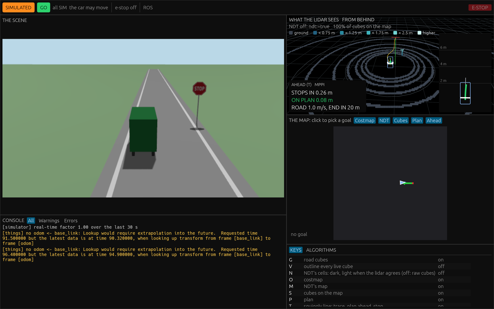
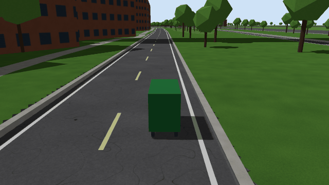
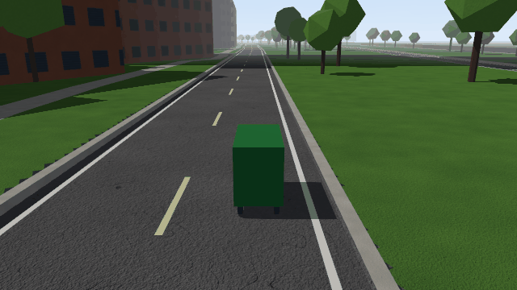

# What we built: the AAV software, 0.4-rc1

The software for Carleton's autonomous car (AAV), built by the 2026-27 capstone team,
as it stands on 17 Nov 2026. It takes about 10 minutes to read.

!!! warning "Almost all of it has run only in our simulator"
    Every number on this page comes from **Ravensim** (our simulator), bench mode, QEMU
    or unit tests, unless it says "car". The real car drove on 13 Nov with only the
    localization update installed ([Status](status.md#on-the-car)).

## In one line

**A self-driving stack of our own, mostly in Rust, that drives a simulated Carleton
campus end to end, and beat Nav2 (the standard ROS navigation stack) on the same routes.**

## The headline numbers

| What | Ours | The yardstick | From |
|---|---|---|---|
| Legs reached, 3 tours (lot, campus, University Drive), in Ravensim | **30 of 30** (3 runs) | Nav2: 14 of 20 (2 runs) | [League, 16 Nov](league-results-2026-11-16.md#nav2s-last-yardstick) |
| Off the path, on average, campus tour | **0.17 m** | Nav2: 0.83 m | the same |
| Time over the centre line, University Drive | **0 %** | Nav2: 13 %; other planners 45-74 % | the same |
| A 0.3 m kerb across the road, in Ravensim | seen 8.4 m out, **stopped 0.80-0.82 m before it** | before: drove into it | [Kerbs](kerbs.md) |
| The stop zone, ours against Nav2's, in shadow | **24 of 24** of Nav2's stops, never later | - | [Nav2, as it was](history/nav2-as-it-was.md#the-swap-of-the-stop-zone) |
| ego in Rust against Python (CPU of one core) | **2.4 %** | 17 % | `TODO.md` 185 |
| The behaviour planner in Rust against Python | **1.3 %** | 9.0 % | the same |
| Lidar cubes in Rust: one turn of 28,800 points | **0.53 ms** | 4.29 ms in Python | the same |
| RavenTiles: the global costmap's memory, campus | **145 MB** | 474 MB, one whole map | `TODO.md` 175 |
| RavenTiles: NDT ready at start-up | **0.02 s** | 2.5 s, one whole map | [Release 0.4](release-0.4.md) |

## The picture

```text
                        SENSORS  lidar · radar · cameras · IMU · GPS · wheels
                           │          (on the car, or Ravensim in their place)
                           ▼
  LOCALIZATION   two EKFs + GPS ── lane pose ── NDT on map chunks ── (KISS-ICP trial)
                           │
  PERCEPTION     lidar cubes · kerb step finder · RF-DETR camera detector
                 lane finder · radar clusters · the things tracker
                           │
  MAPS           three levels on 64 m chunks (RavenTiles)
                 route: Lanelet2 / street graph ─ path: ~100 m ahead ─ close up: costmap
                           │
  BEHAVIOUR      drive · approach · wait · go: stop signs, anything moving, parked things
                           │
  PLANNING       the lane's centre (path:=lane) · lattice / Hybrid-A* in Rust
                           │
  CONTROL        MPPI that knows the lag ──► twist_mux ──► ego (+ the pedal, speed loops)
                           │
  SAFETY LOCKS   e-stop · stop zone · watchdog · geofence · stop hold  (never swapped)
                           │
  FIRMWARE       the spine (Rust, Embassy) · today's ESP32 · Picos
                           ▼
                 THE CAR  (or Ravensim: the same topics, so nothing above can tell)
```

Every box talks only through ROS topics fixed in `docs/interfaces.yaml`. So any box can
be swapped for another that gives the same topics: a new algorithm, or the simulator in
place of the car. More: [How it fits](how-it-fits.md).



## How to read the tables

| Mark | Means |
|---|---|
| ✅ | the champion: the default in `stack:=ours` |
| ⚔️ | a challenger: runs beside the champion, takes over only if it wins on the same routes |
| sim | works in Ravensim |
| built | in the repo with its tests, not yet driven in the simulator |
| car | has worked on the real car |

Who built what is in [Features](features.md). Nearly everything here is Ben's; the other
names are in [Who](#who-built-it).

## The areas

### Ravensim: our simulator

| What it does | Algorithms we built | Language | Status | Key number |
|---|---|---|---|---|
| Plays the car: world, car, lidar, radar, IMU, GPS, wheels, clock, on the car's own topics | ✅ Ravensim (`aav_simulator`); reads the same SDF worlds Gazebo did | Rust | sim | passed every `sim-check` leg Gazebo passed (8 Nov) |
| Cameras | ✅ `aav_sim_cameras` (Bevy, no window); **camera lockstep**: with no GPU the clock waits for each picture; **`graphics:=pretty`** (17 Nov): grain, a sky, haze, painted stop lines | Rust | sim | 640 x 360, Gazebo's lens and rate |
| Faults on purpose | `pixi run sim-fault`, `sim-check --faults`, `--actuator-faults` | Python | sim | 14 sensor faults; 6 of 6 actuator faults |
| Wheels that slip, kerbs that stop the car | seeded wheel noise and slip; each wheel finds the ground | Rust | sim | a 0.3 m kerb stops the car |
| Big maps | **RavenTiles**: a map cut into 64 m chunks | data | sim | the campus in 625 chunks a detail |

What the car's cameras see on the campus, before and after `graphics:=pretty`
([Looks](own-simulator.md#looks-graphicspretty-17-nov)):

| Before | After |
|---|---|
|  |  |

### Screens

| What it does | What we built | Language | Status |
|---|---|---|---|
| In-car HUD, on the Pi | ✅ the HUD, with a SIMULATED banner, GO / STOP, the squiggly line ahead, themes | Rust (raylib) | sim |
| Every sensor's number, OK / STALE / NEVER | ✅ the hardware panel, with steering calibration and graphs pages | Rust (raylib) | sim |
| The street map, offline, with place search | ✅ the map window | Rust (raylib) | sim |
| Everything at once on a laptop: scene, console, lanes, chunks | ✅ the developer window | Rust (Bevy) | built |

A frozen screen stops the car: each screen sends a heartbeat, STALE within 1 s
([Safety case](safety-case.md)).

### Localization: where am I

| What it does | Algorithms we built | Language | Status | Key number |
|---|---|---|---|---|
| Smooth pose from wheels and IMU, plus GPS | ✅ two EKFs (stock `robot_localization`), a GPS outlier gate, heading from the gyro and from GPS | Python | sim | parked, the global EKF stays within 0.2 m |
| Sideways correction from the painted lines | ✅ **lane pose** (`aav_lane_pose`), the default since 17 Nov where there is a camera and a lane map | Python | sim | University Drive sideways error 9.2-9.9 → **6.9-7.8 cm** |
| Pose from a saved lidar map | ⚔️ NDT (`aav_ndt`), loading only the 3 x 3 chunks round the car; ⚔️ NDT into the global EKF (`ndt_ekf`) | Rust | sim | `ndt_ekf` is calmer on every tour, but stopped once in 2 of 3 runs: "recommended next" |
| Lidar odometry, no map | ⚔️ KISS-ICP (stock, MIT) into the local EKF | Python | sim | a trial |
| Health checks | ✅ localization health | Rust (Python twin) | sim | 1.5 % of a core against 9.4 % |

### Perception: what is around

| What it does | Algorithms we built | Language | Status | Key number |
|---|---|---|---|---|
| Lidar as cubes (voxels) | ✅ `aav_voxels_rs` (the Python twin kept) | Rust | built | 25 % → 6 % of a core |
| Kerbs | ✅ the **step finder** with a 10 s memory | Rust | sim | 0.3 m kerb seen 8.4 m out; 0.15 m kerb from 4.7 m |
| Objects in the cameras | ✅ RF-DETR Nano; YOLO as an option; Core ML on a Mac | Python (ONNX) | sim | saw a stop sign from 20 m (YOLO11n: 10 m) |
| Lane lines | ✅ the lane finder | Python | sim | lane keeping on a 171 m campus road, mean error 4 cm |
| Radar | ✅ radar clusters | Rust | sim | ported from the 2025-26 team's C++ |
| Things that move | ✅ **the things tracker** (`aav_things_rs`), cubes on the map's walls dropped | Rust | sim | 9.9 things to 1.7; every walker found within 0.2 s |

### Maps: three levels on fixed chunks

| What it does | What we built | Language | Status | Key number |
|---|---|---|---|---|
| The map in 64 m squares, loading only those near the car and along the route | ✅ **RavenTiles** (`map-chunks`), each chunk on its own core | Rust | sim | costmap 474 → 145 MB, 12 → 4 % CPU; planner 403 → 65 MB |
| Zoomed out: which roads | ✅ the street graph; ⚔️ **Lanelet2 in Rust** (our own reader and router) | Rust | sim | the campus: 998 lanes, 98 stop lines; routes in under 1 ms |
| Middle: the path about 100 m ahead | ✅ the planner on the chunks, far goals in steps | Rust | sim | 20 of 20 legs, the same as the whole map |
| Close up: what is in the way | ✅ our costmap (`ours_chunks`) | Rust | sim | the same drive as the whole map, a third of the memory |
| Carleton itself | ✅ the campus from OpenStreetMap (`pixi run campus`) | Python | sim | no Google data |

### Behaviour: the rules of the road

| What it does | What we built | Language | Status | Key number |
|---|---|---|---|---|
| One state machine: DRIVE, APPROACH, STOPPED, WAIT, GO, ASK | ✅ the behaviour planner (Python twin kept) | Rust | sim | 1.3 % of a core against 9.0 % |
| One law for every planned stop | ✅ the stopping law S(v), from the car model | Python and Rust | built | every number a guess until the car tests |
| Stop for anything moving | ✅ hold while a thing moves 0.3 m/s or more within 10 m | Rust | sim | held for a car, a person crossing, cross traffic, every run; the parked box never |
| Stop signs | ✅ the stop-sign lock, stops about 4.7 m before the sign | Python | sim | missed 1 in 8 runs |
| The road ahead: the line, edges, limits, the end | ✅ `/world/road_ahead` | Rust | sim | ego holds every follower to it |
| Pass something parked | ✅ the pass (`pass.rs`) | Rust | sim | over the line 5-5.5 s, back in lane 8.6-9.6 m after |

### Planning: the path

| What it does | Algorithms we built | Language | Status | Key number |
|---|---|---|---|---|
| Follow the right lane's centre on mapped road | ✅ **`path:=lane`** | Rust | sim | **0 %** over the centre line; others 45-74 % |
| Plan on open ground (the lot) | ✅ the lattice (Nav2's idea, our code); ⚔️ Hybrid-A* | Rust | sim | Hybrid-A* sways least, but in the wrong lane |
| Fewer changes of gear | ✅ a price on each cusp (`cusp_penalty`) | Rust | sim | three-point turn, 6.5 m street: 9 → **4** changes of direction |
| A model draws the path | ⚔️ the diffusion planner (ONNX) | Python | sim | a trial for the lot, not the road |

### Control: steering and pedals

| What it does | Algorithms we built | Language | Status | Key number |
|---|---|---|---|---|
| Follow the path, knowing the actuators lag | ✅ **`mppi_lag_calm`** (MPPI with the car's lag) | Rust | sim | the calmest that reverses; a tick 3.4-5.3 ms |
| The same, as an optimiser | ⚔️ lag-aware MPC (`mpc_lag_rs`) | Rust | sim | 2-7 times closer to the path, a tick 0.7-0.9 ms; reverses since 20 Nov (lot tour 4/4, 7.8 m backwards); sways |
| Turn a wish into what the car can do | ✅ **ego**: Ackermann, jerk limit, body model, lag lead, the 2 s trace (Python twin kept) | Rust | sim | 2.4 % of a core against 17 % |
| The pedal and the speed loop | ✅ `default` loop; ⚔️ `smooth`, `firm`, `lqi` | Rust (`spine-core`) | sim | `default` overshoots its command by 14 %; `firm` doesn't, but sways more |

### Safety: the locks (never swapped out)

| What it does | What we built | Language | Status | Key number |
|---|---|---|---|---|
| Four e-stops; one blocks every driver | ✅ `/safety/estop` in twist_mux, the spine's flag | Python, Rust | sim | the spine brakes within 2-12 ms |
| Stop for what is ahead or behind | ✅ **the stop zone** (`aav_stop_zone`), took the lock from Nav2 on 17 Nov | Rust | sim | 0.16-0.55 m before a post; 0.75-0.85 m before one behind |
| Sensors and nodes alive | ✅ the watchdog: STUCK steering, OVERSPEED, frozen wheels (Python twin kept) | Rust | sim | 13 faults stop within 6 s; stuck steering caught in 3.6 s |
| Stay in the area | ✅ the geofence | Python | sim | stopped 1.06 m after the lock (bench) |
| Commands lost | ✅ the firmware's 100 ms timeout | Rust | QEMU | brakes 111-120 ms after |
| One page per hazard | ✅ the [safety case](safety-case.md): 14 hazards, each with its number | - | - | none measured on the car yet |

### Firmware

| What it does | What we built | Language | Status | Key number |
|---|---|---|---|---|
| The spine: modes, arming, watchdog, speed loop, CAN | ✅ `spine-core` (state machine, self-test and stop rules: Arsh) | Rust (`no_std`, Embassy) | sim | 143 tests |
| Today's control board, no new hardware | ✅ the ESP32 spine, every C++ behaviour matched, updates over WiFi | Rust | built | tested in QEMU |
| What drives the car today | the 2025-26 team's ESP32 firmware | C++ | **car** | stays until the Rust one replaces it |
| Spine, wheel encoder and status display boards | ✅ Pico 2 programs | Rust | built | a 100 ms hardware watchdog |
| The CAN contract | ✅ `aav.dbc`, shared test vectors for Python and Rust | - | sim | wheel speeds on 0x200, 0x201 |

### Tools

| What it does | What we built | Status |
|---|---|---|
| One champion per level, challengers scored on the same tours | ✅ **the league** (`stacks.yaml`, `stack:=ours`) | built |
| Score any stack on tours: legs, time, sway, off the path | ✅ `pixi run measure` | sim |
| Check the whole system in 2 minutes | ✅ `pixi run sim-check` | sim |
| Record a drive, score it later | ✅ `tools/record.sh`, `score_drive.py` | sim |
| Let an AI assistant look, never touch | ✅ the read-only [MCP server](mcp.md) | built |
| Every test on every push | ✅ CI: Linux x86 and ARM (the car's), a Mac and Ravensim nightly | built |

## What we replaced

| Replaced | By | Why | Its last score |
|---|---|---|---|
| **Nav2** (deleted 17 Nov) | our navigator, planner, costmap, MPPI, smoother and stop zone, all ours | "We want to run everythign ourselves in rust and/or python" (Ben, 14 Nov) | 14 of 20 legs against our 30 of 30; gave up on University Drive both runs ([page](history/nav2-as-it-was.md)) |
| **Gazebo** (deleted 16 Nov) | Ravensim | Ravensim passed every leg Gazebo did; Gazebo brought 25 packages into every environment | its last nightly CI run failed; a campus road: 60 m and into the other lane, against Ravensim's 171 m ([page](history/gazebo-as-it-was.md)) |

We kept a few small, proven stock parts: `robot_localization`, `twist_mux` and teleop.

## What's next

| Step | What | Who |
|---|---|---|
| 1 | **The car's seven blockers**: the firmware timeout, the brake, wheel speed seen, clocks, the steering's centre, a truth for "1 m" (`TODO.md` 158) | the hardware team, with us |
| 2 | **Car day**: drive our stack on the real car, record it, score it ([Car day](car-day.md)) | the team |
| 3 | The last heavy Python nodes to Rust, and the champions made the car's default | software |
| 4 | The models in ONNX | software |
| 5 | A prettier Ravensim: grain, sky and haze done (17 Nov); more on the road world | software |

The whole list: `TODO.md`, "What is next".

## Who built it

| Person | What |
|---|---|
| Ben | nearly everything above ([Features](features.md)) |
| Arsh | the spine's state machine, self-test, stop rules, wheel speed on the serial link; the getting-started guide, CONTRIBUTING and the merge queue |
| Senura | the IMU's measured noise; the localization Pi |
| Betsi | localization health checks; the measured wheelbase |
| the 2025-26 and 2024-25 teams | the car, its ESP32 firmware, the radar driver, lane keeping, the battery monitor |

Everything we learned from or copied: [Acknowledgements](acknowledgements.md).

## Read more

| Page | For |
|---|---|
| [0.4-rc1](release-0.4.md) | the release, one command per job |
| [The league's scores](league-results-2026-11-16.md) | every option, scored |
| [How it fits](how-it-fits.md) | each box in detail |
| [Status](status.md) | what works, what doesn't yet |
| [Safety case](safety-case.md) | every hazard and its number |
| [Kerbs](kerbs.md), [Stopping](stopping.md) | two safety stories in full |
| [Our planner](own-planner.md), [Our costmap](own-costmap.md) | planning in Rust |
| [Ravensim](own-simulator.md), [its cameras](own-simulator-cameras.md) | the simulator |
| [Three levels](designs/2026-11-15_three-levels.md) | the map chunks' design |
| [Decisions](decisions.md) | what we decided, and why |
| [Features](features.md) | every feature, its reason, and who built it |
