# What's new: 22 October to 1 November

> **Frozen on 1 November, as history.** From 0.2 on, what's new goes in [the release notes](release-notes.md).

Everything the last few pull requests added (#13 to #19, and the branch after), by area;
then the best version to take to the car, what's left for CARLA, and which Ubuntu each
computer should run. Every feature, with who built it: [Features](features.md). How to
switch each trial on: [Switches](switches.md).

> **The short version**
> - **Screens:** a hardware panel with simple buttons, and a debug screen that shows what the car sees in 3D.
> - **Where am I:** the lidar's point cloud now feeds NDT (a map match) and KISS-ICP (how far it moved), beside the two EKFs.
> - **What's around:** RF-DETR (not YOLO) for objects, OpenCV for lanes, the lidar as a flat scan or as cubes.
> - **Getting there:** five planners, six path followers, reversing and the U-turn.
> - **Talking to it:** a local Qwen model with our own harness, and MCP so Claude can drive the sim.
> - Everything here has run in Gazebo; **none of it has driven the real car yet.**

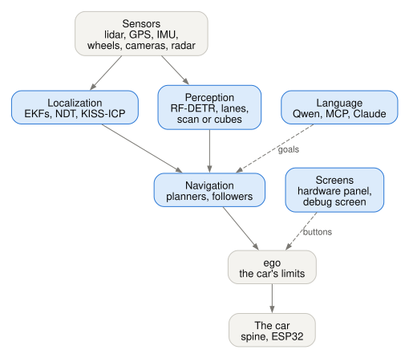

*Blue: built in the last few pull requests. Grey: there before.*

**Status:** *sim* = works in Gazebo; *built* = built and tested, not yet in a full run.

## Hardware interface: the two screens

### The hardware panel (`pixi run hw-panel`)

Every sensor's number from its own node, and very simple buttons: speed up and down,
left, right, centre, stop. The car moves only while you **hold** Space (or GO).

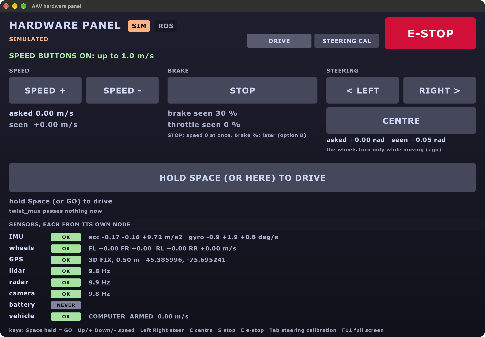

| What | Why | Status |
|---|---|---|
| OK / STALE / NEVER for each sensor | see at a glance what's missing | sim |
| Hold to drive, through twist_mux's slot 45 | a person always outranks it; let go and it stops | sim |
| SIM and BENCH only | not on the real car until its own test (TODO 49b) | built |

### The debug screen (`pixi run demo --debug`)

Left: the lidar as cubes in 3D, and where each localizer thinks the car is. Right: the
lidar map from above, and NDT's match. New on 1 Nov: **Nav2's cubes** in red (key V), and
**localization health**.

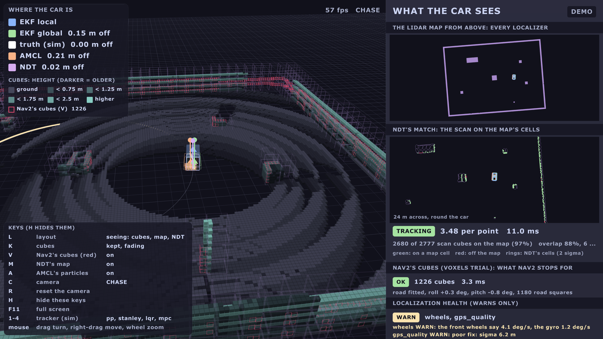

| Colour | Who says where the car is |
|---|---|
| blue | EKF local (wheels, IMU) |
| green | EKF global (plus GPS) |
| purple | NDT |
| orange | AMCL |
| white | Gazebo's truth (sim only) |

### The firmware behind it

| What | Who | Status |
|---|---|---|
| The spine's state machine, self-test at boot, hardware test mode | Arsh | built |
| The ESP32's Rust firmware: brakes 111-120 ms after the Orin's heartbeat stops | Ben | built (QEMU) |
| The preflight on stands (`pixi run actuator-test preflight --stands`) | Ben | sim |
| Geofence and stop hold (new twist_mux locks) | Ben | sim |

## Localization: where am I?

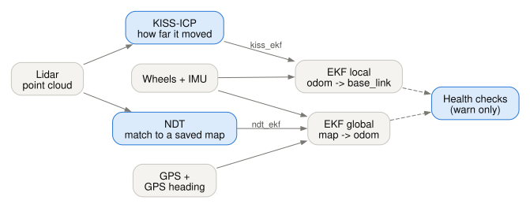

| Piece | What it does | Switch | Result in Gazebo | Status |
|---|---|---|---|---|
| **EKF local and global** | the default: wheels + IMU, then GPS | always | 0.2 m off the truth | sim |
| **NDT** (ours, Rust) | matches the lidar to a saved map | `ndt:=true` | 1-3 cm off, 2 ms a match | sim |
| **NDT into EKF global** | uses that match to correct the map position | `ndt_ekf:=true` | 17 cm → **1.6 cm**; holds with the GPS off | sim |
| **KISS-ICP** (stock, MIT) | how far the car moved, from lidar alone | `kiss_icp:=true` | 0.04 m drift per 100 m (wheels: 0.33) | sim |
| **KISS-ICP into EKF local** | its speed and turn rate into the EKF | `kiss_ekf:=true` | not a clear win yet: off by default | sim |
| **AMCL** (stock) | a particle filter on a 2D map | `amcl:=true` | lost itself: the EKF wins | built |
| **Health checks** (Betsi) | warns on gyro bias, a tilted IMU, bad GPS, wrong frames | `health:=true` | on the debug screen, in `pixi run check` | sim |

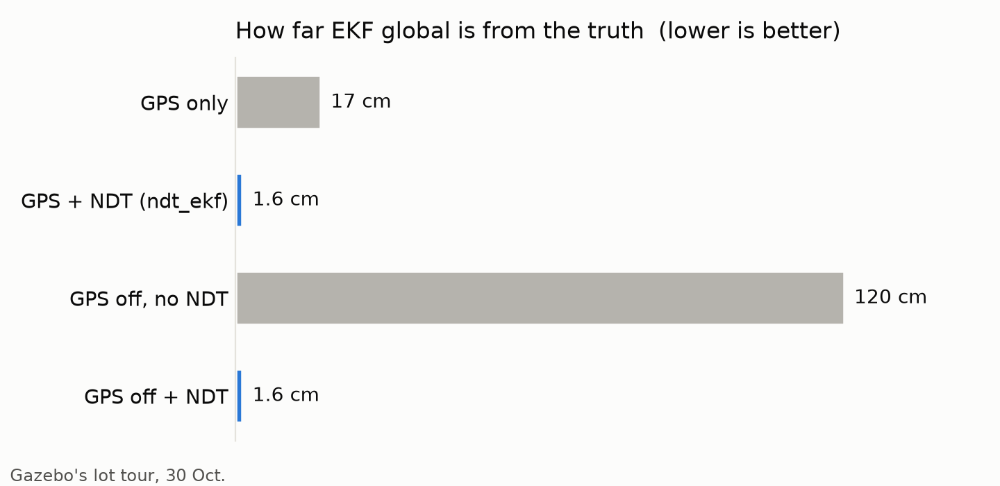

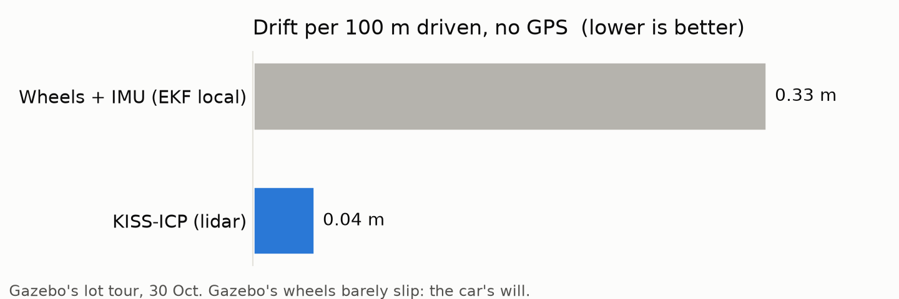

### NDT, in one picture

The map becomes blobs; a new scan slides and turns until it sits on them.

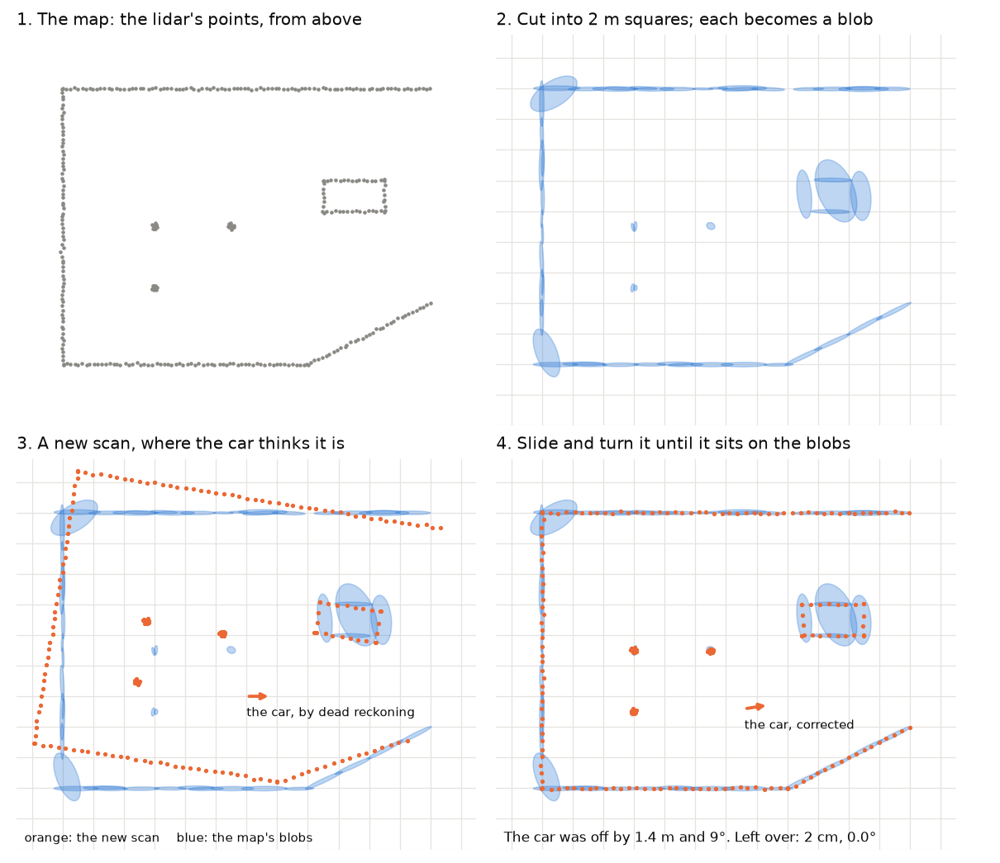

### ICP, in one picture

Each scan point pairs with its nearest map point; move to close the pairs; repeat.

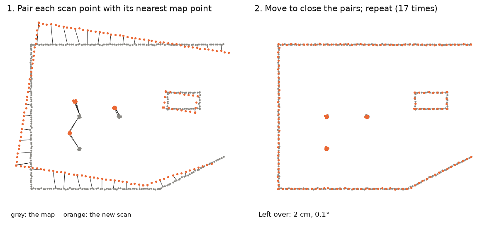

## Perception: what's around?

| Piece | What it does | Result | Status |
|---|---|---|---|
| **RF-DETR Nano** (not YOLO; Apache-2.0) | finds objects and stop signs | a stop sign from 20 m (YOLO11n: 10 m), no false finds | sim |
| A second detector on a Mac (Core ML) | a second opinion over WiFi | 21 ms a picture on a MacBook | sim |
| **Lane finder** (classic OpenCV, no model) | finds the lane from the camera | 0.78 ms a picture | sim |
| Radar clustering (Rust) | radar points into objects | the same answers as the C++, bit for bit | sim |

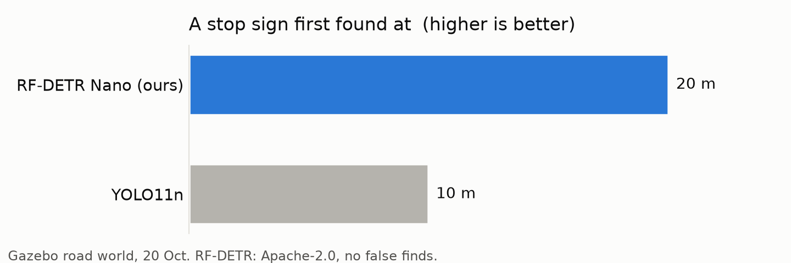

## Navigation in 2D and 3D: the lidar for Nav2

The lidar sends about 29,000 points ten times a second. Nav2 reads them one of two ways:

| | **Flat scan** (2D, the default) | **Cubes** (3D, a trial: `voxels:=true`) |
|---|---|---|
| What | one slice: 720 distances round the car | 0.25 m cubes, measured from the road fitted to each cloud |
| Size | 720 numbers | about 1,200 cubes |
| Sees height? | no | yes: a kerb, a table edge; a leaning car doesn't see the road |
| Result in Gazebo | the default | stopped 0.44 m before a post; 4 of 4 legs; 6 ms a cloud |

## Navigation: the route and the steering

### Planners: who draws the route (`planner:=`)

| Planner | Keeps to the turning circle? | Gazebo, the lot tour | |
|---|---|---|---|
| **State Lattice** (on our own moves) | yes | every leg, **184 s** a tour (with reversing) | **the default** since 1 Nov |
| Hybrid-A* | yes | every leg, 213 s | the default when forward only |
| Lattice, 32 headings | yes | every leg, 197 s: no better | trial |
| Smac 2D | no | 2 of 4 (forward only) | trial |
| NavFn, Theta* | no | not tried | trial |

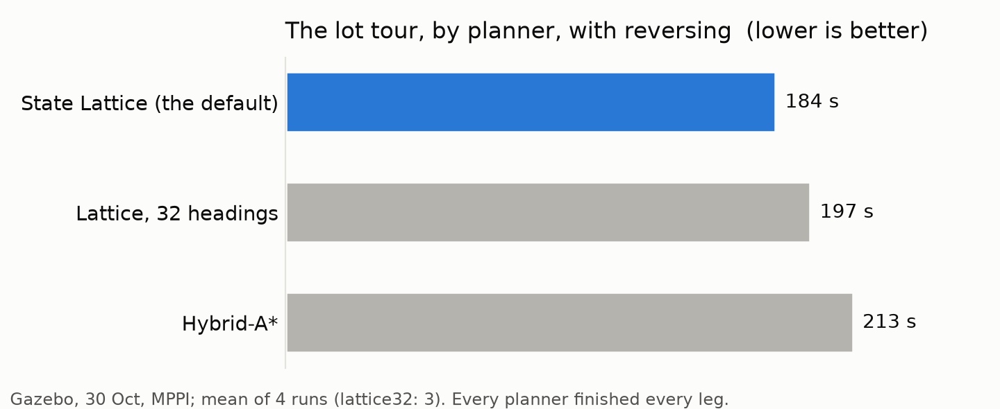

The lattice strings together short moves our car can really make, worked out from
`vehicle.yaml` (`pixi run python3 tools/lattice_primitives.py`):

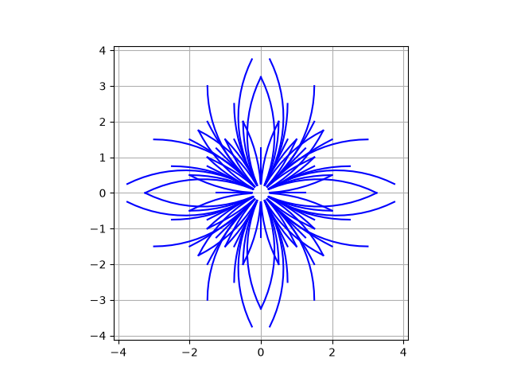

### Path followers: who steers along it

`tracker:=pure_pursuit` (or `stanley`, `lqr`, `mpc`) swaps them; in Gazebo, live, with
keys 1-4 on the debug screen.

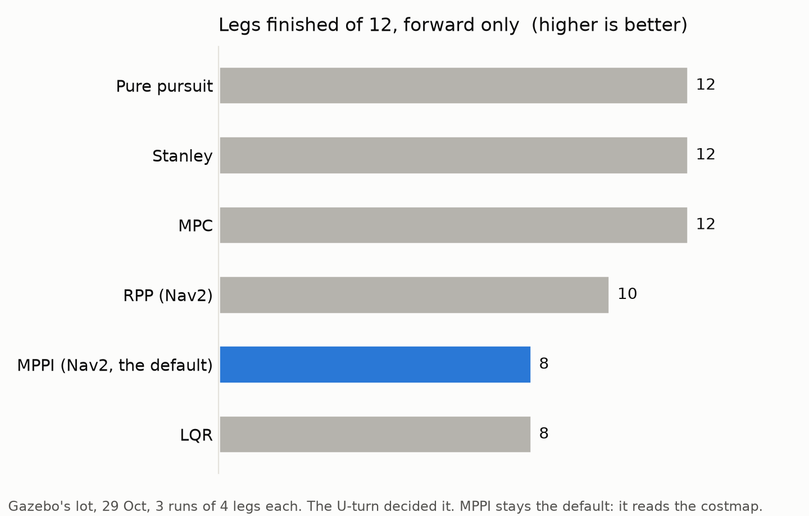

MPPI finished fewest, but stays the default: it reads the costmap, so it steers round
obstacles; the trackers only follow the line.

### Reversing and the U-turn

On again on the car since 1 Nov, at 0.5 m/s at most, only where the lidar watches behind.
Forward only, a U-turn in a narrow lane fails about half the time; reversing, the car
makes a three-point turn (16 of 16 legs with the lattice).

## Talking to the car

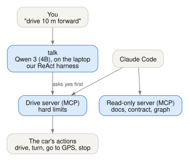

| Piece | What it does | Status |
|---|---|---|
| **Qwen 3 (4B) with our own harness** (`pixi run -e llm talk`) | plain English ("drive 10 m forward") into steps, on the laptop, no internet; asks **yes** before the car moves | sim |
| The harness (`aav_language`: `react.py`) | our own ReAct loop: reads Qwen's, Llama's, Gemma's and Mistral's tool formats | sim |
| **MCP drive server** (`aav-drive`) | lets Claude (or any MCP app) drive: distance, turn, go to a GPS point, stop, e-stop; hard limits it won't break | sim |
| **MCP read-only server** (`aav`) | lets Claude read the docs, the topic contract and the live ROS graph; never writes | built |

## The best version: what goes on the car

One pick per job: the car's defaults. The trials stay as switches; real data decides
them next ([Every test](tests.md), 4e: record the lot, then score them on replay).

| Job | The best version | Why | Next in line, and what it waits for |
|---|---|---|---|
| Where am I | the two EKFs, with the GPS | works anywhere, no map needed | **NDT into EKF global**: a lidar map of the lot (test 4.21) |
| How far it moved | wheels + IMU | always there | **KISS-ICP into EKF local**: real wheels that slip (4.22) |
| What's around | RF-DETR Nano | twice YOLO's range, Apache-2.0 | - |
| Sees obstacles | the flat lidar scan | small, proven | **cubes**: a real, bumpy lot (4.22) |
| Draws the route | State Lattice (Hybrid-A* forward only) | every leg, the quickest | - |
| Steers along it | MPPI | reads the costmap | pure pursuit, if the trackers learn the costmap |
| Reverses? | yes, 0.5 m/s, where the lidar sees behind | the U-turn needs it | wheels that tell direction (H5) |
| Talks | Qwen on the laptop | no internet, asks yes first | Claude through MCP: the sim only |

`test_car_launch.py` checks the car's defaults are exactly these.

## CARLA: what's left to work with our graph

CARLA runs on the lab's Ubuntu desktop. Our side (`aav_carla`, `pixi run carla-car`)
publishes the same topics as Gazebo, so the rest of the graph can't tell them apart. It is
tested against a pretend server only: **it has never met a real one.**

| # | Left | Who | Size |
|---|---|---|---|
| 1 | **Which CARLA** is on the desktop: `CarlaUE4` = 0.9.x, `CarlaUnreal` = 0.10. Its Python client, the same version, in our environment ([CARLA](carla.md), step 2) | the lab | 30 min |
| 2 | **The first real run:** `pixi run carla-car host:=127.0.0.1` with the server up; drive with the keyboard, then a Nav2 goal | the lab | 1 h |
| 3 | **A `carla` profile in the graph check** (`pixi run check carla`): the contract doesn't list which topics must be live in CARLA yet | Claude, now | small |
| 4 | **The new switches in `carla.launch.py`:** it passes reversing, but not `planner`, `tracker`, `voxels`, `kiss_icp`, `kiss_ekf` (it gets Nav2's defaults) | Claude, now | small |
| 5 | **A `carla-check`**, like `sim-check`: the graph, a drive, the EKF against CARLA's truth | Claude, then the lab | 1 day |
| 6 | **Signs nobody has seen:** the IMU's roll and pitch, the radar's speed sign, the GPS line-up | the lab, with 5 | 1 h |
| 7 | **Carleton's streets:** only CARLA 0.9.16 builds roads from OpenStreetMap; 0.10 can't yet | the lab | 1 h |
| 8 | **NDT in CARLA:** needs a lidar map of the CARLA town (`ndt-map` drives Gazebo only today) | Claude | half a day |

Not on the list, on purpose: CARLA's own ROS 2 (`--ros2`) stalls on Jazzy, so our adapter
talks to CARLA through its Python client instead ([CARLA](carla.md), "Other ways").

## The computers: which Ubuntu

**Can each one be upgraded? Yes**: Ubuntu 24.04 (Jazzy's own) runs on the Pi 4 and the
Pi 5, and NVIDIA's JetPack 7.2 is Ubuntu 24.04 for the Orin. **But car day doesn't need
it:** our car kit runs on today's Ubuntu 22.04 through Pixi (CI tests that on every
push). Upgrading is the hardware lead's call (Q24).

| Computer | Today | Should be | How | Note |
|---|---|---|---|---|
| **Orin** (JETSON, .140) | Ubuntu 22.04, JetPack 6 | JetPack 7.2 (Ubuntu 24.04) | SDK Manager on the lab's desktop, **after** its full image | the only one that needs the x86 desktop |
| **Motor Pi** (CORTEX, .120), Pi 4 | Ubuntu 22.04 | Ubuntu 24.04 Server | a **new SD card** (Raspberry Pi Imager); turn the UART on | keep the old card: undo is a card swap |
| **LOCALIZATION** (.113), Pi 4 | Ubuntu 22.04 | Ubuntu 24.04 Server | a new SD card | the IMU and GPS are USB: no change |
| **aav-desktop** (.196), Pi 4, the dashboard | Ubuntu 22.04 | **Ubuntu 24.04 Desktop** | a new SD card | runs the HUD and the map window: it needs a desktop; check it has 4 GB or more |
| `.211`, a Pi | Ubuntu 22.04 | ask the team first | | its job is unknown |
| **CAM1-PI**, **CAM2-PI** (.108, .118), Pi 5 | Debian 13 (Pi OS) | **keep Pi OS** | - | no ROS on them; the Pi camera works best on Pi OS |
| **The lab's desktop** (x86, NVIDIA) | Ubuntu, running CARLA | **keep as it is** | - | our stack runs there through Pixi on 22.04 or 24.04; don't upgrade under a working CARLA |

## Tools to find all this again

| Tool | Does |
|---|---|
| `pixi run pick` | a menu of every switch above, in plain words; it runs the command |
| [Switches](switches.md) | every switch on one page |
| [Trials](trials.md) | every result, and how it was measured |
| `pixi run check <profile>` | the running graph against the contract, then the health line |
| `pixi run python3 tools/whats_new_figures.py` | redraws this page's diagrams and charts |
