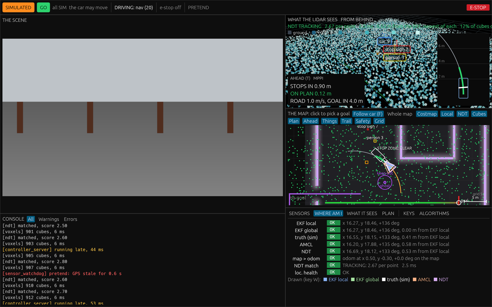
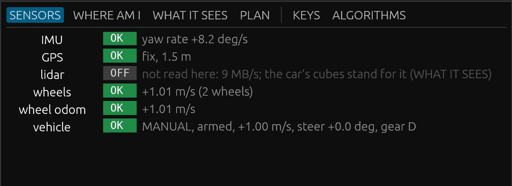
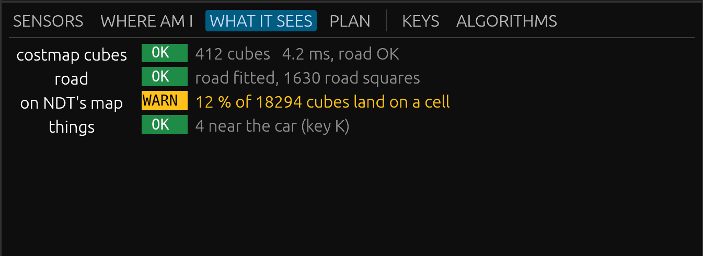
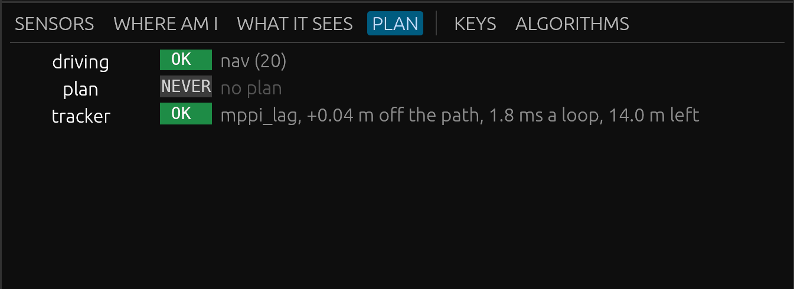
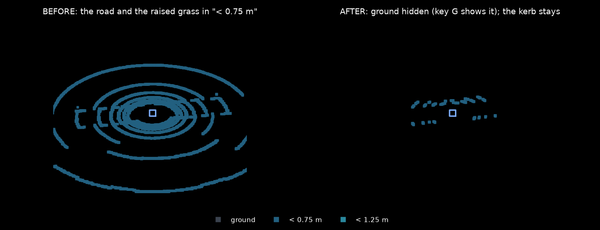

# aav_dev_window

## Overview

The developer window, in Bevy and egui: one screen for laptops, and the **world view** of
the four screens (wrap-up step 4, [the plan](../../../docs/wrap-up.md#4-the-screens-eight-become-four)):
since 25 Nov it also has the debug screen's pages. Pretend data and live ROS
are drop-ins for each other, behind one `Feed`. SWAP (15 Nov) swaps `aav_track`'s follower live in the
simulator; the other choices are made at launch. The plan:
[our own simulator](../../../docs/designs/2026-11-05_own-simulator.md).

```text
┌─ GO / STOP and why · DRIVING: who · e-stop · source ┐
├────────────────────────────┬──────────────────────┤
│ the scene: the car driving │ debug: what the      │
│                            │ lidar sees, and NDT  │
│                            ├──────────────────────┤
├────────────────────────────┤ the map: click to go │
│ console                    ├──────────────────────┤
│                            │ the pages | keys |   │
│                            │ algorithms           │
└────────────────────────────┴──────────────────────┘
```

The pages: SENSORS, WHERE AM I, WHAT IT SEES, PLAN ([below](#the-world-view-the-debug-screens-pages)).

## Subdirectories & Boundaries

| File | What it is |
|---|---|
| `src/main.rs` | the app: options, the cubes, the 3D camera, the speed test |
| `src/panels.rs` | the layout and every panel, in egui |
| `src/feed.rs` | what the window is told, and the gates on commands: no Bevy, no ROS, tested |
| `src/pages.rs` | the world view's four pages, row by row, from `debug-core`'s `DebugState`: no Bevy, no egui, tested |
| `src/pretend.rs` | pretend data, as a `Feed`: no Bevy, no ROS, tested |
| `src/map_nav.rs` | how the map panel moves: follow the car, the whole map, or free; drag, wheel, pinch, F: no Bevy, no egui, tested |
| `src/chunks.rs` | the chunks loaded (`map_chunks::wanted`), their outlines, labels and saved maps: no Bevy, no egui, tested |
| `src/lanes.rs` | the lane map's lines and their looks (`lanelet-map`) |
| `src/ros.rs` | the node `dev_window`, as a `Feed` (the `ros` feature). Its docstring lists its topics |
| `config/dev_window.yaml` | every topic's name |
| `src/map_edit/main.rs` | the map editor (`pixi run map-edit`, TODO 251): its own binary, `map_edit`; no ROS. The edits are the `map-edit` crate's ([docs/map-editor.md](../../../docs/map-editor.md)) |
| `src/map_edit/tool.rs` | its tools: a drag into a box, an align drag or key: no Bevy, no egui, tested |
| `src/map_edit/streets.rs` | its street map: the tiles round the map, read once (`map-core`) |
| `src/ladder_window/main.rs` | the tests screen (`pixi run ladder-window`, TODO 271, 277): its own binary, `ladder_window`; no ROS ([Proving it](../../../docs/proving-it.md#the-tests-screen-pixi-run-ladder-window)) |
| `src/ladder_window/draw.rs` | its drawing, in egui: the ladder's ten rungs (a rung not built says so); the chosen rung: its question, its graphs, its pass mark, its Run, each part of it alone (folded); on the right its **answer**: one verdict line, **Open the report**, each graph of asked-for against measured with its numbers beside the car's slot ("no car run yet"), the faults table; under it, folded, every step of the run (the table, a step's own graph and numbers, a hallway run's fits); the console. At the top "Before you start": the checks that move no car, a Run each; and "The simulated car: on stands / on the ground" with its one button, on only while a simulator runs on this computer (`pixi run jacks`, TODO 272) |
| [`crates/nav-core`](./crates/nav-core/README.md) | the navigation view's logic: the trail, a marker's outline, the stop zone, the body, the scale: no Bevy, no egui, no ROS, tested by `tools/test.sh` |
| [`crates/ladder-core`](./crates/ladder-core/README.md) | its logic: the tool's JSON as types (the rungs, the checks, a rung's answer), each cell and button, a run's steps, graph and fits, the tool's commands, the run as a child: no Bevy, no egui, tested by `tools/test.sh`. Also the hardware panel's LADDER tab's logic (`aav_hud`'s panel-app, by path, 25 Nov) |

Also: `--map-span M` (metres across at the start), `--title`, `--position X,Y`,
`--screenshot-every S` (the newest picture of a long run). What the map took over from
RViz: [RViz and ours](../../../docs/hud.md#rviz-and-ours).

It shares logic with the raylib screens: `debug-core` (the cubes' bands, the camera; since
25 Nov its whole `DebugState` and the sensor rows' `words`), `map-core` (map to screen and
back), `hud-core` (a picture message into RGBA; the localizers' colours).

## Interface

```sh
pixi run dev-window                                # the window, pretend data
pixi run demo screen_cubes:=true                   # then, beside it:
pixi run dev-window --live                         # live: may send goals and the e-stop, SIM only
pixi run dev-window --watch                        # listens to the network it's on; no publishers
pixi run dev-window --all-layers --seconds 12      # the speed test: prints the frame rate
pixi run dev-window --live --map-whole             # the map panel starts on the whole map
pixi run dev-window --cubes 60000 --seconds 8 --screenshot /tmp/window.png
pixi run dev-window --live --lanes maps/campus/campus.osm   # the lane map's lines (pixi run campus)
pixi run dev-window --live --chunks maps/campus/chunks     # the chunks loaded, their saved map
pixi run dev-window --page where                   # starts on a page: sensors, where, sees or plan
pixi run nav-view --live                           # the map panel alone, in its own window (--map-only): what RViz was for
pixi run map-edit bags/<drive>/map                         # the map editor: no ROS (docs/map-editor.md)
pixi run ladder-window                                     # the tests screen: no ROS (docs/proving-it.md)
pixi run ladder-window --pretend --rung stands --seconds 5 --screenshot /tmp/ladder.png   # sample data, seen without a person
pixi run dry-run                                           # the ladder window beside a Ravensim to watch
```

The status strip says who is driving (19 Nov, TODO 247): **DRIVING: keyboard (90)**, from
`/control/command_mux/state` (`aav_mux_state`), grey `DRIVING: ?` when it is quiet. The
map window's debug page (key D) shows the whole command path.

| Key | Does | Key | Does |
|---|---|---|---|
| G | the ground: road, and the lidar's rings on raised grass (off) | M | NDT's map |
| V | outline every live cube | S | live scan |
| N | NDT's cells, dark to light purple (off, the default: cubes by height) | P | plan |
| O | costmap | C, R | from behind it (the default) or the car; reset |
| T | the squiggly line (on) | K | the things, with their names (on) |
| H | the chunks loaded, their saved map, and the route (on) | L | the lane map's lines (on) |
| F | the map: follow the car, or the whole map (also its buttons) | B | the car's trail on the map (on) |
| J | the local costmap on the map, amber (on) | Z | the ghost, the keep-out circle, the stop zone's box (on) |
| Q | the map's grid of round metres (on) | W | where each localizer puts the car, 3D and map (on) |
| A | AMCL's particles, 3D (off) | | |

### The world view: the debug screen's pages

Wrap-up step 4 (Ben, 25 Nov): the world view takes over the debug screen (`debug_hud`).
The corner's tabs gained four pages, named for the layer each comes from. Their rows are
`src/pages.rs`, built from `debug-core`'s own `DebugState`: the same logic, the same words.



| Page | Rows | Light |
|---|---|---|
| SENSORS | IMU, GPS, lidar, wheels, wheel odom, vehicle | OK, STALE, NEVER; lidar OFF (below) |
| WHERE AM I | EKF local, EKF global, truth, AMCL, NDT (each: x, y, heading, metres from EKF local); map > odom; NDT match; loc. health | WARN when NDT is LOST or poor, or a health check isn't OK |
| WHAT IT SEES | costmap cubes; the road's fit; the share of cubes on NDT's map; the things | WARN when the road is taken as flat, or under half the cubes land on NDT's map |
| PLAN | who drives; the plan (points, length, its end); the tracker (cross track, loop time, metres left) | WARN when the tracker misses ticks |

| SENSORS | WHAT IT SEES | PLAN |
|---|---|---|
|  |  |  |

Pictures: pretend data, `dev_window --page <page> --seconds 8 --screenshot FILE` (25 Nov,
Ben's MacBook); the pages cut out of the window. The plan says "no plan" because the
pretend car gets one only from a click. `pixi run dev-window --page where` starts on a page.

**Every debug screen feature, and where it is now:**

| The debug screen (`debug_hud`) | In the world view |
|---|---|
| the costmap's cubes, red wireframes (V) | already: V |
| the ground hidden (G); the car's box; the plan; the trail | already: G; the box; P; B |
| NDT's map as wireframes (M) | already: N (NDT's cells in 3D), M (on the map) |
| NDT's score: TRACKING, LOST, score, ms | already over the cubes; now a WHERE AM I row too |
| EKF global, AMCL, NDT, truth: an outline, an arrow, a pole each, in 3D | **added**: W |
| AMCL's particles (A) | **added**: A (they need map > odom from `/tf`) |
| the legend: each localizer's distance from EKF local | **added**: WHERE AM I |
| the lidar map from above, every localizer's car | already the map panel (M); the cars **added** (W) |
| the costmap cubes' status: road fit, count, ms | **added**: WHAT IT SEES |
| localization health: OK, or WARN and each check | **added**: WHERE AM I |
| the sensor panel (key L): IMU, GPS, wheels, wheel odom, vehicle, each estimate, map > odom, tracker | **added**: SENSORS, WHERE AM I, PLAN |
| a pose in the wrong frame | **added**: a WHERE AM I "frames" row |
| keys 1-4: swap the sim's tracker | already: ALGORITHMS, SWAP (the same rule: SIM only) |
| the camera: chase, follow, free; drag, wheel | already: C, R, drag, wheel |
| the key legend (H) | already: the KEYS tab |
| the lidar's own cubes, kept and fading (K) | **not ported**: the window draws the cubes the car makes, never the raw cloud (Ben, 5 Nov; about 9 MB/s over WiFi). The lidar row says OFF and why |
| NDT's match as ellipses, the scan green or red over them | **not ported yet**: the share on the map is a row; the ellipses are left |
| themes (latte), the little robot | not ported: the world view is dark only; the robot is the car screens' |

**What it reads, new** (`config/dev_window.yaml`, the debug screen's names): `/tf` (map >
odom only), `/sensors/imu/data`, `/sensors/gps/fix`, `/vehicle/wheels`, `/vehicle/odom`,
`/vehicle/sim/truth`, `/localization/amcl/pose`, `/localization/amcl/particles`,
`/localization/health`, `/perception/voxels/status`, `/drivers/nav/track/status`. Only
subscriptions: no new publisher, no new call. The IMU, wheels, truth and `/tf` reach the
window at most 10 times a second: a row needs only its freshness.

`debug-hud` and RViz stay for now: step 5 turns the old names into aliases once this has
been used.

### The squiggly line (Ben, 7 Nov)

Like a Tesla's line in front of the car, in the 3D scene and on the map (`docs/hud.md`):

| Part | Looks | From |
|---|---|---|
| what the car WILL do, 2 s | bold line: green on the plan, amber off it, red far off; white with no plan | `/ego/trace` |
| what the planner WANTS | thin grey line | `/ego/plan_ahead` |
| where a full brake now stops | white bar across the way (two posts in 3D) | `/ego/stop_point` |
| the words | STOPS IN, ON / OFF PLAN, GOAL or OBSTACLE room: bottom left of the scene | `/ego/ahead` |
| a close-up from above | the same, 8 m ahead, a line every 2 m: right of the scene | all four |

All four are base_link, placed with the car's newest pose (odom in 3D, map on the map).

**The road ahead** (`/world/road_ahead`, map; with the plan, key P): the strip the car
drives by, coloured by its speed limit, green at the strip's top speed to red at a stop; a
red bar across its end, which the car may not pass; on the map, a white ring and the reason
at each stop ([the whole car](../../../docs/designs/2026-11-14_the-whole-car.md#the-road-ahead)).
Silent for 2 s: not drawn. The maths is `hud_core::ahead` and `aav_ego look_ahead`.
Pretend data plays `hud_core::ahead::pretend`'s 12 s loop.


Live (8 Nov, `--live` beside our own simulator, after its Nav2 goal had finished): parked,
so the stop bar sits at the car and the words say NO PLAN, STOPS IN 0.00 m.
[The picture](../../../docs/img/dev-window-squiggly-live.png). The drive itself was caught
by the HUD (`docs/hud.md`).

**The things** (`/world/things`, odom; key K, TODO 192): each thing near the car as a box
in its kind's colour, in the 3D scene and on the map, with its name over it.

| Kind | Colour |
|---|---|
| person | yellow |
| car, truck, bus, motorcycle | blue |
| stop sign | red |
| any other name | green |
| unknown (no camera named it) | orange, no name |

The colours are `hud_core::things`' (the HUD's and the RViz markers' too). Silent for 2 s:
not drawn. Pretend data: a person crossing ahead, a stop sign, a car, an unnamed box.

**The three levels** (TODO 175, step 7; [the design](../../../docs/designs/2026-11-15_three-levels.md)):
on the map, with `--chunks` and `--lanes`; key H.

| Level | Drawn as | From |
|---|---|---|
| zoomed out: the route | thick violet line | `/drivers/nav/route/path` (street_router), latched |
| middle: the chunks loaded | each chunk's square, labelled `(i, j) fine` (blue; the car's own light blue) or `(i, j) coarse` (amber) | `chunks::loaded`: `map_chunks::wanted` on the car and the route (the plan with no route), 100 m ahead |
| middle: the saved static map | each loaded chunk's `.pgm`, at its detail (0.25 m or 1 m) | `--chunks` folder (`chunk-map`), read once per chunk |
| the lanes | white lines, grey dashes, amber kerbs, red stop lines | `--lanes` (a Lanelet2 `.osm`) |

With `--chunks`, the map fits the chunks loaded until you move it. Pretend data has a
route out of its lot (`pretend::route`). Seen 16 Nov only off screen (the screen was
locked): the same `chunks.rs` and the campus files drawn into a picture.

**A goal sent elsewhere** (sim-check, the tools, RViz, the map window): while plans keep
coming on `/plan` (within 5 s), the map marks the plan's end in gold and says "driving
to a goal sent elsewhere". Our navigator replans while it drives (as Nav2's did).

Mouse on the cubes: drag turns the head and the wheel zooms. From behind, right-drag also moves.

On the map (Ben, 17 Nov: "The map can't be scrolled"; `src/map_nav.rs`, map-core's view):

| Do | To |
|---|---|
| click (no drag) | pick a goal |
| drag, either button | move the map: it stops following the car |
| wheel, or pinch | zoom at the pointer |
| F, or **Follow car** | back to the car (F again: the whole map) |
| **Whole map** | the whole campus; `--map-whole` starts so |

It starts on the car, sized to the chunks loaded (the three levels), or 160 m on a big map
with no chunks; a small map is shown whole. Untested on screen yet (the screen was locked
on 17 Nov): its tests drive it.

### The ground, hidden (17 Nov)

Ben, 17 Nov: "lets get rid of the waves the lidar made ... those circles don't help
anymore". Each lidar ring that hits flat ground makes a circle of cubes. Two causes:

| Rings | Why they showed | Now |
|---|---|---|
| on the road (`/perception/voxels/ground`) | banded from 0 m above base_link: road a centimetre up was "< 0.75 m" | always ground |
| on the campus's grass and pavements, a 0.30 m kerb up (`tools/campus_world.py`) | the voxels node rightly calls them obstacles (`/perception/voxels/cubes`, 0.28-0.33 m) | flat raised ground: ground |

`debug_core::flat` decides: a cube under 0.45 m is ground unless the road or a taller
cube is within 0.5 m of it (seen from above), so the kerb's edge and a person's feet stay.
Key G shows the ground again, grey. The cubes on the map (key S) are as they were. The debug HUD does the same.



Drawn off screen from a real campus scan (Ravensim, 17 Nov), through `debug_core::flat`,
from behind the car. The live window [before](../../../docs/img/dev-window-rings-before.png).

## Invariants

- **Its own Cargo workspace, and no `package.xml`**: colcon and the car's builds never compile
  Bevy. The in-car screens stay raylib, on the Pi (Ben, 5 Nov).
- It runs on laptops and desktops, never the Orin, which runs no graphics (Ben, 5 Nov).
- The world keeps ROS's axes (z up), so nothing is converted between frames.
- Logic goes in crates with no engine, so the raylib screens can share it.

## Side Effects

- `--live` also publishes `/hud/dev_window/heartbeat`: frames drawn, 10 Hz. Only sim's
  `watch_screens:=` reads it.
- `ladder_window` starts `python3 tools/ladder.py` (`--json` every 2 s; `session <rung>
  --json` when a rung is chosen or a run ends; `run <rung>`, `run <rung> --only <test>` and
  `run <check>`, the simulator only; `record` on a press; `report <rung> --open` for
  **Open the report**: the tool writes the page if the run has none, and opens the browser). A run uses the simulator that is open on
  this computer (`pixi run dry-run`), or starts its own. It never writes the progress file, and
  it has no control that starts a car test. For the simulated car's jacks it starts
  `tools/ros.sh --local python3 tools/jacks.py status --sim --json` (5 s after each answer),
  and `up` or `down` on a press: the simulator only, this computer only.
- Opens a window. `--live` publishes `/goal_pose` and `/safety/estop` (only ever true), after
  every gate: developer mode, ROS kept on this computer, every sensor SIM. Behind the same
  gates it calls `/navigate_to_pose/_action/cancel_goal` (CANCEL THE GOAL: every goal, the navigator's or
  our navigator's) and `/track/set_parameters` (SWAP: `tracker`, which the track node takes only
  with `live_swap:=true`); the answers go to the console. `--watch` and pretend data have no
  publishers and call nothing.

## Verification

```sh
cd ros/hud/aav_dev_window && pixi run cargo test --release   # the pretend data's tests
pixi run dev-window --all-layers --seconds 12                # needs a screen
pixi run dev-window --live --click-goal 14,0 --seconds 60    # a click and two presses, scripted
```

`tools/test.sh` tests only `ladder-core` here (`cargo test -p ladder-core`), so Bevy
doesn't slow every test run.

With ROS (`ros` feature), after `pixi run build`, as `aav_hud`'s README does it:

```sh
pixi run bash -c 'source install/setup.bash && cd ros/hud/aav_dev_window \
  && export LIBRARY_PATH=$(ls -d $PWD/../../../install/*/lib | tr "\n" ":")$CONDA_PREFIX/lib \
  && cargo clippy --release --features ros --all-targets -- -D warnings'
```

Tested 25 Nov (the pages): `cargo test --release` (58 tests), `cargo clippy --all-targets`
with and without `ros`; the four pages' pictures above; and live, on ROS domain 147 kept on
the Mac: `ros2 topic pub` of the IMU, the GPS, the health checks and the tracker, the
window `--live` without `--developer`: the IMU and GPS rows OK with their words.
